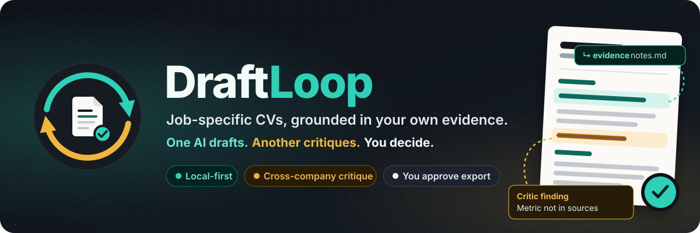
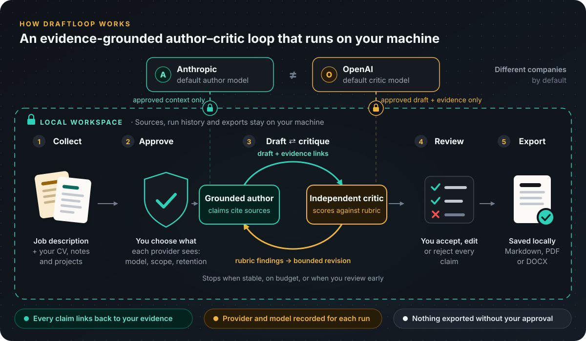

<h1></h1>

[](https://github.com/akoita/draft-loop/actions/workflows/ci.yml)


DraftLoop turns candidate-owned sources into a job-specific CV with grounded
evidence, independent AI critique, and final human control.

It is designed for candidates who want useful drafting assistance without giving
up traceability or control of their source material. Claims remain connected to
candidate-provided evidence, provider and model identities are visible, and the
candidate decides what to approve and export.

> **Current maturity:** DraftLoop is an alpha. Its capabilities are integrated
> and deterministically validated, but private quality checks show drafts that
> still cover fewer job requirements than a manually tailored CV, and no
> representative consented outcome has been recorded. The
> [roadmap and current status](docs/roadmap.md) record the evidence and
> remaining gaps. This project is not production-ready.

## Ways to run DraftLoop

| Way to run | Status | What it is |
| --- | --- | --- |
| [Self-hosted server](#quick-install-with-docker) | Recommended | The web screen, API, worker and database on your own machine with Docker. Your files stay on your disk. |
| [Desktop app](#desktop-app) | In development | DraftLoop's desktop version beside the web screen, for your self-hosted server and the hosted service once it opens. The v0.8 alpha with its own local engine gets fixes only, and its workspaces move to the server with one command. |
| [CLI](#developer-quick-start) | Source only | Every workflow step from a terminal, over the same packages. |
| Hosted service | In development | The same server in the EU with sign-in and consent ([ADR 0011](docs/adr/0011-client-server-version.md)). It is not offered yet. |

All of them run the same packages and the same author–critic loop, and differ
only at their adapters; see the [architecture overview](docs/architecture/overview.md#ways-to-run).

[](https://raw.githubusercontent.com/akoita/draft-loop/main/docs/assets/ways-to-run.svg)

## How DraftLoop works

DraftLoop keeps the job description and career evidence in your own store, then
applies an evidence-grounded
[evaluator–optimizer workflow](https://github.com/anthropics/claude-cookbooks/blob/main/patterns/agents/evaluator_optimizer.ipynb):
an author generates, an independent critic evaluates against a rubric, and
accepted feedback drives bounded revision. The default cross-company pairing is
Anthropic as author and OpenAI as critic; Anthropic-only pairs use a different
Claude model as critic. [ADR 0003](docs/adr/0003-evidence-grounded-evaluator-optimizer.md)
records DraftLoop's adaptation and controls.

[](https://raw.githubusercontent.com/akoita/draft-loop/main/docs/assets/how-draftloop-works.svg)

The loop is an assistant, not an authority. DraftLoop does not independently
verify a career, contact past employers, replace interviews, or turn a
candidate's source material into permission to invent facts.

## Quick install with Docker

The self-hosted server needs only Docker with the Compose plugin: no clone, no
Node and no build. Its images are published on GitHub Container Registry with
each `server-v*` release on the [releases page](https://github.com/akoita/draft-loop/releases).

On Linux or macOS, download the install script and install the newest
`server-v*` release, writing its number without the `server-v` prefix:

```sh
curl -fsSLO https://raw.githubusercontent.com/akoita/draft-loop/main/deploy/local/bin/draft-loop-server
chmod +x draft-loop-server
./draft-loop-server install <version>      # for example 0.13.0
```

Then add your keys and start the stack:

1. Put each provider key in its own file in `~/draft-loop-server/keys/`:
   `anthropic_api_key`, and `openai_api_key` for the default OpenAI critic. A
   local model such as Ollama can replace either; see
   [Local models](docs/operations/self-hosted.md#local-models).
2. Run `~/draft-loop-server/bin/draft-loop-server up`. The first start pulls
   the images and creates a random owner token and database passwords.
3. Open <http://127.0.0.1:8080> and sign in with the token that
   `~/draft-loop-server/bin/draft-loop-server token` prints.

On Windows, use `draft-loop-server.ps1` from the same
[`deploy/local/bin`](deploy/local/bin) folder in PowerShell with the same
commands. The [self-hosted server](docs/operations/self-hosted.md) guide covers
settings, upgrades, backup and restore, privacy, and moving a desktop
workspace to the server.

On the self-hosted server, your coding agent can record notable work it helped
ship through the `draftloop-mcp` MCP server. Each note waits for your review
before it becomes career evidence; see the
[agent channel](docs/reference/agent-channel.md).

## Desktop app

The desktop app is a first-class DraftLoop client beside the web screen: an
Electron app over a DraftLoop server's own web screen, pointed at your
self-hosted server or at the hosted service once it opens. It is being built in
the [Desktop client milestone](https://github.com/akoita/draft-loop/milestone/65)
([ADR 0011, D9](docs/adr/0011-client-server-version.md#d9-clients)).

The current v0.8 alpha still runs its own local engine. That architecture is in
maintenance mode since 2026-10-28: it gets fixes but no features, and it is
retired one release after the new client ships. Existing users can send a
workspace's applications and career evidence to a self-hosted server with
`draft-loop server import`; see
[Coming from the desktop app](docs/operations/self-hosted.md#coming-from-the-desktop-app).

### Installing

Download the [newest desktop release for your platform](https://github.com/akoita/draft-loop/releases)
and its `SHA256SUMS` file. Releases from v0.9.0 hold the desktop client; the
v0.8 alpha releases hold the old app with its own engine. Packages are
platform-specific ZIP archives, including Windows x64. Compare the ZIP's digest
with its line in `SHA256SUMS`:

```sh
# Linux
sha256sum "./<downloaded-archive>.zip"

# macOS
shasum -a 256 "./<downloaded-archive>.zip"
```

On Windows, run `(Get-FileHash .\your-download.zip -Algorithm SHA256).Hash` in
PowerShell. Extract the ZIP and launch the executable from the extracted
folder. The packages are not signed and do not update themselves; the client
says when a newer version is on the releases page.

On first launch the client opens this computer's self-hosted server
(`http://127.0.0.1:8080`) when it answers, or a picker where you add another
server by its `https` address. It never starts the server itself: run
`draft-loop-server up` first. It needs its server to work; there is no offline
drafting. See [the desktop client](docs/reference/cli-and-desktop.md#desktop-client)
for what it stores on your computer.

## Developer quick start

DraftLoop has no npm package: from a clone, use Node.js **24.22.1** and pnpm
**10.18.3**:

```sh
pnpm install --frozen-lockfile
```

The source-only CLI and both desktop apps run from the clone. The desktop client
opens your self-hosted server; the v0.8 desktop's **Try demo workspace** runs
the deterministic fixture workflow offline, with no provider spend:

```sh
pnpm --filter @draft-loop/cli start --help
pnpm --filter @draft-loop/desktop-client start
pnpm --filter @draft-loop/desktop start
```

Every CLI command group, from opportunity briefs to candidate knowledge bases,
is documented with runnable examples in the
[CLI and desktop operations reference](docs/reference/cli-and-desktop.md).
Live use requires an explicit provider-transmission approval and configured
provider credentials, and may incur provider cost. Keep real candidate
material out of the repository.

List each job requirement as its own bullet line in `job.md`. A run started
without a reviewed opportunity brief refuses long unbulleted paragraphs, such as
a pasted web page, before any provider call.

The server has two Compose stacks in a clone:

- `pnpm server:up` and `pnpm server:test` run the development stack, with a
  Cloud Storage emulator, Keycloak and no provider calls; see the
  [local server stack](docs/operations/local-server-stack.md), which also
  walks through the web screen and the sign-in mode.
- `pnpm self-hosted:up` builds and starts the self-hosted stack from source,
  and `pnpm self-hosted:test` checks it the way a person installs it.

For the normal quality gate, run:

```sh
pnpm format:check
pnpm lint
pnpm typecheck
pnpm test
pnpm validate
```

### Local semantic retrieval model (optional)

DraftLoop can use a pinned, local embedding model (Apache-2.0; Granite, about
313 MB for the default `311m` tier and 98 MB for `97m`, or the experimental
EmbeddingGemma 2 `eg2-text` tier at about 175 MB). It runs on your machine
and is never downloaded implicitly. The files are fetched only when you run
`install` with `--confirm`; without it, the command prints what would be
downloaded and exits.

```sh
pnpm --filter @draft-loop/cli start embeddings status [--tier 311m|97m|eg2-text] [--verify]
pnpm --filter @draft-loop/cli start embeddings install [--tier 311m|97m|eg2-text] [--from <dir>] --confirm
pnpm --filter @draft-loop/cli start embeddings remove [--tier 311m|97m|eg2-text]
```

Use `--from <dir>` to import the files offline from a directory that mirrors the
model repository layout. Every file is checked against its pinned SHA-256
checksum before the model becomes available. The default location is your
per-user data directory; set `DRAFT_LOOP_EMBEDDING_MODEL_ROOT` (or pass
`--model-dir`) to choose another.

Choose how a workspace searches its knowledge with `retrieval mode`
(`lexical`, the default, `semantic`, or `hybrid`). Runs fall back visibly to
lexical retrieval when the local model or index is unavailable; see the
[CLI reference](docs/reference/cli-and-desktop.md#retrieval-mode).

```sh
pnpm --filter @draft-loop/cli start retrieval mode ./workspace [lexical|semantic|hybrid] [--tier 311m|97m|eg2-text] [--json]
```

When the critic judges requirement coverage, run output prints a
`Coverage judgement:` summary and `status` lists each requirement's assessment;
see [Requirement coverage in run output](docs/reference/cli-and-desktop.md#requirement-coverage-in-run-output).
`evidence-usage` shows, for each author call of a saved run, how many retrieved
chunks it was sent and how many its draft cites, as counts and ranks only.

## Technology and architecture

| Area                  | Technology or boundary                                                        |
| --------------------- | ----------------------------------------------------------------------------- |
| Runtime               | TypeScript, Node.js 24.22.1, pnpm 10.18.3                                     |
| User interfaces       | React 19 and Vite screens shared by the web and the desktop; Electron 44; Commander CLI |
| Product core          | Framework-free domain contracts, Zod schemas, orchestrator ports              |
| Server                | Fastify API typed by Zod, a worker on a pg-boss run queue, a separate page fetcher |
| Providers             | Explicit Anthropic and OpenAI SDK adapters; OpenAI-compatible local models on the server |
| Data and output       | Postgres with pgvector on the server; SQLite via Drizzle ORM on the desktop; Markdown, PDF, and DOCX exports |
| Packaging             | Server images on GitHub Container Registry with Docker Compose; desktop ZIP archives |
| Quality               | Biome, ESLint, Markdownlint, Vitest, GitHub Actions                           |

The [architecture overview](docs/architecture/overview.md) is the entry point:
it shows how each way to run maps onto the packages, then links the detailed
views of [candidate evidence](docs/architecture/candidate-evidence.md),
[drafting and review](docs/architecture/drafting-and-review.md), and
[runtime and trust](docs/architecture/runtime-and-trust.md).

Career evidence lives in a portable Candidate Knowledge Base (CKB): versioned
source files with a lexical index, and optional local semantic retrieval.
Runs read only the source versions a workspace selects; see
[Candidate evidence](docs/architecture/candidate-evidence.md).

## Trust boundary

- On your machine (self-hosted server, desktop, or CLI), career evidence, run
  history, and exports stay on your disk. A provider receives only context
  covered by an explicit approval, and the workspace shows the provider, model,
  transmission scope, and retention choice. A local model keeps everything on
  the machine.
- Independent review is a product constraint: the author and the critic are
  different models, by default from different companies, and their identities
  and versions are recorded with each run.
- Model presets range from economy (Claude Haiku 5.5 with GPT-6 Luna) to
  standard (Claude Opus 5.5 with GPT-6.1 Sol), plus Anthropic-only pairs with
  a different Claude critic and opt-in development authors. Their CV quality is
  unvalidated; see [CLI model profiles](docs/reference/cli-and-desktop.md#cli-model-profiles)
  and the [model strategy](docs/roadmap.md#model-strategy).
- The hosted service is designed to store material only with recorded
  consent, in the EU with per-tenant encryption, and to send providers only
  approved material under zero-retention terms
  ([ADR 0011](docs/adr/0011-client-server-version.md)). It is not offered yet.
- DraftLoop prepares artifacts. It does not submit applications, publish
  documents, send messages, or perform uncontrolled web research on a user's
  behalf.

## Documentation

- [Documentation map](docs/README.md) · [Roadmap and current status](docs/roadmap.md) · [Release history](https://github.com/akoita/draft-loop/releases)
- [Architecture overview](docs/architecture/overview.md) · [Candidate evidence](docs/architecture/candidate-evidence.md) · [Drafting and review](docs/architecture/drafting-and-review.md)
- [Runtime and trust](docs/architecture/runtime-and-trust.md) · [Architecture decision records](docs/adr/) · [CLI and desktop operations reference](docs/reference/cli-and-desktop.md)
- [Privacy and evaluation](docs/security/privacy-and-evaluation.md) · [Threat model](docs/security/threat-model.md)
- [Self-hosted server](docs/operations/self-hosted.md) · [Local server stack](docs/operations/local-server-stack.md) · [Client-server version (ADR 0011)](docs/adr/0011-client-server-version.md) · [Client-server delivery plan](docs/architecture/client-server-delivery-plan.md)
- [Contributing](CONTRIBUTING.md) · [Releasing](docs/operations/releasing.md)

Human approval is mandatory before an artifact is exported. DraftLoop can help
prepare a CV, but the candidate remains responsible for factual review, final
approval, and every action beyond it.
