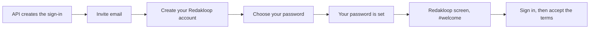

# The hosted service's Keycloak image

For whoever deploys or changes sign-in. The image is stock Keycloak with its
build options baked in and Redakloop's theme, `draftloop`, in
`themes/draftloop`. It holds no realm, secret or setting.

## What the theme changes

| Part  | Page or email                            | What a person sees                                                   |
| ----- | ---------------------------------------- | -------------------------------------------------------------------- |
| Email | Execute-actions (`UPDATE_PASSWORD` only) | "Your Redakloop beta invite" with one **Create your account** button |
| Login | Confirmation before the form             | "Create your Redakloop account" and **Choose my password**           |
| Login | Password form                            | "Choose your password"                                               |
| Login | After the password                       | "Your password is set" and **Continue to Redakloop**                 |
| Login | Sign-in                                  | "Sign in to Redakloop", buttons and links in Redakloop's teal        |

Every other email and page keeps Keycloak's words. Each text exists in
English and French, in `messages/messages_<locale>.properties`.

## Turn it on

The realm uses the theme once its `loginTheme` and `emailTheme` are
`draftloop`. The deployment sets them with the other realm settings, after
the image that holds the theme is running: a realm naming a theme the server
lacks sends no themed mail.

## Check a change locally

1. Build the image from the repository root:
   `docker build -f deploy/keycloak/Dockerfile -t draft-loop-keycloak .`
2. Run it in development mode:
   `docker run --rm -p 8080:8080 -e KC_DB=dev-file -e KC_BOOTSTRAP_ADMIN_USERNAME=admin -e KC_BOOTSTRAP_ADMIN_PASSWORD=admin draft-loop-keycloak start-dev`
3. In a test realm, set both themes to `draftloop` and an SMTP catcher such as
   Mailpit, create a user, and send
   `PUT /admin/realms/<realm>/users/<id>/execute-actions-email` with
   `["UPDATE_PASSWORD"]`.

The email arrives in the catcher; its link walks the three pages above. A
page that still shows Keycloak's words means the realm does not name the
theme, or the browser's language is neither English nor French.
