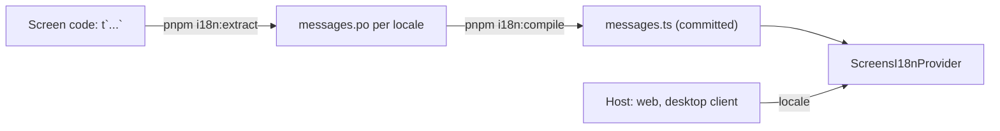

# ADR 0012: Screen translations with Lingui

- Status: Accepted
- Date: 2026-11-06
- Decision owners: DraftLoop maintainers

## Context

The screens are English only. French screens come after French documents
([rollup #2336](https://github.com/akoita/draft-loop/issues/2336)). The shared
screens in `packages/ui` run in the web screen, the desktop client and tests, so
the translation layer must work in a browser, in Vitest and in the Vite build.

## Decision

The shared screens use [Lingui](https://lingui.dev) 6, pinned exactly.

| Part | Where |
| --- | --- |
| Messages in code | `t` from `@lingui/core/macro`, source English text as the message |
| Catalogs | `packages/ui/src/locales/<locale>/messages.po`, compiled to a committed `messages.ts` |
| Configuration | `lingui.config.ts` at the repository root, covering `packages/ui` and `apps/web` |
| Macro build step | `packages/ui/lingui-macro.mjs`: Babel runs only on files that import a macro |
| Active locale | `packages/ui/src/i18n.tsx`: English at import; the host passes a locale to `ScreensI18nProvider` |
| Gate | `pnpm i18n:check` in `pnpm validate` |
| Dates, numbers, money, lists | `packages/ui/src/locale-format.ts` over `Intl`; English screens format as `en-GB` |

The `pseudo` locale accents every message. A development web build shows it
with `?locale=pseudo`, so an untranslated string stands out.

## Why Lingui

- **Source text as the message.** Code stays readable, and the catalogs are
  standard PO files a translator can edit.
- **Compiled catalogs.** Production bundles carry compact lookups, and
  `compile --strict` refuses a missing translation.
- **Small runtime.** `@lingui/core` and `@lingui/react` add no Node or host
  dependency, so `packages/ui` stays browser-only.

The cost is a Babel pass over files that use a macro, since the Vite 8 React
plugin no longer runs Babel.

## Consequences

- A new screen string goes through `t`, then `pnpm i18n:extract` and
  `pnpm i18n:compile`. `pnpm i18n:check` fails when the catalogs or the
  compiled files are stale.
- `packages/ui/src/screen-strings.test.ts` refuses literal JSX text and
  `aria-label`, `title`, `placeholder` or `alt` text in `packages/ui` and
  `apps/web`. Text inside `code`, `kbd`, `pre` and `samp` stays verbatim.
- Sentences that screen models build in TypeScript also use `t` inside the
  function that builds them, never at module level, so a locale switch reaches
  them.
- Documents are not translated by this layer: their language is the
  application's document language, written by the author.
