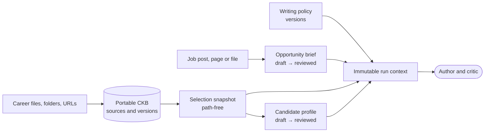

# Candidate evidence architecture

This page is the reference for how candidate material and job context become
bounded, reviewable evidence for a run. It covers opportunity briefs, writing
policies, the portable candidate knowledge base (CKB), canonical candidate
profiles, and retrieval in runs. It is written for a developer or coding agent
changing `packages/ingestion`, `evidence`, `storage` or `application`.

Use the [architecture overview](overview.md) for the system map. Related pages:

- [Drafting and review](drafting-and-review.md): the author, the critic and
  artifact quality
- [Memory model](memory.md): every kind of memory a run uses and its rules
- [Runtime and trust](runtime-and-trust.md): workflow, adapters, providers and
  exports
- [CLI and desktop reference](../reference/cli-and-desktop.md): user commands
- [ADR 0007](../adr/0007-portable-candidate-knowledge-store.md): canonical for
  the CKB contract

Four rules hold across every part of this page:

- **Immutable versions.** Briefs, policies, source versions and profiles are
  append-only, checksummed versions. An edit creates a new version.
- **Exact pins.** A run pins exact reviewed versions in its immutable context,
  and resume cannot swap them.
- **Path-free outside the store.** Host paths, URLs and origins stay in local
  storage. They never reach provider requests, run history, diagnostics or the
  screens.
- **Approval to send.** Sending any of this to a provider needs the explicit
  provider-data approval.

## Opportunity brief contract

A **brief** is a provider-independent, versioned record of the job: role,
employer, responsibilities, requirements, priorities and candidate
instructions. Every field cites its source.

| Source kind                                       | May support                                                  |
| ------------------------------------------------- | ------------------------------------------------------------ |
| Job posting, social announcement, company context | Opportunity facts (role, employer, requirements, priorities) |
| Candidate instructions                            | Only the instruction fields, never opportunity facts         |

Opportunity requirements are employer context, never candidate facts. Each
source records its provenance: approved URL, local file, pasted content or
direct input.

### Intake

- **Allowed inputs.** Intake accepts approved HTTPS URLs, selected local files,
  pasted content and direct candidate instructions. The existing ingestion
  controls remain authoritative.
- **What is kept.** Captured sources keep checksums. The draft holds bounded
  structured fields, provenance metadata and checksums, never raw source content
  or host paths.
- **Failures stay visible.** Failed or inaccessible sources keep a visible
  status and issue, without a fabricated checksum. Duplicate captured bytes stay
  visible for review.
- **No refetching.** Reload never refetches URLs or files.

### Review and versions

- **Draft issues.** A draft may hold inaccessible, unsupported, failed,
  partial, stale, duplicate or contradictory source issues.
- **Reviewed.** A reviewed brief needs the minimum structured fields and no
  open issue. Acknowledged limitations stay visible, and human-authored order is
  preserved.
- **Edits.** Editing a reviewed brief creates a new draft, never a change to
  the reviewed value. Edits and reviews apply only to an explicitly expected
  latest version.
- **Storage.** Versions live in the workspace's SQLite history (schema v22),
  under a workspace-scoped composite identity. Canonical checksums,
  immediate-parent checks and immutable update and delete guards protect them.
  Identical writes are idempotent, and there is no mutable current pointer.
- **Audit.** Events keep only an opaque brief identity, version, status and
  checksum.

### Extraction

Extraction uses the configured author model through the Anthropic, OpenAI or
local adapter, with the same data approval as drafting.

- **What crosses.** Only sanitized source records cross the boundary: IDs,
  classifications, statuses, media types, checksums and text. Candidate inputs,
  URLs, paths and provenance stay local.
- **Untrusted text.** Source text is treated as data. Tools and research are
  unavailable.
- **Checked output.** Output is schema- and citation-checked before the
  application creates IDs. A failure becomes a fixed, content-free draft issue.
- **Adapters.** The CLI accepts runtime-only JSON manifests. The hosted API takes
  job text, an approved URL or an uploaded file (see
  [hosted service](hosted-service.md#job-applications)).

### Binding to a run

A new run may select one exact reviewed brief ID and version.

- **Verified.** The application verifies the stored checksum, and derives the
  opportunity context only from that record.
- **Recorded.** It persists an ID, version and checksum reference in the run
  context.
- **Fixed.** Resume reuses that snapshot and cannot select another version.

## Writing policy enforcement

A **writing policy** is the candidate's style guidance, stored as local,
immutable, checksum-addressed versions in the workspace's SQLite history.

- **Activate** appends a Markdown or text file and makes it the default for
  future runs.
- **Import** appends a version without changing the default.
- **Managed files.** Existing managed files are migrated lazily. A direct change
  to a managed file is versioned before the next run, never silently
  overwritten.

| Directive                        | Enforced by                          | Notes                                                                     |
| -------------------------------- | ------------------------------------ | ------------------------------------------------------------------------- |
| Forbidden terms and punctuation  | `packages/validation`, deterministic | Includes the anti-formulaic defaults, which can be disabled in the policy |
| Section order                    | `packages/validation`, deterministic | Reports stable, content-free section and block locations                  |
| Tone, spelling locale, verbosity | Advisory model context               | Locale is not a spell checker                                             |
| Page target (one or two pages)   | Advisory model context               | Not a rendering profile, and rendering QA checks the document separately  |
| Emphasis areas                   | Advisory model context               | Never authorizes new facts                                                |

- **Validation.** It runs in artifact section and block order, during normal
  draft validation, before independent critique.
- **Findings.** Each finding carries a stable rule identity and a content-free
  block location. Messages never copy the forbidden term, the matched text,
  paths or surrounding content.
- **Old snapshots.** Older content-only snapshots stay readable.
- **Per-opportunity override.** A reviewed opportunity may select one imported
  version as a complete override. The run records base and override checksums,
  both author and critic get the effective policy, and the workspace's active
  policy is unchanged.
- **Reading content.** Projections show version and lineage metadata. The exact
  content needs an explicit local content-read action.

## Portable Candidate Knowledge Base

### Workspace versus portable CKB

|          | Application workspace                                                                         | Portable CKB                                                              |
| -------- | --------------------------------------------------------------------------------------------- | ------------------------------------------------------------------------- |
| Holds    | Opportunity context, run snapshots, review decisions, artifacts, exports, application history | Reusable candidate material: sources, versions and managed bytes          |
| Storage  | The workspace's SQLite history                                                                | A separate local SQLite store, plus opaque managed files under `sources/` |
| Identity | Workspace id                                                                                  | A logical UUID, independent of its path                                   |

A workspace never reads CKB content implicitly. Its local manifest may bind
named CKBs by runtime store root and pinned logical store and CKB IDs.

- **Revalidated per run.** Before each new run, the application reopens those
  stores, checks identity and readiness, and embeds a fresh path-free selection
  snapshot in the run context. Existing runs keep the snapshot they recorded.
- **Checked before sending.** Before a provider-capable start, resume or
  revision, the application compares the current binding's complete entries
  with that record. Missing, replaced, unready or changed evidence fails with a
  path-free review-required error, before any provider call or state change.
- **Plaintext.** The store is local plaintext. Restrictive permissions are
  best-effort, not encryption, and do not protect against another process run by
  the same user.
- **Backups.** A copy of only the SQLite file is not a complete backup, because
  the raw bytes live under `sources/`.

### Source and version model

A **source** has a stable CKB-scoped logical ID, a `file` or `url` kind, and a
local label. Each **version** is immutable and ordered, recording SHA-256,
media type, byte size, creation time and parent lineage.

- **Checksums** are integrity metadata and a duplicate signal, not identity.
  The duplicate projection emits only source and version IDs. It never merges,
  prefers or removes evidence.
- **Files.** Regular files of at most 20 MiB, in five media types: plain text,
  Markdown, HTML, PDF and DOCX. Extraction, stable-file and managed-copy checks
  must pass before anything is saved. Exact bytes are copied under an opaque
  ID-derived name.
- **Pasted text.** The server's Career evidence screen has a Paste text box. It
  uploads the text as one plain-text file named `<title>.pasted.txt`, through
  the same route as a picked file; the file list tags it "Pasted text". Screening, quarantine, consent and duplicate checks
  are therefore the same.
- **New versions.** A changed append creates the next parent-linked version.
  Identical bytes are a no-op, and do not advance time or imply freshness.
- **URLs.** URL intake reuses the HTTPS-only boundary, with public-address
  resolution, manual redirects, response and extraction limits, and usable-text
  checks. It stores the exact response bytes, with sensitive per-version
  provenance: the approved URL, the final redirect, the fetch time and a URL
  kind.
- **URL refresh** is explicit, reuses only the stored original URL, and records
  changed bytes as a new version. Redirect-only drift is a no-op. A failure after
  preflight records only a URL-free inaccessible observation.

**PDF text.** Extraction walks the page tree and decodes each text run with the
ToUnicode map of the font that run selects. That includes fonts in Form XObjects
and object streams, because subset fonts reuse glyph codes and one document-wide
map would garble multi-font PDFs.

- **Line joining.** Adjacent fragments on one line are joined using
  text-position operators, which keeps browser-generated PDFs readable.
- **No page tree.** Files without a readable page tree fall back to scanning
  every stream.
- **Saved job text** keeps its earlier extraction until the job document is
  replaced or imported again.

### Origins, refresh and retirement

A managed file create may remember its verified origin path in a sensitive,
local-only binding table. Manual append paths are runtime-only and never replace
it. Nothing here runs in the background or reaches a provider.

| Operation    | Result                                                                                                                                                                                                                      |
| ------------ | --------------------------------------------------------------------------------------------------------------------------------------------------------------------------------------------------------------------------- |
| Status check | `unbound`, `current`, `changed`, `missing` or `inaccessible`, with no path or file metadata                                                                                                                                 |
| Refresh      | Appends changed bytes from the remembered origin, and records a path-free observation tied to the examined version                                                                                                          |
| Rebind       | Replaces only the sensitive path, after an exact media type, checksum and size match with the latest version                                                                                                                |
| Retire       | Writes an immutable `user-requested` marker. It blocks later versions, rebinds and observations, and keeps metadata, bytes, bindings, observations and journal evidence. It is not deletion, index cleanup or reactivation. |

### Lifecycle readiness

Readiness is a CKB-scoped read projection over one consistent SQLite snapshot.
Indexing and selection read it instead of the sensitive tables.

- **Per source.** It shows the latest version identity, `ready` or `blocked`,
  bounded reasons, and a structured revision.
- **The revision** holds only safe IDs, timestamps, booleans and numeric
  directory revisions. It changes when eligibility-relevant evidence changes.
- **Blocked states.** Retired, archived, unmanaged, unbound,
  directory-conflicted, adverse-observation and stale-observation sources are
  blocked.
- **Fresh intake** is eligible without a refresh observation. Adverse or stale
  observations block, without any TTL or live-filesystem claim.
- **Excluded.** Labels, paths, URLs, relative-path hashes, checksums, media
  types, sizes and bytes.

### Selection snapshot contract

A selection produces an immutable, schema-versioned snapshot. It holds the
store ID, the CKB ID, the exact selected source and version IDs, and each
source's lifecycle revision.

- **Combining.** One CKB needs no extra approval. More than one needs an
  explicit approval before any store is opened.
- **Fail closed.** Archived, empty or blocked CKBs are refused.
- **Canonical.** Entries and sources are sorted lexically. The snapshot
  excludes roots, labels, paths, filenames, URLs, hashes, checksums, media types,
  sizes and content.
- **Compatible.** It embeds in a run context without breaking older contexts
  that lack the field.
- **Roots stay local.** The workspace binding keeps runtime roots only to
  revalidate future runs. Everything else sees the path-free record.
- **Not an authorization.** The snapshot does not authorize provider
  transmission or prove index freshness.

### Directory and member lifecycle

A directory import is a bounded selector over ordinary file sources, not a
source kind of its own. The root must be a real, non-symlink directory outside
the store. Traversal is deterministic by relative path, and extraction is
checked for every file before anything is written.

| Limit           | Value                          |
| --------------- | ------------------------------ |
| Depth           | 32                             |
| Scanned entries | 1,024                          |
| Accepted files  | 256                            |
| Accepted bytes  | 256 MiB total, 20 MiB per file |

Dot-prefixed entries, unsupported files, special entries and child symlinks are
skipped and counted. A complete import records a sensitive root binding, and
immutable SHA-256 hashes of the normalized relative member paths.

The operations below are summarized from [ADR 0007][adr-0007], which holds their
full contract and privacy invariants.

| Operation                      | Scope and result                                                                                                                                             | Writes                                                                                                                |
| ------------------------------ | ------------------------------------------------------------------------------------------------------------------------------------------------------------ | --------------------------------------------------------------------------------------------------------------------- |
| Inventory and refresh preview  | Count-only store inventory; path-free member states (`current`, `changed`, `missing`, `retired`, `origin-conflict`) and unmatched-file count                 | None                                                                                                                  |
| Add members                    | Confirm and append unmatched accepted files as independent sources, in lexical order                                                                         | Each candidate's source, version, origin binding, managed bytes, journal event and immutable member, atomically       |
| Observation or applied refresh | Record path-free observations, or append changed bytes for active same-member files in source-ID order                                                       | The observation batch is atomic. An applied refresh may return path-free partial progress after a later failure.      |
| Member retirement              | Approve one active `missing` member, with root, member, version and origin guards                                                                            | The `user-requested` retirement marker only; bytes and membership remain                                              |
| Root rebind                    | Reuse one complete scan, verify every historical member, and update all origins                                                                              | A guarded append-only root revision with `rebound` counts, or a `current` no-op                                       |
| Moved-candidate preview        | Compare exact media type, checksum and size for missing sources and unmatched files                                                                          | None; ambiguous matches are omitted                                                                                   |
| One-source member move         | Reuse one bounded scan for one selected source; accept a unique exact-integrity match, or the scanned current member as a no-op                              | A verified append-only member revision, or a guarded no-op. The result is `moved` or `current`.                       |
| Missing-member reconciliation  | Partition one complete scan into current, changed, moved-candidate, missing, already-retired, conflicted and new; apply only explicitly selected retirements | Each marker is atomic. All-success returns `applied` or `current`, and a later failure returns path-free partial IDs. |

- **No target path.** The move command takes none. It forwards a runtime-only
  match through the verified member handle, and changes no source identity,
  version, observation, retirement, blob, journal or baseline membership.
- **No inference.** Nothing infers renames automatically or reconciles all
  removals. Automatic move inference and background refresh stay deferred.
- **History is kept.** Later versions, rebinds, retirement and readiness never
  rewrite historical membership.

### Managed publication and the journal

**Publication** verifies bytes before committing metadata. The database marker
and the opaque file must agree on checksum and size. Publication is no-replace,
file first and database second.

- **Residue.** A crash or a concurrent loser may leave unreferenced opaque
  entries.
- **Ownership.** File shape or matching bytes never prove DraftLoop owns an
  entry.

**The journal** is append-only. For each new managed write, it records opaque
intent, target resolution, publication, the marker and database commit, and
completion.

- **Sensitive fields.** Versioned ownership, expected integrity, staging-file
  identity and writer generation stay local, and never cross application or
  provider boundaries.
- **Recovery** first records a durable claim with a newer generation. That fences
  stale journal and commit transactions before any artifact is inspected, and
  stays retryable after a cleanup failure. It recovers only that exact
  operation.
- **Unknown entries.** Legacy, unjournaled, mismatched and unrecognized entries
  stay unknown and untouched.

**The writer lease.** Every CKB mutation command takes one store-wide exclusive
lease. Reads stay unleased.

- **Coordinator.** The lease lives in a private SQLite coordinator, separate from
  the data database. It records the scope, opaque ownership, an operation code,
  timestamps and a rising fencing generation.
- **No interleaving.** Heartbeats, atomic stale takeover, nested fencing checks
  and a generation-guarded release keep commands from interleaving.
- **Conflict messages** name only the active operation and scope.
- **On open,** the store takes the lease to roll back verified incomplete
  publication, or finish verified committed cleanup.

### Retention, backup, restore and deletion

**Retention.** The contract covers six classes: raw sources, normalized facts,
indexes, run snapshots, exports and backups. All six are kept until explicit
deletion.

- **Expiry.** Append-only policy revisions may set day-based expiry.
- **Holds.** Legal-hold and manual-preservation events override expiry.
- **Plans.** A plan is keyed by policy revision, override revision and
  evaluation time. It shows only counts and effective states, and planning never
  deletes anything.
- **What can expire.** Only committed managed raw-source versions with ownership
  proof. Unmanaged, unknown and not-yet-materialized classes are preserved.

| Operation          | What it does                                                                                                                                                                                                                                                                           | Limits                                                                                                                                                                                                                                                                                                   |
| ------------------ | -------------------------------------------------------------------------------------------------------------------------------------------------------------------------------------------------------------------------------------------------------------------------------------- | -------------------------------------------------------------------------------------------------------------------------------------------------------------------------------------------------------------------------------------------------------------------------------------------------------- |
| Backup export      | Holds the writer lease and builds a versioned package outside the store: a strict logical manifest plus checksum-addressed source objects. It needs an approved destination, and publishes without replacing anything once the package passes its own inspector.                       | Fails closed when the ownership inventory is incomplete, a managed version cannot be verified, or the store holds unmanaged legacy versions. It excludes origins, roots, writer coordination, journals, credentials, workspace data and the rebuildable index. Hashes detect corruption, not authorship. |
| Restore            | Inspects the whole package again, imports into a staged current-schema store, validates the graph and bytes, then publishes to an approved new directory                                                                                                                               | Only `fail-if-destination-exists`. It never merges stores, renames identities or claims continuity. Every source is restored unbound, URL evidence keeps only its fetch time and kind, and the index must be rebuilt.                                                                                    |
| Confirmed deletion | Deletes an archived, non-default CKB after a separate path-free preview. Its token binds the store graph, retention revisions, object integrity and physical inventory. Under the lease, it revalidates, stages verified blobs, then commits, with a durable v21 journal for recovery. | Blocked by legal hold, manual preservation, unmanaged records, missing or mismatched blobs, and unknown deletion state. Unknown entries are preserved. External backups, exports and copies are not deleted.                                                                                             |

The schema keeps append-only history for these records:

- sources and versions
- origins and observations
- retirements
- URLs, including restored path-free URL provenance
- directory roots and members

[ADR 0007][adr-0007] summarizes schema versions v6 to v21.

### Canonical candidate profile contract

A **canonical profile** is an immutable, provider-independent set of facts about
the candidate. It binds an exact path-free CKB selection, and keeps the legacy
profile identity for older contexts.

- **Fact categories.** Identity, contact, employment and dates, achievements,
  projects, skills, certifications, education, languages and approved links.
- **Citations.** Every fact cites an exact store, CKB, source and version, and
  needs candidate-provided provenance. Public corroboration is optional.
- **Issues, not choices.** Conflicts, possible duplicates and omissions stay
  explicit issues, and every issue must be handled before review.
- **Schema checks.** The strict schema enforces lineage, review timestamps,
  source membership, bounded collections, stable IDs, canonical order, deep
  immutability and path-free JSON round trips.

**History.** Profiles live in workspace-local, append-only SQLite history
(migration 24), with canonical checksums, parent lineage, monotonic timestamps,
immutable triggers, strict reload and content-free audit events. Edits are
optimistic. A reviewed version is created only after the review blockers pass.

**Derivation.**

1. **Read.** CKB storage returns fresh bytes and safe version metadata after a
   one-handle size, checksum and identity check. It never exposes the managed
   path.
2. **Revalidate.** The application checks the lifecycle snapshot after
   normalization, and again after extraction, before saving.
3. **Send.** With explicit provider-data approval, it sends only bounded
   normalized text, media types, checksums and opaque source IDs, through a
   strict extraction port. The adapter uses the workspace's author model over an
   API key, a user session or a local transport. Its system prompt treats the
   text as untrusted.
4. **Check.** Every proposed fact needs an evidence quote that occurs in its
   cited source and contains the value. Matching ignores Markdown and
   typographic punctuation, never wording. The quote is checked locally and not
   saved.
5. **Build.** The application maps citations to exact versions, generates
   deterministic IDs, and keeps conflicting and duplicate facts. Local conflicts
   apply only to known single-valued fields such as title or start date. It adds
   visible category omissions and appends the draft.

- **What the model cannot choose.** It cannot choose persisted IDs, provenance
  kinds, review state, severity or messages.
- **Weak issues.** A proposed conflict or duplicate that names fewer than two
  distinct facts is dropped, and its facts are kept.
- **Adapters.** The CLI and the hosted API expose the same derive, get, edit,
  review and list operations. No command accepts a store root, and only
  derivation needs the transmission approval. The shared profile screen edits
  only fact values and issue statuses, and keeps provenance.

**Binding to a run.** A new run may select one exact reviewed version.

- **Checked.** The driver verifies its checksum, and requires its CKB selection
  to match the workspace's current ready selection. It then records the ID,
  version and checksum.
- **Fixed.** Resume accepts no replacement, so later edits cannot change an
  existing run.
- **Lifecycle changes** keep profile and run history. The same selection check
  blocks a stale draft from review, and an unavailable profile from new runs.
- **Backups.** A profile may combine CKBs, so it is not part of a single CKB
  backup. Whole-workspace backups keep it.
- **Derived index rows** for unavailable dependencies are handled by #80.

**Fact-first evidence.** A run with a pinned profile retrieves evidence facts
first (`run-profile-fact-retrieval.ts`, `profile-fact-evidence.ts`).

| Step        | What happens                                                                                                                                                                                                                                                                              |
| ----------- | ----------------------------------------------------------------------------------------------------------------------------------------------------------------------------------------------------------------------------------------------------------------------------------------- |
| Verify      | At start and resume, the exact version is loaded and its checksum checked. A missing or changed version fails the run before any evidence is sent.                                                                                                                                        |
| Build items | Each fact whose quote occurs verbatim in its cited, pinned, non-withheld source becomes one evidence item. It carries the source id, the quote's line range, and the value with its quote, so author citations resolve to the source.                                                     |
| Select      | Facts are ranked in the run's retrieval mode. Up to 8 facts (two fifths of the 20-item limit) are added beside the usual chunks, for at most 28 items. Reserved contact, chronology and priority chunks keep their slots, and a chunk repeating a selected quote is skipped.              |
| Trace       | Each selection appends a content-free origin trace (`retrieval-origin-trace.ts`) beside the v1 retrieval trace. It holds the profile ID, version and checksum, the ranking mode, a query checksum, and each item's opaque ID, source ID and origin (`profile-fact` or `knowledge-chunk`). |

A full-source run already sends every eligible chunk and is unchanged, as is a
run without a profile.

### CKB integration status

**Integrated now: exact-version lexical retrieval.**

- **Index.** Each store owns a replaceable SQLite FTS5/BM25 projection of its
  managed versions.
- **Per run.** The application revalidates the selection, synchronizes or
  rebuilds each selected scope, queries the selected stores, and fuses
  multi-CKB results deterministically.
- **What crosses.** Provider-facing results carry only bounded text and opaque
  chunk IDs, and workspace history keeps content-free traces.
- **Fail closed.** A stale, unavailable or mismatched selection never silently
  becomes empty context.
- **Invalidation.** Index rows can be invalidated when versions are deleted,
  while historical traces stay in run history.

**Not the default yet.** Vector and hybrid retrieval are opt-in (see
[retrieval mode](../reference/cli-and-desktop.md#retrieval-mode)). They remain
evaluation components until deletion, retention, isolation, provenance and
quality are validated.

[adr-0007]: ../adr/0007-portable-candidate-knowledge-store.md

## Retrieval in runs

Runs read the selected knowledge base. Legacy workspace evidence (the
workspace's `evidence` folder) is used only when no base is selected, and the
career evidence card says so.

[ADR 0008](../adr/0008-ckb-scoped-lexical-retrieval.md) defines the CKB design:

- each store owns its replaceable exact-version lexical index
- the application fans out only across the workspace's explicit selection
- content-free retrieval traces are kept in workspace history

Migration 25 supplies the chunk and FTS projection, freshness checks, exact-scope
queries with fallback, invalidation on version deletion, and immutable traces.
Retrieval sits behind a provider-independent port.

| Bound                 | Rule                                                                                                                                                                                                                                                                                                                                                  |
| --------------------- | ----------------------------------------------------------------------------------------------------------------------------------------------------------------------------------------------------------------------------------------------------------------------------------------------------------------------------------------------------- |
| Long queries          | A query over the storage limit is cut to its first 48 normalized, distinct, non-stopword terms, the same as storage. The job text in the run context and author input is unchanged. If the terms still exceed the limit, retrieval stops with a bounds error.                                                                                         |
| Experience chronology | A saturated date probe triggers a scan of the exact source versions in the recorded snapshot. Sources are verified and normalized locally, and dated headings are selected, without reading origins. The scan is limited to 512 KiB of text, and fails closed when it is exceeded or the headings cannot fit the 20-item and 128-KiB provider bounds. |

What the author and critic receive depends on the workspace's
[evidence mode](../reference/cli-and-desktop.md#evidence-mode), which is
full source by default.
