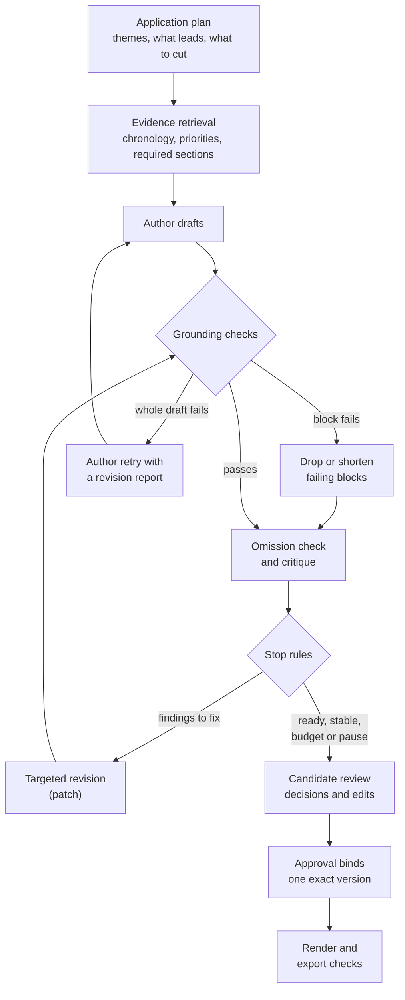
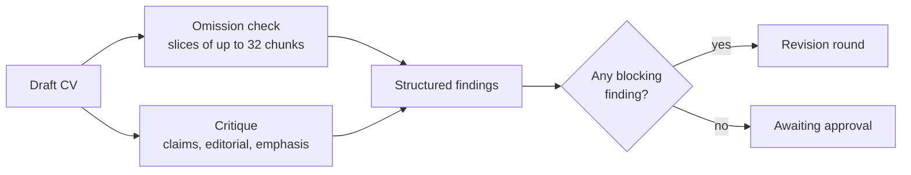
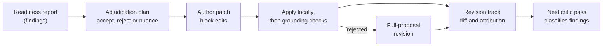
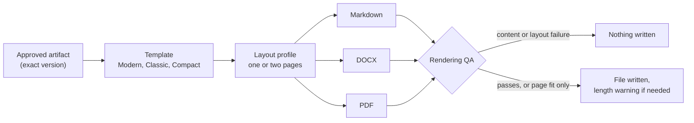

# Drafting and review architecture

This page explains how DraftLoop turns approved evidence into a CV: how the
author drafts, which checks the draft must pass, how the critic reviews it, how
a revision works, when the loop stops, and how an approved CV is rendered.

It is written for contributors who change the author, the critic, the checks or
the renderers. For the system map, read the [architecture overview](overview.md).
Sources and profiles are in [Candidate evidence](candidate-evidence.md), and
workflow states and provider controls are in
[Runtime and trust](runtime-and-trust.md). What a run remembers between
calls and rounds is in the [memory model](memory.md).

## Contents

- [A run at a glance](#a-run-at-a-glance)
- [Planning the application](#planning-the-application)
- [Evidence the author receives](#evidence-the-author-receives)
- [What the author writes](#what-the-author-writes)
- [Grounding checks](#grounding-checks)
- [Requirement coverage](#requirement-coverage)
- [How the critic reviews a draft](#how-the-critic-reviews-a-draft)
- [Deterministic quality warnings](#deterministic-quality-warnings)
- [Revisions](#revisions)
- [When the loop stops](#when-the-loop-stops)
- [Approval and review edits](#approval-and-review-edits)
- [Rendering and export checks](#rendering-and-export-checks)

## A run at a glance

DraftLoop applies the evaluator–optimizer pattern to a factual workflow. The
author generates, the independent critic evaluates against a visible rubric,
and each revision is one bounded step. The screens say "author" and "critic"
because that is clearer to candidates.
[ADR 0003](../adr/0003-evidence-grounded-evaluator-optimizer.md) records the
decision.

The rubric covers factuality, evidence support, requirement coverage and
quality. Findings are structured, severity-rated, and linked to claims,
sections or source locators where possible.

A critic can find a problem but cannot establish truth. The candidate's
evidence and decisions stay authoritative.

## Planning the application

Before the first draft, the run decides what the CV should lead with. The plan
step makes at most three provider calls:

1. **The author model plans:** the job's 3 to 5 ranked central themes, each
   linked to requirement ids and to the approved evidence that best proves it;
   what leads (the summary angle and 3 to 5 core-area items); and what to drop
   or compress. A theme with no supporting evidence is a **gap**, never a claim.
2. **The critic model reviews the plan** for fit to the job and answers accept,
   or revise with specific points.
3. **On revise, the author revises the plan once.** There is no second review.

The plan holds short user-visible text and ids, never reasoning or facts of its
own.

### Validation

`validateApplicationPlan` (`packages/schemas/src/application-plan.ts`) rejects
an evidence id the request's approved evidence lacks, an unknown requirement id,
and a core area that serves a gap.

- **A rejected first plan** fails the step as an invalid response, which can be
  retried, and names the failed checks as codes and paths.
- **A rejected revision** does not fail the step. The reviewed plan stands, and
  the revision's step record keeps the failed checks (`rejectedDiagnostics`).

Evidence is sent under the same short aliases as drafting.

### Running and resuming

`packages/orchestrator/src/application-plan.ts` runs the step through the
`ApplicationPlanner` port, and `packages/application/src/application-plan-agent.ts`
implements it with the run's author and critic models.

- Each call is saved on the run snapshot (`applicationPlan`) when it completes,
  so a resumed run continues mid-plan without repeating a call.
- Each call's cost adds to the run cost. The cost budget is checked before each
  call and before the draft, and a call whose estimated worst cost would pass
  the limit is refused before it is sent.
- `applicationPlan: false` in the run options turns the step off for tests.

### How the plan is used

The plan goes to the author as guidance on every round. The prompt states that
the plan is not evidence, that grounding applies as before, and that a
candidate direction outranks it.

The critic's emphasis review takes its central themes from the plan
(`emphasisPlanThemeSourceInstructions`) and reports a plan gap as
`emphasis-theme-gap`. The plan is recorded as a `run.application-plan` event
and shown in **Run details** as "Application plan".

Runs on author templates before `cli-author-v11` do not plan and resume
unchanged.

## Evidence the author receives

### Requirements from a local job document

When a run selects no reviewed opportunity brief, the application extracts
complete list items and paragraphs from the local job document. It joins
wrapped lines, removes Markdown heading structure, and gives every unit neutral
`medium` priority.

This makes no claim that every paragraph is a hiring criterion: choosing
requirements and priorities belongs to the reviewed brief.

The fallback refuses, with a message pointing to a reviewed brief:

- documents over 64 KiB, more than 100 units, or units over 2,000 characters;
- empty or heading-only input, code fences and tables.

It never silently truncates source text. Pinned contexts are never
re-extracted on resume, so a corrected interpretation needs a new reviewed
context.

### Evidence limits

- **`retrieval` mode:** at most 20 chunks and 128 KiB of serialized evidence.
- **`full-source` mode,** the default for a CKB workspace, replaces those limits
  with its own size budget; see
  [Evidence mode](../reference/cli-and-desktop.md#evidence-mode).

Every reservation below shares these limits. When protected evidence cannot
fit, retrieval fails visibly before any provider call. All queries run locally,
add no provider call and infer no dates.

### Required CV sections

Before evidence reaches the author, bounded supplementary searches reserve
content for required CV sections. If a search limit is reached without
establishing a section's content, drafting fails visibly, because the search
cannot establish absence.

### Chronology

Dated headings keep a candidate's career ranges available even when the
headings contain no job-query terms.

- **Local sources without a CKB selection.** Author and critic retrieval
  reserves space for dated Markdown headings from the exact pinned source ids
  and checksums. Headings keep their text, chunk identity and source
  references, and ranked evidence fills the remaining slots after duplicate and
  unapproved-source filtering.
- **CKB workspaces requiring Experience.** The selected-version route also
  reserves matched dated headings. Fixed local lexical supplements cover English
  month and ongoing-end terms and the years 1900–2099, in batches below the
  query-term cap. Each query returns at most 100 hits, and fallback results are
  ignored.
- **Merging.** Discovered headings are deduplicated and kept ahead of ranked job
  evidence, then merged with candidate-priority evidence and the required-section
  supplements. Indexed chunks are never changed.

The heading scan reads at most 100 pinned sources and 100 heading chunks per
source. It recognizes Markdown headings with a year range or an ongoing end
marker, and never infers dates or repairs chronology.

Retrieval fails closed on missing or mismatched sources, a scan overflow, a
saturated supplement, or headings that cannot fit or are lost in the merge.
This is bounded discovery, not an exhaustive chronology inventory, and the
ordinary CKB lifecycle and freshness checks still apply.

### Role records

For each discovered heading, retrieval assembles a bounded role record from that
source version. Sources are read through the managed store and chunked with the
same verified derivation as the lexical index.

- **Contribution first.** An explicit contribution region, such as `His work:`
  or `CV-usable facts`, is preferred over introductory platform or team context.
  It stops before a sibling or ancestor heading, or another dated role.
- **Whole blocks only.** Complete paragraphs and top-level list items, with their
  nested continuations, are chosen by lexical overlap with the job query and
  kept in source order. Blocks may be left out to fit the 4,000-character limit,
  but a block is never truncated and a nested caveat never leaves its item.
- **Fallback prefix.** Without a contribution region or project groups, the
  record is the heading and its following whole chunks, up to the next
  same-level or higher heading, another dated role, or the record limit. An
  overflowing chunk is not skipped to reach later material, and a heading with
  no eligible body that fits stays as it is.
- **Identity.** A combined record gets a deterministic identity from its parts
  and keeps the pinned source, version and full line ranges. Provider evidence,
  inspection and diagnostics all use the same records.

Source identity, lifecycle, checksums and exact heading matches are verified
before assembly; other versions and local paths are never substitutes. No role
record is read when Experience or dated headings are absent.

### Project groups

Explicitly independent roles can hold project-labelled source groups.

- **Requested projects come first.** Exact source titles or declared aliases
  named in the candidate's instructions reserve evidence in instruction order,
  with their descriptor, production limits and nested caveats.
- **Unrequested groups need real overlap** with the job's terms; a project name
  alone does not establish relevance.
- **Overflow.** A requested project that cannot fit the role record may add its
  own source-backed overflow record, with the same per-record limit. Whole
  bundles from one role and source may share a record when they fit. Overflow
  records use the priority slots ahead of generic matches and never repeat a
  project already in the role record.

Groups share the 4,000-character role limit and use no extra retrieval slots.
Selection never invents an alias or truncates a limitation to fit, and local
omission reasons stay visible. Supplying a
requested project's evidence lets the author judge fit; it does not force the
project into the CV.

### Candidate priorities

When the candidate's drafting instructions are not blank, CKB retrieval also
queries the first explicit sentence-level `Prioritize` clause, or the trimmed
instructions when there is none, with at most 2,000 characters and 20 hits. The
full instructions still reach the author unchanged.

- Up to three distinct matched chunks that are not single-line headings are
  reserved, in query order, after chronology and before general job results.
- The merge keeps the largest prefix of those chunks that fits beside
  chronology and required-section evidence.
- Only Experience may reuse evidence already supplied by chronology. Other
  required sections keep their own supplements, so policy text that mentions
  education, credentials or languages cannot displace their source records.
- A required record found by the general query stays reserved even beyond the
  priority prefix, and a duplicate id takes one slot.

Retrieval fails when matched priority evidence exists but not one chunk fits.
Lexical matches select input; they do not prove job fit or resolve uncertain
claims.

### Production experience and contact records

- **Production experience.** With a Skills section configured, one cached local
  `production experience` query (20 hits) runs. A substantive explicit
  `Production experience:` record, plain or Markdown, takes precedence in the
  Skills supplement. Unavailable, negative, heading-only and fallback results
  are never promoted.
- **Contact record.** One matched candidate contact record is reserved for the
  header, even when Header is not a required section. Selection needs an actual
  field in explicit candidate contact context; policy mentions and unavailable
  values do not qualify. The chunk keeps its exact text, identity and
  provenance.

## What the author writes

The author returns a structured proposal of semantic sections: header,
summary, experience, projects, skills, education, certifications and languages.
It includes each section that retrieved evidence supports, and its section and
entry order is kept through the artifact and every exporter.

New runs use author template `cli-author-v17`. A resumed run keeps the exact
prompt and output ceiling it started with.

### Writing for the job

The job description, its requirements and its responsibilities are employer
context, never candidate facts. The author:

- opens the summary with a one-line headline of the candidate's own supported
  titles and the strongest skill areas the job asks for, never the target title
  as a held role;
- adds a **Core areas** section (kind `alignment`) after the summary, with three
  to five grounded items that answer the job's main requirements, labelled only
  with words the cited evidence contains;
- leads each role with its most relevant content and shortens unrelated detail,
  while keeping every role, its title, employer and dates, and the chronology;
- lists the skills and certifications the job asks for first.

A writing policy's section order or emphasis overrides this guidance.

### Document language

A run writes in its context's `language`: the application's own language, or
the workspace's. For any language but English, each author call adds one
sentence at the end of its own instructions, after the run-stable prefix. The
sentence asks for the language's conventions, keeps names as the sources write
them, and asks for faithful translation of facts from other languages. The
cover letter, interview questions and career interviewer add the same
sentence (`packages/application/src/document-language-instruction.ts`).
English prompts are unchanged, so English runs keep their prompt versions and
cached prefixes.

### Each part of the CV has one job

- **Experience and Projects** carry the detail of each fact. A role's
  achievements and leadership stay in its entry.
- **Summary:** two to three sentences in new words, never a restated bullet: the
  role and level the evidence supports, the strongest proof, and the focus.
- **Core areas** group evidence from several roles under one theme the job asks
  for. A theme with a single example is left to Experience, and each label
  names the content it heads.
- **Skills, Education and Certifications** are `Label: items` paragraphs grouped
  by theme, never bullets, with label words from cited evidence.

### Shape of each role

- **Per role or project:** a role line, a context paragraph of 1 to 3 lines
  (what it was, scope, team, stack), then 2 to 4 bullets of about 45 to 70
  words. Older roles get 0 to 2 bullets.
- **One statement per bullet.** Each bullet states one achievement; separate
  facts are never joined with semicolons, and short bullets are never stacked.
- **Whole CV:** never more than 4 bullets in a row.
- **Professional prose.** The author rewrites supported sentences into
  candidate-focused prose and action-led bullets. It keeps documented limits,
  such as production versus staging or credential status, and never copies
  source notes, status reports, reviewer comments or third-person narration.
- **No negatives or repeats:** no statement about work not done, and no
  repeated sentence.

### Length and page target

Length follows the writing policy's `Page target`. A one-page CV is a shorter
text, not the same text printed smaller.

| | Two pages, or no target | One page |
| --- | --- | --- |
| Summary | 2 to 3 sentences | 2 to 3 lines |
| Bullets | About 16 to 20, roughly 1,400 to 1,700 words in all | 6 to 9, at most 3 per role, only for the 2 or 3 most relevant roles |
| Other roles | Full entries | Role line and a one-line context paragraph |
| Labelled paragraphs | As needed | 2 or 3 in Core areas; one or two lines for Skills, Education and Certifications |

Every role keeps its title, employer and dates at any length. When the evidence
holds more job-relevant achievements than fit, the author keeps the
achievements and cuts detail. The output-budget sentence asks the author to
avoid redundancy, never to drop supported accomplishments to save tokens.

When an export names no template, a one-page run is drawn with Compact and any
other with Modern, so the layout matches the length the author wrote to.

### Placeholder header

When the evidence holds no name or contact details, the header shows
`[Your name]`, `[Email]`, `[Phone]` and `[City]` as missing-data notices with no
claims. Claim coverage accepts them only in a header section, and no value is
ever invented. See `missing-cv-header` under
[quality warnings](#deterministic-quality-warnings).

### Inputs on a revision

- **Requirement coverage.** The author receives the critic's judged coverage of
  the draft as `requirementCoverage`: each requirement's verdict, rationale and
  covering block ids. It adds content for an uncovered requirement only when the
  evidence supports it, and keeps covering blocks unless an accepted finding
  needs a change.
- **Candidate directions.** With **Request revision**, the candidate can give up
  to 1,000 characters of direction for the next round
  (`candidateDirection.instructions`). The author follows them for selection,
  emphasis, order, omission and framing within the retrieved evidence. They are
  instructions, not evidence: grounding still rejects a fact they add.
- **Repeated facts.** For a `repeated-fact` finding, the author keeps the fact in
  one section and removes or rewrites the others, unless the candidate rejected
  that finding.

The next critic receives the same direction text, with a rule not to flag a
requested change as a defect; it still reports unsupported claims. A direction
is stored for its round only, recorded as a revision decision and with the
round's `run.author-input` event, and shown in Run details. A run that started
before directions existed refuses one rather than ignoring it.

### Output ceiling

`cli-author-v17` states and sends a 32,768-token ceiling for the structured
proposal, including repeated claim text and JSON overhead. It is a ceiling, not
a target, so it allows more output and possibly higher cost, but it changes no
reasoning effort, model choice, critique, grounding or approval.

A model profile with a larger output cap, such as the Standard author's 64,000
tokens, states and sends its own cap instead (#1966).

### Author prompt versions

| Version | What it added | Output ceiling | Issue |
| --- | --- | --- | --- |
| v1, v2 | First prompts | 8,192 | |
| v3 | Compact schema-only JSON | 16,384 | |
| v4, v5 | Output ceiling raised | 32,768 | |
| v6 | Concise professional prose | 32,768 | |
| v7 | Writing for the job, Core areas | 32,768 | |
| v8 | Requirement coverage input on revisions | 32,768 | |
| v9 | Candidate directions | 32,768 | |
| v10 | Targeted revisions (patches) | 32,768 | #1112 |
| v11 | Application plan | 32,768 | #1304 |
| v12 | Fuller bullets, labelled Core areas (superseded by v13) | 32,768 | #1338 |
| v13 | Context paragraphs and labelled lines | 32,768 | #1341 |
| v14 | Length by page target | 32,768 | #1364 |
| v15 | Each part of the CV has one job | 32,768 | #1860 |
| v16 | One statement per bullet, placeholder header | 32,768 | #1875 |
| v17 | Full first draft at two-page length | 32,768 | #1971 |

## Grounding checks

Before a proposal becomes an artifact, the application checks every
substantive claim against its cited evidence. These checks never pass
ungrounded content.

### Claims and block text

- **Claims.** A claim with no evidence, an unrelated citation, or a changed exact
  value (dates, metrics, credentials, links, employers, multi-word titles) is
  rejected. Protected multi-word values must stay within one cited chunk.
- **Block text outside claims** fails with the content-free
  `substantive_text_uncovered` diagnostic when:
  - an uncovered content word appears in no retrieved chunk (a short closed list
    of function words is exempt);
  - a protected value is not supported by the chunks its claims cite;
  - a date range is not stated with the same start and end in one cited chunk;
  - a capitalised single-word name appears in no retrieved chunk.
- **Exempt:** headings, labels and explicit missing-data notices. Wording built
  only from function words and evidence words is left to the critic and the
  candidate.
- **Sections.** Empty sections and unavailable placeholders are rejected when the
  supplied evidence establishes content; a missing individual detail may stay
  explicit.

### When some blocks fail

One failing block does not discard the whole draft. When every failure is
confined to individual blocks, the draft keeps the blocks that pass:

- a block with a failing claim, or a failing date range in its text, is removed,
  and a section left with no blocks is removed;
- a block whose claims pass but whose other text fails is shortened to its own
  claim text, with no new wording;
- the kept draft is checked again with the same rules, and carries one
  content-free `ungrounded-author-content-dropped` warning with the counts.

The author step still fails with the original diagnostics when a failure is not
confined to a block, such as a required section losing all its content, or when
no section would remain.

### Dates and employers

- **Date ranges,** in claims or block text and even when split across separately
  covered claims, must appear as one complete range in one cited chunk.
  Separate endpoints or ranges never combine into support.
- **Employer-first headers** (pipe-delimited experience headers) also need the
  employer and each stated range together on one cited source line. Separate
  employer and career-wide date statements, even in one chunk, do not establish
  the link.

Date formats and year-only equivalence are accepted. The check infers no
aliases and does not verify employment, including when one line names several
employers.

### Names, technologies and phrases

Grounding protects names exactly, with a few closed grammar rules so that normal
CV phrasing can pass. Each rule still needs every name it separates to be in the
cited evidence.

- **Action plus technology.** `Built TypeScript tools` is read as an action plus
  the protected name `TypeScript`. This needs a known opening past-tense verb,
  one acronym or mixed-case name, and a known software-object noun (including
  `proxy` and `proxies`).
- **Reordered title-case phrases.** Other capitalized multi-word values pass
  lexical grounding only when every whole-word component is in the same cited
  chunk and two of them are adjacent there. Components never combine across
  chunks or match as substrings, and the critic still judges the meaning.
- **Software descriptions.** In explicit software grammar, phrases such as an MVP
  API, a Solidity/Foundry EVM protocol, generated language proxies
  (`generating Java and Python FLUXRPC proxies`, also with `producing`), or
  replacing a Haskell-based DSL get component checks. A language modifier
  before a platform name yields two protected names, and a claim-start label
  ending in `MVP:` keeps both the project name and the stage.
- **Appositives and employers.** `Built <name>, a Java Model-Driven Engineering
  tool` separates the product, language and descriptor. A sentence opening
  `At <Employer>, <lowercase action> ...` with one capitalized token protects
  that employer name only in that exact structure.
- **Whole tokens.** A standalone mixed-case name needs whole-token support:
  `SuperTypeScript` cannot support `TypeScript`.

Employer names, titles, linking statements and ambiguous names keep full-name
protection. Numbers, dates, URLs and emails stay exact. Headings, contact
fields and skills or tool lists keep their exact-copy instructions. None of
these rules adds fuzzy matching or proves what a composed phrase means.

### Experience statements, phones and references

- **Experience statements.** `No GraphQL experience` and `GraphQL experience`, for
  one acronym or mixed-case technology, keep both the technology and whether
  experience is present. A cited source must state the same thing, directly or
  in an `Experience:` or `No experience:` list. Missing evidence is never
  evidence of no experience, and conflicting, qualified or partial matches do
  not qualify.
- **Phone numbers.** A standalone international phone claim needs its complete
  literal in one cited chunk; digit groups never combine across chunks.
- **Section references.** A terminal `; see <section>.` is navigation only when
  the exact target is configured and present. Everything before it is still
  checked.

### Retrying after a rejection

After a validation rejection, the next author attempt for the same run and
round in the same process revises its rejected proposal instead of starting
over. Its `revision` input holds the rejected proposal and a report of at most
16 items: each issue's path and code, the offending text, and the specific
problems, such as unsupported values or a date range beside the ranges the
evidence states.

The report quotes candidate content, so it goes only to the author provider
and stays in bounded process memory. Run history, diagnostics, retry feedback
and captures stay content-free. After a restart, retries use the content-free
retry feedback alone.

### Diagnostic captures

Two local captures help investigate failures. Both are off by default, have no
CLI flag or screen control, need a caller-chosen parent directory that already
exists, and never trigger a provider call or change retry behaviour. On POSIX,
directories are mode `0700` and files `0600`; the caller owns retention and
deletion.

| Capture | Option | What it writes |
| --- | --- | --- |
| Rejected author proposal | `authorProposalCaptureDirectory` | A new private folder with `replay.json`: the proposal, the exact `buildAuthorArtifact` inputs, provider and model identity, and sanitized diagnostics. Existing captures are never overwritten. |
| Unknown Claude error category | `localClaudeCategoryCaptureParent` | A `categories.json` file in an unpredictable private folder, holding only an unrecognized `subtype` or `terminal_reason` string (at most 128 bytes, or nothing). |

- **Proposal captures hold sensitive candidate material and paths,** so keep
  them outside shared repositories. Replay one by passing its
  `validationInputs` to `buildAuthorArtifact`, or summarize a folder with the
  content-free `capture-report` command in the
  [pilot protocol](../evaluation/pilot-protocol.md). Transport errors and
  token-budget rejections happen earlier and are not captured.
- **Category captures exclude everything else:** stop reasons, provider prose,
  prompts, outputs, session and usage data, paths, URLs, credentials and
  environment values. They apply only to Anthropic user-session adapters built
  for run execution.
- **Only a fixed success or failure code** joins the normal diagnostics. The
  original error code, message, status, retryability and failure stage are
  never changed.

The category allowlist knows Claude's `api_error` terminal reason and the
`success` subtype, including a result still marked `is_error: true`. A
structured `api_error` with no numeric API status is a retryable transient
failure with a generic message; with a status, the status mapping wins.

## Requirement coverage

Validation and readiness decide whether a block covers a requirement with one
shared block-local matcher in `packages/validation`.

- **The half-token rule.** At least half of a requirement's distinct meaningful
  tokens, and at least one, must appear within one artifact block.
- **Never pooled.** Matches never combine across blocks or sections, and section
  titles and claim-only text do not count.
- **Literal tokens.** Inflected forms are distinct: `implement` does not match
  `implemented`. A block can restate a requirement in another form and still
  fall short.
- **Gaps win.** An explicit gap overrides a match. Priority weights and rubric
  thresholds are not changed by this matcher.

Three closed rules refine the match, below. None infers negation, credential
equivalence or meaning. Stored contexts and scores are never rewritten, so a
new evaluation can give a different result.

### Degree coverage

A standalone requirement of the form `[a] <subject> [or <subject>] degree
[preferred|required]` uses a closed degree rule instead of lexical overlap. The
subjects are `computer science` (also hyphenated) and `quantitative`, and
either alternative is enough.

- **Per clause.** A block is split on `;` and on a sentence-final `.`, never on
  commas, because credentials use commas for specialization and years. One
  clause must state a permitted attained degree on its own:
  `MSc in Computer Science; training in software architecture.` qualifies.
- **No rescue.** An uncertain clause is never rescued by a neighbour:
  `Pursuing an MSc in Computer Science; interested in secure development` does
  not qualify.
- **Status clauses stay attached.** A following clause with a status term and no
  topic of its own, such as `; not completed` or `; expected 2027`, belongs to
  the credential beside it, exactly like `, not completed`.
- **Accepted form.** An optional `earned`, `completed` or `holds` and article,
  then a credential (BS/BSc, MS/MSc, PhD, Bachelor/Master of Science, Doctor of
  Philosophy, bachelor's/master's/doctoral degree, or degree), then `in` and a
  permitted subject. A comma-separated specialization and year or year range may
  follow. Case, whitespace, typographic apostrophes and the hyphen are
  normalized.
- **Refused.** Negated, coursework-only or status-qualified entries (expected,
  incomplete, candidate, honorary, revoked) are not attained degrees, and a
  recognized requirement that fails this rule cannot fall back to lexical
  overlap.

Mathematics and other subjects are not classified as quantitative. Dotted
abbreviations, free-form credential prose, degree-level requirements and
subject equivalence are outside the rule. This is text matching, not credential
verification.

### Permitted alternatives

A requirement that lists alternatives is matched once per alternative, so
listing more alternatives never makes it harder to satisfy. `Experience with
Prometheus, OpenTelemetry, or Datadog.` is covered by a block naming one of
them.

- **Conditions stay in every branch.** `Production experience with Prometheus or
  OpenTelemetry.` still needs production wording in the same block, and one
  block must satisfy the half-token rule for one branch on its own.
- **Closed grammar.** It reads `A or B` and comma lists ending in `or`, with up
  to five single-word alternatives and exactly one `or`.
- **Not recognized,** so matched as usual: compound `and` conditions, `and/or`,
  several enumerations, and multi-word alternatives such as `Google Cloud or
  AWS`. A capitalized word beside the list is read as a possible multi-word
  alternative and stops the rule.

### Organisation-maturity qualifiers

When a requirement states an organisation-maturity qualifier, the block that
matches it must state it too. `Early-stage startup experience.` is not covered
by `Built internal tools at a 40-person startup.`

- **Closed vocabulary:** early stage, seed stage, pre-seed, series A/B/C, growth
  stage, late stage, scale-up and startup stage, with hyphen, spacing and case
  variants. On its own, `startup` is a type of organisation, not a qualifier.
- **Never inferred** from headcount, funding or organisation type, and never
  taken from a neighbouring block.
- **Per branch.** `Early-stage or growth-stage experience.` is covered by either
  stage. When the alternatives rule cannot split a requirement, every qualifier
  is required: `Series A or Series B experience.` stays uncovered by a block
  naming one series, a known conservative false negative.

### Coverage across revisions

After a revision, the orchestrator checks that covered requirements stay
covered:

- **`coverage-block-dropped`:** none of a covered requirement's cited blocks
  survives the revision, by id or identical text. Rewording a covering block
  also raises it, and a later critic judgement of covered clears it.
- **`coverage-lost`:** a requirement covered in the previous round, on any
  basis, is uncovered or only possibly covered after this round's critique,
  unless the revision already reported it as dropped (#1861).

Both warnings are content-free and name the requirement id.

### When a coverage miss blocks approval

A token-match miss on a critical requirement blocks approval only when the
critic also reports the gap: an uncovered verdict, an `emphasis-theme-gap`
finding, or its own coverage finding about it (#1789). Emphasis advice
(`emphasis-theme-buried`, `emphasis-order`, `emphasis-padding`) says the
requirement is supported, so it never confirms a gap (#1872). Otherwise the
miss stays a warning.

## How the critic reviews a draft

Each round, the critic model makes two kinds of call: an omission check, then
the critique. Both return structured findings, never a rewritten CV, and the
critic execution record sums the tokens and cost of every call.

### The critique

The critique reviews the draft three ways:

| Review | What it asks | Finding codes |
| --- | --- | --- |
| Claims | Is each claim supported by its cited evidence, with the right attribution, work maturity and credential scope? Does the CV omit a dated employment gap the sources state? | Factuality findings; a coverage warning with the source id for an omitted gap |
| Editorial | Is the CV ready to send? | `editorial-source-note`, `editorial-fragment`, `editorial-negative-aside`, `editorial-missing-evidence` |
| Emphasis | Does the CV lead with the job's central themes? | `emphasis-theme-buried`, `emphasis-padding`, `emphasis-order`, `emphasis-theme-gap` |

The editorial codes mean:

- `editorial-source-note`: a copied source note, commentary about the sources or
  the job search, or third-person narration about the candidate;
- `editorial-fragment`: a fragment or semicolon-stitched evidence quotes;
- `editorial-negative-aside`: an aside that undercuts an accomplishment instead
  of stating a real limit once;
- `editorial-missing-evidence`: a requirement a retrieved chunk clearly supports
  but the CV does not show, with the chunk id.

The emphasis codes each name one move and the theme or requirement it serves:

- `emphasis-theme-buried`: expand a supported central theme, or move it into the
  summary or core areas;
- `emphasis-padding`: compress or drop content the job does not ask for;
- `emphasis-order`: move supported, relevant content earlier;
- `emphasis-theme-gap`: a central theme the evidence does not support, reported
  as a gap, never as a move.

Rules that apply to the whole critique:

- **Never beyond the evidence.** The critic never asks for content the evidence
  does not support, uses no fixed technology list or outside verification, and
  never infers a gap from the spacing between roles or turns "no listed
  software work" into unemployment.
- **Emphasis findings are warnings.** The one exception is
  `emphasis-theme-buried`, an error when the job's top-priority theme is missing
  from the summary and core areas and the evidence supports it. The critic
  contract downgrades any other emphasis error to a warning.
- **A format slip costs one finding, not the critique.** The contract cuts a
  message over 400 characters, drops a malformed finding, and keeps errors
  first when the list passes 16. It refuses the critique only when no finding
  is valid.
- **Themes come from the plan,** or from the job's requirements and
  responsibilities weighted by priority and repetition when there is no plan.
- **Evidence arrives as a compact table** (`reference-table-v2`, #1986). A claim
  whose evidence is a retrieved chunk's whole text, or at least 40 characters
  with a line locator, cites the chunk id (`ref-N`) instead of repeating the
  text, so the source is never sent twice.

Accepted findings reach the author through the adjudicated revision, so a move
the author makes is still bound by the grounding rules.

### The omission check

The omission check finds supported accomplishments that the CV leaves out or
reduces to a bare mention (`critic-omission-check.ts`, instructions
`omission-check-v2`).

- **What it reads:** every retrieved chunk, in slices of at most 32, one guarded
  call per slice, with the CV's text (sections in order, bullets marked), every
  supported theme and the plan's cuts.
- **What counts:** an accomplishment from a chunk the plan cites for a theme, or
  from any other chunk when the check names the theme it serves.
- **What it returns:** at most twelve `coverage-omitted-accomplishment` errors
  per round, each with a short quote, the chunk id, the role, the theme and one
  move. They are merged once per chunk and accomplishment, replace any the
  critique reports, and each one blocks.
- **What it never asks for:** what the plan cuts, what the job does not ask for,
  or what the evidence does not state.

A blocking omission makes the round revise. One the author does not fix within
a revision pauses the run as a persisting finding instead of looping. On the
web, open omission warnings read "supported accomplishments left out".

The check runs before the critique, so a critique the guard then refuses still
carries the check's cost. Up to four slices run at once. The cost guard reserves
each call's worst cost while it is in flight, and a slice that does not fit
waits for the others to bill. A refusal part-way carries what the other slices
billed. A run with no candidate chunks skips the check.

### Critic prompt versions

New runs use `cli-critic-v11`. A resumed run keeps the prompt and omission check
it started with.

| Version | What it added | Issue |
| --- | --- | --- |
| v1, v2 | Claim review | |
| v3 | Dated employment gaps in the claim review | |
| v4 | Editorial review | |
| v5 | Job emphasis review | |
| v6 | Compact evidence table | #1986 |
| v7 | Omission review inside the critique | #2026 |
| v8 | Omission review focused on theme-cited chunks | #2031 |
| v9 | Omission check as its own call, over theme-cited chunks | #2039 |
| v10 | Check over every retrieved chunk; every omission blocks | #2046 |
| v11 | Each finding names its claim, section or requirement in its own fields, so a revision can target it | #2232 |

## Deterministic quality warnings

Validators that need no model add these findings. They never block approval
unless the table says so.

| Code | Raised when |
| --- | --- |
| Duplicate checks | A block or claim is duplicated, or a phrase of three or more words repeats back to back in one block, which usually means overlapping quotes were stitched |
| `editorial-source-note` | A block calls the candidate "he", "she" or "the candidate", or says "labelled as such", so the warning does not depend on the critic |
| `editorial-fragment` | A bullet opens with a lowercase letter (except a known name such as `iOS` or `npm`), ends on a dangling connector, or joins two statements of three or more words with a semicolon |
| `dense-bullet-series` | More than 4 bullets in a row, a section of 4 or more one-line bullets, or adjacent bullets where either has under about 30 words; one warning per run of bullets, asking to expand an item or move it into the context paragraph, never to join facts with semicolons (#1874) |
| `repeated-fact` | The same fact is in more than one section: the shorter of two claims has at least four content words and the longer holds at least 80% of them, after dropping function words and endings (#1859) |
| `missing-cv-header` | A CV with an experience section has no header or an empty one, or the header still shows placeholders (one finding per block, #1878). A warning during the loop, an **error at approval** (#1902): the candidate replaces the placeholders or overrides with a reason, and the export prints a `Header warning:` line |
| `unlabelled-skills-line` | A Skills section has `Label: items` lines and a line without a label |

The CV shape checks (`missing-cv-header`, `unlabelled-skills-line`, #1862) do
not apply to letters or application answers.

## Revisions

A revision applies the findings the candidate or autopilot accepted, keeps the
rejected ones visible, and proves structurally what changed.

### Adjudication plan

`packages/schemas` owns the strict, versioned adjudication plan. It binds one
explicit `accept`, `reject` or `nuance` decision and a short rationale to every
finding of one readiness report, keeps only the finding metadata audit needs,
and derives whether a revision is required or a disagreement must stay visible.

`buildAuthorAdjudicationPlan` (`packages/orchestrator`) checks the report and
artifact identity, the target references, that every finding has a decision,
and the report order.

### Targeted revisions

A revision answers with block-level edits instead of a whole new proposal
(#1112). A full rewrite costs output tokens, can change blocks nobody flagged,
and can drop a line that covered a requirement. First drafts and retries after
a rejection still use the full proposal.

- **The patch** is `{edits: [...]}`: each edit replaces, inserts or deletes one
  block, carries the complete new block for a replace or insert, and names the
  `findingIds` it addresses. Edits use the section and block ids of the
  `currentArtifact` the author received, which are unambiguous because a patch
  applies only to that exact artifact.
- **Applying.** The patch is expanded locally into a complete proposal: blocks no
  edit names are copied with their claims and evidence. The result goes through
  the same citation completion, grounding and validation as any proposal, and a
  deleted covering block still raises `coverage-block-dropped`.
- **Fallback.** Malformed JSON, an unknown block, section or finding id, two edits
  to one block, a section left empty, an unmappable evidence reference, or a
  result grounding would shorten rejects the patch. The agent then asks for a
  full-proposal revision in the same attempt and sums both calls' tokens and
  cost.

The mode is stored on the revision execution as `revisionMode`: `patch`, `full`
or `patch-fallback`.

### Revision trace

`diffArtifacts` and `traceAdjudicatedRevision` in `packages/artifacts` build the
trace. It needs a distinct next artifact version linked to its parent, records
claim, section and artifact diff ids, and marks an accepted effect verified only
when the diff proves it.

- **Missing effects.** Evidence, requirement and rubric effects stay missing
  unless an explicit, bounded override records a rationale. A trace is valid
  only when no accepted effect is missing.
- **Overrides.** A direct effect wins and stays `verified` even with an override.
  Duplicate, unknown, malformed and non-accepted overrides fail validation.
- **Disagreements.** Rejected and nuanced findings stay `disagreement-preserved`.
- **Structure, not resolution.** Verification records structural changes only,
  and never exposes a `resolved` flag; only the next critic pass judges that.

The orchestrator's `requestAdjudicatedRevision` carrier saves the exact report,
plan, overrides and derived trace on the run snapshot, and passes it only to the
matching revision. The author adapter sends that content-safe carrier with
instructions to apply accepted findings, keep rejected or nuanced disagreements,
and keep the grounding safeguards. Legacy revision requests stay separate.
Invalid provider lineage fails closed without a trace, and no raw prompts, responses or hidden reasoning are stored.

### Attribution

A version 2 trace carries `attribution`: every changed block (by positional
`blockKey`) with the accepted findings that targeted it, the accepted findings
no changed block could be tied to, and a `findingIdentity` for every finding
(#1108). Version 1 traces have no attribution and still load and replay.

- **Patch revisions** take attribution from each edit's `findingIds`
  (`source: "edits"`). A replayed execution keeps its stored attribution,
  because the edits are not stored.
- **Full rewrites** derive it from the block diff and each finding's target: a
  claim finding maps to its block, a section finding to every changed block of
  that section.

### Finding identity and classification

Ids are minted per execution and change on every revision, so findings are
matched by `findingIdentity`: `normalizedCode|targetKind|locator`.

- **Code:** lower-cased, with punctuation runs collapsed to `-`.
- **Locator:** a claim's block is `<sectionKind>#<n>/b<i>` (the n-th section of
  that kind, the i-th block), a section is `<sectionKind>#<n>`, requirement,
  evidence and rubric targets keep their stable ids, and the artifact is
  `artifact`.
- **Ignored:** messages and severity, so near-duplicates in one block collapse.

After the critic reviews the revised artifact, the orchestrator stores a
content-free `findingClassification`:

| Class | Meaning |
| --- | --- |
| `persisting` | An accepted finding whose identity the pass raises again |
| `resolved` | An accepted finding the pass does not raise again |
| `new` | A finding that matches no adjudicated finding |
| Not classified | A recurring rejected or nuanced finding, which is a preserved disagreement |

The key is positional and code-based, so a reworded code, or a revision that
inserts or reorders blocks, turns a real match into one `resolved` plus one
`new`.

## When the loop stops

The orchestrator stops at the configured round, cost or time limit, when quality
is stable, when the draft is ready, or when the candidate reviews early. It never
loops to optimize a subjective score. The default author and critic come from
different companies, and both model versions are recorded in run history.

### Stop rules

The rules run after each critic pass, in
`packages/orchestrator/src/consensus-stop.ts` (#1113):

| Reason | When |
| --- | --- |
| `consensus-ready` | No blocking finding, the rubric is met, and the previous round's blocking findings are resolved |
| `ready` | Ready, with nothing resolved this round |
| `stable-convergence` | Scores stop moving between rounds |
| `persisting-findings` | A blocking finding with the same identity blocked two rounds in a row; the run pauses for the candidate, autopilot included, and records the identities in `persistingFindings` |
| Limits | The round, cost or time limit, or a stop by the person |

Which findings count:

- **After an adjudicated revision,** only accepted blocking findings count, so a
  recurrence the candidate rejected never pauses.
- **Without adjudication,** as in autopilot rounds, the previous round's blocking
  identities (`latestEvaluation.blockingFindingIdentities`) are compared with
  this round's.
- **The candidate's decision sticks.** An identity the candidate rejected,
  overrode or deferred never pauses again; only accepted or undecided findings
  do. `RunStore.listFindingDecisions` lists the decisions, and
  `latestEvaluation.blockingFindingRefs` maps each identity to the review's
  finding id.
- **Near misses never pause.** Inserting a block can turn one finding into a
  resolved-plus-new pair, which does not match.

The finding-based reason is stored on `latestEvaluation.stopReason`, and the
others on the stopping decision's `stopReason`. The run details drawer words
every reason in plain language (`packages/ui/src/stop-reason.ts`).

### Autopilot

With the off-by-default workspace autopilot, the loop keeps revising through
blocking findings and stable scores until the round limit. It pauses earlier
only when the draft is ready, a blocking finding persists, or on a conflict: a
disputed claim or a blocking factuality finding.

The conflict pause replaces the evaluation's reason in the run event and is
kept on the snapshot as `autopilotPause`, from which the review state marks
approval readiness with `autopilot-conflict`.

### Readiness report

`packages/schemas` owns the strict, versioned `independentReadinessReport`. It
records the context and artifact identity, the independent-review record, input
completeness, all seven rubric dimensions, and the deterministic and critic
findings with their provenance.

The assembler in `packages/evaluations` orders the findings, assigns their
origin, validates the report, and returns an immutable projection with no
provider payloads or hidden reasoning.

### Stopping decision

`packages/schemas` also owns the application-readiness stopping decision. It
binds one readiness report, an optional latest revision trace, the exact
artifact and context identities, the artifact's version chronology,
per-dimension agreements, content-free deterministic checks, blockers,
limitations, loop context and the derived stop fields.

`evaluateApplicationReadinessStoppingDecision` (`packages/evaluations`) validates
the artifact, report and trace, reruns deterministic validation, and applies
conservative blockers and stop-reason precedence. It stores no messages, source
excerpts, payloads or reasoning.

Human approval stays a required literal in the contract: application-ready
never means approved.

## Approval and review edits

At approval, the application assembles a fresh report for the current artifact,
saves the readiness decision with an exact artifact checksum binding, and
requires that same binding before export. A revision or replaced artifact
clears the binding. Older snapshots without it fail closed at export until a
new approval records it.

The candidate's review edits reach the approved CV (#1876). When any edit
changes a block's text, `approve` takes the latest edit per block and builds one
new artifact version:

- each edited block carries the new text, with one `edit` decision per block;
- claims in an edited block keep their evidence links but become `unverified`,
  and a block's only claim takes the new text;
- final checks run again on that version, so a fixed placeholder clears its
  check and a new unsupported figure blocks approval unless overridden.

Approval binds that exact version, and export renders it. A blocked approval
with edits saves nothing and fails with `edits_readiness_blocked`, naming the
checks.

The critic does not review the edits; the round's critique still counts as the
review of the parent version. The edited version's finding ids are scoped to
that parent, so recorded decisions still show after approval (#1929).

## Rendering and export checks

`packages/rendering` draws an approved artifact as Markdown, DOCX or PDF. It
never truncates, reorders, summarizes or rewrites content to meet a page
target; an overflowing PDF is a QA signal instead.

Headings, the document title and the `lang` of the HTML and DOCX follow the
artifact's language. French is typeset at export: an ordinary space before
`: ; ! ? »` or after `«` becomes a no-break space, so the mark never starts a
line (`packages/rendering/src/language-conventions.ts`). The approved
artifact and its checksum are unchanged. English and French are the supported
languages; German, Spanish, Italian, Dutch and Portuguese are offered as
previews.

### Layout profiles

| Profile | Used by | Look |
| --- | --- | --- |
| `standard-two-page` (default) | Classic, Modern | 9 pt body at 11 pt leading, 10.5 pt bold headings with a rule, a 16 pt title, 12 mm side and 10 mm top and bottom margins; about 2,000 words fit on two pages |
| `compact-one-page` | Compact | One-page density, unembedded Helvetica in the PDF |

The profile is recorded with the source-content and rendered-byte checksums
and applied the same way to HTML, PDF and DOCX.

- **Fonts.** The two-page PDF embeds Carlito, the Calibri-metric-compatible font,
  in full as a Unicode font, so every character it has a glyph for reads back as
  written. The DOCX names Calibri with the same leading. Carlito Regular and
  Bold are vendored unmodified (SIL OFL 1.1) as a generated, compressed
  TypeScript module, so no runtime needs a file lookup; a
  two-page PDF is about 570 kB. Wrapping and length use the font's real advance
  widths. Source, checksums, licence and regeneration steps are in
  `packages/rendering/fonts/carlito/NOTICE.md`.
- **Layout version.** Exports record `cv-controlled-v4` (role context lines, bold
  labels, compact lists). Records written as `v3` (role headers), `v2` or `v1`
  still parse.

### How the layout reads structure

The layout reads structure from the blocks without editing their text:

- **Headline.** A header's first block written as `Name | contact details` draws
  the name alone at the name size and the rest as a contact line, when the part
  before the first `|` reads as a name and the rest holds an email, phone or
  profile address (`header-lines.ts`, #1931).
- **Role headers.** In Experience and Projects, a paragraph directly followed by
  bullets, or with a ` | ` segment and followed by a plain paragraph, is a role
  header (`role-header.ts`). It is bold with extra space before it, except under
  a section heading. A trailing month-year or year range is right-aligned on the
  same line, and a line too long to share its row with the dates falls back to
  plain bold.
- **Context lines.** A plain paragraph directly after a role header is a context
  line and stays regular.
- **Labels.** A paragraph or bullet opening with a short `Label:` and a space (at
  most five words and 40 characters, with a letter, not a URL scheme or a time)
  draws the label bold.
- **Compact lists.** Three or more consecutive one-line bullets are drawn as one
  wrapped paragraph joined by ` · ` (`minCompactListItems` in
  `compact-list.ts`). A run with a two-line bullet stays bullets.

The PDF tags label, compact and title lines with marked content, and the DOCX
uses a `CompactList` style, so the inspectors split compact paragraphs back into
bullets, rejoin labels, and read a wrapped headline as one title (#1929).

Role headers use PDF font resource `F3`, a second name for the bold face of `F2`
on the same embedded file, so the inspectors read them as body text, not
sections. The ` | ` before a right-aligned date is not drawn; the inspectors
restore it, so content integrity compares role lines like any paragraph.

### Templates

A rendering template is validated data (`renderingTemplateSchema`,
`@draft-loop/schemas/rendering-template`): margins and page target, font sizes
and line height, spacing, heading rule and case, name and body alignment, the
role context-line style and an optional accent colour. Every value is bounded,
and enums accept only what the renderer draws.

| Template | Profile | Notes |
| --- | --- | --- |
| `modern` | `standard-two-page` | The export default. Left-aligned name, uppercase headings and role dates in a teal accent, justified text, labelled paragraphs with a hanging indent, an italic (slanted Carlito) context line under each role (#1329) |
| `classic` | `standard-two-page` | The renderer's fallback when no template is named |
| `compact` | `compact-one-page` | Chosen by default for a one-page run |

`profileFromTemplate` (`templates.ts`) derives the profile all formats share.
Settings a template does not carry (font names, wrapping caps, preview spacing,
title and heading leading) are fixed per page target, except that the title line
grows to fit a larger name. `renderArtifact` takes an optional `templateId` and
still accepts `layoutProfile`; naming both requires that they agree.

Every output draws the template's options (the printed PDF and DOCX since #1412,
the built-in PDF writer since #1791):

- **DOCX:** paragraph styles carry the look: `Title` alignment, `caps` and the
  accent on `Heading1`, justified `Normal`, a `RoleContext` style and a
  `Labelled` style with a hanging indent. Classic and Compact DOCX bytes are
  unchanged.
- **Built-in PDF writer:** name alignment, fill colours for the name, contact
  line, headings and role dates, the rule colour, justified lines, and the
  context line slanted and grey. Capitalised headings carry their written text
  as `/ActualText`.

In both, the text stays as written, so QA reads the same words as from Classic.
The template's id and version are on `RenderedDocument.metadata.renderingTemplate`
and in the export payload as `renderingTemplate`; the QA report keeps only the
layout profile.

**Choosing a template.** The person picks it at export (#1330):
`ExportCommand.templateId`, `export --template <id>` in the CLI, or `templateId`
in the API's export request, which accepts only built-in ids. A chosen
template's page target replaces the writing policy's in the length warning.

### Printed PDFs

A host may print PDFs from HTML instead of using the built-in writer (#1362):

1. `renderPrintHtml` (`print-html.ts`) builds one self-contained A4 HTML document
   for the template. It embeds Carlito and marks every visible block with
   `data-dl-unit`, whose text is exactly the block's text. Bullets are a real `•`
   in a hanging indent, uppercase headings are a CSS transform, and keep rules
   are CSS `break-*` properties.
2. The host's `PdfPrinter` prints that HTML and reports the marked units.
3. `exportApprovedRun` builds the export from those bytes (`renderedPrintedPdf`).
   `buildPrintedPdfRenderingQa` compares the reported units with the artifact
   and takes the page count from the PDF.

An export that fails QA writes nothing. No current host passes a printer: the
v0.8 desktop did, and the CLI and the server draw every PDF with the built-in
writer.

### Rendering QA

`buildRenderingQaReport` produces a strict, immutable, content-free report after
approval and before any file is written, and saves it with the export history.
It covers visible-content integrity, section and block order, active-content
signatures and PDF page counts. Markdown uses deterministic QA; PDF and DOCX use
controlled byte inspectors.

| Failure | Result |
| --- | --- |
| Content integrity, active content, clipped text, blank page, orphaned section start | The export stops before any file is written |
| Page fit only (PDF) | The file is written, the report keeps `passed: false`, and one `Length warning:` line gives the real page count |

DOCX and Markdown write the same length warning from their length estimate.

- **The PDF inspector** checks page targets, blank pages, text coordinates (each
  run measured with the font's real widths against the right margin) and
  orphaned section starts where page boundaries show them.
- **The DOCX inspector** checks OOXML text order, explicit page breaks, package
  integrity and relationship targets. OOXML cannot establish true office
  pagination or clipping, so that limit stays explicit; this is not
  cross-viewer certification.

Structured links and images are not supported by the current artifact model.
