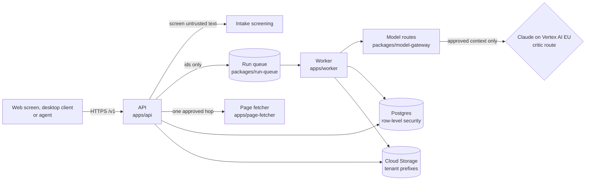
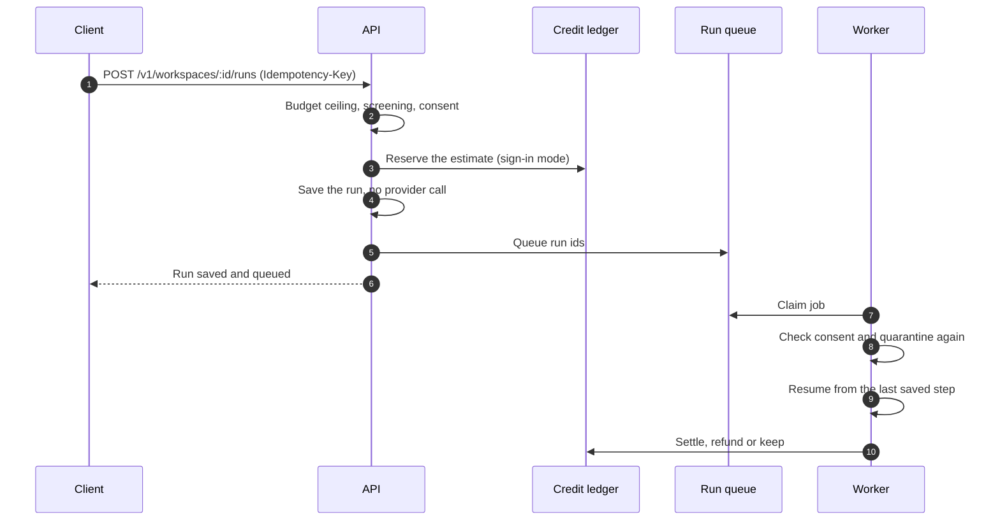
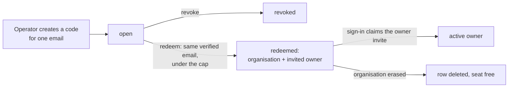
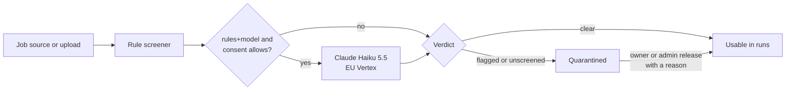

# Hosted service architecture

This page is the reference for the parts of DraftLoop that only the server has.
It covers the run queue, model routes, run limits, the `/v1` API from setup to
export, organisations and plans, and intake screening. It is written for a
developer or a coding agent changing `apps/api`, `apps/worker` or the server
packages. The self-hosted server runs the same code with local adapters
([self-hosted server](../operations/self-hosted.md)).

Start with the [architecture overview](overview.md) for the system map. Storage
ports and tenant isolation are in [Storage and tenancy](storage-and-tenancy.md),
and the decisions behind this page are in
[ADR 0011](../adr/0011-client-server-version.md).

The service runs in one of two **auth modes**. **Owner-token mode** has one
operator token and no organisation. **Sign-in mode** (`oidc`) resolves
identity-provider tokens to an organisation and a role. Plans, credits, seats
and consent apply in sign-in mode only, unless a section says otherwise.

## Contents

- [Server apps](#server-apps)
- [Run queue](#run-queue)
- [Plans and credits for a run](#plans-and-credits-for-a-run)
- [Model routes and provider keys](#model-routes-and-provider-keys)
- [Run limits and usage](#run-limits-and-usage)
- [The API from setup to export](#the-api-from-setup-to-export)
- [Organisations, plans and deletion](#organisations-plans-and-deletion)
- [Intake screening](#intake-screening)

## Server apps

Each server app is an adapter, and holds no domain logic. The full rules are in
the repository's `AGENTS.md`.

| App                                | Owns                                                                                                                                                                                                                                                                                                                    | Never owns                                                                              |
| ---------------------------------- | ----------------------------------------------------------------------------------------------------------------------------------------------------------------------------------------------------------------------------------------------------------------------------------------------------------------------- | --------------------------------------------------------------------------------------- |
| API (`apps/api`)                   | Zod-typed `/v1` routes over `ApplicationService`, the committed OpenAPI document, request authentication, serving each request from its caller's tenant, membership and operator routes, idempotent run starts that queue the run, and the error shape                                                                  | Domain logic, storage engines, provider calls                                           |
| Worker (`apps/worker`)             | Claiming queued runs and resuming each from its last saved step. Requeuing a run paused by a usage or rate limit. Extracting queued briefs and deriving queued profiles. Stopping within Cloud Run's shutdown notice.                                                                                                   | Domain logic, provider calls outside the application service, job payloads with content |
| Page fetcher (`apps/page-fetcher`) | The only runtime that reaches public web servers: one `POST /v1/fetch` hop of an approved job page per request, through the pinned fetcher. It answers the hop's status, content type, redirect target and at most one byte past intake's limit, and logs the host only. Cloud Run's IAM check decides who may call it. | A database, secrets, candidate material, text extraction, following redirects           |
| Web screen (`apps/web`)            | The browser screen over `/v1`, served by the API on the same origin, with a client typed from the OpenAPI document                                                                                                                                                                                                      | Domain logic, imports of `apps/api` or server packages, provider calls                  |

The worker extracts a queued brief only while the brief is still at the queued
version and its job text matches the checksum. A derivation stops within
seconds of a cancel.

### The web screen

The web screen shows the screens it shares with the desktop client
(`packages/ui`). It hides what the service does not offer, such as closing the
workspace and provider sign-in. Sign-in uses the owner token, or in `oidc` mode
the identity provider (authorization code with PKCE), and is kept in the tab.

| Part                                                            | What it does                                                                                                                                                                                                                                                                      |
| --------------------------------------------------------------- | --------------------------------------------------------------------------------------------------------------------------------------------------------------------------------------------------------------------------------------------------------------------------------- |
| Header                                                          | Carries a service status dot, the credit balance (sign-in mode), and Sign out. A red strip shows when the service cannot be reached.                                                                                                                                              |
| Records (`oidc` mode)                                           | Lists the caller's candidate records and switches between them. Owners and admins assign members, export a record's archive and delete a record. Each record opens on the shared Home and New application screens (`shared-screens.tsx`).                                         |
| Start dialog (`start-panels.tsx`, sign-in mode)                 | Shows the run's credit estimate and asks for consent to send material to the workspace's providers, holding Start until it is recorded. It explains a plan refusal in plain words.                                                                                                |
| `http-bridge.ts`                                                | Answers the shared screens' workspace model, writing policy, application, brief, run, review-load and model catalog commands over the API. It advertises nothing else.                                                                                                            |
| `profile-bridge.ts`                                             | Derives the career profile on the worker, with progress and cancel, then reads, edits and reviews it, so a run binds a reviewed version.                                                                                                                                          |
| `review-actions.ts`                                             | Starts a run from the reviewed brief and an optional reviewed profile. It then decides findings, edits blocks, approves, asks for a revision, pauses, resumes, stops and exports, reading the review state again after each. Autopilot and provider recovery are refused for now. |
| `knowledge-bridge.ts`                                           | Uploads a file from the browser's picker, lists only the bases the record owns, and selects one, in one store per tenant. Folders, URLs and store switching stay hidden.                                                                                                          |
| Evidence panels (`evidence-panels.tsx`, `private-sections.tsx`) | In sign-in mode, the permission to store material. In both modes, each file's screening check with its release control, and the selected bases' private-section rules, read as sentences.                                                                                         |

- **Job sources.** An attached job file goes to `applications/from-file`, which
  keeps only its text. A job page address needs the person's approval, and the
  API fetches it once, when requirements are extracted.
- **Review** happens on the shared review screen, with run details and the
  comparison between an application's runs.
- **Refusals.** Every API refusal has a stable `code`, its English `message`
  and, where the text needs them, `params` such as the resource `not_found` is
  about. The screen words known codes in its own language
  (`refusal-text.ts`) and shows the message for any other; the MCP server
  shows the message.
- **Crash reports.** An uncaught error or rejected promise in the tab is
  posted to the public `POST /v1/client-errors` (`error-reporting.ts`). The
  screen and the API both scrub it (`@draft-loop/domain/client-error-report`):
  quoted text, addresses, numbers, queries and ids are removed, and only stack
  frames are kept. The API logs one `client_error` line at `ERROR` severity.
  One tab sends at most 5 reports, and one address at most 10 per 10 minutes.
- **Exports** download under the name the review state shows
  (`@draft-loop/ui/export-file-name`), Modern unless another template is
  chosen.

## Run queue

The service starts runs through a queue, never inside the request (ADR 0011,
D4).

- **Saved first.** `POST /v1/workspaces/:id/runs` saves the run, then queues its
  ids in `packages/run-queue`. If it saved the run but could not queue it, it
  answers 503. A retry with the same `Idempotency-Key` then queues the saved
  run.
- **Model pair.** An optional `modelProfiles` binds exact author and critic
  versions, such as a preset's pair. A pair the registry refuses answers 422.
  Without one, the run uses provider-default controls and unknown context
  windows, so a full-source request over the default budget falls back to
  retrieval.
- **Profile.** An optional `candidateProfile` binds a reviewed version. The
  hosted history records no retrieval origin traces yet, so a hosted run with a
  profile retrieves the same evidence and traces none.
- **One job per run.** The queue keeps at most one waiting and one active job
  per run, so repeated requests collapse. A paused run can queue its resumption
  while the paused attempt finishes.
- **Migrations.** Queue migrations run as the schema owner (`migrateRunQueue`),
  and `grantRunQueueAccess` gives the runtime role table and function access
  only.

### Brief and profile jobs

The same queue carries two other jobs. Their payloads hold ids and the person's
choices only.

- **Brief extraction.** A live workspace's brief made from job text is saved
  without extraction. Once screening clears the text,
  `POST /v1/workspaces/:id/opportunities` queues its extraction. The brief's
  view says `extraction: pending` until the worker saves the next version, or
  `failed`. Flagged or unscreened text is never queued, and a fixture
  workspace's brief is extracted as it is saved. The shared setup card polls
  the brief every few seconds.
- **Profile derivation.** The worker derives the profile from the selected
  evidence, with the same extractor, sensitivity exclusions and provider
  approval as the CLI. A fixture workspace calls no model. The worker records
  content-free progress (calls done of calls planned). A cancel stops it before
  its next provider call, and the job keeps how it ended: the saved version, or
  a fixed message the person can act on.
- **Derivation routes.** `/v1/workspaces/:id/profiles/:profileId/derivation`
  starts (POST), reads (GET) and cancels (DELETE) a derivation. A start needs
  the record's transmission consent in sign-in mode. The profile's own routes
  read, list, edit, review and check freshness.

### How the worker handles a job

One worker serves every tenant. It opens one `openPostgresTenancy` pool and one
bucket at startup. For each job, `tenantServices` composes the application over
`forTenant(job.tenantId)` and that tenant's blob prefix. Nothing is cached
between jobs or carried between tenants.

| Situation                                                                                             | What the worker does                                                                                                                                                                  |
| ----------------------------------------------------------------------------------------------------- | ------------------------------------------------------------------------------------------------------------------------------------------------------------------------------------- |
| The run is paused by the person, awaiting approval, or finished                                       | Leaves it alone, so a duplicate or late job does nothing                                                                                                                              |
| Paused on a provider usage limit                                                                      | Queues it again for the reset time, or 15 minutes when the provider names none                                                                                                        |
| Stopped by a retryable failure: a rate limit, a timeout, a provider fault, or rejected output (#1763) | Retries while the step has attempts left. A rate limit waits at least a minute, the others at least 10 seconds, or longer if the provider asks.                                       |
| An authentication or credit failure                                                                   | Waits for the operator                                                                                                                                                                |
| A job fails or stops sending heartbeats, as after a crash                                             | Retried with backoff, resuming from the last saved step                                                                                                                               |
| SIGTERM                                                                                               | Stops claiming and gives the job in flight 8 seconds. It never cancels a step, which would record the run as cancelled. A step still running fails back to the queue and is repeated. |

### Idempotency keys

Keys live in Postgres (`idempotency_keys`, under row-level security), so every
API instance replays a key's first result for a day.

- **A retry during the first request** waits up to five seconds, then answers a
  retryable 409 `idempotency_in_progress`. It never runs the command twice.
- **A request that stopped without a result** frees its key after a two-minute
  lease.
- **Cleanup.** Each new key removes up to 100 expired ones.
- **A row whose parent is still being saved**, such as a finding decided as a
  run reaches review, answers a retryable 409 `not_ready` with `Retry-After: 1`.
  The log names the database constraint, never a value.

## Plans and credits for a run

In sign-in mode, a run must fit the organisation's plan and credits (ADR 0011,
D13). `entitlement-gate.ts` checks this after the budget ceiling, screening and
consent. Owner-token mode skips it, because its tenant has no organisation row
to hold a plan or a ledger.

| Order | Status and code              | Cause                                       | Fields                  |
| ----- | ---------------------------- | ------------------------------------------- | ----------------------- |
| 1     | 403 `plan_required`          | The organisation has no plan                | none                    |
| 2     | 422 `model_tier_unknown`     | A model's tier cannot be determined         | `role`                  |
| 3     | 403 `model_tier_not_in_plan` | The plan lacks a model's tier               | `role`, `tier`          |
| 4     | 429 `run_cap_reached`        | The concurrent or daily run cap is reached  | `cap`, `limit`          |
| 5     | 402 `credits_insufficient`   | The balance does not cover the estimate     | `estimate`, `remaining` |
| 6     | 503 `spend_pool_exhausted`   | The deployment's monthly spend pool is used | none                    |

Refusals carry codes, a role, a tier and numbers only.

### Monthly spend pool

A deployment can cap what all organisations' runs cost in a UTC month with
`DRAFT_LOOP_SPEND_POOL_USD` (#2459). The public beta uses it so free credits
cannot spend past a fixed budget.

- **Reserve.** After the credits, the gate holds the run's own cost limit
  (`maxCostUsd`) in `spend_pool_entries`. A start that would pass the ceiling
  is refused and its credits are refunded.
- **Close.** When the worker settles or refunds the run's credits, it replaces
  the hold with the run's estimated cost. A run that could not begin closes at
  zero.
- **Shared.** The table is deployment-wide and content-free: run ids and
  dollars only. Erasing an organisation does not give its spend back.

### Pricing a run

- **Tiers.** They come from the application's own pair, else the request's
  `modelProfiles`, else the workspace's models (`resolveRunCreditTiers`).
- **Estimate.** `estimateRunCredits` prices the run at the workspace's round
  limit.
- **Rule v2.** 1 credit per block of two rounds, doubled when a model is
  premium or a named profile runs at `high`, `xhigh` or `max`.
- **Versioned.** Each reservation records the rule version that priced it, so a
  v1 run keeps its price.

### Reserving credits

1. The gate picks the run id.
2. It reserves under the ledger's lock, credits and caps together, so
   concurrent starts cannot overspend.
3. It passes the id to `begin` (`runId` on the begin command).

- **A refusal saves nothing,** and a failed `begin` refunds the reservation.
- **Replays.** Everything runs inside the `Idempotency-Key`'s one execution, so a
  replay reserves nothing more.
- **Queueing failure.** The reservation stays, since the run is saved.
- **A crash** between reservation and save leaves one open reservation, which
  reconciliation releases.

### Settling credits

The worker closes each reservation in `run-credit-settlement.ts` after a job
leaves its run in a final state. The ledger acts once, so a replayed job settles
once.

| Outcome | When                                                                                                                                 |
| ------- | ------------------------------------------------------------------------------------------------------------------------------------ |
| Settle  | The run has a draft: `awaiting-approval`, `approved`, `exported`, `stopped`, or `provider-error` with an artifact                    |
| Refund  | The run ended in one of those states without a draft, or its job was dropped for an erased record or a missing run                   |
| Keep    | The run can continue: a user pause, a usage-limit pause, a failure awaiting retry, a consent or quarantine hold, or a step in flight |

A job for a run with no reservation, as in owner-token mode, does nothing.

- **No free run.** Only the worker retries a `provider-error` run. The shared
  screen offers no retry by hand. It says the service retries the step, or that
  a new run is needed (#1764). A job whose run has a refunded reservation ends
  as `credits-closed` without a provider call.
- **Reconciliation.** After each job, the worker reads that tenant's open
  reservations older than an hour. A reservation with no saved run is refunded.
  A run that finished without a job to say so, such as a paused run the person
  stopped, is settled or refunded as above. It runs per tenant, so an orphan is
  found at the tenant's next job.
- **Known limits.** Erasing a record does not close its paused runs'
  reservations at once. Reconciliation does, within an hour of the tenant's next
  job. A run above the deployment's ceiling keeps its reservation. Rounds added
  after the first draft are not charged again.

### Reading estimates and balances

- **`GET /v1/workspaces/:workspaceId/runs/estimate`** (`credit-routes.ts`) says
  what a run on the current settings would reserve: `credits`,
  `estimateVersion`, the tiers and the round limit.
  - It prices with `priceRun` (`run-pricing.ts`), the same function as the
    gate, so the number shown is the number reserved.
  - `?applicationId=` prices an application's own pair.
  - It refuses nothing and works in both modes. An unknown tier answers 422
    `model_tier_unknown`.
  - In sign-in mode it also returns `plan`, meaning whether the plan allows the
    tiers and which code the gate would answer, and `balance`, meaning whether
    `remaining` covers the estimate.
- **`GET /v1/organisation/credits`** (sign-in mode, any role) answers the plan id
  and entitlements (`modelTiers`, `runsPerDay`, `concurrentRuns`, `seats`,
  `candidateRecords`). It also answers the period's `allowance`, `used`,
  `reserved`, `grantsRemaining`, `remaining`, `periodStart`, `periodEnd` and
  `unlimited`. With no plan it answers 403 `plan_required`, and in owner-token
  mode 404.

| Field      | Meaning                                                                                                                                                        |
| ---------- | -------------------------------------------------------------------------------------------------------------------------------------------------------------- |
| `used`     | Credits finished runs settled from the allowance, plus the part of `reserved` taken from it, so a started run counts at once. Operator grants are not counted. |
| `reserved` | The total held, from the allowance and grants                                                                                                                  |
| `warning`  | True once `used` is at least 80% of `allowance`. Never true on an unlimited plan or a zero allowance, which answer `null` for `allowance` and `remaining`.     |

### Credit alerts

The gate logs two content-free `WARNING` lines when a new reservation crosses a
threshold: `credit allowance 80% used` and `credit balance exhausted`.

- **Fields.** Each line carries `organisationId`, `periodEnd`, `allowance`,
  `used` and `remaining`.
- **Once per crossing.** The ledger returns the balance just before and just
  after the reservation, read under its lock, so racing starts cross a
  threshold once.
- **Only saved runs.** The line is written once the run is saved, so a refused
  or refunded start writes nothing.
- **Re-crossing.** The ledger holds no flag. A refund that brings the balance
  back under a threshold, followed by a new reservation, can cross it again.
- **Unlimited plans** and a zero allowance never log the 80% line.

## Model routes and provider keys

Every provider call records its route beside its company and model, such as
`anthropic-api`, `vertex-ai` or `openai-api`. A change of endpoint is never
silent (ADR 0011, D5), and run status in the CLI and the API lists each step's
routes.

### Claude on Vertex AI

`packages/model-gateway` reaches the hosted author on Vertex AI.

- **EU only.** Only the `eu` multi-region or a `europe-*` region is accepted.
  The endpoint is set explicitly, never from the environment.
- **No long-lived key.** Authentication uses the runtime's service identity.
- **Listed models only.** Models are called under their first-party ids, and
  any other model is refused, never replaced.
- **Prices.** Cost estimates apply the location's price factor, which the
  deployment takes from Google's price list.
- **The content screener** (`createHostedContentScreener`) classifies untrusted
  text with Claude Haiku 5.5 on this route. It sees the text only inside a
  delimited block of the user turn and answers with closed signal codes. It
  fails closed on any error, and reports each call's usage and cost through
  `onUsage`.

### The direct Claude API fallback

`createRoutedAdapter` applies the deployment's route policy. The direct Claude
API is optional and off unless the deployment turns it on, because it processes
material outside the EU.

| Falls back when                                                                                                                                                            | Never falls back on                     |
| -------------------------------------------------------------------------------------------------------------------------------------------------------------------------- | --------------------------------------- |
| The model is not offered on the primary route, or the deployment may not use it there, such as a billing account that cannot buy Claude on Vertex AI (`model-not-offered`) | Content errors                          |
| The route still refuses after the adapter's retries (`route-unavailable`)                                                                                                  | Policy, authentication or budget errors |

A fallback keeps the company and the model, and run history records the route
it left and why.

### Provider keys

Keys come from Secret Manager at call time, never from an image or an
environment file. `createSecretManagerCredentialResolver` reads the version the
deployment names for each key.

- **Which keys.** OpenAI's key for the critic, and the Claude API key only when
  the fallback is on. Vertex AI needs none.
- **Rotation.** A key stays in memory for five minutes, so a rotated key takes
  effect without a restart.
- **Errors.** A failed read names only the provider, never the value or the
  client's error.

### Who calls a model

- **The worker** composes the routes at startup from its settings, listed in the
  [local server stack](../operations/local-server-stack.md#model-routes) guide.
  Anthropic authors go through `createHostedAnthropicRoute`
  (`providerClientFactories.anthropicRoute`). The critic's OpenAI client targets
  the EU endpoint. Without these settings, as on the local stack, only fixture
  runs work.
- **The API** never drafts or reviews. Its driver resolves no key and refuses
  to build a provider client (`apiProviderOptions`), whatever its environment
  holds. Its only model call is the opt-in screener in
  [Intake screening](#intake-screening).

## Run limits and usage

Each deployment sets a **ceiling** per run: rounds, cost and duration, all
required.

- **Defaults.** A workspace without a cost or duration limit gets the ceiling's
  (`withRunBudgetDefaults`).
- **Above the ceiling.** A run whose workspace asks for more answers 422
  `budget_above_ceiling`, naming the limit to change.
- **Re-checked.** The worker checks each run's saved budget before it executes,
  so a lowered ceiling also holds for queued runs.

### How the cost limit holds

1. **Before each priced call**, the orchestrator passes each agent what the run
   may still spend.
2. **The agent estimates the call's worst cost.** That is the prompt at the
   input rate, with any cached prefix at the cache-read rate, plus the whole
   output budget at the output rate.
3. **A call that could pass the limit is never sent.** The run stops as
   budget-exhausted, with the estimate in the reason and nothing billed
   (`packages/application/src/call-cost-guard.ts`).
4. **After the call** the limit is checked again. This catches an expired
   cache, which costs more than the estimate.

- **Unpriced calls.** When a call on a metered route returns no cost, a run with
  a cost limit stops as budget-exhausted. Subscription sessions, local models
  and fixtures are unmetered and exempt.
- **Failed attempts count** when the provider billed them. A rejected response,
  such as a draft stopped at its output cap, keeps its tokens and cost on the
  failed execution and in the run total.

### Reading usage

Usage reads return counts and amounts only.

| Route                                      | Returns                                                                                                                                                                                              |
| ------------------------------------------ | ---------------------------------------------------------------------------------------------------------------------------------------------------------------------------------------------------- |
| `GET /v1/workspaces/:id/runs/:runId/usage` | One run's billed calls by company, model and route: calls, input and output tokens, estimated cost. It includes the application plan's calls, which the plan step records apart from the executions. |
| `GET /v1/usage?month=YYYY-MM`              | The tenant's totals for a UTC month in the same shape, summed in Postgres under row-level security                                                                                                   |

Calls without a cost estimate are counted as `unpricedCalls`, never as zero.

## The API from setup to export

These routes take a hosted run from an empty workspace to a downloaded CV. The
API only adapts `ApplicationService`, so each group follows the same rules as
the CLI.

1. Set up the workspace and its knowledge.
2. Create an application and review its brief.
3. Begin a run, and let the worker draft it.
4. Decide the findings, then approve.
5. Export and download.

The local server stack's smoke and `pnpm test:postgres` both run that flow, one
of them through a revision round
([local server stack](../operations/local-server-stack.md#tests-against-the-stack)).

### Workspace setup

| Route                                             | What it does                                                                                                                                                                                                                     | Refusals                                                                                                       |
| ------------------------------------------------- | -------------------------------------------------------------------------------------------------------------------------------------------------------------------------------------------------------------------------------- | -------------------------------------------------------------------------------------------------------------- |
| `PUT /v1/workspaces/:id`                          | Creates the workspace with its language, models, run limits, fixture mode and autopilot. It names no file or folder.                                                                                                             | Non-Anthropic or non-OpenAI models. A budget above the ceiling answers 422. An existing workspace answers 409. |
| `GET /v1/workspaces`                              | Lists the workspaces the caller can reach                                                                                                                                                                                        | none                                                                                                           |
| `PATCH /v1/workspaces/:id/models`                 | Changes the author and critic for the next runs. Recorded runs keep their pair.                                                                                                                                                  | A one-lineage pair without `independenceOverrideRationale`. A change during an executing run answers 422.      |
| `PUT /v1/workspaces/:id/autopilot`                | Turns autopilot on or off from the next run action. The web's **Autopilot** checkbox calls it.                                                                                                                                   | none                                                                                                           |
| `PUT /v1/workspaces/:id/budget`                   | Replaces the round, cost and duration limits for the next runs. A limit left out falls back to the ceiling.                                                                                                                      | Above the ceiling                                                                                              |
| `GET /v1/model-catalog`                           | The served profiles, with tier, roles, list prices, default and allowed reasoning levels, the presets it fully serves, and the default preset (`hosted-model-catalog.ts`). Desktop-only companies and local models are left out. | none                                                                                                           |
| `PUT /v1/workspaces/:id/writing-policy`           | Sets the policy from Markdown text of at most 64 KiB, as a new immutable version the next runs follow. `GET` reads it, and `GET .../versions` lists versions without text.                                                       | The server never reads a policy file a client names                                                            |
| `GET /v1/writing-policy-template`                 | Reads the template an editor starts from. It saves nothing.                                                                                                                                                                      | none                                                                                                           |
| `PATCH /v1/workspaces/:id/opportunities/:briefId` | Saves a brief edit as a new draft version. `GET .../versions` lists numbers, statuses and dates.                                                                                                                                 | A stale `expectedVersion` answers 409 `brief_version_stale`                                                    |

- **Default models.** A side the request leaves out gets the Balanced preset,
  Claude Sonnet 5.5 as the author and GPT-6.1 Terra as the critic. The CLI keeps
  the cheaper Economy pair as its default. The Anthropic-only presets use a
  different Claude model on each side, so they need no override.
- **Autopilot** is on for a new hosted workspace unless the request turns it
  off. A run then revises through the critic's blocking findings up to its
  round limit.
- **The budget route** is the way out when the ceiling drops below a budget
  stored at creation, which would otherwise refuse every run (#1993). The
  workspace view shows the stored cost and duration limits.
- **Reasoning levels.** A profile reference in a run start or an application's
  pair may carry an allowed `effort`. An unknown level answers 400, and a level
  the profile refuses answers 422.

### Job applications

These routes live in `application-lifecycle-routes.ts` and `application-folder-routes.ts`.

| Route                                                              | What it does                                                                                                                                                                                         |
| ------------------------------------------------------------------ | ---------------------------------------------------------------------------------------------------------------------------------------------------------------------------------------------------- |
| `POST /v1/workspaces/:id/applications`                             | Creates an application from a name and pasted job text, kept in its record, never in a file. Or from a job page address with `jobUrlApproved: true`, fetched later. An optional `folderId` files it. |
| `GET .../applications/:applicationId/job`                          | Reads the job text back, or the address                                                                                                                                                              |
| `POST .../applications/from-file?name=<name>&fileName=<file name>` | Creates one from a PDF, DOCX, Markdown or text file sent as the raw body, within the evidence upload limit (`application-file-routes.ts`). Only the text is kept, as if pasted.                      |
| `PATCH .../applications/:applicationId`                            | Renames, archives, restores, or moves it with `folderId` (`null` for no folder). An unknown application answers 404.                                                                                 |
| `GET`, `POST .../application-folders`                              | Lists or creates the folders that group applications on Home: one level, one folder per application (`application-folder-routes.ts`). A taken name answers 422.                                      |
| `PATCH`, `DELETE .../application-folders/:folderId`                | Renames a folder, or deletes it and puts its applications back in no folder. No application is deleted.                                                                                              |
| `PUT .../models`                                                   | Sets or clears the application's own pair                                                                                                                                                            |
| `PUT .../chosen-run`                                               | Chooses the run whose draft it uses                                                                                                                                                                  |

**Fetching a job page.** The page is fetched once, when requirements are
extracted, and the brief's `approved-url` source must match the approved
address.

- **Checked addresses.** The fetcher connects only to an address it checked
  (`job-page-brief.ts`, over `@draft-loop/ingestion`'s pinned fetcher).
- **Through the page fetcher.** A deployment's API has no route to the internet.
  It makes each hop through `apps/page-fetcher` when
  `DRAFT_LOOP_PAGE_FETCHER_URL` is set (#1837), and still checks every
  redirect and bounds the page.
- **Timeouts.** The API waits 25 s per hop, longer than the fetcher's own 15 s
  limit and its cold start (#1853), so a slow site shows as the fetcher's
  timeout.
- **Unreadable pages** answer 422 before a brief is saved.
- **Recorded.** The brief records the original and final address and the fetch
  time.
- **Screened.** The page text is kept for the worker's extraction, and screened
  like pasted text before a model sees it.

### Review state for the shared screens

`GET /v1/workspaces/:id/review-state` (`review-state-routes.ts`) projects a run
for the shared screens, with the same `packages/review-state` code as other
hosts. The web bridge answers `review.load` from it, and the port validates every
field.

- **What it returns.** The run on screen, with its draft, findings, decisions
  and edits, and the workspace's readiness for the next run.
- **Choosing the run.** `applicationId` scopes it to that application's newest
  run, and `runId` names an earlier one. A run the application does not hold
  answers 404.
- **With an application,** it adds the run details and the comparison's run
  list (`@draft-loop/review-state/application-runs`). These hold each run's
  models, round, state and score, its evidence mode, and what its latest author
  step was sent.
- **Readiness** reads the application's job or reviewed brief, the selected
  sources and the writing policy. Without a run, the state is the start state,
  with `runId` `pending`.
- **The provider preflight** names the gateway's routes and reads as
  acknowledged, because the server itself refuses a provider call without
  recorded consent.

### Career knowledge

Sources reach a hosted store through `createHostedKnowledgeIntake` in
`packages/application`, over the storage and blob ports.

- **One store per tenant.** It is created with the first knowledge base, since
  bases belong to the tenant.
- **Files.** PDF, DOCX, Markdown or text, or a pull request list as JSON or
  CSV, at most 10 MiB by default
  (`DRAFT_LOOP_MAX_SOURCE_BYTES`).
- **No parsing to store.** The type is checked by signature only (ADR 0011,
  D11). The worker extracts text from the stored bytes, and the API reads the
  text once more only to [screen it](#intake-screening).
- **Bytes first.** The bytes go to the tenant's blob prefix, then the source and
  version are recorded, so a recorded version always has its bytes.
- **Duplicates.** The same bytes in the same base return the existing source.

| Route                                                                         | What it does                                                                                                                                                                                                                                                                                              | Refusals                                                               |
| ----------------------------------------------------------------------------- | --------------------------------------------------------------------------------------------------------------------------------------------------------------------------------------------------------------------------------------------------------------------------------------------------------- | ---------------------------------------------------------------------- |
| `POST /v1/knowledge-bases`, `GET`                                             | Creates a base, or lists them                                                                                                                                                                                                                                                                             | none                                                                   |
| `GET /v1/knowledge-bases/:id/sources`                                         | Lists sources with the latest file's name, media type, size, checksum and date, never content                                                                                                                                                                                                             | none                                                                   |
| `POST /v1/knowledge-bases/:id/sources?name=<file name>`                       | Uploads one file as the raw body, with its media type as `Content-Type`. A JSON or CSV pull request list is stored as Markdown, one heading per pull request (`normalizeHostedUpload`). The answer carries its `screening`. The same bytes again answer 200 with the existing source, so a retry is safe. | Another type answers 415. Over the limit answers 413.                  |
| `GET /v1/knowledge-bases/:id/sensitivity-rules`, `POST`, `DELETE .../:ruleId` | Lists, adds or removes a rule that marks sections under a heading as `sensitive` or `never-share`. Each change saves a new list version, and runs withhold the marked sections.                                                                                                                           | A duplicate rule answers 422                                           |
| `PUT /v1/workspaces/:id/knowledge-selection`                                  | Selects the bases a workspace's runs use, by id. The API names the tenant's store itself, and the workspace view lists `knowledgeBaseIds`.                                                                                                                                                                | An unknown base answers 404. Several bases need `combinationApproved`. |
| `GET /v1/workspaces/:id/fact-usage`, `PUT`                                    | Reads or sets where career facts may be used: `cv`, `interview-only` or `never-say`, by section (fact category) or by fact usage key, never fact text. `null` clears a level; unset reads as `cv` (`fact-usage-routes.ts`).                                                                               | Fact text as a key, or an unknown level, answers 400                   |

Every route except the upload parses JSON.

### Reviewing a run

These routes act on `/v1/workspaces/:id/runs/:runId`. They change the run's
state only: their engine has no agents, so the API still reaches no provider.

| Route                                  | What it does                                                                                                                                                                                                                             | Refusals                                                                                                                                                                                                             |
| -------------------------------------- | ---------------------------------------------------------------------------------------------------------------------------------------------------------------------------------------------------------------------------------------- | -------------------------------------------------------------------------------------------------------------------------------------------------------------------------------------------------------------------- |
| `GET .../review`                       | The draft with the owner's latest block edits, each claim with its evidence excerpts, the findings with ids and decisions, the recorded review independence, and the latest readiness scores. Before the first draft, the draft is null. | none                                                                                                                                                                                                                 |
| `PUT .../findings/:findingId/decision` | Records accepted, rejected, deferred, overridden or back to pending, with an optional rationale. Answers the updated review.                                                                                                             | Not awaiting approval answers 409 `review_closed`. Outside the current draft answers 404.                                                                                                                            |
| `PUT .../edits/:blockId`               | Records replacement text for one block. Answers the updated review.                                                                                                                                                                      | As above                                                                                                                                                                                                             |
| `POST .../approve`                     | Approves a run awaiting approval                                                                                                                                                                                                         | A blocking finding still pending, deferred or only accepted answers 409 `findings_unresolved`. Failed final checks answer 409 `readiness_blocked`, listed in `approvalCheck`, and need `readinessOverrideRationale`. |
| `POST .../revision`                    | Sends the run back for another round, with optional direction for the author. Takes an `Idempotency-Key` and queues the run.                                                                                                             | As below                                                                                                                                                                                                             |
| `POST .../pause`, `.../resume`         | Pauses an active run, or lifts the pause without running a step (`releasePause`). Resume takes an `Idempotency-Key` and queues the run.                                                                                                  | As below                                                                                                                                                                                                             |
| `POST .../stop`                        | Stops the run for good                                                                                                                                                                                                                   | Any action the run's state does not allow answers 409 `run_state_conflict` (`RunTransitionError`)                                                                                                                    |

### Exporting an approved run

| Route                                         | What it does                                                                                                                                                                  | Refusals                                                                                                |
| --------------------------------------------- | ----------------------------------------------------------------------------------------------------------------------------------------------------------------------------- | ------------------------------------------------------------------------------------------------------- |
| `POST /v1/workspaces/:id/runs/:runId/exports` | Renders the approved draft as Markdown, DOCX or PDF, with an optional built-in template, under an `Idempotency-Key`. It runs the rendering checks and marks the run exported. | Not yet approved answers 409                                                                            |
| `GET .../exports`                             | Lists the run's exports, newest first                                                                                                                                         | none                                                                                                    |
| `GET .../exports/:exportId/content`           | Downloads one as an attachment named `cv-<day>-<export id>.<extension>`, with its media type and SHA-256 in `X-Content-SHA256`                                                | Bytes that differ from the recorded checksum or size answer 409 `export_integrity` and are never served |

- **Never replaced.** Each export gets a new path under its workspace.
- **Storage.** Bytes go to the tenant's blob prefix (`workspaceReferenceBlobs`).
  The record keeps their checksum and size, and the API never shows where a
  document is stored.
- **PDFs** come from the built-in writer, because the server images carry no
  browser engine.
- **Downloads** go through the owner token, with no signed storage URLs.

## Organisations, plans and deletion

People manage their organisation through the API once it has a tenant directory
(ADR 0011, D6).

### Members and roles

| Route                                                | What it does                                                                                                                                                         |
| ---------------------------------------------------- | -------------------------------------------------------------------------------------------------------------------------------------------------------------------- |
| `GET /v1/me`                                         | Who the caller is: a member's organisation, id, role and email, or `{ "kind": "owner" }` for the owner token, which belongs to no organisation                       |
| `GET`, `PUT /v1/me/screen-language`                  | A member's saved screen language (`en`, `fr` or null), read after sign-in and saved on each change; 404 for the owner token, whose screen keeps the browser's choice |
| `GET`, `POST /v1/organisation/members`               | Lists the organisation, or invites a person by email                                                                                                                 |
| `PATCH`, `DELETE /v1/organisation/members/:memberId` | Changes a role, or removes a member                                                                                                                                  |

- **Who may manage.** Owners and admins manage members, and members get 403.
- **The owner role.** Only an owner grants, takes away or removes it. The last
  owner answers 409 `last_owner`.
- **No races.** The directory checks the acting role against the target's
  inside the change, under the organisation's row lock, so a racing promotion
  cannot slip past.
- **Logs.** Each change logs one content-free line with the action,
  organisation, member and role, never an email. The hash-chained audit trail is
  per workspace, and membership belongs to none.

### Beta invites

The invite-only public beta (#2460) creates accounts from single-use invite
codes, in the directory's `betaInvites` (`beta-invites.ts`). The sign-up
screen comes in #2503.

| Route                                        | Who                                | What it does                                                         |
| -------------------------------------------- | ---------------------------------- | -------------------------------------------------------------------- |
| `POST /v1/operator/beta-invites`             | Operator                           | Creates a code for one email; the answer carries the plain code once |
| `GET /v1/operator/beta-invites`              | Operator                           | Lists invites without codes, the accounts they created and the cap   |
| `DELETE /v1/operator/beta-invites/:inviteId` | Operator                           | Revokes an open invite; 404 otherwise                                |
| `POST /v1/sign-up`                           | A verified sign-in with no account | Redeems a code, assigns the Beta plan and makes the caller the owner |

`POST /v1/sign-up` is the one route a sign-in without a membership reaches
(`request-auth.ts`). After five refused codes in 15 minutes, one sign-in gets
429 `rate_limited` with `Retry-After`. The cap is `DRAFT_LOOP_BETA_ACCOUNT_CAP`.

- **Codes.** 16 characters without look-alike letters, stored as SHA-256
  hashes. The plain code is returned once, at creation.
- **Redemption.** One transaction, under an advisory lock, checks the code,
  the email and the cap, then creates the organisation. Refusals are
  `invite_unknown`, `invite_revoked`, `invite_used`, `invite_email_mismatch`
  and `beta_full`.
- **Cap.** It counts redeemed invites; 0 closes sign-up. Organisations the
  operator creates directly are not counted.
- **Data.** The table belongs to no tenant and holds an email and ids only.

### Plan limits

In sign-in mode, the plan's `seats` and `candidateRecords` limit growth
(`plan-limits.ts`, ADR 0011, D13). Owner-token mode checks nothing.

| Limit              | What counts                                                                                                                          | Races                                                                                                                   |
| ------------------ | ------------------------------------------------------------------------------------------------------------------------------------ | ----------------------------------------------------------------------------------------------------------------------- |
| `seats`            | Active and invited members. Removing a member frees a seat, and an email already invited answers 409 `member_exists` and takes none. | Counted under the organisation's row lock in the insert's transaction, so racing invitations cannot pass the limit      |
| `candidateRecords` | Records as `GET /v1/workspaces` lists them. An erased or closing record takes none, and an archived one still does.                  | The count and the save are separate steps, so racing creations can pass by one record, and the next creation is refused |

Past a limit, the answer is 409 `plan_limit_reached` with `limit` and `value`.
An organisation with no plan gets 403 `plan_required`.

### Model calls outside runs

The plan's `modelCallsPerDay` bounds what a member's model calls outside runs
can cost (`model-call-gate.ts`, #2487). Beta allows 20 a UTC day; the other
plans have no cap.

| Counted call                 | Route                                                                                            |
| ---------------------------- | ------------------------------------------------------------------------------------------------ |
| An interview turn            | `POST .../career-interview/sessions/:sessionId/actions` with `accept`, `answer` or `own_subject` |
| A live interview             | `GET .../career-interview/sessions/:sessionId/live`, once per session                            |
| Drafted application material | `POST .../applications/:applicationId/material`                                                  |
| A profile derivation         | `POST .../profiles/:profileId/derivation`                                                        |

- **Free.** Brief extraction, since a run needs a brief. Owner-token calls
  are not counted.
- **Refusal.** 429 `model_call_cap_reached` with `limit`, and `Retry-After`
  until midnight UTC. The API logs `model call cap reached`.
- **Counting.** `model_call_counts` holds one counter per organisation and
  day. The check and the increment are one statement, so racing calls cannot
  pass the cap. A call the route then refuses for another reason still counts.

### Operator routes

Operator routes take only the deployment's owner token, in both auth modes,
never a member's sign-in.

| Route                                                           | What it does                                                                                                                              |
| --------------------------------------------------------------- | ----------------------------------------------------------------------------------------------------------------------------------------- |
| `POST /v1/operator/organisations`                               | Creates an organisation and invites its first owner                                                                                       |
| `PUT /v1/operator/organisations/:organisationId/plan`           | Assigns a plan: `planId`, optional `overrides`, `seats`, and `periodStart` (today's UTC date by default)                                  |
| `POST /v1/operator/organisations/:organisationId/credit-grants` | Grants 1 to 1,000,000 credits with a reason code. Needs an `Idempotency-Key`, so a retry is not doubled. A grant expires after 12 months. |
| `GET /v1/operator/organisations/:organisationId/credits`        | Reads the plan, entitlements and balance                                                                                                  |
| `DELETE /v1/operator/organisations/:organisationId`             | Deletes an organisation (see [Deleting](#deleting-a-record-or-an-organisation))                                                           |

These routes are in `operator-plan-routes.ts`. An unknown plan, a seat-priced
plan without seats, or an impossible date answers 422
`invalid_plan_assignment`. An unknown organisation answers 404
`organisation_not_found`. Each write logs one content-free `audit` line, with
ids, the plan id, numbers and the reason code, since a plan belongs to no
workspace's audit trail.

### Consent

Each candidate record keeps an append-only consent ledger (ADR 0011, D7). It is
the `ConsentLedger` port from `@draft-loop/storage/consent-ledger`, over the
`consent_events` table.

- **Routes.** `GET /v1/workspaces/:workspaceId/consents` returns each kind's
  latest entry and the history. `POST` records a `material-storage` or
  `provider-transmission` grant or withdrawal, with its basis.
- **Storage rules.** The runtime role may only read and insert. Each entry logs
  a content-free line without its note.

In sign-in mode the API enforces the ledger (`consent-enforcement.ts`):

| Action                                 | Needs                                                                          | Otherwise                           |
| -------------------------------------- | ------------------------------------------------------------------------------ | ----------------------------------- |
| A source upload                        | A current `material-storage` grant on the base's record                        | 409 `storage_consent_required`      |
| Starting a run, a revision or a resume | A `provider-transmission` grant naming every company the author and critic use | 409 `transmission_consent_required` |

- **The worker checks too.** With `DRAFT_LOOP_AUTH_MODE=oidc`, the worker checks
  again as it claims each job, and pauses the run without a provider call when
  consent is gone. In owner mode, `DRAFT_LOOP_REQUIRE_CONSENT=true` opts in.
- **A ceiling above consent.** `DRAFT_LOOP_ALLOW_PROVIDER_DATA` still applies on
  top of consent.

### Record archive

`GET /v1/workspaces/:workspaceId/archive` downloads everything held about a
record as a zip in the [record archive v1](../reference/record-archive.md)
format. The manifest's SHA-256 is in `X-Archive-Manifest-SHA256`.

- **Who may export.** Owners and admins, or the owner token in owner-token mode.
  Members get 403.
- **Which bases.** In sign-in mode, the bases the record owns. In owner-token
  mode, every base of the tenant.
- **Integrity.** `openPostgresRecordArchives` reads the record's rows from one
  snapshot, and checks every source and export object before the first byte. A
  missing or changed object answers 409 `archive_integrity`.
- **Streaming.** The zip streams one file at a time, and each download logs one
  content-free line.

### Deleting a record or an organisation

|                   | Delete a record                                                                                              | Delete an organisation                                                                                                                                                                                                                  |
| ----------------- | ------------------------------------------------------------------------------------------------------------ | --------------------------------------------------------------------------------------------------------------------------------------------------------------------------------------------------------------------------------------- |
| Route             | `DELETE /v1/workspaces/:workspaceId`                                                                         | `DELETE /v1/organisation` (an owner), or `DELETE /v1/operator/organisations/:organisationId` (the operator token)                                                                                                                       |
| Who               | Owners and admins, or the owner token in owner-token mode                                                    | As in the route                                                                                                                                                                                                                         |
| Confirmation      | `{ "confirm": "<workspace id>" }`, else 400 `confirmation_mismatch`                                          | The organisation id typed back as `confirm`                                                                                                                                                                                             |
| Active runs       | A queued or running run answers 409 `run_active` until stopped                                               | Any queued or running run answers 409 `run_active`                                                                                                                                                                                      |
| Order             | Closes the record, which is then 404 to every other route. Removes its stored objects by key, then its rows. | Erases each record as on the left, then every object left under the tenant's prefix, then what the tenant still holds through `erase_tenant_remainder`: tenant-wide bases, idempotency keys, and the organisation with its members last |
| While in progress | A queued job ends in the worker as `record-erased`, without a provider call                                  | The first call sets `organisations.closing_at`, which is never cleared. Every member request but the repeated delete answers 409 `organisation_closing`, and the worker drops queued jobs.                                              |
| Interrupted       | Calling again finishes it. A record already gone answers 404.                                                | The next call finishes it                                                                                                                                                                                                               |
| Log               | One content-free line with the ids and counts removed                                                        | As for each change                                                                                                                                                                                                                      |

Accounts at the identity provider are not deleted. A person's sign-in simply no
longer resolves to an organisation.

Record erasure has two storage steps (`@draft-loop/storage/record-erasure`):

1. **Close.** This writes a `candidate_record_erasures` mark, after which the
   record is missing to every reader, and returns the object keys its rows name.
2. **Erase.** This calls `erase_candidate_record`, a `SECURITY DEFINER` function
   owned by the migrating role. It is the only delete the runtime role may make
   on the consent ledger and the audit chain.

In one transaction, the erase removes:

- the record's history, settings and run state
- its idempotency keys and assignments
- its consent and screening results
- its owned knowledge bases, with their sources, versions and indexes
- the erasure mark, last

A repeated close finds the mark, so an interrupted erasure finishes on the next
call.

### Where the server keeps screening, plans and credits

| Store                          | Code                                                                                                                                                | Rules                                                                                                                                                                                                                                                                                                                                                       | Erased by                                                                                                      |
| ------------------------------ | --------------------------------------------------------------------------------------------------------------------------------------------------- | ----------------------------------------------------------------------------------------------------------------------------------------------------------------------------------------------------------------------------------------------------------------------------------------------------------------------------------------------------------- | -------------------------------------------------------------------------------------------------------------- |
| Screening results and releases | `ContentScreeningStore` from `@draft-loop/storage/content-screening`, over append-only `content_screening_results` and `content_screening_releases` | See [Quarantine](#quarantine-and-release)                                                                                                                                                                                                                                                                                                                   | Record and organisation erasure. The record archive includes them.                                             |
| Plan assignment                | `createOrganisationPlans` in `@draft-loop/storage-postgres`, as `forTenant(organisationId).organisationPlans`                                       | The current `organisation_plans` row is keyed by the tenant (the organisation). It holds the plan id, catalog version, validated overrides, seats and the UTC period start. `organisation_plan_history` appends every assignment and refuses updates and deletes.                                                                                           | Organisation erasure only. A plan is not candidate material, so record erasure and the archive leave it alone. |
| Credits                        | `createCreditLedger` in `@draft-loop/storage-postgres`, as `forTenant(organisationId).creditLedger`                                                 | Append-only rows of kind `grant`, `reserve`, `settle`, `refund` and `expire`, with positive amounts. The balance is their sum. Every write locks the balance row first, so reservations, run caps and the period roll cannot race. A reservation spends the allowance first, then the grant that expires first, and a refund never revives expired credits. | Organisation erasure                                                                                           |

## Intake screening

The API screens untrusted text for prompt injection before any model reads it
(ADR 0011, phase 2d), in `content-screening-*.ts`. `DRAFT_LOOP_SCREENING`
chooses how, the same in both auth modes. Any other value stops the API at
startup.

| Mode              | Screeners                                                                                  |
| ----------------- | ------------------------------------------------------------------------------------------ |
| `off`             | Nothing is screened or stored, and the `screening` object is absent                        |
| `rules` (default) | The rule screener in `packages/ingestion`                                                  |
| `rules+model`     | The rules, plus Claude Haiku 5.5 on the EU Vertex route. `screenWith` merges the verdicts. |

### What is screened

- **Job sources.** Each source of `POST /v1/workspaces/:id/opportunities`.
- **Uploads.** Each file of the knowledge source upload, after it is saved, so
  the subject ids exist. An upload's text comes from the same extraction the run
  uses. A file with no readable text is left unscreened.
- **Not screened.** An edit to a reviewed brief, which a member typed.

The answer carries a `screening` object with the verdict, the closed signal
codes and the stored result id, never a quote of the text.

### Rules that hold

- **Fail closed.** A screener that fails makes the result `unscreened`, which is
  quarantined like `flagged`. The request still succeeds. The same bytes uploaded
  again are screened again while the result stays unscreened and unreleased.
- **Consent for the model.** A job post is third-party text, so `rules+model`
  always sends it to the model. A candidate source (an upload, or a brief's
  candidate-input source) reaches the model only when
  `DRAFT_LOOP_ALLOW_PROVIDER_DATA` is on and the record's current
  `provider-transmission` consent names Anthropic. Otherwise only the rules run,
  and the result's `screeners` says so.
- **Bases no record owns.** A base with no owning record, as in owner-token
  mode, has no consent to read, so its uploads get the rules only. The data
  policy is built from consent, as a run's is.
- **Usage.** Each model call writes one content-free log line with the tenant,
  model, token counts and estimated cost. There is no usage table yet, and
  per-tenant metering comes with entitlements.

### Quarantine and release

A subject is quarantined while its latest result is `flagged` or `unscreened`
and no release covers that result. Quarantine is derived, not stored, so a newer
`clear` result lifts it and a newer flag brings it back. A result names its
subject: a pasted job source of a brief, or one knowledge source version.

`POST /v1/workspaces/:id/screening/:resultId/release`, with a `{ "reason" }` of
1 to 500 characters, lets one result through.

| Case                                                                            | Answer                                                                                                                              |
| ------------------------------------------------------------------------------- | ----------------------------------------------------------------------------------------------------------------------------------- |
| Owners, admins or the owner token                                               | Released. The reason is kept in the table, and a content-free `content-screening.released` audit event names the result and member. |
| Members                                                                         | 403                                                                                                                                 |
| A result outside the record (its job source, or a base it owns in sign-in mode) | 404                                                                                                                                 |
| A result a newer one replaced                                                   | 409 `result_superseded`                                                                                                             |
| A clear result                                                                  | 409 `not_releasable`                                                                                                                |

A later flagged or unscreened result quarantines the text again.

### The run gate and the worker check

**At run start,** `POST /v1/workspaces/:id/runs` refuses quarantined material
with 409 `material_quarantined`. That covers the brief's job sources and the
latest version of any source in a selected base, listed with result ids in
`error.quarantined`.

- **Every mode.** The gate reads stored results, so it holds in every mode,
  including `off`.
- **Unscreened material.** With screening on, the gate also answers 409
  `material_unscreened` for material with no stored result, listed in
  `error.unscreened` (`unscreenedRunMaterial` in `packages/application`). Such
  material is a brief saved while screening was `off`, or one whose result write
  failed.
- **Fixing it.** The gate does not screen, because the brief's text and the
  upload's bytes are not at hand there. Saving the brief or uploading the file
  again screens it.

**At job claim,** the worker asks the same question
(`quarantinedRunMaterial`, shared with the gate) before any provider call, in
every auth mode. Material can be flagged after a run is queued.

1. **Pause.** When anything the run would send is quarantined, or, with
   screening on, has no result, the worker pauses the run, as for withdrawn
   consent.
2. **End the job.** The job ends with outcome `material-quarantined`.
3. **Log.** The worker writes one content-free `WARNING` with the ids and, for
   each piece, its kind, result id and signal codes.
4. **Resume.** After a release, a resume queues the run and the next job
   continues it.

### Status and the web screen

`GET /v1/workspaces/:id/screening` reads the record's latest status after a
reload. It covers each job source of its briefs, and each current source
version in the bases it owns or selects (every base in owner-token mode).

- **Each item** has the subject ids, verdict, signal codes, result id and
  `quarantined`. A released item adds `release`, with the member and time.
- **Release reasons** are member-written, so only owners and admins get them.
- **Access.** The route needs the same sign-in and record access as other
  workspace routes. It answers an empty list when nothing was screened.

`apps/web` uses that route to badge each file and the job brief, with text as
well as colour. The badges read clear, quarantined (flagged with its signals in
words, or not screened), released, or not screened.

- **At run start,** a 409 `material_quarantined` names what is quarantined.
- **Releasing.** Owners and admins release each piece in a dialog that requires
  a reason. Other members see the status only, and the API enforces the same
  rule.

### Alerts and the red-team test

Four content-free `WARNING` lines let the owner alert on screening and refused
access (ADR 0011, D16). They carry ids and closed codes only, never text, a file
name or a release reason.
[Server deploy](../operations/server-deploy.md#logs) lists their fields.

| Line                                  | Written by                                               |
| ------------------------------------- | -------------------------------------------------------- |
| `material quarantined`                | The API at intake                                        |
| `quarantined material released`       | The API at release                                       |
| `run paused for quarantined material` | The worker                                               |
| `access refused`                      | The API, when it refuses a record, run or knowledge base |

`apps/worker/src/injection-flow.test.ts` runs the synthetic corpus of
`packages/ingestion` through the API on Postgres and the worker, with a scripted
gateway. It checks three things:

- every injected case is quarantined by the rule screener alone, as a job post
  and as an upload
- clean cases are not quarantined
- no author or critic call happens before a release

The [threat model](../security/threat-model.md#hosted-service-prompt-injection-through-job-posts-and-uploads)
lists the gaps that remain.
