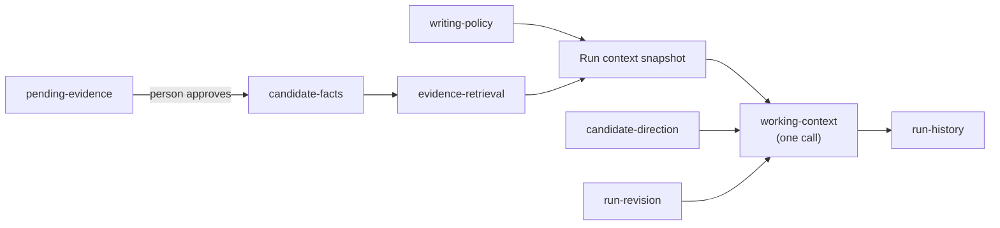
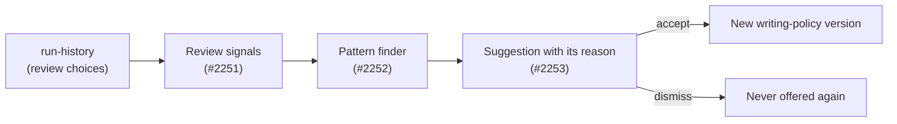

# Memory model

This page is for a developer or coding agent changing code that stores or
reads context for a run. It names every kind of memory DraftLoop has, who
writes and reads it, and the rules every kind follows.

The catalog in code is
[`packages/domain/src/memory-model.ts`](../../packages/domain/src/memory-model.ts).
A test keeps the [table below](#memory-kinds) and the catalog in step, so
change both together.

## Contents

- [Rules](#rules)
- [Memory kinds](#memory-kinds)
- [Where each kind enters a run](#where-each-kind-enters-a-run)
- [Planned: preferences learned from review](#planned-preferences-learned-from-review)
- [Gaps and plan](#gaps-and-plan)

## Rules

- **Facts need a citation.** A candidate fact reaches a draft only with a
  reference to the evidence that supports it.
- **Learned items are never facts.** Anything DraftLoop learns from use is a
  preference or a lesson. It can change how a draft is written, never what it
  claims.
- **The person sees and edits every long-term item.** Facts, writing policy
  and pending evidence all have a screen or command.
- **Content stays out of traces.** A kind that may quote candidate content
  stays out of diagnostics, retry feedback, logs and run events. Those carry
  codes, counts and ids only.

## Memory kinds

Lifetime is how long an item lives: one model call, one run, a workspace, or
the candidate's whole record. The writer is `system` (DraftLoop or an agent),
`person`, or `person-confirmed` (proposed by the system, kept only after the
person approves).

<!-- memory-kinds:start -->

| Kind | Lifetime | Writer | Candidate content | Owning module |
| --- | --- | --- | --- | --- |
| `working-context` | call | system | yes | `packages/domain/src/context-snapshot-references.ts` |
| `run-revision` | run | system | yes | `packages/application/src/author-revision-memory.ts` |
| `candidate-direction` | run | person | yes | `packages/application/src/candidate-direction.ts` |
| `evidence-retrieval` | run | system | yes | `packages/application/src/candidate-knowledge-retrieval.ts` |
| `candidate-facts` | candidate | person-confirmed | yes | `packages/domain/src/canonical-candidate-profile.ts` |
| `pending-evidence` | candidate | system | yes | `packages/application/src/work-journal.ts` |
| `writing-policy` | workspace | person | yes | `packages/application/src/writing-policy-file.ts` |
| `run-history` | workspace | system | yes | `packages/storage-postgres/src/run-history.ts` |

<!-- memory-kinds:end -->

What each kind holds:

- **`working-context`:** what one author or critic call receives, built from
  the run's pinned context snapshot. It is gone when the call ends.
- **`run-revision`:** the last rejected author proposal for a run and round,
  in process only. It is never persisted; after a restart, retries fall back
  to content-free feedback.
- **`candidate-direction`:** the person's own steering for one revision
  round. It is not evidence, so grounding review still applies.
- **`evidence-retrieval`:** the evidence chunks retrieved for a run, lexical
  by default and semantic when the workspace opts in.
- **`candidate-facts`:** the reviewed career profile with citations, drawn
  from the knowledge base ([ADR 0007](../adr/0007-portable-candidate-knowledge-store.md)).
- **`pending-evidence`:** work journal notes from a coding agent, waiting in
  an inbox until the person approves them as evidence. Confirmed career
  interview topics take the same path.
- **`writing-policy`:** forbidden terms, section order and style preferences.
  Each run pins and enforces one version.
- **`run-history`:** runs, rounds, findings, decisions and artifact versions,
  kept for review, comparison and the record archive. Its events and
  diagnostics are content-free.

[Candidate evidence](candidate-evidence.md) and
[drafting and review](drafting-and-review.md) describe the contracts behind
these kinds.

## Where each kind enters a run

## Planned: preferences learned from review

This loop is a plan (#2248), not current behaviour. Review choices become
suggestions, and only an accepted suggestion changes the writing policy.

## Gaps and plan

The [agent memory rollup](https://github.com/akoita/draft-loop/issues/2248)
holds the ordered issues. In short:

- Review choices never become reusable preferences yet (#2251–#2253).
- The critic never learns its false positives (#2254).
- The agent channel cannot search career evidence (#2255, deferred).
- Past approved drafts are never recalled as examples; this waits for the
  quality gate (#1309).
