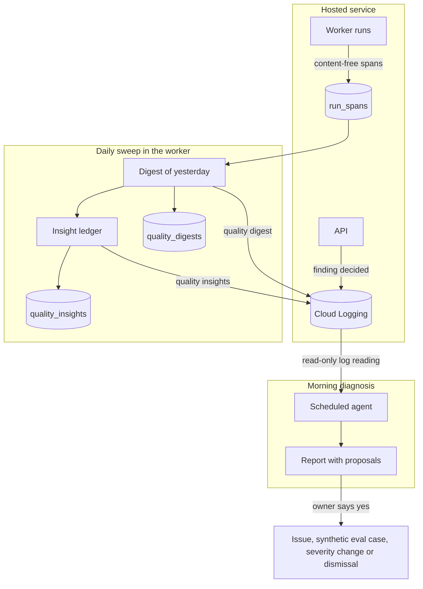
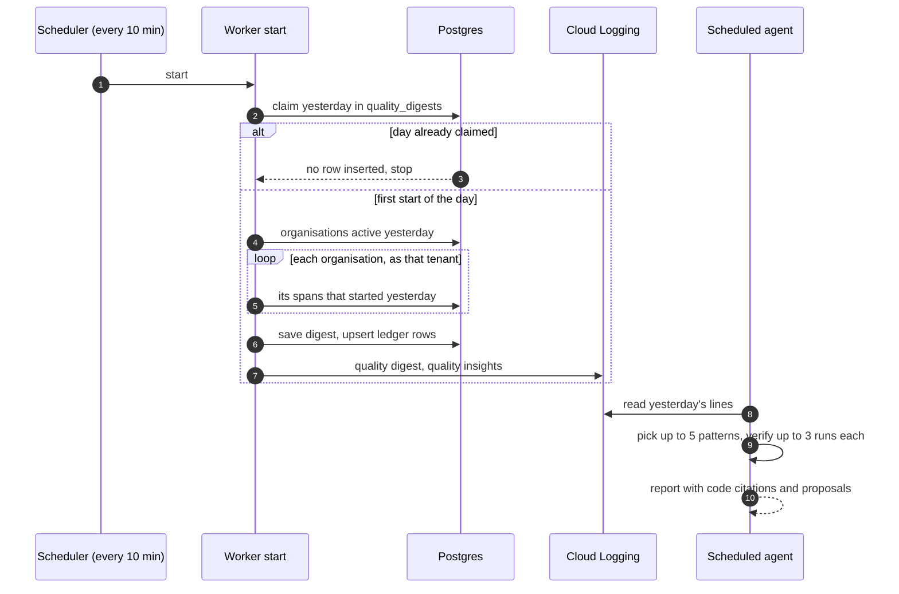
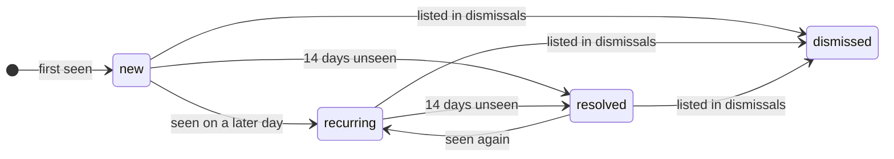

# Outer loop: production quality diagnosis

For a maintainer or operator who wants to know how DraftLoop finds recurring
quality problems in production runs, and how to act on what it reports.

The outer loop watches finished production runs, groups their failures into
patterns, and proposes fixes for a person to accept. It never sits in a run's
path, never reads candidate material, and never files an issue or changes code
on its own. Rollup: #2914.

## How it works

| Part      | What it does                                                                             | Where                                                 |
| --------- | ---------------------------------------------------------------------------------------- | ----------------------------------------------------- |
| Signals   | Spans per author, critic, revision and retrieval call; one log line per finding decision | [Run traces](runtime-and-trust.md#run-traces)         |
| Digest    | Reduces one UTC day of spans to counts, codes, model ids and sample run ids, plus output quality by model pair, step latency, and week-over-week trends for both | `packages/application/src/quality-digest.ts`          |
| Ledger    | Tracks each pattern's status across days                                                 | `packages/application/src/quality-insights.ts`        |
| Sweep     | Builds the digest, updates the ledger, logs both                                         | `apps/worker/src/quality-digest-sweep.ts`             |
| Storage   | `quality_digests` and `quality_insights`, deployment-wide, content-free                  | `packages/storage-postgres/src/quality-digests.ts`    |
| Diagnosis | Verifies patterns, cites code, proposes outputs                                          | An operator's scheduled agent; not in this repository |

## One day

- **Once a day.** The worker already starts every 10 minutes. The first start
  after midnight UTC claims the previous day by inserting its row, so only one
  start builds it.
- **Tenant isolation.** Spans are read one organisation at a time, acting as
  that organisation, so row-level security still applies. Only counts leave.
- **Failure.** A sweep error is logged as `quality digest failed` and never
  touches a run. The day stays claimed, so it is not retried.

## Pattern statuses

Each pattern is keyed by its mechanism, for example
`failure:author:<model>:invalid-response:max_tokens`,
`patch-rejection:<code>`, `retrieval:empty` or `retrieval:single-source`.
A quality drop is `quality-drop:<ready-rate|readiness>:<author model>:<critic
model>`: the last seven days fell more than 5% against the seven before, with
at least five evaluated runs in each week.

A latency rise is `latency-rise:<operation>:<step>:<model>`: the step's p95
duration over the last seven days rose more than 25% against the seven before,
with at least ten finished spans in each week. The weekly p95 is the
span-weighted mean of the daily p95s, so it is an approximation.

A `recurring` pattern stays `recurring` each day it is seen, and a `dismissed`
one stays `dismissed` even when it is seen again. Dismissals live in
`qualityInsightDismissals`.

The diagnosis reports only `new` and worsening `recurring` patterns, so a
known problem is not reported every morning.

## Privacy

- **Content-free.** Spans accept only listed attribute names with short
  identifier values. The digest and the ledger hold codes, model ids, counts
  and at most three run ids per pattern.
- **No member text.** The finding decision log line carries the finding code,
  category, severity and decision, never the finding message or the member's
  rationale.
- **No transcripts to a model.** The diagnosis reads these signals and the
  source code only. It never sends a run's material to a model.
- **Public issues.** A proposed issue is anonymised: codes, counts, versions
  and code citations. Run ids stay in the private report.
- **Checked by code.** The diagnosis runs every draft through
  `node scripts/public-text-check.mjs --strict` before showing it, and again
  on the approved text. Strict mode also refuses quoted passages and pasted
  log lines, so an issue describes a log in codes and counts, never copies it. The Public text check workflow scans every issue, PR,
  comment, review and PR commit message after posting, with a private
  deny-list from the `PUBLIC_TEXT_DENYLIST` secret. A hit fails the run and
  labels the item `privacy-check`; the log never prints the value.

## Act on a report

| You want to                           | Do this                                                                                                             |
| ------------------------------------- | ------------------------------------------------------------------------------------------------------------------- |
| Fix a pattern                         | Say yes to the proposed issue; it is filed and linked to the pattern                                                |
| Stop a pattern being reported         | Add its key, a reason and any issue number to `qualityInsightDismissals` in a PR; the next sweep marks it dismissed |
| Turn a failure into a regression test | Accept the proposed synthetic eval case; it reproduces the failure's shape with fictional data                      |
| Change a finding's severity           | Accept the proposal after it is checked against the labelled failure taxonomy (#1105, #1106)                        |

## Check that it runs

On a deployed environment, read the worker's logs for the last day with the
filter `jsonPayload.message="quality digest"`. Expected: one line per day
after the first worker start past midnight UTC. If there is none, look for
`quality digest failed` with the same filter style. A day with no runs still
produces a digest with `runs: 0`.
