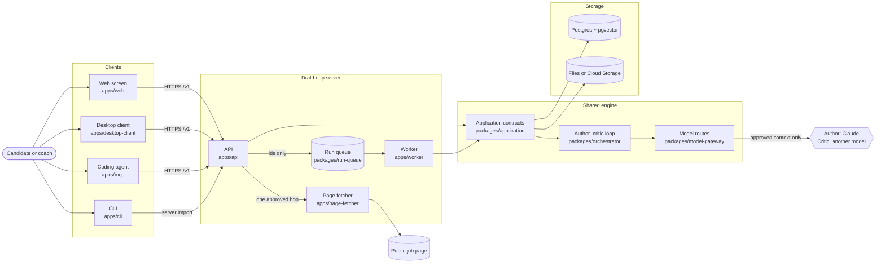
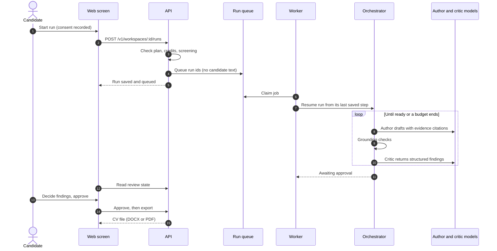
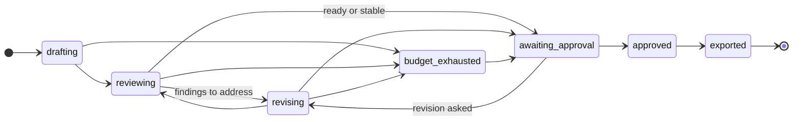
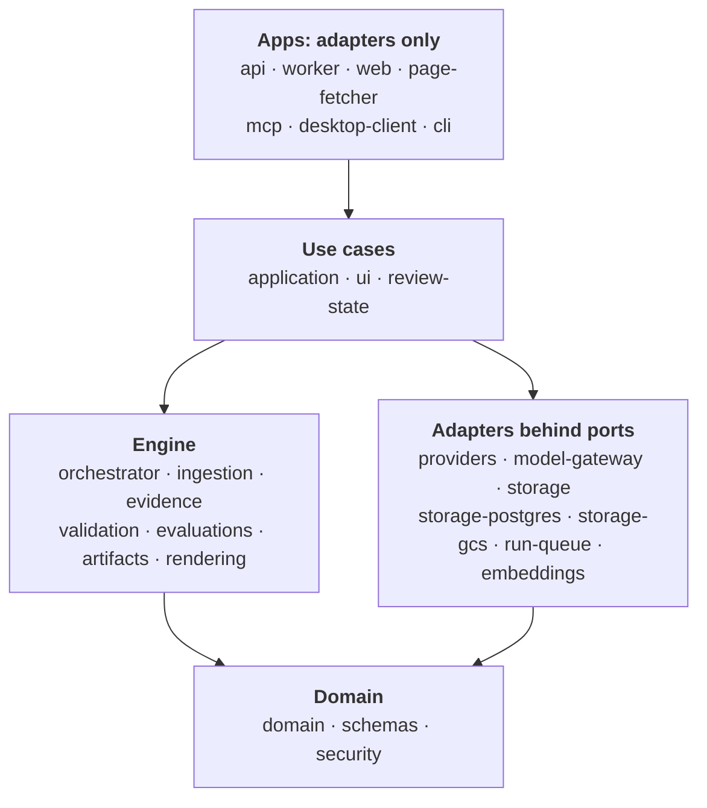
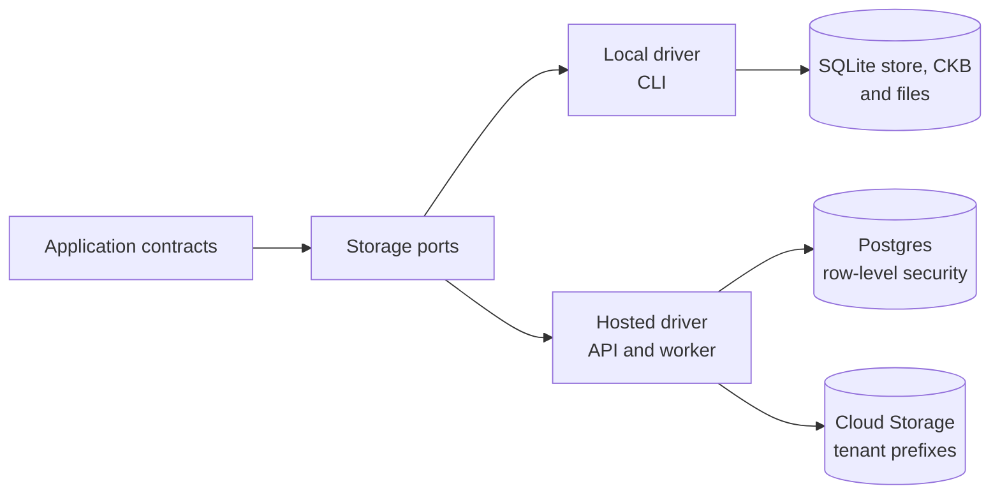

# Architecture

DraftLoop is a multi-model drafting and review workspace that keeps candidate
material under the candidate's control. Its first artifact is a job-specific
CV: an author model drafts from the candidate's evidence, an independent critic
reviews the draft, and the candidate approves the result before anything is
exported.

This page is the map. Each section ends with a link to the page that holds the
detail.

## Contents

- [Ways to run](#ways-to-run)
- [The system at a glance](#the-system-at-a-glance)
- [How a run works](#how-a-run-works)
- [Packages by layer](#packages-by-layer)
- [Storage behind ports](#storage-behind-ports)
- [Trust boundaries](#trust-boundaries)
- [Where to read more](#where-to-read-more)
- [Current limitations](#current-limitations)

## Ways to run

One set of packages runs in four ways, which differ only at their adapters
([ADR 0011](../adr/0011-client-server-version.md), D15):

| Way to run | Status | Clients | Storage and keys | Model routes |
| --- | --- | --- | --- | --- |
| Self-hosted server ([guide](../operations/self-hosted.md)) | Main local option | The web screen in a browser, the CLI's `server import`, coding agents through `draftloop-mcp` ([agent channel](../reference/agent-channel.md)) | Postgres with pgvector and files in Docker volumes; keys from local files | `direct` Claude and OpenAI routes, or an OpenAI-compatible local model |
| Desktop client ([guide](../reference/cli-and-desktop.md#desktop-client)) | Alpha (v0.9.0) | An Electron window over a self-hosted server's own web screen, and the hosted service's once it opens | None of its own: the server's storage and keys; the owner token is remembered in the system keychain | The server's |
| CLI | Source only | Terminal commands | A local SQLite workspace store and portable CKB | Anthropic and OpenAI SDK adapters, plus opt-in development authors |
| Hosted service | In development, staging only | The web screen | Cloud SQL Postgres and Cloud Storage in the EU, per-tenant encryption | Claude on Vertex AI in the EU and OpenAI's EU endpoint through the model gateway |

The self-hosted server and the hosted service run the same images. Only their
adapters differ: keys from local files or Secret Manager, files on disk or
Cloud Storage, `direct` model routes or Vertex AI in the EU.

The desktop is a client of the server beside the web (ADR 0011, D9). The v0.8
desktop with its own local engine is retired; `draft-loop server import` moves
its workspaces to a server.

## The system at a glance

- **Clients** hold no domain logic. The web screen and the desktop share their
  screens (`packages/ui`), the desktop client is an Electron shell over the
  server's own web screen, and coding agents reach the API through the
  `draftloop-mcp` server ([agent channel](../reference/agent-channel.md)).
- **The API** is a Fastify adapter over the application contracts, with
  Zod-typed `/v1` routes and a committed OpenAPI document. It saves a run and
  queues only its ids.
- **The worker** claims queued runs and resumes each from its last saved step,
  so a crash or a usage limit does not lose work.
- **The page fetcher** is the only runtime that reaches public web servers. It
  makes one hop of an approved job page and holds no database, secret or
  candidate material.
- **Model routes** are the only way out to a model provider, and every call
  records its company, model and route.

Detail: [Hosted service](hosted-service.md).

## How a run works

Before a run starts, the candidate reviews two inputs: a **job brief**
extracted from the job post, and a **career profile** derived from the selected
career evidence. The run then moves through these states:

Any active state can also pause, stop, or move to `provider-error` for an
explicit retry. A run never claims readiness while a high-severity factuality
finding is unresolved.

Detail: [Runtime and trust](runtime-and-trust.md) for the loop and its states,
and [Drafting and review](drafting-and-review.md) for grounding, critique and
rendering.

## Packages by layer

Dependencies point inward: apps depend on the use cases, which depend on the
engine and on adapters behind ports, which depend on the domain.

| Package | Owns |
| --- | --- |
| `domain`, `schemas` | Framework-free concepts and workflow states; Zod schemas for persisted and exchanged data |
| `security` | Data classifications, retention policies and redaction rules |
| `application` | Adapter-neutral use cases (`ApplicationService`) and the local and hosted drivers |
| `orchestrator` | Author–critic sequencing, budgets, pause, stop and recovery, through ports only |
| `ingestion`, `evidence` | Approved file and URL intake, extraction, provenance and source references |
| `validation`, `evaluations` | Deterministic checks, rubric findings and structured critique records |
| `artifacts`, `rendering` | Approved structured output and Markdown, DOCX and PDF rendering |
| `providers` | Provider identity, SDK translation, data-policy enforcement and model calls |
| `model-gateway` | The server's model routes: Claude on Vertex AI in the EU, the opt-in Claude API fallback, the critic's routes, the self-hosted `direct` routes, provider keys and the injection screener |
| `storage` | Storage ports, the SQLite workspace store and the portable candidate knowledge base (CKB) |
| `storage-postgres`, `storage-gcs` | The server's implementations of those ports on Postgres and Cloud Storage |
| `run-queue` | The durable run, brief and profile queues on Postgres (pg-boss), with ids-only payloads |
| `embeddings` | Local text-embedding runtimes and the pinned model manifest |
| `ui` | The screens the desktop and the web share, and the capability port they reach their host through |
| `review-state` | The host-side projection of a run into the shared screens' review state |

The apps are described in [The system at a glance](#the-system-at-a-glance).
The rules each package follows, such as which ones the desktop never depends
on, are in the repository's `AGENTS.md`.

## Storage behind ports

Application code names storage ports, never SQLite or Postgres. The local
driver keeps a workspace in SQLite and files; the hosted driver runs the same
code over Postgres and Cloud Storage without touching the filesystem. One
conformance suite checks both.

In the hosted service, every table carries `tenant_id` under forced row-level
security, every stored object sits under its tenant's prefix, and each request
is served from its caller's tenant.

Detail: [Storage and tenancy](storage-and-tenancy.md).

## Trust boundaries

- **Models see only approved context.** The provider adapters are the only
  model-facing boundary. They enforce the approved data policy and never store
  hidden chain-of-thought or raw provider payloads.
- **Untrusted text is screened first.** Job posts and uploads are screened for
  prompt injection, and quarantined material reaches no model until an owner
  or admin releases it ([intake screening](hosted-service.md#intake-screening)).
- **Queue jobs carry ids, never candidate material.**
- **One runtime reaches the web**: the page fetcher, one approved hop at a
  time.
- **Nothing leaves without approval.** Exports need an approved run, and
  DraftLoop never submits applications, sends messages or publishes documents.
- **The desktop client holds no engine or keys.** It loads only its server's
  origin, sends other links to the system browser, and runs the page sandboxed
  without Node.js access.

Detail: [Runtime and trust](runtime-and-trust.md#trust-and-privacy-controls),
the [threat model](../security/threat-model.md) and
[ADR 0011](../adr/0011-client-server-version.md).

## Where to read more

| Page | Read it for |
| --- | --- |
| [Hosted service](hosted-service.md) | The run queue, model routes, run limits, the `/v1` API from setup to export, organisations and plans, intake screening |
| [Storage and tenancy](storage-and-tenancy.md) | Storage ports, local and hosted drivers, tenant isolation, blobs and run history |
| [Candidate evidence](candidate-evidence.md) | Job briefs, writing policy, the portable CKB, career profiles and retrieval in runs |
| [Drafting and review](drafting-and-review.md) | The evaluator–optimizer loop, grounding checks, critique, stopping decisions and rendering |
| [Runtime and trust](runtime-and-trust.md) | The author–critic loop, model profiles, workflow states, provider and export controls |
| [Client-server delivery plan](client-server-delivery-plan.md) | How the hosted service is being delivered |

## Current limitations

- The hosted service runs on staging only, and production is not open.
- Local vector and hybrid retrieval remain evaluation components; runs use
  lexical retrieval over the selected source versions.
- Rendering QA is bounded: OOXML cannot establish true office pagination or
  visual clipping, and the artifact model has no structured links or images.
