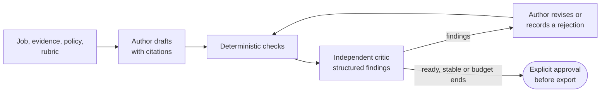

# Runtime and trust architecture

This page is the reference for the author–critic runtime and the boundaries
that keep it trustworthy. It covers model profiles and provider routes, the
workflow states, active-duration accounting, what reaches a provider, prompt
caching, the adapters, and exports. It is written for a developer or coding
agent changing `packages/orchestrator`, `providers`, `application` or an
adapter.

Use the [architecture overview](overview.md) for the system map. Related pages:

- [Candidate evidence](candidate-evidence.md): sources and profiles
- [Drafting and review](drafting-and-review.md): prompts, grounding, critique
  and rendering
- [Privacy and evaluation policy](../security/privacy-and-evaluation.md) and
  [threat model](../security/threat-model.md): the wider trust controls

## Author–critic loop

1. A workspace holds a job, a selected knowledge base (or legacy evidence
   folder), instructions, a truthfulness policy and a readiness rubric.
2. Selected sources are ingested and normalized into a canonical evidence base.
3. The author drafts, with evidence references on important claims.
4. The independent critic gets the same inputs, the draft and the rubric. It
   returns structured findings, never an untracked rewrite.
5. The author revises each finding, or records a visible rejection.
6. The loop repeats within the round, cost and time budgets.
7. Deterministic checks run, open disagreements are shown, and export needs
   explicit approval.

- **Default pair.** One Anthropic model and one OpenAI model, with swappable
  roles. A same-company pair is shown and warned about.
- **History.** Provider identity and model version are recorded in run history.
- **Prompts and caps.** The author template versions, their output caps and
  the critic's contract are in
  [Drafting and review](drafting-and-review.md). Every live author request
  carries its template's cap in both its prompt budget and its transport
  settings, and a resumed run keeps its original template and cap.
- **Usage checks still enforce the cap.** Claude reports
  [cumulative usage across a call](https://code.claude.com/docs/en/agent-sdk/cost-tracking),
  so a token-budget failure alone does not show the size of the final JSON.

## Model profiles

A **model profile** is a versioned provider and model identity. It holds a
tier, the roles it supports, runtime controls for effort, output and thinking,
and declared limits. The framework-free contract is in
`@draft-loop/domain/model-profile` and `@draft-loop/schemas/model-profile`.

- **Limits.** Validation keeps the output ceiling within the model's output
  limit, and a thinking budget within that ceiling. A context-window limit is
  separate.
- **`provider-default` effort** means the adapter omits its effort override. It
  makes no numeric or capability promise.
- **The registry.** `@draft-loop/application/model-profiles` exports
  `createModelProfileRegistry` and `defaultModelProfileRegistry`. It resolves an
  exact profile ID and version for a role, and never picks the latest version
  or falls back. Inputs and results are detached copies.
- **Historical profiles.** `legacy-anthropic-author@1` (Anthropic's
  `claude-sonnet-4-5` alias) and `legacy-openai-critic@1` (OpenAI's
  `gpt-5.6-luna` alias) stay registered so old runs resume. Their limits were
  verified on 2026-09-30. Aliases do not pin provider-side weights, or claim
  availability or quality.

The current presets and catalog are listed in the
[CLI reference](../reference/cli-and-desktop.md#cli-model-profiles).

### Routes that support profiles

Before an SDK call, the adapter checks that the configured and requested
profile snapshots match. Provider-default controls stay omitted.

| Route                         | Profile support                                                                                                                                                                                                                     |
| ----------------------------- | ----------------------------------------------------------------------------------------------------------------------------------------------------------------------------------------------------------------------------------- |
| Anthropic API key             | Output budget, effort and supported thinking controls                                                                                                                                                                               |
| Anthropic Claude user session | Output budget and effort. Budgeted or disabled thinking only for the verified Sonnet 4.5 alias and snapshot. Inherited CLI control overrides are removed first ([environment variables](https://code.claude.com/docs/en/env-vars)). |
| OpenAI API key                | Output budget and reasoning effort. Thinking must stay `provider-default`.                                                                                                                                                          |
| OpenAI Codex user session     | Rejected before launch, because there is no verified generation-output cap                                                                                                                                                          |
| Local adapter                 | Rejected before invocation, because profile controls are not implemented                                                                                                                                                            |

**Codex** profiles stay unavailable until a cap can be verified and built
([#674](https://github.com/akoita/draft-loop/issues/674)). On 2026-09-30 the
[Codex configuration reference](https://developers.openai.com/codex/config-reference/)
had no generation-output cap, for installed CLI 0.159.1. Its post-generation
usage check is a legacy acceptance check, not a cap. An unsupported route is
refused visibly, and transports, authentication and providers are never
switched automatically.

### How a profile binds to a run

- **Resolved once.** `begin` and `start` accept exact author and critic profile
  references. The registry resolves each once, and the full snapshots join the
  run context before its inputs are saved.
- **Run only.** A profile replaces the workspace pair for that run, and never
  reconfigures the workspace.
- **Caps.** The author prompt and request use the recorded output cap, and the
  critic request uses its own.
- **Resume** checks the saved route against the current authentication settings,
  without the registry, then continues with the context's provider, model and
  controls.
- **No profile.** Runs without profile references use workspace settings.

### Reasoning levels in the run snapshot

Each run records both roles' resolved profiles, runtime controls included, in
its context snapshot.

- **Choosing a level.** A saved pair, an application's pair or a run start may
  choose a level per role, from the levels the catalog lists for that exact
  version (`model-profile-efforts.ts`).
- **Applied at resolution.** The level is applied when the profile is resolved,
  so the snapshot holds the level the run actually used.
- **Reused.** Resume reuses it, and the review screens read it from the
  snapshot.

## Workflow state machine

Each transition emits an auditable event, and keeps the relevant inputs,
outputs, evidence links and user decisions.

| State               | Meaning                                                            | Allowed next states                                                                                                             |
| ------------------- | ------------------------------------------------------------------ | ------------------------------------------------------------------------------------------------------------------------------- |
| `collecting`        | Workspace inputs are being assembled                               | `ingesting`, `paused`, `stopped`                                                                                                |
| `ingesting`         | Selected material is being normalized                              | `drafting`, `collecting`, `paused`, `stopped`                                                                                   |
| `drafting`          | The author is creating a draft                                     | `reviewing`, `paused`, `stopped`, `budget-exhausted`                                                                            |
| `reviewing`         | The critic is producing structured findings                        | `revising`, `awaiting-approval`, `paused`, `stopped`, `budget-exhausted`                                                        |
| `revising`          | The author is addressing accepted findings                         | `reviewing`, `awaiting-approval`, `paused`, `stopped`, `budget-exhausted`                                                       |
| `provider-error`    | A provider request failed, and safe recovery metadata is available | The same active step on retry (at most three attempts), `awaiting-approval` when an artifact can return to review, or `stopped` |
| `awaiting-approval` | Checks are complete, and the user must decide                      | `approved`, `revising`, `paused`, `stopped`                                                                                     |
| `approved`          | The user approved the current artifact                             | `exported`, `revising`                                                                                                          |
| `exported`          | An approved artifact was rendered                                  | none                                                                                                                            |
| `paused`            | The user suspended the run                                         | `collecting`, `drafting`, `reviewing`, `revising`, `awaiting-approval`, `stopped`                                               |
| `stopped`           | The user ended the run                                             | none                                                                                                                            |
| `budget-exhausted`  | A round, cost or time budget ended the loop                        | `awaiting-approval`, `revising`, `stopped`                                                                                      |

The loop enters `awaiting-approval` in four cases:

- the readiness criteria are met
- quality is stable across the configured rounds
- the user reviews early
- a budget ends

Readiness is never claimed while any of these is open:

- a high-severity factuality issue
- a critical requirement with no explicit gap
- a newly introduced unsupported claim

`provider-error` stays a distinct state across every boundary. A retry never
widens the acknowledged transmission scope.

### Active provider-duration accounting

With `maxDurationMs` set, each `RunSnapshot` keeps a `durationAccounting`
record, holding accumulated active milliseconds and `activeSince` (or `null`).

| Accrues time                                                                  | Does not accrue time                                                                     |
| ----------------------------------------------------------------------------- | ---------------------------------------------------------------------------------------- |
| `drafting`, `reviewing`, `revising`, including the provider calls inside them | Awaiting approval, pause, provider-error retry waits, budget exhaustion, terminal states |

- **Segments.** A new run starts active at `startedAt`. Leaving active work
  settles the segment, and a retry, a resume or a revision request starts a new
  one. Nothing uses timers or cancellation.
- **Old snapshots** use wall-clock time from `startedAt`, until a safe
  transition saves the migrated record.
- **Safety.** Malformed accounting fails closed at the duration budget, and a
  clock that goes backwards never reduces accumulated time.
- **Scope.** Only duration is measured this way. Round, cost, retry and
  cancellation rules are unchanged.

## Trust and privacy controls

- **Recoverable, without hidden reasoning.** Evidence links, structured
  findings, approved versions, revisions, decisions, provider and model
  identity, usage and checksums stay recoverable, and hidden chain-of-thought
  is never stored.
- **No raw payloads in logs.** Raw prompts and provider responses are never
  operational-log or audit payloads.
- **An explicit data policy.** Every provider call needs one, and local
  retention settings are visible per workspace.
- **Human approval** is mandatory.
- **Out of scope.** Job discovery, application submission and uncontrolled
  research are not part of the product.

The [threat model](../security/threat-model.md) and the
[privacy and evaluation policy](../security/privacy-and-evaluation.md) hold the
trust boundaries, redaction rules, retention defaults and evaluation gates.

### What reaches a provider

Before transmission, the author and critic share a projection of the local
context. The stored snapshot and its provenance are never rewritten, and the
transmission policy still applies.

| Item                                                                | Sent as                                                                                                                                                                      |
| ------------------------------------------------------------------- | ---------------------------------------------------------------------------------------------------------------------------------------------------------------------------- |
| Source manifest paths                                               | Opaque ordinal labels such as `evidence-source-1`, never filenames, locations or URLs                                                                                        |
| Source IDs, checksums, other manifest metadata, candidate fact text | Unchanged                                                                                                                                                                    |
| Artifact evidence references                                        | Logical source labels. Matching manifest references reuse their label, and others get opaque labels in first-occurrence order. Excerpts, locators and checksums stay intact. |
| Knowledge selection and operator lineage                            | Omitted                                                                                                                                                                      |
| A retrieved chunk                                                   | Its id, a run-local source alias (`S1`, `S2`, …), its line numbers and its text. The checksum, workspace id, rank and ordinal stay local.                                    |

**Evidence tables.** Provider-facing artifacts use
`evidenceEncoding: reference-table-v1`. Each claim's ordered
`evidenceReferenceIds` resolves to one entry in the artifact's
`evidenceReferences` table.

- **Deduplicated.** Identical references appear once, while distinct
  checksums, locators and excerpts stay distinct, and every full excerpt is
  kept.
- **Where it applies.** The critic's artifact and the author's prior draft both
  use this encoding, after path projection.
- **Separate ids.** Table IDs are separate from the retrieved-evidence chunk IDs
  in author proposals. Stored artifacts keep their original references, and the
  model instructions explain how to resolve the table.

### Claim coverage rules

Author validation requires substantive claim coverage for factual block text.
A few narrow rules refine it:

- **Skills labels.** In Skills blocks, the exact leading label
  `Cloud and DevOps:` counts as presentation when content and a claim follow.
  Every listed technology still needs coverage and evidence. Arbitrary labels
  and proficiency claims get no exemption.
- **Emphasized names.** A protected multiword name may match same-line evidence
  with balanced Markdown strong emphasis around single words. Word identity and
  order are kept. Separate lines are never joined, and arbitrary punctuation,
  escaped markers and code literals are never ignored.
- **Software phrases.** Closed contexts tell an opening transition, API
  authentication and an opening pair of tools apart from compound names. The
  resulting names still need whole-word support, and employer, title,
  linking-word, number and date checks stay in force.

## Provider calls and prompt caching

Live provider execution is opt-in, and the provider boundary enforces the data
policy before the SDK call.

**Every call is stateless.** Each round resends the system prompt and the full
input, and no provider-side conversation is reused. Inputs list the run-fixed
members first, then the per-call members:

| Run-fixed (shared prefix)                                                                             | Per call                                     |
| ----------------------------------------------------------------------------------------------------- | -------------------------------------------- |
| Context, retrieved evidence, the achievement plan, and the author's grounding guide and output budget | Run, round, execution, artifact and findings |

Providers with automatic prefix caching can reuse that shared prefix. These are
Mistral, Gemini, DeepInfra and Claude Code's own caching. Mistral requests also
carry an opaque cache key hashed from the context snapshot ID.

### Claude

Claude has no automatic prefix cache, so the Anthropic adapter, on the Claude
API and on Vertex AI, marks one.

- **Layout.** An author call sends the system instructions, then the run-fixed
  members as one block, with the request's only cache breakpoint. The call's own
  instructions (adjudication, retry, revision or patch) and the per-call members
  follow it. The words match what other providers get, and only their order
  differs.
- **Lifetimes.**

  | Role   | Lifetime                                            | Write price |
  | ------ | --------------------------------------------------- | ----------- |
  | Author | 5 minutes, since its calls land minutes apart       | 1.25× input |
  | Critic | 1 hour, since its calls bracket the author's drafts | 2× input    |

- **Keep-alive.** A lifetime counts from the start of each request, and a draft
  can run past five minutes. So, while a five-minute cached request is in
  flight, the adapter resends a copy with one output token every 3.5 minutes.
  The copy reads the prefix at the cache-read rate, and its usage joins the
  call's. A failed copy is ignored, and a request with budgeted thinking sends
  none.
- **Plan calls** send the same prefix as the drafts, with the plan instructions
  after it. The first plan call writes the cache, and the revision and every
  draft read it.
- **One output format.** Claude's cache also keys on the output format, so every
  author call asks for one object with a member per output (plan, draft and
  revision patch). Each call names its member, and the adapter returns only
  that.

### OpenAI

OpenAI's implicit cache writes every call's whole prompt, at a price above
uncached input, and reads it only for a full repeat. The OpenAI adapter
therefore turns it off. It caches only through an explicit breakpoint, keyed on
the context snapshot.

- **Critic calls** carry that breakpoint, or the Claude layout on a Claude
  critic. The plan review and every critique send the same instructions, output
  format and leading members: context, retrieved evidence and achievement plan.
  The plan review writes the prefix and every critique reads it.
- **Matching ids.** The review cites evidence by the ids the critiques use,
  never the author's short aliases, so the prefixes match.
- **Round-specific instructions.** Coverage-judgement and candidate-direction
  instructions vary by round, so they follow the breakpoint.
- **One format.** Every critic call asks for one format, with a member per
  output. The adapter returns the member the call named, and drops the empty
  coverage list of a critique that judged none.

### Decision models

`@draft-loop/providers/decisions` asks a fast judgment model small closed
questions about one input. It writes no text: the caller's code makes the
decision from the answers. Nothing calls it yet; the first planned uses are in
[#2247](https://github.com/akoita/draft-loop/issues/2247).

| Question  | Answer                                                    |
| --------- | --------------------------------------------------------- |
| Predicate | Probability that a statement holds                        |
| Choice    | One option of 2 to 255, with a distribution and confidence |
| Score     | A point on 2 to 10 ordered levels, with a distribution    |

`createDecisionModel` picks the vendor; Jev is the default.

| Vendor                 | Wire format                                  | Auth                    |
| ---------------------- | -------------------------------------------- | ----------------------- |
| `typesafe-jev`         | System One, `POST /v1/systemone`             | API key                 |
| `openai-decisions`     | `POST /v1/decisions`                         | API key                 |
| `microsoft-decision-1` | System One on a Foundry resource endpoint    | Entra ID token callback |

- **Policy first.** Each call needs a decision data policy naming the allowed
  vendors. A missing approval, an unlisted vendor or unacknowledged sensitive
  material is refused before anything is sent.
- **Checked both ways.** Questions are checked against the shared limits, and
  answers must match the questions asked: same names and kinds, offered
  options, probabilities between 0 and 1. A refusal counts as an answer.
- **Content-free errors.** Errors carry a code, status and request id, never
  the input or a response body.
- **Data location.** Jev runs in the US, with zero retention on enterprise
  plans only. On the hosted service it must not receive candidate material.

### Recorded usage and evidence

- **Input tokens** count everything a call carried, including cache reads and
  writes.
- **Cache counts.** Adapters that report cached and cache-write counts return
  them. The estimate prices each at its own rate: Claude's cache-read rate, and
  per profile, the write rate for the lifetime its role uses.
- **History.** Run history records the cache counts beside each execution's
  totals and on each plan-step call. A parity run can therefore report what its
  calls read back, instead of inferring it from cost.
- **Evidence sent.** Each completed author and critic execution records the
  evidence it was sent, as content-free references: source id, line range and
  rank, never the text. A recall miss can then be traced to retrieval or to the
  author from the saved run.
- **Comparison.** `evidenceUsage` in `packages/evaluations` compares a draft's
  claims with those references: chunks sent, chunks cited, uncited ranks, and
  claims outside the retrieved set.

### Run traces

The engine can emit content-free spans through a tracing port
(`packages/orchestrator/src/run-tracing.ts`). Without a tracer it records
nothing.

| Span | Opened for | Attributes |
| --- | --- | --- |
| `invoke_workflow` | Each advance of a run | Run id, last round |
| `invoke_agent` | Each author, critic or revision attempt | Step, round, attempt, provider, model, tokens, estimated cost, error type |
| `retrieve_evidence` | Retrieval inside an attempt | Chunk count |

- **Content-free.** Only listed attribute names are kept, and a string value
  must be a short identifier, so a prompt or a draft sentence is dropped.
- **Names.** Attributes follow the OpenTelemetry GenAI conventions where one
  exists, pinned to one version.
- **Plan.** Storing spans beside run history (#1103) and exporting them
  locally (#1104) are planned.

## Clients and adapters

Every client is an adapter over the shared application driver. The driver keeps
a workspace manifest beside its SQLite history, ingests selected sources, builds
context snapshots and drives orchestration.

| Client                                 | Where paths and files come from                                                    | Boundary                                                                                                                                                                                                          |
| -------------------------------------- | ---------------------------------------------------------------------------------- | ----------------------------------------------------------------------------------------------------------------------------------------------------------------------------------------------------------------- |
| CLI (`apps/cli`)                       | Intentional, runtime-only file and directory paths, and JSON manifests and patches | Local workspace, CKB store and provider keys from the environment                                                                                                                                                 |
| Hosted API (`apps/api`)                | Browser uploads and approved URLs only. No path crosses the API.                   | See [Hosted service](hosted-service.md)                                                                                                                                                                           |
| Web screen (`apps/web`)                | The browser's file picker, through the API                                         | Holds no domain logic or keys                                                                                                                                                                                     |
| Desktop client (`apps/desktop-client`) | The server's web screen                                                            | Holds no engine, storage or keys. It loads only its server's origin, sends other links to the system browser, and runs the page sandboxed without Node.js ([ADR 0011](../adr/0011-client-server-version.md), D9). |

**The same rules apply to every client.** The shared application boundary
applies the same approvals, lifecycle guards, network policy, ordering, and
complete-or-partial result contracts.

- **Opportunity briefs.** Provider extraction is enabled only by an explicit
  per-create approval.
- **Results.** Mutation results expose only opaque identities, statuses,
  timestamps, counts and bounded partial progress. Read-only inspections are
  fresh reads, not a shared snapshot.
- **Confirmation.** Archiving a CKB, and other destructive or externally visible
  operations, need explicit confirmation.
- **No silent widening.** Adapters never silently rewrite a workspace selection,
  or widen an approved source, URL or provider scope.

The CKB contracts are in
[Portable Candidate Knowledge Base](candidate-evidence.md#portable-candidate-knowledge-base),
and are canonical in [ADR 0007](../adr/0007-portable-candidate-knowledge-store.md).

## Exports

Approved artifacts render to Markdown, controlled DOCX or controlled PDF.
Immutable export records keep the artifact and template versions, the time, the
format, the MIME type and the checksum. Rendering is described in
[Drafting and review](drafting-and-review.md).

## Evidence levels

Contracts and tests for these components exist, but they are not integrated or
outcome-validated by that alone:

- additional artifact schemas
- multilingual templates
- portfolio ingestion
- a local endpoint adapter

The [roadmap](../roadmap.md) records each evidence level.

The `pilot` CLI command runs synthetic fixtures through the whole workflow:

- ingestion
- authoring
- independent criticism
- one bounded revision
- approval and export
- typed history and audit events

Its report holds only safe counts and identifiers. It validates the workflow
mechanics, not the quality of real applications.
