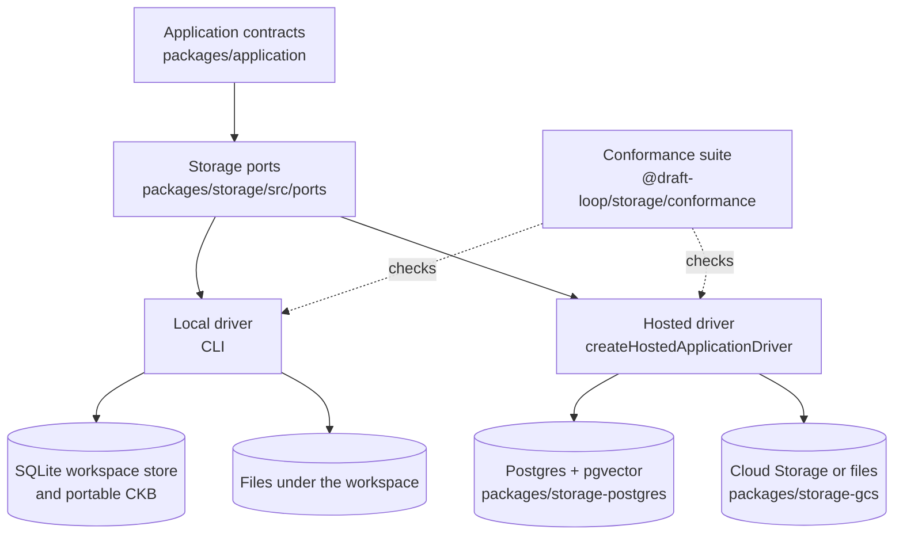
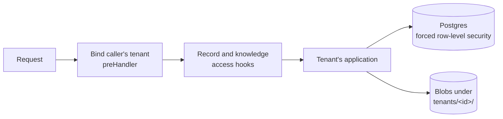

# Storage and tenancy architecture

This page is for a developer who changes how DraftLoop stores workspaces,
candidate knowledge, exports and run history, or how the hosted service keeps
tenants apart. Application code names storage ports only. A local driver and a
hosted driver implement them (ADR 0011, D3 and D15).

Start with the [architecture overview](overview.md) for the system map. The
hosted routes that use this storage are in [Hosted service](hosted-service.md).

## Contents

- [Storage ports](#storage-ports)
- [Postgres and the hosted driver](#postgres-and-the-hosted-driver)
- [Tenant isolation](#tenant-isolation)
- [Blobs on Cloud Storage](#blobs-on-cloud-storage)
- [Testing and running the stack](#testing-and-running-the-stack)
- [Run history](#run-history)

## Storage ports

The port interfaces and record types live in `packages/storage/src/ports/`.
Application modules name these ports, never the SQLite class.

| Port               | What goes through it                                                                         | Local implementation                                      | How another driver plugs in                       |
| ------------------ | -------------------------------------------------------------------------------------------- | --------------------------------------------------------- | ------------------------------------------------- |
| Storage factory    | Workspace history and records                                                                | `local-storage-factory.ts`, the one module opening SQLite | `withStorageFactory`                              |
| Workspace settings | Configuration, writing policy, and documents recording modes, model pair, consent, decisions | Files under `<root>/.draft-loop/`, written atomically     | `withWorkspaceSettings`                           |
| Workspace files    | A job description and source folder                                                          | `workspace-files.ts`                                      | `withWorkspaceFiles(noWorkspaceFiles, ...)`       |
| Knowledge store    | The stores a run's selection names (`openKnowledgeStore`)                                    | The store's folder                                        | `withKnowledgeStoreOpener`                        |
| Blobs              | Exported documents, read and checked by content checksum                                     | Today's export paths                                      | `packages/storage-gcs` on Cloud Storage           |
| Managed files      | Candidate-knowledge files keyed by source and version, checked by checksum and size          | The CKB's managed store                                   | Same port; backup and path lookup stay local-only |

Rules that cut across the ports:

- **Local-only maintenance:** only the local storage factory reaches SQLite
  backup, integrity checks and history compaction.
- **No local files:** a driver without them starts runs only from a reviewed
  job brief and a knowledge selection.
- **Run-only knowledge stores:** a non-local store offers just a run's
  operations (`@draft-loop/storage/run-knowledge-store`): readiness,
  sensitivity rules, pinned source bytes, and the lexical and vector
  projections. `runOnlyCandidateKnowledgeStore` refuses everything else.
- **Managed writes:** intake stages and verifies bytes, then publishes them
  without replacing an existing file, or rolls them back. Deletion stages a
  base's files away from their keys, then removes or restores them. Store-open
  recovery and the unknown-entry inventory use the same port.

`createHostedApplicationDriver` (`packages/application/src/hosted-driver.ts`)
is the shared driver over injected ports (ADR 0011, D15):

- It runs the local driver's code inside the four `with…` wrappers, so a call
  never touches the filesystem.
- Its workspace reference is an opaque absolute POSIX path, such as
  `/tenants/<tenant>/workspaces/<id>`.
- It offers workspace setup, job briefs, applications and runs; other methods
  refuse until an issue needs them.
- It never imports a Postgres or Cloud Storage package.

## Postgres and the hosted driver

A conformance suite, exported as `@draft-loop/storage/conformance`, checks the
contracts any implementation must honour. It runs against SQLite in
`pnpm test`. `packages/storage-postgres` passes the history, versioned-record,
application, knowledge-base, lexical-retrieval, vector-index and
workspace-settings groups.

Both stores share these rules, so they accept, hash, chain and audit records
the same way and differ only in their queries:

| Rules                                        | Module                                            |
| -------------------------------------------- | ------------------------------------------------- |
| Audit-trail hashing                          | `@draft-loop/storage/audit-trail`                 |
| Run records                                  | `@draft-loop/storage/history-records`             |
| Versioned-record chains                      | `@draft-loop/storage/versioned-records`           |
| Knowledge-source versions                    | `@draft-loop/storage/candidate-knowledge`         |
| Lexical index and retrieval traces           | `@draft-loop/storage/candidate-knowledge-lexical` |
| Vector validation, staleness and hit ranking | `@draft-loop/storage/knowledge-vector-rules`      |

How Postgres matches the local store:

- **Lexical ranking:** `@draft-loop/storage/lexical-ranking` tokenizes as
  FTS5's `unicode61` tokenizer does and computes `bm25()` in the application,
  over chunks Postgres selects through a GIN index (ADR 0011, D11). Parity
  tests check that both stores return the same chunks, order and scores.
- **Vectors:** stored as pgvector `vector` values and ranked exactly in the
  application. There is no approximate (HNSW) index: one person's knowledge
  base is small, and exact ranking keeps hits identical to the local index.
- **Workspace settings:** one row per document, keyed by workspace reference
  and document name.

The hosted pieces the worker composes per job, for the tenant the job names:

| Function                                                    | What it provides                                                                                                   |
| ----------------------------------------------------------- | ------------------------------------------------------------------------------------------------------------------ |
| `openPostgresCandidateKnowledgeStore`                       | One tenant's knowledge store for runs: records from Postgres, bytes from blob storage checked by checksum and size |
| `hostedWorkspaceHistory`                                    | One tenant's run history. Orchestrator state lives in `run_state_entries`, its key-value port                      |
| `hostedApplicationPorts`                                    | The hosted driver's ports over one tenant's Postgres and blob storage                                              |
| `hostedWorkspaceReference`, `hostedKnowledgeStoreReference` | The references the driver addresses                                                                                |

Postgres records the store, which versions the service holds bytes for and
where, and the versioned sensitivity rules, hashed as the local store does. A
hosted file source's origin is the upload, so it is ready once its latest
version's bytes are held. The legacy local evidence folder and semantic
retrieval traces refuse, since hosted runs take evidence from knowledge bases.

## Tenant isolation

### In the API

The API serves each request from its caller's tenant (ADR 0011, D6): a member
acts in their organisation, and the owner token in `DRAFT_LOOP_TENANT_ID`'s
tenant.

- **Shared resources:** one pool, one run queue and one bucket. A tenant's
  application is composed on its first request, with blobs under its prefix,
  and the 100 most recently used stay composed.
- **Binding:** a `preHandler` hook binds the tenant's application to the
  request's async context (`registerTenantApplications`). A route with no
  tenant bound fails with a server error rather than reach a default tenant.
- **Idempotency keys:** belong to the tenant, under row-level security in
  Postgres and scoped by tenant in the memory store.
- **Logs:** request lines carry tenant and member ids, never an email or token.

### Record and knowledge access

A refused record or base answers 404, like an unknown one.

| Rule                        | Sign-in mode                                                                                                                | Owner-token mode                                                | Code                                                     |
| --------------------------- | --------------------------------------------------------------------------------------------------------------------------- | --------------------------------------------------------------- | -------------------------------------------------------- |
| Who reaches a record        | Assigned members; owners and admins reach every record. `GET /v1/workspaces` lists what the caller reaches                  | The owner token reaches every record                            | `registerRecordAccess`, `recordAccessFor`                |
| Creating a record           | Assigns its creator before saving; concurrent creators of one record get one assignment, the rest a 404                     | No assignment                                                   | `assignCreator`                                          |
| Assigning members           | Owners and admins, through `/v1/workspaces/{workspaceId}/members`; assigned members only read. Each change is an audit line | Not used                                                        | `registerRecordMemberRoutes`                             |
| Who owns a knowledge base   | The record named at creation; access follows that record's                                                                  | The workspace it was created for (#1758)                        | `registerKnowledgeAccess`, `registerOwnerTokenKnowledge` |
| Listing and selecting bases | Only reachable bases list; a workspace selects only its own                                                                 | A workspace lists and selects only its own; the token lists all | as above                                                 |
| Erasing a record            | Erases the bases it owns                                                                                                    | Same                                                            | `knowledgeOwnersFor`                                     |

### Flow tests

| Test                                    | What it proves                                                                                                                     |
| --------------------------------------- | ---------------------------------------------------------------------------------------------------------------------------------- |
| `apps/worker/src/tenancy-flow.test.ts`  | Two organisations, from creation to export: neither's material reaches the other's provider requests, export or listings           |
| `apps/worker/src/coaching-flow.test.ts` | One owner and two coaches: each reaches only their record, uploads and runs wait for consent, a withdrawal stops the next run      |
| `apps/worker/src/erasure-flow.test.ts`  | Two records: each archive holds only its own material, erasing one leaves no trace of it, deleting the organisation leaves nothing |

### In Postgres

Postgres isolates tenants in shared tables (ADR 0011, D3):

- **Keys:** every table carries `tenant_id`, and every key and foreign key
  includes it, so tenants can reuse ids.
- **One pool:** `openPostgresTenancy` hands out a tenant's ports with
  `forTenant`. Each transaction sets `draft_loop.tenant_id`, which fills
  `tenant_id` on insert, so the pool never grows with the number of tenants.
  Tenant ports borrow the pool; `openPostgresStorage` opens one tenant over its
  own.
- **Row-level security:** forced, and compared on every read and write. The
  store refuses to open as a superuser or `BYPASSRLS` role.
- **Roles:** migrations run as the schema owner (`migratePostgresStorage`), and
  `grantPostgresStorageAccess` gives the runtime role table access only.

### Organisations, members and ownership

| Port                                                | What it records                                                                                                                                        |
| --------------------------------------------------- | ------------------------------------------------------------------------------------------------------------------------------------------------------ |
| `TenantDirectory` (`createPostgresTenantDirectory`) | Organisations (id = tenant id) and members with role `owner`, `admin` or `member`. An organisation always keeps an owner, and a person belongs to one  |
| `CandidateRecordAccess` (`candidateRecords`)        | Which members are assigned to which records. A record is a workspace named by its API id; assignments go when the member does                          |
| `KnowledgeBaseOwners` (`knowledgeBaseOwners`)       | The one record that owns each base, set once. If the API cannot record an owner for a new base, `removeUnowned` deletes it so none is left unreachable |

A member is invited by email and becomes active on the first sign-in with that
verified email, which binds issuer and subject. Resolving a sign-in is the one
cross-tenant read: it goes through `resolve_member_sign_in`, a
`SECURITY DEFINER` function owned by the migrating role, which the runtime role
may only execute.

## Blobs on Cloud Storage

`packages/storage-gcs` passes the `blobs` conformance group, which the
filesystem implementation also runs (ADR 0011, D3):

- **Keys:** a blob's location is its full object key, and every operation
  refuses a key outside `tenants/<tenantId>/`.
- **Reads:** put stores the content's SHA-256 as object metadata. Reads use it
  to skip replaced objects, then download that exact generation and hash it.
- **Deletes:** name the generation they verified, so a concurrent write
  survives.

## Testing and running the stack

| Command              | What it runs                                                                                                       |
| -------------------- | ------------------------------------------------------------------------------------------------------------------ |
| `pnpm test:postgres` | Postgres suites, including the run queue, worker and API idempotency store, against `DRAFT_LOOP_TEST_POSTGRES_URL` |
| `pnpm test:gcs`      | Cloud Storage suites against the emulator at `DRAFT_LOOP_TEST_GCS_URL`                                             |
| `pnpm server:up`     | Postgres, the emulator, the API and a worker with Docker Compose                                                   |
| `pnpm server:test`   | Both suites and an end-to-end smoke through the API only                                                           |

The CI `Server storage` job runs the first two against Postgres 16 with
`pgvector` and the `fake-gcs-server` emulator. The
[local server stack](../operations/local-server-stack.md) describes the stack
and its smoke.

`deploy/local/compose.yaml` runs the same services for real use on one machine,
with the `direct` model routes, files on disk and generated secrets. See the
[self-hosted server](../operations/self-hosted.md).

## Run history

Each immutable artifact ID begins its own version-1 lineage, and later rows
link by parent version. Run, execution, finding, decision and export references
stay valid, and update and delete triggers keep versions immutable. Before
inserting the latest artifact, the application checks workspace and context
identity and rejects missing or conflicting ancestors. It then projects
checksum-verified ancestry from durable run snapshots, parent first and
idempotently. Resume can complete an already-reviewed projection without
another provider call.

Run snapshot rows are slim. Each references its executions (ids plus a checksum
over their contents) and its draft (id, version, checksum) instead of embedding
them. The executions and the draft are stored once under the run store's keys.
`resolveSnapshotPayload` in the orchestrator is the single reader: it rebuilds a
snapshot, verifies the checksums and passes older full rows through unchanged.

`workspace compact` shrinks a workspace written before that shape. The
hash-chained history file is never edited in place:

1. Keep a verified backup.
2. Rewrite a copy: slim legacy rows, turn snapshot events into references,
   recompute the chain, and add a `workspace.history-compacted` event naming
   the old head.
3. Check the copy and swap it in.

The old chain survives whole in the backup.
