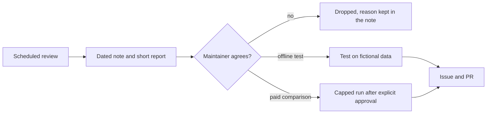

# Writing authenticity watch

For a maintainer who wants to know how DraftLoop keeps its cover letter help
current, and how to act on what the watch reports.

A letter written entirely by a model can be spotted by recruiters and
AI-detection tools and can count against the application (#3276). DraftLoop
therefore helps candidates write their own letter: a writing kit, a check of
their own text, and a warning before any full AI draft. The watch is a
scheduled review of new research that could make that help better, tracked
in issue #3283.

## What it reads

Twice a month a scheduled agent searches primary sources from the last
16 days in three areas:

| Area | Why it matters |
| --- | --- |
| Voice and style: writing samples, style transfer, human and AI co-writing | Ideas that help a person write faster in their own voice |
| AI-text detection and watermarking | Keeps the warning accurate and shows what reads as machine-made |
| Recruiter surveys, employer policies, rules on AI in applications | Keeps the warning and the user guide true |

It keeps only items that change the writing kit, the letter check, the
writing-tells rules (`packages/application/src/writing-tells.ts`) or the
warning, and labels each one as a direct claim, an adaptation or unverified.

## The boundary

The watch studies detection; it never games it. It does not propose ways to
make machine-written text pass a detector. That race cannot be won, and it
would mislead employers on the candidate's behalf. An idea is in scope only
when it makes the person's own writing easier or better.

## From finding to change

1. The review writes a dated note with a findings table, the tests it
   proposes and the items it rejected, with sources.
2. A maintainer reads the short report and decides what to test.
3. An offline test uses fictional data only. A paid comparison names its
   model and a US$ cap and waits for explicit approval.
4. Nothing is filed or merged by the watch itself.

Everything the watch fetches from the web is untrusted data. Text bound for
this repository passes `node scripts/public-text-check.mjs --strict` first.

## Related

- [Outer loop](outer-loop.md): the daily review of production run quality.
- [Application material](../reference/application-material.md): the Cover
  letter tab the watch serves.
