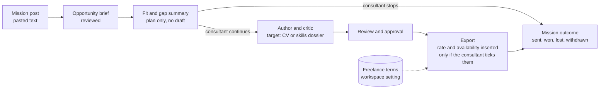

# Design: freelance mission dossiers

**Status:** proposal for [#1996](https://github.com/akoita/draft-loop/issues/1996).
Nothing here is built yet. The rollup's market test and the CV quality stage
(#1309) gate any build.

**Reader:** the maintainer deciding whether to admit #1996, and the developer
who then cuts it into issues. This page helps you choose how much new surface
a dossier needs and what to measure first.

**Recommendation:** treat a mission as an application of kind `mission`. Add a
plan-only fit and gap step that stops before drafting, and a skills-dossier
artifact rendered by new templates. Keep day rate and availability in a
workspace setting that is inserted at export time. It never reaches a model.

## Problem

A freelance consultant answers mission posts every week. Each answer needs a
fit and gap summary, then a CV or skills dossier tailored to the mission. Today
DraftLoop produces only a CV, and has nowhere to keep a day rate, availability
or the outcome of each mission.

From the issue:

- A mission post is mostly pasted text, because many sit behind a login.
- Every dossier claim is sourced from the career record and reviewed by the
  critic, then approved by the consultant.
- Day rate and availability are stored per workspace and offered, never sent
  without approval.
- The workspace keeps a history of missions answered.

**Gate:** one real mission dossier is produced with three or fewer edits
before sending, and every claim traces to the career record.

## What exists

| Piece                    | Where                                                                   | Fit for missions                                                                       |
| ------------------------ | ----------------------------------------------------------------------- | -------------------------------------------------------------------------------------- |
| Opportunity brief        | `opportunityBriefSchema` in `packages/schemas/src/index.ts`             | Role, requirements with priority, sourced items; fits a mission post as is             |
| Pasted job text          | `application create --job-text`, `POST /v1/workspaces/:id/applications` | The main mission path already works                                                    |
| Applications and status  | `packages/domain/src/application.ts`, `deriveApplicationStatus`         | One job source with briefs, runs and exports; status covers the CV pipeline only       |
| Gap themes               | `gapThemes` in `packages/schemas/src/application-plan.ts`               | The application plan already marks themes with `gap: true` and cites evidence          |
| Requirement coverage     | `requirement-achievement-plan.ts`, `run-coverage-judgement.ts`          | `uncoveredRequirementIds` and the critic's coverage judgement                          |
| Rendering templates      | `builtInRenderingTemplates` in `packages/rendering/src/templates.ts`    | `classic`, `compact`, `modern`; style only, all render the same CV sections            |
| Workspace settings       | `WorkspaceSettingsPort`, closed `workspaceSettingNames`                 | One JSON document per name, local file or Postgres row                                 |
| Entitlements and credits | ADR 0011 D13, `packages/domain/src/entitlements.ts`                     | One credit is about one reviewed CV; an included CV costs at most about half its price |

Two gaps matter most:

- A template changes only page, fonts, spacing, headings and accent. A skills
  dossier groups claims by skill and mission, so it needs its own artifact
  shape, not only a template.
- No user-facing step shows fit and gaps before a full run, which costs about
  US$3.60 today against a US$3 target (#1597).

## Options

### A. Template only

Add a "dossier" rendering template for the existing CV artifact.

- **For:** smallest change; no new author output.
- **Against:** the CV sections stay the same, so it is a restyled CV, not the
  skills grid consulting firms ask for. It gives no fit and gap summary and no
  mission history.

### B. Missions as applications, with a dossier artifact (recommended)

Add a `kind` to the application (`job` or `mission`), a plan-only fit and gap
step, a skills-dossier artifact the author can target, and a stored outcome.

- **For:** reuses briefs, runs, critic, review, approval and export. The plan
  step already computes most of the fit and gap data. One history of all
  applications, filterable by kind.
- **Against:** a new artifact shape touches the author prompt, validation,
  rendering QA and three export writers. The outcome field is new persisted
  data in both stores.

### C. A separate freelance module

Build missions, dossiers and rates as their own package and screens.

- **For:** no risk to the CV path.
- **Against:** duplicates the engine the issue says to reuse, and splits the
  candidate's history in two.

## Recommended design

Choose **B**, delivered in the order below. Each step is useful alone, so the
work can stop after any step that the walk does not justify.

### 1. Fit and gap summary

Run the application plan agent and requirement coverage, then stop. Show
covered requirements with the evidence they cite, and gaps with no evidence.
The summary says what is missing; it never proposes wording for a gap.

This step costs a fraction of a run, so it is a cheap filter before the
consultant spends a credit on a dossier. Measure its cost on synthetic
fixtures before giving it a credit price.

### 2. Freelance terms setting

Add `freelance-terms.json` to `workspaceSettingNames`, holding a day rate with
currency, availability (a start date and days per week) and optional notes.

- The author and critic never receive it. Export inserts it as a separate
  block, only when the consultant ticks it for that export, so no provider
  ever sees the rate.
- The hosted version names it in the consent text and retention policy before
  release, because a rate is new personal data.

### 3. Skills-dossier artifact

Add a second artifact shape the author can target: a short profile, a skills
grid where each skill cites evidence, and selected missions. It goes through
the same validator, critic and rendering QA as the CV. Add two dossier
templates styled like common consultancy layouts, with only synthetic
examples in fixtures.

### 4. Missions and outcomes

Add `kind` to the application, defaulting to `job` so every existing row is
unchanged. Add a stored, candidate-set outcome: `sent`, `won`, `lost` or
`withdrawn`, with a date. The derived pipeline status stays as it is.

## Risks

| Risk                                                          | Mitigation                                                                                         |
| ------------------------------------------------------------- | -------------------------------------------------------------------------------------------------- |
| Weekly use multiplies run cost above plan margins             | Fit and gap first; dossier runs priced only after #1597 passes                                     |
| The market is too small (median under three dossiers a month) | The no-code market test runs before any code, as the rollup requires                               |
| The rate leaks to a provider                                  | Never in run context; inserted at export; a test asserts no request contains it                    |
| A dossier claims skills with no evidence                      | Each grid cell cites evidence; the validator rejects uncited cells; gaps go to the summary instead |
| A new artifact shape regresses the CV path                    | Separate artifact type and tests; CV fixtures and evaluations must pass unchanged                  |
| Mission posts behind a login tempt a scraping feature         | Pasted text only; the page fetcher still reads approved public pages only                          |
| Outcome data adds retention scope                             | Covered by the same record archive and erasure as applications                                     |

## Test plan

All fixtures are synthetic: an invented consultant profile and invented
mission posts. No test calls a paid model.

| Layer            | Test                                                                                                        | Package                                         |
| ---------------- | ----------------------------------------------------------------------------------------------------------- | ----------------------------------------------- |
| Fit and gap      | A fixture brief and record give the expected covered and gap requirements; each covered item cites evidence | `packages/application`                          |
| Fit and gap      | The step stops before drafting and records no draft                                                         | `packages/application`                          |
| Terms setting    | The new setting name round-trips in the filesystem and Postgres drivers; unknown names are still refused    | `packages/storage`, `packages/storage-postgres` |
| Terms privacy    | With terms set, no author or critic request contains the rate or availability                               | `apps/worker`                                   |
| Terms export     | The block appears only when ticked, in DOCX, PDF and Markdown                                               | `packages/rendering`                            |
| Dossier artifact | Uncited skill cells fail validation; a valid dossier passes rendering QA in both templates                  | `packages/validation`, `packages/rendering`     |
| Applications     | Existing rows read as `job`; outcome changes are stored and listed by kind                                  | `packages/storage`, `apps/api`                  |
| Regression       | Existing CV evaluation fixtures pass unchanged                                                              | `packages/evaluations`                          |
| Gate             | Manual: one real mission, counted edits before sending, every claim traced                                  | evaluation record                               |

## Proposed issue order

1. The no-code market test and its record (no code).
2. Fit and gap summary, plan only.
3. Freelance terms setting with export insertion.
4. Mission kind and outcomes.
5. Skills-dossier artifact and templates, after #1309 and #1597 pass.
