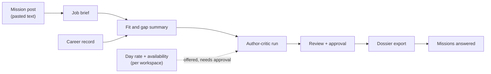

# Freelance mission dossiers: design proposal

**Status: proposal for [#1996](https://github.com/akoita/draft-loop/issues/1996).**
Nothing here is built. It is for the owner, who decides whether to admit the
rollup. Two conditions come first: a no-code market test, and the CV quality
stage ([#1309](https://github.com/akoita/draft-loop/issues/1309)) plus the run
cost target ([#1597](https://github.com/akoita/draft-loop/issues/1597)).

## Recommendation

Treat a freelancer as a candidate who applies weekly. Reuse the whole
author–critic workflow and add only four things: skills-dossier templates,
mission posts as input, a stored day rate and availability, and a history of
missions answered. No architecture change; it fits the Individual and Pro
plans ([ADR 0011, D13](../adr/0011-client-server-version.md#d13-plans-and-entitlements)).

## Before building

1. **Market test, no code.** Ask ten freelancers how many tailored CVs or
   dossiers they produce per month. A median under three stops this rollup.
2. **Quality and cost.** The CV quality stage has passed, and a run costs no
   more than the target in #1597. Weekly use multiplies run cost, so the
   dossier path must not cost more than a CV run.

## What is new, and where it lives

| Piece                     | Design                                                                                                                                                                  | Boundary                                                    |
| ------------------------- | ----------------------------------------------------------------------------------------------------------------------------------------------------------------------- | ----------------------------------------------------------- |
| Mission post input        | A mission is a job brief with a `mission` flavour. Pasted text is the main path; many posts sit behind a login. The page fetcher still reads only approved public pages | `packages/ingestion` brief intake, thin                     |
| Fit and gap summary       | Requirement coverage the run already computes, shown before the run starts                                                                                              | `packages/ui` summary over existing coverage data           |
| Dossier templates         | Layouts consulting firms ask for: a skills matrix, mission-by-mission experience, and a one-page summary. Modern stays the default CV export                            | `packages/rendering`, beside the CV templates (#1328–#1331) |
| Day rate and availability | Stored per workspace as profile fields, offered in the draft, never sent without approval                                                                               | `packages/application` feature module, `packages/schemas`   |
| Missions answered         | A per-workspace list of applications of the `mission` kind with their state                                                                                             | Reuses the applications list (milestone 28)                 |

## Rate and availability handling

- Stored as candidate-provided profile data, versioned like other profile
  facts.
- The draft shows them as suggested lines. The candidate approves each use;
  nothing is added silently.
- They are **not** sent to a model provider unless the candidate approves, and
  never when marked `sensitive` or `never-share`.
- The rate is a personal-data field. The hosted version names it in consent
  and retention before other users have it.

## Template format

A dossier differs from a CV in shape, not in evidence:

- A **skills matrix**: skill, years or recency, and a cited mission. Every
  cell links to a source fact; a skill without evidence is left out, not
  guessed.
- **Missions** replace job history: client sector (anonymised unless the
  candidate allows the name), period, context, role, result.
- Anonymisation is a candidate choice per mission. The default hides client
  names, since contracts often forbid naming them.

## Steps and child issues

Ordered, each admitted separately after the two conditions pass.

| #   | Outcome                                                    | Boundary                    |
| --- | ---------------------------------------------------------- | --------------------------- |
| 0   | Market test result recorded                                | owner, no repository change |
| 1   | Mission post as pasted input, with a fit and gap summary   | ingestion + `packages/ui`   |
| 2   | Day rate and availability stored per workspace and offered | schemas + application       |
| 3   | One dossier template in the rendering package              | `packages/rendering`        |
| 4   | Missions-answered history                                  | applications list           |
| 5   | Representative evaluation of one real mission              | evaluation, owner's run cap |

## Risks and limits

- **Quality is unproven.** #1309 is unmet; do not claim dossier quality
  before it passes.
- **Cost.** A weekly user triples monthly runs against the plan's CV
  allowance. Decide whether a dossier counts as one credit before pricing.
- **No scraping.** Login-gated mission boards are never fetched; pasted text
  or a candidate-exported file only.
- **Provider diversity** applies unchanged: author and critic from different
  companies, versions recorded.

## Gate

One real mission dossier is produced with three or fewer edits before
sending, and every claim traces to the career record.

## Decisions needed

1. Admit the market test now? It needs no code.
2. Should a dossier cost one credit, as a CV does?
3. Pasted text only for the first step, or also a file the candidate exports?
