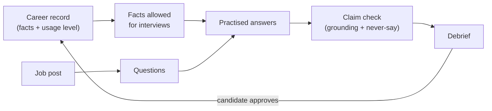

# Interview preparation: design proposal

**Status: proposal for [#1995](https://github.com/akoita/draft-loop/issues/1995).**
Nothing here is built. It is for the owner, who decides whether and in what
order to admit the child issues. It stays behind the CV quality stage
([#1309](https://github.com/akoita/draft-loop/issues/1309)), like the other
Controlled expansion outputs in the [roadmap](../roadmap.md).

## Recommendation

Build interview preparation as a second output of the verified career record,
not a new product. Add one new setting, the **usage level** of a fact, and
reuse everything else: the tiers, the grounding check, the critic and the MCP
channel. Run the no-code test first; build only if it wins.

## What the candidate gets

A candidate preparing an interview gets questions drawn from the job post,
practises answers built only from facts allowed for interviews, and sees each
answer checked for unsupported claims and for things they never want to say.
What they learn in the interview goes back into the career record after they
approve it.

## Core decision: usage level is not a sensitivity tier

The [sensitivity tiers](../../packages/domain/src/source-sensitivity.ts)
(`normal`, `sensitive`, `never-share`) decide what may **reach a provider**.
They do not say where a fact may be **used**. A second, independent setting
does.

| Usage level | Meaning                             | Default            |
| ----------- | ----------------------------------- | ------------------ |
| `cv`        | May appear on a CV and in interview |                    |
| `interview` | Interview only; never on a CV       |                    |
| `never-say` | Never used in any output            | Applied when unset |

Rules:

- When unset, the strictest reading applies: the fact is `never-say` until
  the candidate sets it.
- Usage never loosens a tier. A `never-share` section stays withheld from
  every provider and from the MCP server whatever its usage level.
- Usage applies per fact or per section, using the same heading-rule
  mechanism as the tiers, so it survives source refreshes.
- CV drafting ignores `interview` facts: the CV path filters on
  `cv` exactly as today after the filter exists.

Open question for the owner: should `never-say` be a third usage value, or a
separate list of phrases and topics (for example "my previous salary")?
Recommendation: a value on facts for the first step, and a free-text "never
say" list later, since a phrase is not always a stored fact.

## Steps and child issues

Each step becomes one child issue when admitted, in this order. Each has one
boundary and one test surface.

| #   | Outcome                                                                                                                      | Boundary                                                  | Depends on |
| --- | ---------------------------------------------------------------------------------------------------------------------------- | --------------------------------------------------------- | ---------- |
| 0   | No-code test: an agent given only the allowed parts of a career file beats an agent with no material, on two real interviews | None (owner, no repository change)                        | none       |
| 1   | Usage level stored per fact or section, enforced in selection                                                                | `packages/domain`, `packages/schemas`, `packages/storage` | 0          |
| 2   | Approved-facts read tool on the MCP server, plus a D17 amendment                                                             | `apps/mcp`, ADR 0011                                      | 1          |
| 3   | Questions from a job post and a claim check on a written answer                                                              | a new feature module in `packages/application`            | 1          |
| 4   | Debrief to candidate-provided evidence after approval                                                                        | shared with #1030                                         | 3          |
| 5   | Rehearsal drill; voice reuses #1030's speech-to-text                                                                         | `packages/ui`                                             | 3, #1030   |
| 6   | Application-form answers remembered per workspace                                                                            | feature module                                            | 1          |

Step 6 can move out of this rollup if it grows; the roadmap already places
application answers under interview preparation.

## Step 2: the MCP tool and the D17 amendment

[ADR 0011, D17](../adr/0011-client-server-version.md#d17-agent-channel-an-mcp-server)
says the host agent never writes CV claims and tools never return
never-share material. The amendment adds one read tool.

- **Tool:** `list_interview_facts`, returning facts grouped by usage level
  `cv` and `interview` with their source references.
- **Never returned:** `never-share` material, `never-say` facts, and the
  contents of anything the candidate has not approved.
- **Host agent role:** it may draft interview answers from the returned facts
  and practise with the candidate. It still cannot write or edit CV claims;
  CV drafting stays in the DraftLoop author–critic workflow.
- **Token scope:** the agent token today reaches only the work journal. Add a
  read-only interview scope; it needs its own setting the candidate turns on,
  as "Accept notes from coding agents" does for the journal.
- **Cost:** the candidate prepares inside Claude or another agent and spends
  no DraftLoop credits. Whatever the tool returns reaches that agent's model
  provider, so the setting names this plainly.

## Step 3: questions and claim check

- **Questions** come from the job brief's requirements and the candidate's
  facts that match them (gaps first), through the existing retrieval. They
  are generated once per application and stored with the brief version.
- **Claim check** reuses the structural claim coverage and the reviewer
  contract ([drafting and review](../architecture/drafting-and-review.md)):
  each claim in a written answer must trace to a fact whose usage allows
  interviews; a `never-say` match is flagged as a finding, not rewritten.
- The check outputs concise structured findings with the fact id as
  evidence. It stores no chain-of-thought.
- Provider pairing follows the product rule: author and critic come from
  different companies, and the run records both model versions.

## Step 4: debrief to evidence

After an interview, the candidate writes or dictates what happened. The
debrief is proposed as **candidate-provided evidence** and waits in a pending
state, as work-journal notes do. Only the candidate's approval makes it a
knowledge source. Design this with #1030 so both write the same evidence
kind, with the same pending state and the same approval screen.

## Data and privacy

- Debriefs, salary expectations and form answers are new personal data. The
  hosted version names them in consent and retention before other users have
  them; local-first keeps them local.
- Never invent achievements, dates, employers or metrics. Every answer cites
  facts.
- Hotspot containment: new logic lives in feature-specific modules, not in the
  frozen domain, schema, storage or knowledge-base files; those get only thin
  wiring that does not raise their line-count baseline.

## Gate

A candidate prepares one real interview from DraftLoop's facts alone. Every
claim in their practised answers traces to an approved fact, and no
`never-say` item reaches an answer.

## Decisions needed

1. Admit the no-code test (step 0) now, before any code?
2. `never-say` as a usage value, a separate list, or both?
3. Is the MCP read tool (step 2) worth shipping before steps 3–5?
