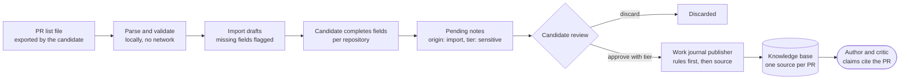

# Design: pull requests as a career evidence source

**Status:** proposal for [#1997](https://github.com/akoita/draft-loop/issues/1997).
Nothing here is built yet.

**Reader:** the developer who takes #1997 into a sprint. This page helps you
choose the import path, cut the work into one-PR issues and know when the gate
passes.

**Recommendation:** import a pull request list that the candidate exported as
a file, turn each row into a pending work journal note, and reuse the work
journal's review, approval and publishing path. Imported notes default to the
`sensitive` tier. Fetching from GitHub directly is a later, separate step.

## Problem

Recent engineering work often lives in merged pull requests, not in a CV. A
candidate has no way to bring that history into DraftLoop as evidence, so a
claim about it has nothing to cite.

The constraints come from the issue and from `AGENTS.md`:

- The local-first path makes no network call: the candidate exports the list.
- Each PR becomes evidence with its link, repository, date and the candidate's
  own description. Facts derived from it cite it.
- Imported PRs default to `sensitive`, because an employer's private repository
  may be confidential. The candidate can lower the tier per repository.
- DraftLoop never invents achievements, dates, employers or metrics.

**Gate:** a run on a fixture workspace with an imported PR list produces a
claim that cites a PR. A PR from a private repository is withheld from the
provider without consent.

## What exists

| Piece                             | Where                                                                             | What it gives this design                                                                   |
| --------------------------------- | --------------------------------------------------------------------------------- | ------------------------------------------------------------------------------------------- |
| Work journal note                 | `packages/schemas/src/work-journal.ts`                                            | Title, summary, period, project with visibility and repository, typed `pull-request` links  |
| Note review and approval          | `apps/api/src/work-journal-routes.ts`, `apps/cli/src/work-journal-commands.ts`    | Pending inbox, edit, merge, discard, approve with a tier                                    |
| Publishing an approved note       | `createWorkJournalPublisher` in `packages/application/src/work-journal-source.ts` | Writes sensitivity rules first, renders Markdown, adds the source, sets kind `work-journal` |
| Dedupe                            | `workJournalDedupeKey` in `packages/schemas/src/work-journal.ts`                  | Repository plus first PR link, so the same PR is not filed twice                            |
| Sensitivity tiers and enforcement | `packages/domain/src/source-sensitivity.ts`, `run-sensitivity-exclusions.ts`      | `never-share` always withheld, `sensitive` withheld without workspace consent               |
| Content screening                 | work journal screening                                                            | A flagged note is quarantined and cannot be approved                                        |

Two facts shape the options:

- A note already maps almost field for field onto a PR: title, description as
  summary, merge date as period, URL as a `pull-request` link, repository as
  `project.repository`.
- A note also requires `category`, `candidate_role` and `technologies`. A PR
  export does not hold them, and DraftLoop must not guess them.

## Options

### A. A new `pull-requests` source kind, ingested as one file

Add a JSON or CSV media type to hosted intake, store the export as one source
with a new evidence kind, and chunk it per PR.

- **For:** one upload, one source, no review step per PR.
- **Against:** intake accepts only PDF, DOCX, Markdown and plain text today, so
  this adds a parser and a media type. Tiers match Markdown headings only, so a
  per-repository tier needs a rendering step anyway. It bypasses the review
  inbox, dedupe and screening the work journal already has. A candidate cannot
  discard one PR without editing the file.

### B. Import into the work journal as pending notes (recommended)

Parse the export locally into one draft note per PR. The candidate completes
the missing fields in bulk, then each note enters the pending inbox and follows
the existing approval path.

- **For:** reuses review, dedupe, screening, per-note tiers and the publisher.
  Each approved PR is its own source, so a claim cites one PR, not a list. The
  candidate sees and can discard each PR before anything is stored as evidence.
- **Against:** needs a draft state for rows that lack required fields, and a
  bulk edit so a 200-row export is not 200 forms. The default tier differs from
  the journal's visibility-based default and must be set by the import.

### C. Fetch from GitHub directly

Call the GitHub API with a user-granted token, or through the page fetcher.

- **For:** no export step for the candidate.
- **Against:** the issue makes it a later step behind explicit approval. It
  adds a credential, rate limits and a network call to the local-first path.
  The page fetcher reads public pages only, so private repositories need a token.

## Recommended design

Choose **B** now and keep **C** as a follow-up that produces the same import
rows. A only becomes attractive if review per PR proves too slow in the walk.

### Import file

A documented JSON format, `draftloop.pull-request-import/v1`, holds an array
of rows. Each row has `url`, `repository`, `title`, `merged_at`, an optional
`description` and an optional `private` flag. The parser also accepts the
JSON that a GitHub CLI pull request search prints. Confirm that tool's exact
field names against a fixture before you rely on them.

- Rows without an https URL, a repository or a merge date are rejected with a
  reason, never repaired.
- A repository's visibility is `private` when the row says so, `public` only
  when the row says so, and `unknown` otherwise.
- The description is the candidate's own text. It is screened like any note
  and capped at the note's summary limit, with the cut stated in the draft.

### Drafts and bulk completion

The import writes drafts, not notes. A draft holds the mapped fields and lists
the required fields still missing. The review screen groups drafts by
repository, so the candidate sets `category`, `candidate_role` and
`technologies` once per repository and adjusts single PRs afterwards. A draft
becomes a pending note only when it validates against
`workJournalNoteContentSchema`.

Drafts live with the work journal in the same workspace. They are candidate
material, so the hosted version stores them only under recorded consent, like
notes.

### Tiers

- Every imported note defaults to `sensitive`, whatever the visibility.
- For a repository that is not `public`, the existing rule in
  `workJournalSourceRules` keeps the "Project and links" section `never-share`.
  The work can be used while the repository name and link stay local.
- The candidate can lower the default per repository. The choice is stored as
  a workspace setting and applied when the note is approved, never retroactively
  to sources already published.

### Provenance

Each note records `origin: "import"` and the import's id, next to the agent's
notes. The publisher already renders a heading with the note id, so a claim's
chunk citation resolves to one PR and its link.

## Risks

| Risk                                                                   | Mitigation                                                                                       |
| ---------------------------------------------------------------------- | ------------------------------------------------------------------------------------------------ |
| Confidential employer work reaches a provider                          | `sensitive` default, `never-share` project section for non-public repositories, consent required |
| A PR description overstates the candidate's part                       | Role is set by the candidate, not inferred; the critic checks claims against the note text       |
| A large export makes review tedious and candidates approve blindly     | Bulk completion per repository; the walk measures time per 50 PRs before admitting more          |
| Duplicates with notes an agent already filed                           | `workJournalDedupeKey` on repository plus PR link marks the import row as a duplicate            |
| Prompt injection in PR text                                            | Existing content screening quarantines flagged drafts                                            |
| The GitHub CLI output format changes                                   | The v1 format is the contract; the CLI adapter is a thin mapper with its own fixture test        |
| Personal or third-party data in descriptions (reviewer names, tickets) | Screening for secret-like content; the candidate edits or discards before approval               |

## Test plan

Use only synthetic fixtures: made-up repositories such as
`example-org/fixture-payments` and invented PR text.

| Layer                | Test                                                                                                                   | Package                                          |
| -------------------- | ---------------------------------------------------------------------------------------------------------------------- | ------------------------------------------------ |
| Parser               | Valid v1 rows map to drafts; rows without URL, repository or date are rejected with a reason                           | `packages/schemas`                               |
| Parser               | The CLI search JSON fixture maps to the same drafts                                                                    | `packages/schemas`                               |
| Parser               | Visibility is `unknown` unless the row states it                                                                       | `packages/schemas`                               |
| Drafts               | A draft becomes a pending note only after the missing fields are set; bulk set applies per repository                  | `packages/application`                           |
| Tiers                | Imported notes default to `sensitive`; a per-repository setting lowers it at approval only                             | `packages/application`                           |
| Dedupe and screening | A PR already filed by an agent is marked duplicate; a flagged description is quarantined                               | `packages/application`                           |
| Routes               | Import, list drafts, bulk complete and refusal codes, with the owner token                                             | `apps/api`                                       |
| Gate, positive       | A fixture run with approved imported notes produces a claim whose citation resolves to one PR link                     | `apps/worker`                                    |
| Gate, negative       | A private-repository note is absent from every provider request without consent, and its repository name never appears | `apps/worker`, beside `never-share-flow.test.ts` |

No test calls a paid model; the gate runs with the scripted providers the
worker flow tests already use.

## Proposed issue order

1. The v1 import format and parser, with fixtures.
2. Import drafts and bulk completion in the application layer and API.
3. The import default tier and per-repository setting.
4. The review screen grouping drafts by repository.
5. The gate flow test.
6. Later, behind its own design: fetching from GitHub with a user-granted token.
