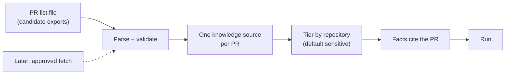

# Pull requests as career evidence: design proposal

**Status: proposal for [#1997](https://github.com/akoita/draft-loop/issues/1997).**
Nothing here is built. It is for the owner, who decides whether to admit the
child issues. This is the "portfolio imports" item of Controlled expansion in
the [roadmap](../roadmap.md), scoped to one source kind.

## Recommendation

Ship in two steps. First, import a file the candidate exports themselves, so
the local-first version makes no network call. Later, add a fetch from GitHub
behind an explicit approval. Imported pull requests default to the
`sensitive` tier, because work in an employer's private repository may be
confidential.

## Input format

A JSON array the candidate produces, for example from `gh pr list --author
@me --state merged --json
number,title,body,mergedAt,url,headRepository --limit 200`. Each item
needs:

| Field         | Required | Use                                                 |
| ------------- | -------- | --------------------------------------------------- |
| `url`         | yes      | Link back; the dedupe key                           |
| `repository`  | yes      | `owner/name`, drives the tier                       |
| `title`       | yes      | Source display name                                 |
| `description` | no       | The candidate's own text, the evidence body         |
| `mergedAt`    | yes      | Date of the evidence                                |
| `visibility`  | no       | `public` or `private`; asked at import when missing |

Zod validates the file. Unknown fields are ignored, and a malformed item is
reported by index, not dropped silently.

## How a PR becomes evidence

- Each PR becomes one Markdown knowledge source with a new `pull-request`
  source kind, following the [work journal](../reference/agent-channel.md)
  pattern: the same PR always renders the same bytes, so a second import finds
  it already present.
- The heading carries the repository and title; the body holds only the
  candidate's description, link and date. No diff and no code is imported.
- Facts derived from the source cite it, with the PR link as the reference.
- The candidate's description is untrusted text; it is screened like any
  upload.

## Tiers and consent

| Case               | Default tier                     | Why                               |
| ------------------ | -------------------------------- | --------------------------------- |
| Private repository | `sensitive`                      | Employer work may be confidential |
| Public repository  | `sensitive`, candidate may lower | One setting, strictest by default |
| Visibility unknown | `sensitive`                      | Strictest reading                 |

- The candidate can lower the tier **per repository**, using the existing
  sensitivity rules mechanism, so one choice covers every PR from that
  repository.
- A `sensitive` PR is withheld from the provider until the candidate gives
  consent, as other sensitive sources are today. A `never-share` PR never
  leaves DraftLoop.
- A private-repository PR may not be lowered below `sensitive` unless the
  candidate confirms in a visible step that they may share it.

## Later: fetch from GitHub

Not part of the first issues. When admitted:

- Fetch only after an explicit approval screen naming the repositories.
- Use a token the candidate grants, or the hosted page fetcher for public
  pages. Never background research, never a stored broad token.
- The fetch reads titles, descriptions and links only, then goes through the
  same file path above, so one importer serves both.

## Steps and child issues

| #   | Outcome                                                         | Boundary                                     |
| --- | --------------------------------------------------------------- | -------------------------------------------- |
| 1   | `pull-request` source kind and the file schema                  | `packages/schemas`, thin domain wiring       |
| 2   | Importer: parse, dedupe, render the source, apply tier defaults | new feature module in `packages/application` |
| 3   | Per-repository tier setting                                     | sensitivity rules, existing mechanism        |
| 4   | CLI and web import action                                       | `apps/cli`, `packages/ui`                    |
| 5   | Fixture workspace and gate test                                 | `packages/evaluations` fixtures              |
| 6   | Approved fetch from GitHub (later)                              | hosted page fetcher or granted token         |

Hotspot containment: the importer is a feature module; the schema, storage
and knowledge-base hotspot files receive only the new kind's compatibility
exports, with no rise in their line-count baseline.

## Privacy rules

- Fixtures use invented repositories and invented PRs; no real employer or
  repository name enters the public repository.
- Never invent achievements, dates, employers or metrics from a PR title;
  a claim cites the description the candidate wrote.
- Hosted: PR descriptions are candidate material, stored only with recorded
  consent, in the EU, like other sources.

## Gate

A run on a fixture workspace with an imported PR list produces a claim that
cites a PR, and a private-repository PR is withheld from the provider without
consent.

## Decisions needed

1. Is `gh pr list` JSON the supported export, or also a plain CSV?
2. May a private PR be lowered to `normal` at all, or must it stay `sensitive`?
3. Admit step 6 (fetch) now, or only after the file import is in use?
