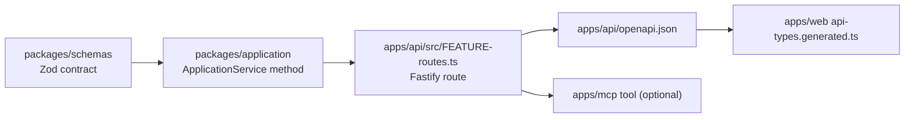

# Add an API route

This guide is for a developer or coding agent exposing a capability over the
HTTP API. The API is Fastify typed by Zod over `ApplicationService`, with no
domain logic of its own. The web screen and, through `apps/mcp`, coding agents
both reach a capability only through a route.

## Where the pieces go



## Steps

1. **Contract.** Put any persisted or exchanged shape in `packages/schemas`
   (for example `@draft-loop/schemas/application-folder`). The route module
   keeps only its request and response wrappers.
2. **Service.** Add the behavior as an `ApplicationService` method in
   `packages/application`, in a feature module rather than a
   [hotspot](../../AGENTS.md#hotspot-containment). Both storage drivers
   implement any new port.
3. **Route module.** Create `apps/api/src/<feature>-routes.ts` exporting
   `register<Feature>Routes(app, options)`. Use
   `app.withTypeProvider<ZodTypeProvider>()`, strict Zod objects for `params`
   and `body`, and a `summary`, a `description` and a `response` schema for
   each status code. `apps/api/src/application-folder-routes.ts` is a small
   model to copy.
4. **Errors.** Answer with `apiError(code, message)` from `errors.ts`. A
   `CliUserError` from the service becomes a client error; never return a
   stack, a path or candidate material.
5. **Wiring.** Register the module in `buildApi` in `apps/api/src/app.ts`,
   inside the branch that has the dependencies it needs. That file should only
   gain the import and the call.
6. **Access.** Workspace routes take `:workspaceId`; tenant and record access
   hooks (`tenant-context.ts`, `record-access.ts`) check it before the
   handler runs. A route that uploads or sends material goes in the matching
   set in `consent-enforcement.ts`. An agent token reaches only the routes
   `request-auth.ts` allows it.
7. **Contract files.** Regenerate and commit both:

   ```sh
   pnpm --filter @draft-loop/api openapi
   pnpm --filter @draft-loop/web api-types
   ```

8. **Agent tool (optional).** If a coding agent should use the capability,
   add an MCP tool in `apps/mcp/src/server.ts` that calls the route, and name
   it in the [feature catalog](../features/README.md).

## Tests

- Next to the route: `apps/api/src/<feature>-routes.test.ts`. Build the API
  with `buildApi({ ownerToken, application: { service } })` over a scripted
  service and call it with `app.inject`. Cover success, validation failure and
  each refusal.
- Postgres behavior, such as tenant isolation, goes in
  `apps/api/src/postgres-<feature>.test.ts`, run by `pnpm test:postgres`.
- `apps/api/src/openapi-document.test.ts` and `apps/web/src/api-types.test.ts`
  fail when you forget step 7.

Run the focused suite while you work:

```sh
pnpm vitest run apps/api/src/<feature>-routes.test.ts
```

## Related

- [Hosted service architecture](../architecture/hosted-service.md)
- [Storage and tenancy architecture](../architecture/storage-and-tenancy.md)
- [Change checklist](change-checklist.md)
