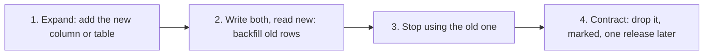

# Change the database schema

For a developer or agent adding a Postgres migration to
`packages/storage-postgres`. Every migration must leave the schema usable by
the release before it, so a bad release rolls back by redeploying the previous
images. The gate enforces this.

## The rule

A migration may add: tables, nullable columns, columns with a default,
indexes, constraints that existing rows already meet, and functions.

It may not, unless it is a marked contract step:

| Refused | Why the previous release breaks |
| --- | --- |
| `DROP TABLE`, `DROP COLUMN` | It still reads or writes them |
| `RENAME` of a table or column | It still uses the old name |
| `ALTER COLUMN ... TYPE` | Its reads and writes assume the old type |
| `ADD COLUMN ... NOT NULL` without `DEFAULT` | Its inserts leave the column out |
| `ALTER COLUMN ... SET NOT NULL` | Its inserts may still write null |

`migration-compatibility.test.ts` runs the check on every migration in
`pnpm test`. A refused statement fails it with the version, the rule and the
statement.

## Expand and contract

Reshape in steps, each its own release:



1. **Expand.** Add the new column nullable or with a default, or the new
   table.
2. **Migrate the code.** Write both shapes and read the new one. Backfill old
   rows in a migration or a worker job.
3. **Stop using the old shape.** Release it. The previous release still
   finds the old column, so rollback stays safe.
4. **Contract.** At least one release after step 3, drop or tighten it in a
   migration marked as a contract step.

A rename is steps 1 to 4 with a new name. A type change is a new column of the
new type, then the same steps.

## Mark a contract step

Set `contract` on the migration. Say what it removes and the release that
stopped using it:

```ts
{
  version: 49,
  name: "drop notes.legacy_body",
  contract: "Drops notes.legacy_body, unread since server-v0.31.0.",
  sql: `ALTER TABLE notes DROP COLUMN legacy_body;`,
}
```

The check skips a marked migration. A reviewer checks the named release is
already on prod. Keep the contract step alone in its migration.

## Check your change

```sh
pnpm --filter @draft-loop/storage-postgres exec vitest run src/migration-compatibility.test.ts
```

Expected: all tests pass. If `passes every released migration` fails, split the
statement it names into expand and contract steps as above.

Rollback itself is the operator's runbook in the private infrastructure
repository. The previous images run against your newer schema there: the
storage opens on a schema at or past its own newest migration and refuses only
an older one (`src/schema-version-check.test.ts`).
