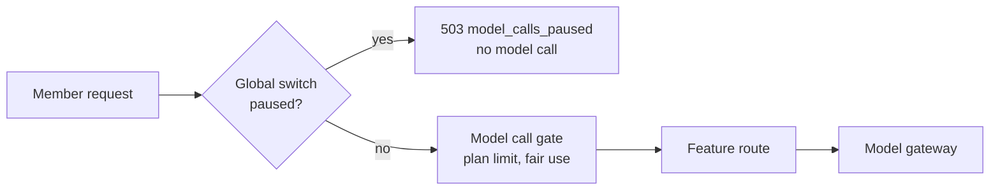

# Add a model-calling feature

This guide is for a developer or coding agent adding a feature that calls a
metered model: Claude, OpenAI, a search model or a speech service. Every such
feature ships with three protections, and the model call registry proves it
has them.

| Protection   | What it means                                                       |
| ------------ | ------------------------------------------------------------------- |
| Limit        | A per-member count, usually the plan's `modelCallsPerDay`           |
| Cost cap     | A dollar cap, or a per-call output-token limit times the count      |
| Kill switch  | One setting that stops this feature alone, without a deploy if possible |

The global switch stops every registered feature at once.

## How a call is checked

## Steps

1. **Build on a route.** Add the route as in
   [Add an API route](api-route.md). Take the model from the gateway's ports
   (`AnthropicRouteBuilder`, or a queued worker job), never a provider SDK.
2. **Count it.** Add the route to `meteredRoutes` in
   `apps/api/src/model-call-gate.ts`, so the plan's daily limit applies. A
   per-application Prepare call sets `prepare: true`.
3. **Register it.** Add an entry to `modelCallPaths` in
   `apps/api/src/model-call-registry.ts`: its routes, its limit, its cost cap,
   its kill switch and the source files that reach the gateway. Choose
   `whilePaused`: `refused` answers 503, `skipped` saves the work without the
   model's part.
4. **Check it.** Run
   `pnpm --filter @draft-loop/api exec vitest run src/model-call-registry.test.ts src/model-call-switch.test.ts`.
   The registry test reads `apps/api/src` and `apps/worker/src` and fails on
   any file that reaches the gateway without an entry.
5. **Document it.** Name the limit and the kill switch in the feature's page
   under `docs/features/`.

When the registry test fails, it names each file and why it counts as
reaching a model. Register that file under its feature, or, for wiring that
starts no member's path, add it to `wiring` in the test with a reason.

## Pause every model call

The operator pauses all registered calls without a deploy:

| Deployment  | How                                                                   |
| ----------- | --------------------------------------------------------------------- |
| Hosted      | Store `{"modelCalls":"paused"}` in the secret `DRAFT_LOOP_MODEL_CALLS_SECRET` names |
| Self-hosted | Set `DRAFT_LOOP_MODEL_CALLS=paused` and restart the API               |

The API reads the hosted secret within a minute. Store `{}` to resume. While
paused, refused routes answer 503 `model_calls_paused` with `retry-after`, and
a new job brief is saved without reading the job ad. Check my letter returns
its wording and requirement findings without the claim check, and the gate
does not count it. Jobs already queued still finish. A secret that cannot be
read keeps calls running and logs a warning.
