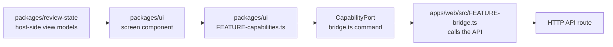

# Add a shared screen

This guide is for a developer or coding agent adding or changing a screen in
`packages/ui`. The web and the desktop client show the same screens. A screen
reaches its host only through the capability port, so it runs in a browser
and never imports Electron, Node built-ins, provider SDKs or server packages.

## Where the pieces go



## Steps

1. **Contract.** Put the screen's input and output types in
   `packages/ui/src/<feature>-contract.ts`.
2. **Commands.** Add the command names to `bridgeCapabilities` in
   `packages/ui/src/bridge-capabilities.ts` and their inputs to the command
   map in `bridge.ts`. Keep `bridge.ts` to thin wiring.
3. **Capabilities.** Build a small `<feature>-capabilities.ts` that returns
   typed functions only when the host offers every command, and `undefined`
   otherwise. A host without them shows no controls;
   `application-folder-capabilities.ts` is the model.
4. **Screen.** Write the component and a separate `<feature>-model.ts` for
   logic you can test without rendering. Give it one primary action for the
   current step.
5. **Web host.** Answer the commands in `apps/web/src/<feature>-bridge.ts`
   with the generated API client, and register it in `http-bridge.ts`. The
   desktop client shows the server's web screen, so it needs no change.
6. **Run review.** A view model for the run review screens belongs in
   `packages/review-state`, which fills it on the host side for both the
   desktop host and the hosted API.

## Web platform guidance

Before you write markup, CSS or browser code for a screen, look up the
pattern in the `modern-web-guidance` skill from
[Modern Web Guidance](https://github.com/GoogleChrome/modern-web-guidance).
Prefer the native feature it names, such as `<dialog>` for a modal, over a
hand-built one.

| Agent       | How it gets the skill                                                  |
| ----------- | ---------------------------------------------------------------------- |
| Claude Code | `.claude/settings.json` enables the plugin and turns its telemetry off |
| Codex       | Run the commands below once on your machine                            |

```sh
export DISABLE_TELEMETRY=1
codex plugin marketplace add GoogleChrome/modern-web-guidance
codex plugin add modern-web-guidance@googlechrome
```

Keep `export DISABLE_TELEMETRY=1` in your shell profile. Without it the skill
sends anonymous usage data, including the agent's search phrases, to Google.

If the skill is not installed, say so in the PR instead of skipping the step.

## Strings in two languages

Every visible string uses the Lingui macros, for example
``t`Create folder` `` from `@lingui/core/macro`, never a bare literal. Then:

```sh
pnpm i18n:extract
```

Translate each new entry in `packages/ui/src/locales/fr/messages.po`, then
compile and check:

```sh
pnpm i18n:compile
pnpm i18n:check
```

`i18n:check` fails on a missing translation or a stale compiled catalog. A
development web build with `?locale=pseudo` shows any string that escaped
Lingui. The rules are in [ADR 0012](../adr/0012-screen-translations-with-lingui.md)
and [Languages](../reference/languages.md).

## Tests

- Model logic: `packages/ui/src/<feature>-model.test.ts`.
- Rendering: `<feature>.test.tsx` with `renderToStaticMarkup` from
  `react-dom/server`, including the host that offers no commands.
- Web host: `apps/web/src/<feature>-bridge.test.ts` checks each request's
  method, path and body.

```sh
pnpm vitest run packages/ui/src/<feature> apps/web/src/<feature>-bridge.test.ts
```

## Related

- [Architecture overview](../architecture/overview.md)
- [Add an API route](api-route.md) for the route the web host calls
- [Change checklist](change-checklist.md)
