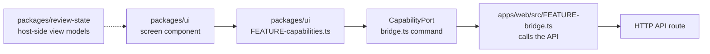

# Add a shared screen

This guide is for a developer or coding agent adding or changing a screen in
`packages/ui`. The web and the desktop client show the same screens. A screen
reaches its host only through the capability port, so it runs in a browser
and never imports Electron, Node built-ins, provider SDKs or server packages.

## Where the pieces go



## Steps

1. **Contract.** Put the screen's input and output types in
   `packages/ui/src/<feature>-contract.ts`.
2. **Commands.** Add the command names to `bridgeCapabilities` in
   `packages/ui/src/bridge-capabilities.ts` and their inputs to the command
   map in `bridge.ts`. Keep `bridge.ts` to thin wiring.
3. **Capabilities.** Build a small `<feature>-capabilities.ts` that returns
   typed functions only when the host offers every command, and `undefined`
   otherwise. A host without them shows no controls;
   `application-folder-capabilities.ts` is the model.
4. **Screen.** Write the component and a separate `<feature>-model.ts` for
   logic you can test without rendering. Give it one primary action for the
   current step.
5. **Web host.** Answer the commands in `apps/web/src/<feature>-bridge.ts`
   with the generated API client, and register it in `http-bridge.ts`. The
   desktop client shows the server's web screen, so it needs no change.
6. **Run review.** A view model for the run review screens belongs in
   `packages/review-state`, which fills it on the host side for both the
   desktop host and the hosted API.

## Web platform guidance

Before you build or rework a component, overlay, layout, animation, form,
media control, or a performance or accessibility fix, read
[`building-draftloop-web-ui`](../../.agents/skills/building-draftloop-web-ui/SKILL.md).
It looks the pattern up in [Modern Web Guidance](https://github.com/GoogleChrome/modern-web-guidance)
and lists where DraftLoop's rules take precedence. Prefer a native element or
API over a hand-built one or a new dependency, with a fallback for browsers
that lack it.

| Agent       | How it finds the skill                                         |
| ----------- | -------------------------------------------------------------- |
| Codex       | `.agents/skills`, and the pointer in `AGENTS.md`               |
| Claude Code | A short file in `.claude/skills` that sends it to the same file |

Three choices are deliberate and should survive edits:

- **Pinned version.** Every command names an exact version, never `@latest`,
  and passes `--ignore-scripts`. Upgrade in one reviewed commit that changes
  the version in the skill body and its `metadata.upstream`.
- **Usage reporting off.** Every command sets `DISABLE_TELEMETRY=1`. By
  default the tool reports search queries and guide ids to its publisher.
- **No upstream installer or plugin.** Either would add an unpinned, always-on
  copy of the upstream skill to one agent only. The project skill gives every
  agent one committed file with the same scope and safeguards.

When guides shaped a change, add the skill's one-line `Web guidance:` note to
the PR body.

## Strings in two languages

Every visible string uses the Lingui macros, for example
``t`Create folder` `` from `@lingui/core/macro`, never a bare literal. Then:

```sh
pnpm i18n:extract
```

Translate each new entry in `packages/ui/src/locales/fr/messages.po`, then
compile and check:

```sh
pnpm i18n:compile
pnpm i18n:check
```

`i18n:check` fails on a missing translation or a stale compiled catalog. A
development web build with `?locale=pseudo` shows any string that escaped
Lingui. The rules are in [ADR 0012](../adr/0012-screen-translations-with-lingui.md)
and [Languages](../reference/languages.md).

## Tests

- Model logic: `packages/ui/src/<feature>-model.test.ts`.
- Rendering: `<feature>.test.tsx` with `renderToStaticMarkup` from
  `react-dom/server`, including the host that offers no commands.
- Web host: `apps/web/src/<feature>-bridge.test.ts` checks each request's
  method, path and body.

```sh
pnpm vitest run packages/ui/src/<feature> apps/web/src/<feature>-bridge.test.ts
```

## Related

- [Architecture overview](../architecture/overview.md)
- [Add an API route](api-route.md) for the route the web host calls
- [Change checklist](change-checklist.md)
