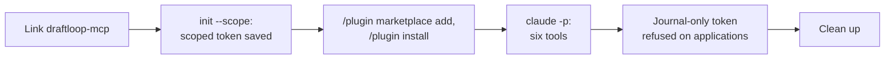

# Claude Code plugin walk with a real coding agent

This record says whether a candidate can install the DraftLoop plugin in Claude
Code and let it read and add job applications. It is for anyone deciding
whether the [agent channel](../reference/agent-channel.md) plugin path is ready.

**Result: passed.** Real Claude Code installed the plugin from the public
marketplace, connected its server and called all six tools with a scoped agent
token. A token without `applications:read` was refused with a message naming
that scope. The walk found one `init` defect, fixed with this record, and three
setup traps the docs now name. Issue:
[#2442](https://github.com/akoita/draft-loop/issues/2442).

## Setup

| Item        | Value                                                                                  |
| ----------- | -------------------------------------------------------------------------------------- |
| Date        | 2026-11-07                                                                             |
| Server      | A clone's self-hosted stack built from `main` (`b1a4ebf`), owner-token mode            |
| Address     | `http://127.0.0.1:8081`, Compose project `draft-loop-dev`, beside the installed stack  |
| Agent       | Claude Code 2.1.296, headless (`claude -p`), on Haiku, only the DraftLoop tools allowed |
| Toolchain   | Node 24.22.1, pnpm 10.18.3, WSL with zsh                                               |
| Data        | One fictional job description; no candidate material                                   |
| Model spend | None by DraftLoop: no run, extraction or interview. About US$0.02 of agent use.         |

## Steps

| #   | Step                                          | Result                                                                                                        |
| --- | --------------------------------------------- | ------------------------------------------------------------------------------------------------------------- |
| 1   | Build and start the clone's stack             | Pass: every container healthy, `/v1/health` 200 on 8081; the installed stack on 8080 untouched                |
| 2   | Put `draftloop-mcp` on `PATH`                 | Pass with `npm link`; `pnpm link --global` answered `ERR_PNPM_NO_GLOBAL_BIN_DIR`                              |
| 3   | `init --host generic --scope journal --scope applications:read --scope jobs:write` | Pass: token issued with the three scopes, saved with mode 600; only its id printed       |
| 4   | `claude plugin marketplace add akoita/draft-loop`, then `claude plugin install draftloop@draftloop` | Pass: plugin 0.1.0 installed for the user; `claude mcp list` shows the server connected |
| 5   | Tools offered                                 | Pass: `add_job`, `get_application`, `get_run_status`, `list_applications`, `list_work`, `record_work`         |
| 6   | `list_applications`                           | Pass: the workspace's one application, no run                                                                 |
| 7   | `add_job` with a fictional job                | Pass: application created with status `drafting`; no extraction started                                     |
| 8   | `get_application` on it                       | Pass: the same record, `latest_run` null                                                                      |
| 9   | `get_run_status` on an unknown run            | Pass: `not_found`, "No such run.", not retryable (the workspace had no run)                                   |
| 10  | `list_work`                                   | Pass: no notes                                                                                                |
| 11  | A `journal`-only token on `list_applications` | Pass: 403 naming `applications:read` and Coding agents; `list_work` still answered; the token then revoked    |
| 12  | The Stop hook                                 | Pass: exit 0 and silent, as nothing was pushed                                                               |
| 13  | Clean up                                      | The test application archived; the stack, the link, the plugin and the walk token left in place              |

## Findings

| #   | Finding                                                                                                   | Follow-up                                                         |
| --- | --------------------------------------------------------------------------------------------------------- | ----------------------------------------------------------------- |
| 1   | `init --scope applications:read` issued a token without `journal`, so its own skill and hook were refused | Fixed with this record: `init` always keeps `journal`             |
| 2   | `pnpm link --global` needs `pnpm setup`, which edits the shell's startup file                             | The set-up steps now offer `npm link`                             |
| 3   | With nvm, the link lands in one Node version's folder; a shell on another version misses it or `claude`   | The set-up steps now say so                                       |
| 4   | The plugin calls 8080; a clone's stack on 8081 needs `DRAFT_LOOP_SERVER_URL` before Claude Code starts    | The set-up steps now say so                                       |
| 5   | `draftloop-mcp --help` did not list `hook stop`                                                           | Fixed with this record                                            |

## Not covered

- **The interactive `/plugin` commands** and the `/log-work` and `/tailor-cv`
  skills; the walk used the `claude plugin` subcommands and headless sessions.
- **A token created in the Coding agents section**; `init` issued it.
- **Codex**, a real CV run followed with `get_run_status`, and the hosted service.
