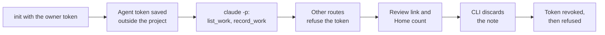

# Agent token walk with a real coding agent

This record says whether a coding agent can use the work journal with an
agent token instead of the owner token. It is for anyone deciding whether the
[agent channel](../reference/agent-channel.md) is ready for a candidate.

**Result: passed, with two gaps.** `draftloop-mcp init` issued an agent token
and kept it out of the project. A real Claude Code session filed a note with
it, and the server refused it everywhere else. The token stopped working once
revoked. Approval was not walked, and the two screen checks rest on
screenshots. Issue: [#2161](https://github.com/akoita/draft-loop/issues/2161).

## Setup

| Item        | Value                                                                                      |
| ----------- | ------------------------------------------------------------------------------------------ |
| Date        | 2026-11-04                                                                                 |
| Server      | A disposable self-hosted stack built from the release branch (`4cd9366`), owner-token mode |
| Address     | `http://127.0.0.1:8081`, its own Compose project, beside the owner's installed stack       |
| Agent       | Claude Code 2.1.296, headless (`claude -p`), on Haiku                                      |
| Toolchain   | Node 24.22.1, pnpm 10.18.3                                                                 |
| Data        | A throwaway Git project with two fictional commits; a workspace created for the walk       |
| Model spend | None by DraftLoop. The agent ran on the owner's own subscription.                          |

The walk used its own Compose project and port. A clone's stack and the
installed stack share one project name, so the default start would have run
branch code on the owner's real data
([#2169](https://github.com/akoita/draft-loop/issues/2169)).

## Steps

| #   | Step                                                 | Result                                                                                                                       |
| --- | ---------------------------------------------------- | ---------------------------------------------------------------------------------------------------------------------------- |
| 1   | Link `draft-loop` and `draftloop-mcp` from the clone | Pass: both run from another folder (#2150)                                                                                   |
| 2   | `draftloop-mcp init --host claude-code`              | Pass: `issued: agent token dlat_…, saved to ~/.config/draftloop/agent-token`; the file has mode 600                          |
| 3   | Project files hold no token                          | Pass: neither token appears in `.mcp.json`, `CLAUDE.md` or `.claude/`                                                        |
| 4   | A real session, without the owner token in its shell | Pass: `list_work`, then one `record_work`; status `pending`, screening `clear`, `review_url` `/#work-journal`                |
| 5   | The agent token on other routes                      | Pass: the workspace 403, whole notes (`fields=summary`) 403, the agent-token routes 403; title listing 200                   |
| 6   | `/#work-journal` after sign-in                       | Pass by screenshot: Career evidence opens at the Work journal panel with the note (#2149)                                    |
| 7   | Home                                                 | Pass by screenshot: "1 work journal note waits for your review." and Review notes opens the panel (#2151)                    |
| 8   | Review from the CLI                                  | `list` showed the note. `approve` refused: the workspace had no knowledge base selected. `discard` passed                    |
| 9   | Revoke                                               | Pass: 200 before, `DELETE` 204, then 401; the list shows `revoked_at`                                                        |
| 10  | Clean up                                             | Pass: the walk stack, its volumes, the project and the revoked token file removed; the owner's installed stack was untouched |

## Findings

| #   | Finding                                                                                    | Follow-up                                                 |
| --- | ------------------------------------------------------------------------------------------ | --------------------------------------------------------- |
| 1   | A clone's stack and the installed stack share one Compose project, and so its data volumes | [#2169](https://github.com/akoita/draft-loop/issues/2169) |
| 2   | `init` always says to turn on intake, even when it is on                                   | [#2170](https://github.com/akoita/draft-loop/issues/2170) |

## Not covered

- **Approval** of a note into a knowledge base, and its citation in a run.
- **The owner's own eyes** on steps 6 and 7; both rest on Playwright screenshots.
- **The default address** `127.0.0.1:8080` end to end, and **Codex**.
