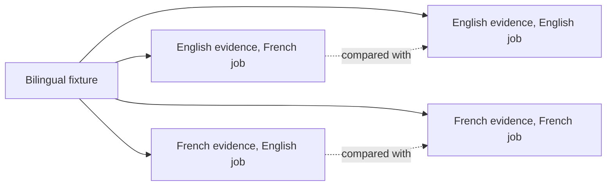

# Cross-language retrieval

This note answers one question for the maintainer deciding French retrieval
work (#2332): how well is French evidence found for an English job, and the
reverse? It uses invented bilingual fixtures and local retrieval only, with no
model provider.

## Result

- **Lexical retrieval does not cross languages.** It finds 40% of the right
  evidence across a language boundary, against 100% in the same language. The
  hits come only from words both languages share, such as "cloud" or
  "migration".
- **Stemming would not close that gap.** Same-language lexical recall is already
  complete on these requirements, and stemming cannot map a French word to an
  English one. No stemming issue is filed.
- **Semantic and hybrid retrieval do cross languages.** With Granite 311M,
  both find every piece of right evidence for every pair, so no pair drops
  below its same-language baseline.
- **Semantic alone is the more precise of the two.** Hybrid adds the lexical
  hits, which brings in more unrelated chunks across languages.

## Fixture

[`cross-language-cases.json`](../../packages/evaluations/fixtures/retrieval-quality/cross-language-cases.json)
describes one fictional candidate. It has 14 evidence chunks, 4 of them
distractors, and 10 job requirements. Every chunk and requirement exists in
English and French with the same meaning, so all four language pairs share one
ground truth.



Each cross-language pair is compared with the same-language pair that shares its
evidence language. The proposed margin is a recall drop of at most 0.10 in the
same retrieval mode (`crossLanguageRecallMargin`).

## Recall

Each mode returns at most three chunks per requirement. Semantic and hybrid use
Granite 311M at 768 dimensions with its pinned relevance floor, measured on
x86-64 Linux (WSL2), CPU only, at about 10 ms per query.

| Pair | Lexical (BM25) | Semantic, 311M | Hybrid, 311M |
| --- | --- | --- | --- |
| English evidence, English job | 1.00 | 1.00 | 1.00 |
| French evidence, French job | 1.00 | 1.00 | 1.00 |
| French evidence, English job | 0.40 | 1.00 | 1.00 |
| English evidence, French job | 0.40 | 1.00 | 1.00 |

## Precision

Citation accuracy is the share of returned chunks that are right evidence.

| Pair | Lexical (BM25) | Semantic, 311M | Hybrid, 311M |
| --- | --- | --- | --- |
| English evidence, English job | 0.88 | 1.00 | 0.88 |
| French evidence, French job | 0.55 | 0.88 | 0.53 |
| French evidence, English job | 0.33 | 0.72 | 0.53 |
| English evidence, French job | 0.33 | 0.82 | 0.53 |

No mode left a claim unsupported. The benchmark's requirement coverage counts
shared words between a requirement and the returned chunks, so it cannot score
a cross-language pair. It reads 0.30 and 0.40 there in every mode, and is left
out of this note.

The earlier [semantic retrieval comparison](semantic-retrieval-comparison.md)
had four French and English cross-language cases among sixteen. Semantic
retrieval with Granite 311M reached 0.969 recall on that whole fixture.

## Reproduce

You need the repository installed and the Granite 311M model files at the
manifest's pinned revision. See
[local embedding model selection](local-embedding-model-selection.md) for the
files.

The lexical numbers run in every test pass:

```sh
pnpm vitest run packages/evaluations/src/cross-language-retrieval.test.ts
```

For semantic and hybrid recall, point the test at the model directory. It writes
a content-free JSON report with every metric and the per-pair comparison:

```sh
DRAFT_LOOP_EMBEDDING_MODEL_DIR="$HOME/models/granite-311m" \
DRAFT_LOOP_EMBEDDING_TIER=311m \
DRAFT_LOOP_RETRIEVAL_REPORT_PATH="$PWD/cross-language-report.json" \
pnpm vitest run packages/evaluations/src/cross-language-retrieval.test.ts
```

Expected result: three tests pass and `cross-language-report.json` exists. If
the model test is skipped, the model directory variable is empty. If the lexical
test fails, the fixture or the lexical ranking changed: update the table and the
recorded values in the test together.
