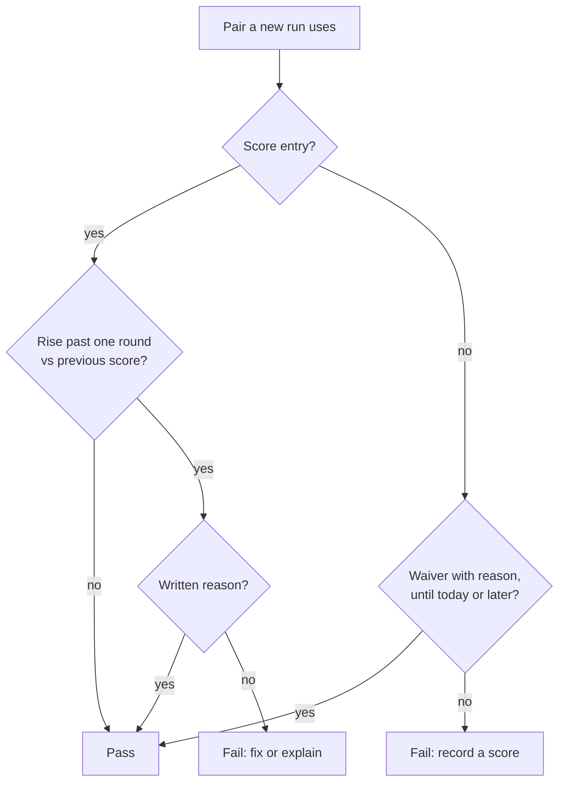

# Prompt score gate

For a developer who changes the author or critic prompt version, or the
default model pair. `pnpm eval:scores` runs in `pnpm lint`, so CI's static
checks fail when the pair a new run uses has no recorded score.

## What the gate checks

The pair is the current author and critic prompt versions
(`promptTemplateVersion` in `packages/application/src/author-adjudication.ts`)
on the default Economy preset's models. The manifest,
[`packages/evaluations/prompt-scores.json`](../../packages/evaluations/prompt-scores.json),
lists a score or a waiver per pair.



- **Score:** a `pnpm eval:live` result on the synthetic cohort cases. It holds
  the model ids, prompt versions, judge, cases, rounds, cost, cost cap and
  fail rate per mode.
- **Rise:** a mode's fail rate rising by more than one round's worth against
  the previous score with the same judge and cases. It needs a `reason`.
- **Waiver:** `status: "waived"` with a `reason` and an `until` date at most
  31 days after its `recordedAt`. The gate fails the day after `until`.

Only the author–critic draft pair is gated: `eval:live` measures nothing else.

## When you bump a prompt version

1. Run the paid evaluation locally, with the owner's go. It never runs in
   hosted CI.

   ```sh
   pnpm eval:live --out ~/draft-loop-eval/<label> --label <label> --total-cap-usd 1 --record
   ```

2. Copy the result into the manifest. This calls no model.

   ```sh
   pnpm eval:scores:record --label <label>
   pnpm format
   pnpm eval:scores
   ```

3. Commit `results.json` and `prompt-scores.json` with the prompt change.

If the record step reports a rise, fix the prompt, or rerun it with
`--reason "<why the rise is acceptable>"`. A result recorded before
`eval:live` saved its cap needs `--cost-cap-usd <cap>`.

When the paid run cannot happen in the same PR, add a waiver entry by hand and
replace it with the score before `until`. Recording the score removes the
pair's waiver:

```json
{
  "status": "waived",
  "author": { "modelId": "claude-haiku-5-5", "promptTemplateVersion": "cli-author-v23" },
  "critic": { "modelId": "gpt-6-luna", "promptTemplateVersion": "cli-critic-v12" },
  "recordedAt": "2026-11-23",
  "until": "2026-12-07",
  "reason": "What changed, and why the paid run is pending."
}
```

How the live evaluation scores a draft:
[Failure taxonomy, Live evaluation](failure-taxonomy.md#live-evaluation).
