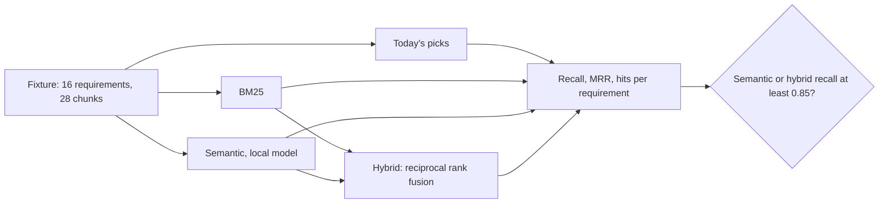

# Requirement-evidence retrieval

This note answers one question for the maintainer deciding the
requirement-evidence map (#2987): for each job requirement, how much of its
supporting evidence does each way of picking chunks find? It uses one invented
candidate and no model provider.

## Result

**Go.** Semantic and hybrid retrieval both find 97% of each requirement's
evidence, against 56% for today's fallback and 53% for BM25. Both pass the
0.85 gate, so the requirement-evidence map (#2981) goes ahead.

- **Keywords miss reworded and French evidence.** BM25 finds 17% of the
  evidence that is partly in French and half of the reworded evidence.
- **The local model closes both gaps.** Granite 311M with the pinned floor
  finds every French and synonym match, and it skips the "machine learning"
  distractor in favour of the chunk that really supports the requirement.
- **Semantic ranks better than hybrid.** Mean reciprocal rank is 0.90 for
  semantic against 0.70 for hybrid: the keyword hits that hybrid adds push
  the right chunk down. The map should rank semantic first and use BM25 to
  add exact matches.
- Every arm returns at most eight chunks per requirement.

| Arm                               | Recall | Mean reciprocal rank | Requirements with a hit |
| --------------------------------- | ------ | -------------------- | ----------------------- |
| Today's picks (shared rare words) | 0.56   | 0.35                 | 12 of 16                |
| BM25                              | 0.53   | 0.38                 | 10 of 16                |
| Semantic, Granite 311M with floor | 0.97   | 0.90                 | 16 of 16                |
| Hybrid, BM25 plus semantic (RRF)  | 0.97   | 0.70                 | 16 of 16                |

Recall by kind of requirement:

| Kind                      | Requirements | Today's picks | BM25 | Semantic | Hybrid |
| ------------------------- | ------------ | ------------- | ---- | -------- | ------ |
| Paraphrase                | 8            | 0.50          | 0.50 | 0.94     | 0.94   |
| Synonym or abbreviation   | 2            | 0.75          | 1.00 | 1.00     | 1.00   |
| Evidence partly in French | 3            | 0.50          | 0.17 | 1.00     | 1.00   |
| Exact terms               | 2            | 1.00          | 1.00 | 1.00     | 1.00   |
| Keyword trap              | 1            | 0             | 0    | 1.00     | 1.00   |

The model numbers come from the
[Retrieval model evaluation](../../.github/workflows/retrieval-model-eval.yml)
workflow on PR #2991, which also reproduced the cross-language result:
keywords 40% across languages, semantic and hybrid 100%.

The picks arm returns chunks in source order, not by score, so its reciprocal
rank understates it. It also has no relevance threshold: any shared rare word
counts.

## Reranking with a local cross-encoder (#3020)

**No gain over the shipped map on this fixture.** A cross-encoder reads the
requirement and the chunk together and scores the pair from 0 to 1. Reranking
the semantic candidates, which the map ranks first, leaves recall and ordering
where they were. It only repairs the RRF hybrid's ordering, which the map does
not use.

| Arm                                     | Recall | Mean reciprocal rank | R-precision |
| --------------------------------------- | ------ | -------------------- | ----------- |
| Semantic, as the map ranks first        | 0.97   | 0.91                 | 0.78        |
| Semantic, reranked                      | 0.97   | 0.88                 | 0.75        |
| Hybrid (RRF)                            | 0.97   | 0.69                 | 0.50        |
| Hybrid, reranked                        | 0.97   | 0.92                 | 0.75        |
| Top 24 semantic without floor, reranked | 0.97   | 0.84                 | 0.69        |

- **R-precision** is the share of the first R chunks that are labelled, where
  R is the requirement's number of labels. It rewards putting the right
  chunks first.
- **The fixture is near its ceiling.** Semantic already finds 31 of 32
  labelled chunks, so it cannot show the problem #3020 found in real runs:
  every requirement fills all eight places, and the critic marks many of them
  unsupportive.
- **Runs vary by a few points.** Two runs of the same arms differed by up to
  six points of R-precision, which is one requirement.
- The model is `BAAI/bge-reranker-v2-m3` in its ONNX int8 conversion
  (Apache-2.0), pinned with sizes and SHA-256 in
  [`reranker-manifest.ts`](../../packages/embeddings/src/reranker-manifest.ts).
  The workflow downloads it with `scripts/download-reranker-model.mjs`.

The decisive test is whether its score separates the picks the critic graded
"supports" from "does not support" in real runs, where cosine similarity does
not. No run uses the cross-encoder.

## Fixture

[`requirement-evidence-cases.json`](../../packages/evaluations/fixtures/retrieval-quality/requirement-evidence-cases.json)
holds 28 chunks of one fictional candidate and 16 requirements. Labels were
written before any arm ran. Three chunks are in French, and four are
distractors, one of which shares the words "machine learning" with a
requirement it does not support.



## Reproduce

Keyword arms, from the repository root:

```text
pnpm exec vitest run packages/application/src/requirement-evidence-retrieval.eval.test.ts
```

Model arms need the pinned model files on disk:

```text
node apps/worker/scripts/download-embedding-model.mjs /tmp/granite
DRAFT_LOOP_EMBEDDING_MODEL_DIR=/tmp/granite DRAFT_LOOP_RETRIEVAL_REPORT_PATH=/tmp/requirement-evidence.json pnpm exec vitest run packages/application/src/requirement-evidence-retrieval.eval.test.ts
```

Add the reranked arms with the pinned cross-encoder:

```text
node scripts/download-reranker-model.mjs /tmp/reranker
DRAFT_LOOP_EMBEDDING_MODEL_DIR=/tmp/granite DRAFT_LOOP_RERANKER_MODEL_DIR=/tmp/reranker DRAFT_LOOP_RETRIEVAL_REPORT_PATH=/tmp/requirement-evidence.json pnpm exec vitest run packages/application/src/requirement-evidence-retrieval.eval.test.ts
```

The report holds ids and numbers only. If the download fails, run the
**Retrieval model evaluation** workflow from the Actions tab and read its
summary or its `retrieval-model-reports` artifact.

## Limits

One invented candidate and 16 requirements: one requirement moves recall by
about six points. The graded arm (a small model judging each candidate) is
measured with the grade step, #2982. The paid end-to-end comparison with full
source is #2985.
