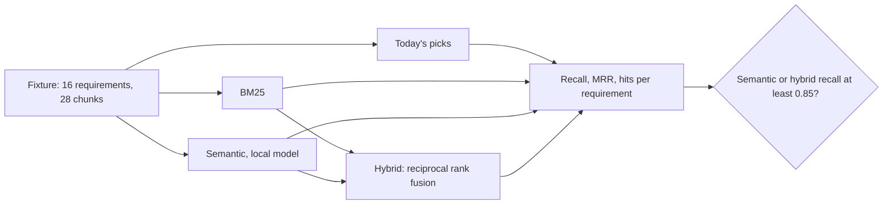

# Requirement-evidence retrieval

This note answers one question for the maintainer deciding the
requirement-evidence map (#2987): for each job requirement, how much of its
supporting evidence does each way of picking chunks find? It uses one invented
candidate and no model provider.

## Result

- **Keywords find about half.** Today's requirement-picked fallback (#2701)
  finds 56% of the labelled evidence, and BM25 finds 53%, at eight chunks per
  requirement.
- **Keywords miss reworded and French evidence.** BM25 finds 17% of the
  evidence written in French and half of the reworded evidence. It finds every
  exact match.
- **Semantic and hybrid arms:** measured by the
  [Retrieval model evaluation](../../.github/workflows/retrieval-model-eval.yml)
  workflow, which downloads the pinned model. Results are recorded below once
  it has run.
- **Gate:** the map work continues if the semantic or hybrid arm reaches 0.85
  mean recall.

| Arm | Recall | Mean reciprocal rank | Requirements with a hit |
| --- | --- | --- | --- |
| Today's picks (shared rare words) | 0.56 | 0.35 | 12 of 16 |
| BM25 | 0.53 | 0.38 | 10 of 16 |
| Semantic, Granite 311M with floor | Pending | Pending | Pending |
| Hybrid, BM25 plus semantic (RRF) | Pending | Pending | Pending |

Recall by kind of requirement:

| Kind | Requirements | Today's picks | BM25 |
| --- | --- | --- | --- |
| Paraphrase | 8 | 0.50 | 0.50 |
| Synonym or abbreviation | 2 | 0.75 | 1.00 |
| Evidence partly in French | 3 | 0.50 | 0.17 |
| Exact terms | 2 | 1.00 | 1.00 |
| Keyword trap | 1 | 0 | 0 |

The picks arm returns chunks in source order, not by score, so its reciprocal
rank understates it. It also has no relevance threshold: any shared rare word
counts.

## Fixture

[`requirement-evidence-cases.json`](../../packages/evaluations/fixtures/retrieval-quality/requirement-evidence-cases.json)
holds 28 chunks of one fictional candidate and 16 requirements. Labels were
written before any arm ran. Three chunks are in French, and four are
distractors, one of which shares the words "machine learning" with a
requirement it does not support.



## Reproduce

Keyword arms, from the repository root:

```text
pnpm exec vitest run packages/application/src/requirement-evidence-retrieval.eval.test.ts
```

Model arms need the pinned model files on disk:

```text
node apps/worker/scripts/download-embedding-model.mjs /tmp/granite
DRAFT_LOOP_EMBEDDING_MODEL_DIR=/tmp/granite DRAFT_LOOP_RETRIEVAL_REPORT_PATH=/tmp/requirement-evidence.json pnpm exec vitest run packages/application/src/requirement-evidence-retrieval.eval.test.ts
```

The report holds ids and numbers only. If the download fails, run the
**Retrieval model evaluation** workflow from the Actions tab and read its
summary or its `retrieval-model-reports` artifact.

## Limits

One invented candidate and 16 requirements: one requirement moves recall by
about six points. The graded arm (a small model judging each candidate) is
measured with the grade step, #2982. The paid end-to-end comparison with full
source is #2985.
