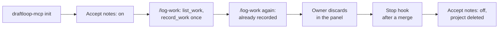

# Work journal walk with a real coding agent

This record says whether the [agent channel](../reference/agent-channel.md)
works with a real Claude Code session against a self-hosted server. It is for
anyone deciding whether the work journal is ready for a candidate to use, and
which of its defects to fix first.

**Result: the core flow passed.** A real Claude Code session filed one note
through `record_work`, a second session did not repeat it, and the owner
discarded it in the Work journal panel. The walk found three defects and one
usability gap, each filed as an issue below. Issue:
[#2142](https://github.com/akoita/draft-loop/issues/2142).

## Setup

| Item        | Value                                                             |
| ----------- | ----------------------------------------------------------------- |
| Date        | 2026-11-04                                                        |
| Server      | Self-hosted stack, `server-v0.14.0`, owner-token mode             |
| Agent       | Claude Code 2.1.296, headless (`claude -p "/log-work"`)           |
| Toolchain   | Node 24.22.1, pnpm 10.18.3, a clone at `main` (`cf7dc53`)         |
| Project     | A throwaway Git project with one fictional commit                 |
| Model spend | None by DraftLoop. The agent ran on the owner's own subscription. |

The note was fictional, so the owner discarded it instead of approving it,
and no fictional note became career evidence. Approval is covered by
`apps/api/src/work-journal-routes.test.ts`, not by this walk.

## Steps

| #   | Step                                           | Result                                                                                                                                       |
| --- | ---------------------------------------------- | -------------------------------------------------------------------------------------------------------------------------------------------- |
| 1   | Stack healthy at `server-v0.14.0`              | Pass                                                                                                                                         |
| 2   | Install, then link `draftloop-mcp`             | Install passed. The documented link command failed (defect 1)                                                                                |
| 3   | `draftloop-mcp init --host claude-code --hook` | Pass: wrote `.mcp.json`, `CLAUDE.md`, the `log-work` skill and `.claude/settings.json`. A rerun changed nothing, and no file holds the token |
| 4   | Turn on "Accept notes from coding agents"      | Pass, through `PUT /v1/workspaces/owner/work-journal/intake`                                                                                 |
| 5   | First `/log-work`                              | Pass in 25 s: the server connected, `list_work` then one `record_work`, status `pending`, screening `clear`                                  |
| 6   | Second `/log-work`                             | Pass: skipped as already recorded; still one note                                                                                            |
| 7   | Review                                         | Pass: the CLI listed the note, and the owner discarded it in the panel                                                                       |
| 8   | Stop hook                                      | Pass: a commit-only turn printed nothing; a turn with `git merge` printed one advisory line, exit 0, without blocking                        |
| 9   | Restore                                        | Pass: intake off again, the project deleted                                                                                                  |

## Defects and gaps

| #   | Finding                                                                                                          | Follow-up                                                    |
| --- | ---------------------------------------------------------------------------------------------------------------- | ------------------------------------------------------------ |
| 1   | `pnpm --dir apps/mcp link --global` links the root package, so `draftloop-mcp` is not on `PATH`                  | Fixed in this change: the guide links from inside `apps/mcp` |
| 2   | `record_work`'s `review_url`, `/career-evidence#work-journal`, answers 404: the web screen is served at `/` only | [#2149](https://github.com/akoita/draft-loop/issues/2149)    |
| 3   | The self-hosted guide's `draft-loop work-journal` command has no `bin` entry, so it does not run from a clone    | [#2150](https://github.com/akoita/draft-loop/issues/2150)    |
| 4   | Nothing on the workspace home says a note waits; the panel is at the bottom of the Career evidence page          | [#2151](https://github.com/akoita/draft-loop/issues/2151)    |

`draftloop-mcp --help` prints its usage but exits 2. That is harmless and not
filed.

## Not covered

- **Approval** of a note into a knowledge base, and its citation in a run.
- **An interactive session.** The walk ran headless, where no trust prompt for
  the project's MCP server appeared. A fresh machine may ask.
- **Codex** and the generic host.
- **Discard rules:** refusing discarded work again, and forgetting its text
  after 30 days.
