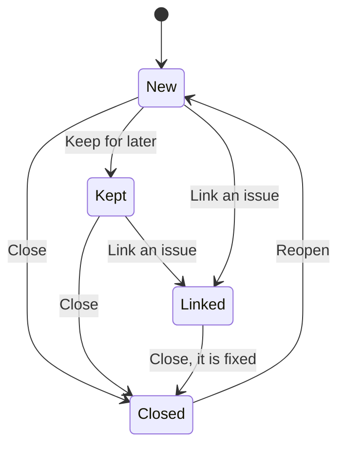
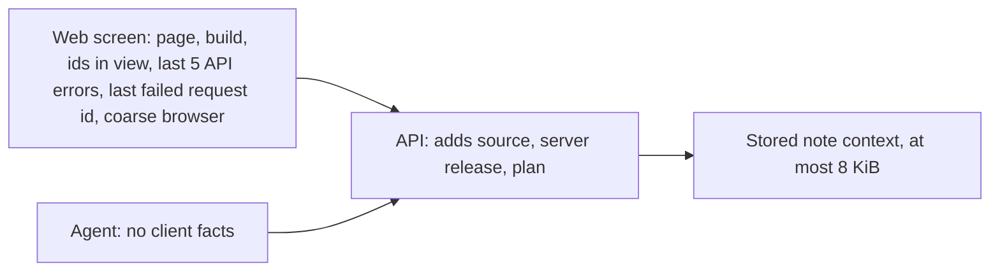

# Feedback

A signed-in member sends a short note about DraftLoop to the operator: a bug,
an idea or anything else, from **Send feedback** in the web header's Help menu, through the API or through their agent's `send_feedback` tool. Each
note carries a bounded technical context, so the operator can tell what broke
without asking. The operator reads every organisation's notes, newest first,
triages them and links each to a GitHub issue.

## Where it runs

Hosted and self-hosted servers in sign-in mode. Owner-token mode has no
members, so it takes no notes.

## How to use it

In the web screen, open **Help** in the header and select **Send feedback**, pick a kind of
note if you know it, write it and select **Send**. Open **What we include**
in the dialog to see every technical value the note carries.

Send a note through the API as a signed-in member:

```sh
curl -X POST "$DRAFT_LOOP_URL/v1/feedback" -H "Authorization: Bearer $TOKEN" \
  -H "Content-Type: application/json" \
  -d '{"text": "The export button does nothing.", "category": "bug", "screen": "review",
       "context": {"route": "/#review", "browser": {"family": "Firefox", "os": "Linux",
       "viewport": "1280x800", "language": "en-GB", "theme": "dark"}}}'
```

The answer is `201` with the stored note.

### Triage notes on the operator screen

Open **Operator** from the account menu; its entry counts the notes waiting
in New. The alert email's link, `#operator/feedback/<noteId>`, opens the page
on that note. Most notes need no answer, so **Close** comes first.



| Control | What it does |
| --- | --- |
| Tabs: New, Kept, Linked to an issue, Closed | Show one status, with each tab's count from the server; New is the default |
| Search | Keeps notes whose text, page or kind contains the words, in every tab's count too |
| **Show more** | Reads the next 50 notes; the list says how many show out of how many match |
| **Close**, **Keep for later**, **Reopen** | Set the note's status |
| **Link an issue** | Saves a GitHub issue address on the note and moves it to Linked |
| **Draft an issue** | Opens GitHub's From feedback template with the note's context and id, never its text or ids in view |
| Checkboxes, **Close selected** | Close several New or Kept notes at once; **Select all shown** picks the notes read so far |
| **Context** | The note's page, versions, plan, ids, recent errors and browser |

### Triage notes through the API

Read the new notes with the owner token, then triage one:

```sh
curl "$DRAFT_LOOP_URL/v1/operator/feedback?status=new&limit=50" \
  -H "Authorization: Bearer $OWNER_TOKEN"
curl -X PATCH "$DRAFT_LOOP_URL/v1/operator/feedback/$NOTE_ID" \
  -H "Authorization: Bearer $OWNER_TOKEN" -H "Content-Type: application/json" \
  -d '{"status": "issue", "issueUrl": "https://github.com/example-org/example-repo/issues/12"}'
```

The answer is `200` with the triaged note. To file the issue, use the
**From feedback** template: an anonymised summary, the note's technical
context and its id, never the member's words, email or name.

## What a note's context holds



| Value | Set by | What it is |
| --- | --- | --- |
| `route` | Client | The page's path and fragment, never its query |
| `webBuild` | Client | The web screen's build id, from its entry script |
| `ids` | Client | The record, application and run the screen last called the API for |
| `recentErrors` | Client | The last 5 API errors: code, message and time, never a body |
| `lastFailedRequestId` | Client | The `x-request-id` of the last failed call: the trace id of its API lines and, for a run, the worker's lines and spans |
| `browser` | Client | Browser family, OS family, viewport, language and theme |
| `source` | Server | `web` from `POST /v1/feedback`, `agent` from the workspace route |
| `serverRelease` | Server | `DRAFT_LOOP_SERVER_RELEASE`, else Cloud Run's `K_REVISION`, else null |
| `plan` | Server | The organisation's plan when the note was sent |

The API refuses a client context with any other field, a server fact or one
over 3,072 characters of JSON. It never holds screenshots, page text, a CV or
a job description.

## How to test it

`pnpm exec vitest run apps/api/src/feedback-routes.test.ts` covers the routes,
the context's bounds and triage. `pnpm exec vitest run
apps/web/src/feedback.test.tsx apps/web/src/feedback-context.test.ts` covers
the dialog, its fold and the error ring buffer. `pnpm exec vitest run
apps/mcp/src/operator-feedback.test.ts` covers the operator's tools. The
Postgres store, its triage policy and its erasure are tested in
`packages/storage-postgres/src/feedback-notes.test.ts`, which runs with
`DRAFT_LOOP_TEST_POSTGRES_URL` set.

## Surfaces

| Surface | What it does |
| --- | --- |
| Web header: **Help** menu, **Send feedback** | A dialog for the note, its kind and a **What we include** fold listing the context, in sign-in mode only |
| `POST /v1/feedback` | A member sends a note: text up to 2,000 characters, an optional category (`bug`, `idea`, `other`), the screen it came from and an optional `context` |
| `POST /v1/workspaces/:workspaceId/feedback` | The same, for a member's agent token with the `journal` scope; its source is `agent` |
| `send_feedback` (MCP) | An agent passes on the candidate's note; its screen is `agent` |
| Web: **Operator**, Feedback | The operator's inbox: tabs by status, Close, Keep for later, Link or Draft an issue, Reopen, bulk close and the new-notes count ([operator screen](organisations-and-consent.md#operator-screen)) |
| `GET /v1/operator/feedback` | The operator lists notes and support tickets with their context and triage, newest first, 100 by default and at most 500, after `offset`, of one `status` and matching `q` when given. The answer adds `total` and each status's `counts`. A ticket has kind `support` and its shared `transcript` |
| `GET /v1/operator/feedback/:noteId` | The operator reads one note by id, the one the alert email links to |
| `PATCH /v1/operator/feedback/:noteId` | The operator sets a note's `status` (`new`, `triaged`, `issue`, `closed`) and its `issueUrl`, an https GitHub issue address |
| `list_feedback`, `triage_feedback` (MCP) | The same two operator routes, offered only when the MCP server runs with the owner token |
| `.github/ISSUE_TEMPLATE/from-feedback.md` | The **From feedback** issue template: anonymised summary, context and note id |
| `POST /v1/workspaces/:workspaceId/support/conversations/:conversationId/handoff` | A member hands a support conversation to a person, with consent: it becomes a support ticket |

## Limits

- A member sends at most 20 notes in 24 hours. Past that, the route answers
  `429 feedback_cap_reached` with `Retry-After`. Support tickets are not
  counted.
- Support tickets are deleted 90 days after they were sent, by the worker's
  sweep at each start. Notes stay until their organisation is erased.
- The operator triages notes on the
  [operator screen](organisations-and-consent.md#operator-screen), through
  the API or with the MCP tools. They cannot answer them from DraftLoop yet
  (#2878).
- Only the operator's triage updates a note. The database refuses any other
  update.
- Status `issue` needs an issue link. Leaving `issueUrl` out keeps the stored
  link, and `null` clears it.
- Notes are shown to the operator only and no model reads them, so they are
  not screened for hidden instructions.
- Erasing an organisation removes its notes. Erasing one candidate record does
  not, since a note belongs to the organisation.

## Related

- [Consent and erasure](organisations-and-consent.md)
- [Agent channel](../reference/agent-channel.md)
