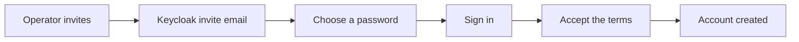

# Organisations and consent

On the hosted service, people work in an organisation. Members are assigned to
candidate records, and nothing about a candidate is stored or sent to a model
provider without that candidate's recorded consent. This page is for an owner
or admin managing an organisation and a developer touching tenancy or consent.

## Where it runs

The hosted service in sign-in mode. A self-hosted server has one owner and no
organisation; it erases everything with `draft-loop-server`
([Self-hosted server](../operations/self-hosted.md#update-and-erase)).

## How to use it

1. An operator creates an organisation and invites its first owner, or, on
   the public beta, sends a person an invite code that creates their own
   organisation on first sign-in. Sign-up asks the person to accept the
   current terms of use and privacy policy, which say that drafting sends
   material to providers outside the EU, and records the accepted version.
   A visitor without a code can join the waitlist. Where the server sends
   mail, they confirm the address from an emailed link within 48 hours, and
   only then wait for a place. The operator turns a waiting entry into an
   invite. See [Who reaches what](#who-reaches-what) for each case. Owners
   and admins invite people by email; each active member or pending invitation
   takes a seat.
2. Assign members to the candidate records they work on. A member reaches only
   their assigned records.
   A record keeps the id it was created with. Anyone who reaches it can give
   it a plain name of up to 80 characters with
   `PUT /v1/workspaces/{id}/name`; the records list returns that name, and a
   record without one is shown by its id. Erasing the record removes the name.
   On the web, **Add a candidate** asks for the name only: the screen makes the
   id from it and saves the name once the record is set up.
3. Check who you are and which team you act for in the account menu at the
   start of the top bar. The screen calls the organisation your team and a
   candidate record a job search; see [What the screen shows](#what-the-screen-shows).
4. Record the candidate's two consents under **Credits and consent**: to store
   their material, and to send it to model providers. Uploads need the first.
   Runs need the second, naming both the writer's and the reviewer's
   companies. A profile derivation and a requirements extraction call only the
   writer's model, so they need the writer's company; on the web, the
   profile's send approval records it. When a run needs a company the consent
   does not name, the permission box offers the consent form again; the new
   grant replaces the old one without a withdrawal. A withdrawal is recorded
   too, and the history is kept.
5. Owners download a [readable copy](../reference/readable-export.md) of a
   record or its complete [archive](../reference/record-archive.md), erase
   one record, or delete the whole organisation. In an organisation with other
   members, these need a sign-in with a second factor (a passkey or an
   authenticator app, set up under **Sign-in security** in the account menu);
   otherwise the API answers `403 second_factor_required`.
6. A person alone in their organisation deletes their own account with
   `DELETE /v1/account`, typing their email address to confirm. It erases the
   organisation, which frees its beta place, then deletes their sign-in account
   at the identity provider. Agents cannot reach it.

## Who reaches what

On the public beta, only an invite creates a DraftLoop account. Where the
API holds the identity provider's account client, an invite also creates the
person's sign-in, and Keycloak sends the only invite email: one button to
choose a password, valid 7 days, worded by the realm's DraftLoop theme
(`deploy/keycloak`). The realm can then refuse registration. A sign-in made
any other way reaches nothing alone.

After choosing the password, the screen goes straight on to sign-in.
Sign-up then finds the open invite by the verified email, so the person types
no code. The emailed link proves they hold that mailbox, and the email must
still match the invite.

Before turning registration off, prepare the invites sent earlier with
`POST /v1/operator/beta-invites/sign-ins` (owner token). It creates each open
invite's missing sign-in and answers how many got a password email, already
had a password, or failed; call it again for the failures.

| Person                 | Joins the waitlist                                  | Signs in                                                                                |
| ---------------------- | --------------------------------------------------- | --------------------------------------------------------------------------------------- |
| New visitor            | Gets a confirmation link, then waits once confirmed | Sees "Join the DraftLoop beta" and needs a code; every other route answers `no_account` |
| Waiting, not confirmed | A fresh link, at most 3, 10 minutes apart           | Same as a new visitor                                                                   |
| Waiting, confirmed     | Nothing changes and no mail is sent                 | Same as a new visitor                                                                   |
| Holds an open invite   | Nothing is stored and no mail is sent               | Accepts the terms; the invite of the verified email is used, with no code               |
| Has an account         | Nothing is stored and no mail is sent               | Goes into the app; a new tab opens it directly while the provider's session lasts       |
| Invite withdrawn       | Joins like a new visitor                            | Same as a new visitor                                                                   |

The waitlist answers every case the same way, so it reveals nobody. A wrong
code, another email's code or a used code is refused, and five refusals make
the sign-in wait 15 minutes.

## What the screen shows

The screen reads the plan's limits from `GET /v1/me`, never its name.

The web calls each record a **candidate**: one person, their documents and
their applications. A one-person plan never shows the word.

| Plan allows                  | Account menu                                 | Above Home                                                 |
| ---------------------------- | -------------------------------------------- | ---------------------------------------------------------- |
| One candidate and one seat   | Email; Download everything; Account settings | Nothing: the record opens, or is created with the defaults |
| Several candidates, one seat | Email                                        | **Candidates · 2 of 3** picker and **Add a candidate**     |
| Several seats                | Email and team name                          | Picker, plus **Who can open this candidate's file**        |

On a one-person plan the menu never holds a delete. **Account settings** opens
the account page: **Your data** with the download, then a red **Danger zone**
with **Delete all documents and applications** and **Delete my account**. Each
delete opens a dialog whose final button stays disabled until the person types
`DELETE` (or its translation) or their sign-in email.

An organisation that already holds two candidates keeps the picker after a
change to a one-person plan, so none is hidden. Nobody can remove their own
access from the screen.

On a one-person plan the first sign-in shows no setup screen. The record is
created with the defaults: CV language from the screen language, the plan's
default model preset, two rounds and demo mode off. Settings on Home changes
them later. If that create fails, the setup screen shows with the reason. Plans
with several candidates keep the setup screen for each new one.

## Operator screen

The operator runs the beta from **Operator** in the web screen. A named
operator finds it in the account menu; owner-token mode shows it in the top
bar. Nobody else sees it: the screen offers it only when `GET /v1/me` answers
`kind: owner` or `operator: true`.

The page shows one section at a time; its buttons count the new notes, the
people waiting and the unused invites. Each list reads 50 rows at a time with
**Show more**, and has a search, so it stays usable with hundreds of rows.
The lists read again every 30 seconds while the tab is visible, and when it
comes back into view; **Refresh** reads them at once. A list grown with
**Show more** waits for **Refresh**, so the operator keeps their place.

| Section   | What it shows                                                                                                                                                                                                                                                                                                                                                                                                                     |
| --------- | --------------------------------------------------------------------------------------------------------------------------------------------------------------------------------------------------------------------------------------------------------------------------------------------------------------------------------------------------------------------------------------------------------------------------------- |
| Feedback  | Members' [notes and support tickets](feedback.md) as an inbox: New, Kept, Linked to an issue and Closed, with Close first and bulk close. Opens first                                                                                                                                                                                                                                                                             |
| Waitlist  | The seats used, then one row per person still waiting, oldest first, searched by email. A sign-up that has not confirmed its email yet is left out. An email that holds an open or redeemed invite is left out, so nobody is invited twice. **Invite** turns one into an invite, emails it and shows its code once; past the cap it asks to confirm first                                                                         |
| Invites   | One row per invite, newest first, filtered by state (sent, redeemed, revoked) and searched by email; the seats used and left, and where the cap comes from                                                                                                                                                                                                                                                                        |
| Run trace | One member's run by organisation and run id. A feedback note that names a run opens it with **View the run's trace**, and shows its organisation under Context. The trace lists each step nested under its parent, with status, duration, provider, model, error class, tokens, cost and the request id. Content-free; each read is written to the audit log (`GET /v1/operator/organisations/:organisationId/runs/:runId/trace`) |

Where the server sends mail, each new invite emails its person once. With
the account client, that email is Keycloak's choose-a-password invite. Without
it, or when preparing the sign-in failed, or for someone who already has a
password, the API emails a link, `/#invite=<code>`, in French and English. The
link opens sign-in, and sign-up then has the code filled in; the code rides
after `#`, so no server log sees it. The screen says whether the email went.
When it did not, because mail is off or the send failed, send the code
yourself. Each invite is written to the
audit log under the operator's sign-in.

The cap starts small and rises in steps, with no redeploy:
[raise the beta cap](../operations/server-deploy.md#raise-the-beta-cap).

## How to test it

- Focused tests: `apps/api/src/organisation-routes.test.ts`,
  `apps/api/src/plan-limits-routes.test.ts`, `apps/web/src/records.test.tsx`,
  `apps/web/src/records-model.test.ts`, `apps/web/src/account-menu.test.tsx`,
  `apps/api/src/beta-sign-up-routes.test.ts`, `apps/web/src/beta-sign-up.test.tsx`,
  `apps/api/src/consent-routes.test.ts`,
  `apps/api/src/record-erasure-routes.test.ts` and
  `apps/web/src/consent.test.tsx`.
- The operator screen: `apps/web/src/operator.test.tsx`, `scripts/beta-cap.test.mjs`, and
  `apps/api/src/request-auth.test.ts` for refusing a member without the role.
- `pnpm test:postgres` adds the tenant isolation, consent enforcement and
  erasure suites.

## Surfaces

| Kind   | Surface                                                                                                                    |
| ------ | -------------------------------------------------------------------------------------------------------------------------- |
| Screen | Account menu, job search picker, who can open it, Credits and consent, beta sign-up                                        |
| Screen | Operator: waitlist, invites and feedback                                                                                   |
| API    | `/v1/organisation`, `/v1/organisation/members`, `/v1/me`                                                                   |
| API    | `POST /v1/sign-up`, `/v1/operator/beta-invites`, `POST /v1/waitlist`, `POST /v1/waitlist/confirm`, `/v1/operator/waitlist` |
| API    | `/v1/workspaces/{id}/members`, `/v1/workspaces/{id}/consents`                                                              |
| API    | `/v1/workspaces/{id}/export`, `/v1/workspaces/{id}/archive`, record and organisation erasure, `DELETE /v1/account`         |
| MCP    | none                                                                                                                       |

## Limits

- Operator routes take the owner token, or a named operator's sign-in that
  holds the `draft-loop-operator` role and used a second factor
  ([setup](../operations/server-deploy.md#sign-in-as-a-named-operator)).
- An account that holds the operator role cannot be deleted from the screen:
  **Delete my account** is hidden and `DELETE /v1/account` answers 409
  `operator_account`. Remove the role from the operator list first.
- The operator screen revokes no invite; use
  `DELETE /v1/operator/beta-invites/{inviteId}`. Invites do not expire.
- Consent covers one candidate record; each record records its own.

## Related

- [Storage and tenancy architecture](../architecture/storage-and-tenancy.md)
- [Privacy policy](../legal/README.md) and
  [processing register](../legal/processing-register.md)
- [Plans and credits](plans-and-credits.md)
