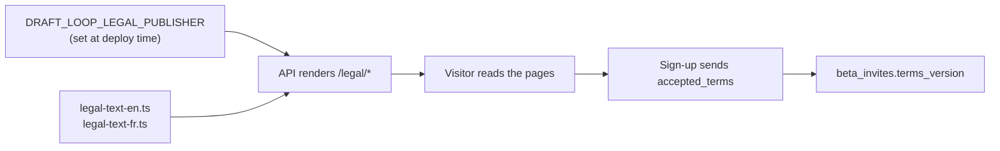

# Legal pack

**Status:** The terms of use, privacy policy and legal notice are published on
the hosted service for the free, invite-only test. A lawyer reviews them
before the first paid sale (#2682). 
**Scope:** The hosted Redakloop service ([ADR 0011](../adr/0011-client-server-version.md)).
A self-hosted server, and the desktop client pointed at it, process data on
the user's own machine and need no privacy policy from the operator.

## Documents

| Document                                                  | Where it lives                                                                                | Readers                                    |
| --------------------------------------------------------- | --------------------------------------------------------------------------------------------- | ------------------------------------------ |
| Terms of use                                              | `/legal/terms` on the service; text in `apps/api/src/legal-text-en.ts` and `legal-text-fr.ts` | Every user, accepted at sign-up            |
| Privacy policy                                            | `/legal/privacy`; same files                                                                  | Every user, accepted at sign-up            |
| Legal notice                                              | `/legal/notice`; same files                                                                   | Every visitor                              |
| [Record of processing activities](processing-register.md) | This folder                                                                                   | The operator and the supervisory authority |
| [Data protection impact assessment](dpia.md)              | This folder                                                                                   | The operator and the lawyer                |

Each page exists in English and French at `/legal/en/<page>` and
`/legal/fr/<page>`; `/legal/<page>` picks the browser's language. The French
version prevails for consumers.

People reach them from the landing page footer, the sign-up form's
acceptance box, and, once signed in, the account menu.

## How the published pages work

- **Publisher details.** `DRAFT_LOOP_LEGAL_PUBLISHER` holds a JSON object
  with `name` and `email`, and either `address` or `detailsUrl`: an https
  page where the company already publishes its full details, which the
  notice and privacy policy link instead of repeating them. `director`,
  `registration` and `phone` are optional; a detail left out drops its line.
  It is set at deploy time and never committed. Unset, the pages show a
  visible placeholder; malformed, the API refuses to start.
- **Accepted version.** `legalVersion` in `apps/api/src/legal-pages.ts` is
  the date the current terms and policy took effect. `POST /v1/sign-up`
  refuses an account without that exact version (400
  `terms_not_accepted`) and records it on the redeemed invite. The web
  screen sends `acceptedTermsVersion` from
  `apps/web/src/beta-sign-up-model.ts`.
- **Changing the text.** Change both languages in the same PR. For a change
  that matters to users, set a new `legalVersion` and the same date in the
  web screen, and announce it in the service before it applies.
- **Facts come from the code.** Each page states only what the service does
  today. When the code changes a data flow, the pages change in the same PR.

The test service's terms say it can stop at any time, with an effort to let
users download their data first. The model routes outside the EU are the
dated beta exception in ADR 0011, D7.

## Open questions for the lawyer

1. Legal basis for storing candidate material: the service records consent
   (ADR 0011, D7). Is consent the right basis, or is performance of the
   contract (Article 6(1)(b)) the better one, with consent kept only for the
   provider transmission and for special-category data (Article 9(2)(a))?
2. Zero-retention terms with the model providers: confirm the contractual
   basis for each route (Vertex AI in the EU, the direct Claude API fallback,
   OpenAI's EU endpoint) and whether any route is a transfer outside the EU.
3. Retention periods: candidate material and run history until deletion by the
   user or [N] months of inactivity; invoices ten years (Commercial Code
   L. 123-22); security logs [N] days. Confirm each.
4. Whether a data protection officer is required (Article 37). The draft
   assumes not, with a named contact instead.
5. Consumer withdrawal right for digital content supplied immediately
   (Consumer Code L. 221-28): confirm the wording and the express-consent
   step at purchase.
6. The coach plans (Team, Business): the coach's organisation is the
   controller for its candidates' data and the operator a processor. Confirm
   and draft the data processing agreement (Article 28).
