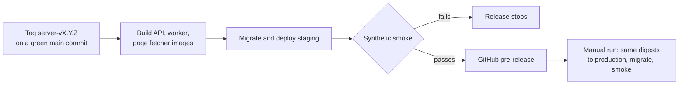

# Deploying the hosted service

This page is for the operator who releases, runs and watches the hosted
service. The service runs on Google Cloud in `europe-west1` (ADR 0011, D14).

This repository holds the code and the images. A private infrastructure
repository holds the Terraform, the deploy workflow and every cloud identifier
(D2). No project id, service account, pool id or bucket name belongs here.

## Releasing a server version



1. **Tag.** The owner starts the staging release workflow in the
   infrastructure repository. It tags a `main` commit whose CI gate passed
   with `server-vX.Y.Z`.
2. **Staging.** The same run builds the three images from their Dockerfiles,
   pushes them by digest, runs the migration job and deploys staging.
3. **Smoke.** It runs `pnpm test:server-smoke`, the same smoke as on the local
   stack, against staging. It also reads the fictional job page
   `apps/api/fixtures/smoke-job-page.txt` through the page fetcher. A failure
   stops the release.
4. **Release notes.** Once the smoke passes, the run publishes a GitHub Release
   for the tag ([Server release notes](#server-release-notes)).
5. **Production.** A second, manual run deploys the same image digests to
   production, migrates, runs the smoke there and adds a
   `Production: deployed on <date>` line to the release.

Server tags are independent of the desktop's `v*` tags. `pnpm release:preflight`
applies to desktop releases only. The workflow signs in through Workload
Identity Federation, so no long-lived service account key exists.

### Self-hosted images

Each server tag also publishes the self-hosted stack's images from the
[Server images](../../.github/workflows/server-images.yml) workflow:

| Fact       | Value                                                                                        |
| ---------- | -------------------------------------------------------------------------------------------- |
| Images     | `ghcr.io/akoita/draft-loop-api`, `-worker` and `-page-fetcher`                               |
| Tags       | The version without its prefix (`server-v0.12.0` gives `0.12.0`)                             |
| Platforms  | `linux/amd64` and `linux/arm64`                                                              |
| Contents   | Code and the pinned embedding model only; no data, keys or settings                          |
| Sign-in    | The workflow's own short-lived token; no registry credential is stored                       |
| Older tags | Run the workflow by hand with an existing tag                                                |
| Visibility | A new package starts private; the owner makes it public once, so an install needs no sign-in |

### Server release notes

Each server tag that passed on staging gets a GitHub Release titled
`Hosted service: <name> server-vX.Y.Z`. It is a pre-release and never marked
Latest, so it never takes that place from a desktop release.

- **Text:** name, summary, known limitations, roadmap stage, stage issue and
  milestone come from [`server-release.json`](../../server-release.json) at the
  tagged commit. Update it in the last pull request of each sprint.
- **Generated parts:** `scripts/server-release.mjs` renders the notes in the
  desktop releases' layout and links the public CI run. GitHub's What's Changed
  follows, and a CycloneDX SBOM of the source is attached.
- **Public only:** the notes never link to the infrastructure repository or
  name a cloud identifier. `pnpm test:release` checks the file for them.

## What runs where

| Part         | Runs as                                     | Notes                                                                             |
| ------------ | ------------------------------------------- | --------------------------------------------------------------------------------- |
| API          | Cloud Run service                           | Scales to zero; serves the `/v1` API and the web screen at `/`                    |
| Page fetcher | Cloud Run service, internal ingress         | Fetches approved job pages for the API; no database, secret or candidate material |
| Worker       | Cloud Run job                               | Drains the queue, then exits (D4)                                                 |
| Migrations   | Cloud Run job, from the worker image        | Runs before each deploy as the schema owner                                       |
| Database     | Cloud SQL for PostgreSQL 16 with `pgvector` | Private IP only, backups and point-in-time recovery                               |
| Objects      | One Cloud Storage bucket per environment    | Encrypted with a customer-managed key                                             |
| Secrets      | Secret Manager in `europe-west1`            | Owner token, the critic's OpenAI EU key, migration login                          |

Until the hosted identity provider is running, staging uses owner-token mode.
The owner opens the web screen at the API's address and signs in with the
owner token from Secret Manager. The tab keeps the token until it closes.

To replace the owner token on a deployment, add a new version of its secret
in Secret Manager, then deploy the API again. Cloud Run sends traffic to the new
revision only once it is ready, so no request is refused for downtime. Disable
the old version afterwards, and sign in again as the
[self-hosted guide](self-hosted.md#replace-the-owner-token) lists.

Each part has its own service account with only the access it needs:

| Part         | Network reach                                                                                                                                             |
| ------------ | --------------------------------------------------------------------------------------------------------------------------------------------------------- |
| Worker       | Google APIs and the OpenAI EU endpoint, nothing else                                                                                                      |
| API          | No internet egress: Google APIs, the page fetcher, and Vertex AI when the model screener is on                                                            |
| Page fetcher | The only part that reaches public web servers: port 443 only, never a private address. Its account holds no role, and only the API's identity may call it |

## Settings

The images read the settings listed in
[the local server stack](local-server-stack.md#configuration). A deployment
sets them from its infrastructure and differs from the local stack here:

| Setting                                                 | Deployment value and why                                                                                                                                                     |
| ------------------------------------------------------- | ---------------------------------------------------------------------------------------------------------------------------------------------------------------------------- |
| `DRAFT_LOOP_GCS_ENDPOINT`                               | Unset, so blobs go to Cloud Storage                                                                                                                                          |
| `DRAFT_LOOP_CLOUD_SQL_INSTANCE`                         | Set, so services use the Cloud SQL connector with no runtime password; IAM users go in `DRAFT_LOOP_RUNTIME_MEMBERS`                                                          |
| `DRAFT_LOOP_WORKER_MODE`, `DRAFT_LOOP_WORKER_JOB`       | `drain` on the worker; the API names the job and starts it after each queued run. Its identity needs permission to run the job                                               |
| `DRAFT_LOOP_ALLOW_PROVIDER_DATA` and the model routes   | Set on the worker. The API reads the flag too, as the ceiling above consent for model screening                                                                              |
| `DRAFT_LOOP_AUTH_MODE=oidc`                             | In sign-in mode, the same on API and worker. The worker then always checks consent and refuses `DRAFT_LOOP_REQUIRE_CONSENT=false`                                            |
| `DRAFT_LOOP_SCREENING`                                  | The same value on API and worker, so material with no stored result is held by one and refused by the other                                                                  |
| `DRAFT_LOOP_RESEARCH_SEARCH`                            | Unset (`claude`) on the worker, so research searches with Claude on Vertex AI in the EU; `linkup` has no Secret Manager key yet and ends each run as `unavailable` |
| `DRAFT_LOOP_PAGE_FETCHER_URL`                           | The page fetcher's address on the API, so approved job pages go through it (#1837)                                                                                           |
| `DRAFT_LOOP_BETA_ACCOUNT_CAP`                           | `25` on the public beta's API, so invites create at most 25 accounts; unset (closed) elsewhere ([beta invites](../architecture/hosted-service.md#beta-invites))              |
| `DRAFT_LOOP_SPEND_POOL_USD`                             | Set on the public beta's API to its monthly model budget; unset elsewhere ([spend pool](../architecture/hosted-service.md#monthly-spend-pool))                               |
| `DRAFT_LOOP_SCREENING_SHADOW`, `DRAFT_LOOP_JEV_API_KEY` | `jev` on staging only, with the key from Secret Manager: job pages also go to Jev, which only logs ([decision models](../architecture/runtime-and-trust.md#decision-models)) |

A Cloud Scheduler sweep starts the worker job every 10 minutes for retries and
resumed runs.

Page fetching needs no key. Each call carries a Google identity token from the
metadata server, which Cloud Run checks. The fetcher makes one hop per call and
returns redirects, so the API's intake still checks every address, bounds the
page and extracts its text.

Screening stays at `rules` by default. With `rules+model` the API calls Claude
Haiku on the EU Vertex route with its own identity. It then needs the Vertex
settings, permission to call Vertex AI and egress to Google APIs, which the
infrastructure repository grants. Without them every model screening fails
closed to `unscreened`.

## Before a provider run on staging

The synthetic smoke runs in fixture mode and calls no model. A run with real
models, such as the [hosted parity](../evaluation/hosted-parity.md) run, needs
two things the code cannot set up:

- the critic's OpenAI EU key, added by the owner as a value of its secret
- Claude enabled in the Vertex AI Model Garden for the project, with EU
  multi-region quota for the author's model

Real reference material goes on staging only with the owner's recorded
consent. Otherwise use synthetic material.

## Assigning plans and granting credits

Until a payment provider lands, the operator assigns plans and grants credits
with the owner token, the only credential `/v1/operator/*` accepts. Plans and
credits apply in sign-in mode only: an owner-token deployment has one tenant
with no organisation row, so it is not metered.
[Hosted service](../architecture/hosted-service.md#run-queue) describes how a
run reserves and settles credits.

### Operator routes

| Route                                                            | Body and headers                                                                                             | Answer                                     |
| ---------------------------------------------------------------- | ------------------------------------------------------------------------------------------------------------ | ------------------------------------------ |
| `PUT /v1/operator/organisations/{organisationId}/plan`           | `planId`, optional `overrides`, `seats` (for `team` and `business`), `periodStart` (UTC date, default today) | The entitlements the plan resolves to      |
| `POST /v1/operator/organisations/{organisationId}/credit-grants` | `credits` (1 to 1,000,000), a `reason` code such as `goodwill`, and an `Idempotency-Key` header              | The grant                                  |
| `GET /v1/operator/organisations/{organisationId}/credits`        | none                                                                                                         | The plan, its entitlements and the balance |

- **Plan ids:** `beta`, `individual`, `job-search-pass`, `pro`, `team`,
  `business` or `internal`. A new assignment replaces the current plan and keeps earlier
  ones as history.
- **Grants:** repeat the same key to retry safely. Granted credits expire after
  12 months and are spent after the plan's allowance. The reason is a code,
  never free text.
- **Errors:** 422 `invalid_plan_assignment` for an unknown plan or missing
  seats, 404 `organisation_not_found`, and 409 `idempotency_conflict` for a key
  reused with another amount.
- **Trail:** each write logs one `audit` line with ids, plan id, numbers and
  the reason code, and no free text.

Members see the plan, limits, balance and an 80% `warning` at
`GET /v1/organisation/credits`. An organisation with no plan is refused with
403 `plan_required`. Going past seats or the record limit answers 409
`plan_limit_reached`.

### Example

These requests give the fictional Fern Careers the Individual plan with an
allowance of 5 credits, grant two more, then check the balance. Set `API` to
the API's address and `OWNER_TOKEN` to the deployment's owner token first.

```sh
curl -X PUT "$API/v1/operator/organisations/org-fern/plan" \
  -H "authorization: Bearer $OWNER_TOKEN" \
  -H 'content-type: application/json' \
  -d '{"planId":"individual","overrides":{"creditsPerPeriod":5}}'

curl -X POST "$API/v1/operator/organisations/org-fern/credit-grants" \
  -H "authorization: Bearer $OWNER_TOKEN" \
  -H 'idempotency-key: grant-org-fern-0001' \
  -H 'content-type: application/json' \
  -d '{"credits":2,"reason":"goodwill"}'

curl "$API/v1/operator/organisations/org-fern/credits" \
  -H "authorization: Bearer $OWNER_TOKEN"
```

A seat-priced plan needs its seats, for example `{"planId":"team","seats":3}`.
The [worker flow test](../../apps/worker/src/plans-credits-flow.test.ts) runs
this sequence against Postgres with scripted providers.

## Erasing records and organisations

Deletion cannot be undone, so offer the record's archive first.

| Who               | Deletes            | How                                                      |
| ----------------- | ------------------ | -------------------------------------------------------- |
| Owners and admins | A candidate record | The web screen, or `DELETE /v1/workspaces/{workspaceId}` |
| An owner          | Their organisation | `DELETE /v1/organisation`                                |
| The operator      | Any organisation   | `DELETE /v1/operator/organisations/{organisationId}`     |

Each asks for the id typed back and refuses while a run is queued or running.
In owner-token mode, the operator erases the deployment's own tenant
(`DRAFT_LOOP_TENANT_ID`) the same way. Deleting an organisation locks it first:
its members get 409 `organisation_closing` until a repeated delete finishes.

- **What goes:** the record's objects in the bucket (sources and exports), then
  its rows: settings, runs, drafts, knowledge bases, assignments, consent
  ledger and audit trail. An organisation delete does this for every record,
  removes every object under the tenant's prefix, then the organisation and its
  members.
- **What stays:** accounts at the identity provider. A deleted member can still
  sign in there but reaches no organisation. Remove the account at the provider
  if the person asks.
- **Backups:** database backups and point-in-time recovery hold deleted rows
  until they age out, within 35 days. A restore from an older backup must
  repeat the deletions made since.

## Logs

The API and the worker write one JSON object per line to standard output, with
a `severity` and a `message`. Cloud Logging reads them as structured entries.
Lines are content-free (ADR 0011, D16): ids, closed codes and numbers only,
never candidate text, file names, titles, email addresses or free text a person
typed.

### Operational lines

| Line (`message`)                     | Writer       | Severity                           | Fields                                                                                                                                                  |
| ------------------------------------ | ------------ | ---------------------------------- | ------------------------------------------------------------------------------------------------------------------------------------------------------- |
| Request lines                        | API          | `INFO`                             | Method, route pattern, status and duration; never headers, bodies, query strings or client addresses                                                    |
| Error lines                          | API, worker  | `ERROR`                            | Type, code and stack frames; never the message, which may quote what a person sent                                                                      |
| `run job finished`                   | worker       | `INFO`                             | Tenant, workspace and run ids, job outcome, run state, and usage so far (calls, tokens, estimated cost) in total and by company, model and route        |
| `provider call failed`               | worker       | `WARNING` if retried, else `ERROR` | Run id, step, role, attempt; company, model, route; HTTP status, normalized code, provider `type` and `code`; for rate limits the limit and Retry-After |
| `export refused by rendering checks` | API          | `WARNING`                          | `format`, `failedChecks` (such as `visible-content` or `page-target`), and for a PDF the `undrawableCharacters` as `U+XXXX`                             |
| `job page fetch failed`              | API          | `WARNING`                          | `issueCode` (such as `fetch-failure`, `unsafe-url`, `fetch-timeout`), the address's `host` and `durationMs`; never path, query or text                  |
| `page fetch`                         | page fetcher | `INFO`                             | One per hop: `host`, `outcome` and the page's `status`                                                                                                  |
| `run credits settled`                | worker       | `INFO`                             | See [Margin line](#margin-line)                                                                                                                         |
| `run credit reconciliation failed`   | worker       | `ERROR`                            | `tenantId` and the error's type, code and stack frames; the job is unaffected                                                                           |

When DraftLoop rejected a provider call's output, `provider call failed` also
names the `failureStage` and the diagnostic codes and field paths, never a
value. The run's failure keeps the same fields. The API returns them as the
run's `lastError.failedCall`, so the web screen can name the call that failed
and why.

### Margin line

When the worker settles or refunds a run's reserved credits, it writes one
`INFO` line with the exact `message` `run credits settled`. A log-based margin
alert compares the credits with the cost. A repeated job writes nothing more,
and a run with no reservation, as in owner-token mode, writes no line.

The fields sit at the top level of the entry and are a stable contract:

| Field                     | Meaning                                                                                                       |
| ------------------------- | ------------------------------------------------------------------------------------------------------------- |
| `organisationId`, `runId` | The organisation and the run                                                                                  |
| `credits`                 | The credits the reservation held                                                                              |
| `estimateVersion`         | The version of the credit estimate rule that priced it                                                        |
| `outcome`                 | `settled` when the run had a draft, `refunded` when it ended without one; a refund still carries cost         |
| `estimatedUsd`            | The run's estimated cost, the same as `usage.estimatedUsd` on `run job finished`; `null` for an erased record |

### Alert lines

Eight `WARNING` lines are the owner's alerts. The infrastructure matches each on
its exact `message` and builds log-based metrics and alerts on their fields.

| Line (`message`)                      | Writer | Written when                                                                | Fields                                                                             |
| ------------------------------------- | ------ | --------------------------------------------------------------------------- | ---------------------------------------------------------------------------------- |
| `access refused`                      | API    | A record or knowledge base is refused to a member                           | `accessRefusal`: `resource`, `reason`, `tenantId`, `memberId`, `resourceId`        |
| `material quarantined`                | API    | An intake result is `flagged` or `unscreened`                               | `screening`: `tenantId`, `resultId`, `subjectKind`, `verdict`, `signals`           |
| `quarantined material released`       | API    | An owner or admin releases a result                                         | `screening` (`tenantId`, `resultId`, `subjectKind`, `signals`) and `audit`         |
| `run paused for quarantined material` | worker | A claimed job pauses its run                                                | `screening` (`tenantId`, `resultIds`, `signals`), the job's ids, and `quarantined` |
| `credit allowance 80% used`           | API    | A run start takes the period's allowance use from under 80% to at least 80% | Credit fields below                                                                |
| `credit balance exhausted`            | API    | A run start takes `remaining` credits to 0                                  | Credit fields below                                                                |
| `spend pool 80% used`                 | API    | A run start takes the month's committed spend to at least 80% of the pool   | `event`, `limitUsd`                                                                |
| `spend pool exhausted`                | API    | A run start is refused because the pool is spent                            | `event`, `limitUsd`                                                                |

`subjectKind` is `job-source` or `knowledge-source-version`, and `signals` are
the closed screening codes. `quarantined` lists each piece's kind, result id
and signals.

**Credit fields.** Both credit lines carry `organisationId`, `periodEnd` (UTC
date), `allowance`, `used` and `remaining` at the top level, plus the request's
`tenantId` and `memberId`. `used` counts settled and reserved credits, as
`GET /v1/organisation/credits` reports. Each line fires once per crossing. A
refund back under the threshold, then a new reservation, crosses it again.
Unlimited plans and a zero allowance never write the 80% line.

**Access refusals.** The member's answer is unchanged: 404 for an unreachable
record or base, 403 for a role.

| Field      | Values                                                                                                                                                                          |
| ---------- | ------------------------------------------------------------------------------------------------------------------------------------------------------------------------------- |
| `resource` | `record` or `knowledge-base`. `run` is reserved: a run the tenant lacks looks the same as a missing one                                                                         |
| `reason`   | `unassigned` when the member is not assigned to the record, `role` for an owner-or-admin action. `other-tenant` is reserved, since row-level security hides other tenants' rows |

A 404 for an id that does not exist, or for a row hidden by row-level security,
is not logged. The owner token is never refused.
