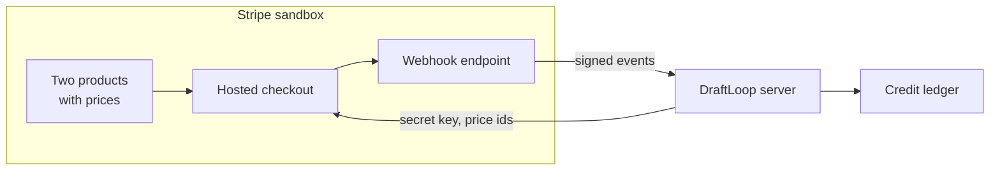

# Set up Stripe in test mode

This page is for the operator who wants the server to sell credit packs
through Stripe Managed Payments in test mode. At the end, a test purchase
adds credits to an organisation and no real money moves.

The server refuses live keys. Selling for real waits for the live account
review and the legal pages (#2462).

## What you need

- A Stripe account. A sandbox needs no business verification.
- A DraftLoop server in sign-in mode: the hosted service, or the local stack.
- Access to the server's settings and secrets.

## How the pieces fit



## Steps in Stripe

1. **Open a sandbox.** In the Dashboard, open the account picker and create a
   sandbox. Do every step below inside it.
2. **Activate Managed Payments.** Go to Settings, Managed Payments, and
   activate it. If Stripe refuses the sandbox, stop here and report it: the
   fallback provider is Paddle (#2682).
3. **Include tax in prices.** In Settings, Tax, set **Include tax in prices**
   to yes, so the buyer pays the price shown.
4. **Create two products.** In the Product catalog, create each with a
   one-time price in EUR:

   | Product name   | Price | Tax code                                                                               |
   | -------------- | ----- | -------------------------------------------------------------------------------------- |
   | 1 application  | 5.00  | `txcd_10105001` (Artificial Intelligence as a Service, cloud based, personal use)      |
   | 5 applications | 22.00 | `txcd_10105001`                                                                        |

   The tax code must show **Eligible for Managed Payments**.
5. **Copy the two price ids.** Open each product and copy its price id. It
   starts with `price_`, not `prod_`.
6. **Add a webhook endpoint.** In Developers, Webhooks, add an endpoint:
   - Address: your server's address followed by `/v1/payments/events`.
   - Events: `checkout.session.completed` and
     `checkout.session.async_payment_succeeded`.
7. **Copy the signing secret** of that endpoint. It starts with `whsec_`.
8. **Create a restricted key.** In Developers, API keys, create a restricted
   key with write access to Checkout Sessions only. It starts with `rk_test_`.
   A standard `sk_test_` key works too, with more access than needed.

## Settings on the server

| Setting                            | Value                                           | Secret |
| ---------------------------------- | ----------------------------------------------- | ------ |
| `DRAFT_LOOP_PAYMENTS`              | `stripe`                                        | No     |
| `DRAFT_LOOP_STRIPE_SECRET_KEY`     | The test key from step 8                        | Yes    |
| `DRAFT_LOOP_STRIPE_WEBHOOK_SECRET` | The signing secret from step 7                  | Yes    |
| `DRAFT_LOOP_STRIPE_PRICE_PACK_1`   | The price id of "1 application"                 | No     |
| `DRAFT_LOOP_STRIPE_PRICE_PACK_5`   | The price id of "5 applications"                | No     |
| `DRAFT_LOOP_PAYMENTS_RETURN_URL`   | Your server's HTTPS address, where buyers return | No     |

Put the two secrets in the deployment's secret store, never in a file under
version control. On the hosted service, the infrastructure repository wires
them ([server deploy](server-deploy.md)). The self-hosted stack does not pass
these settings to the API yet; the local development stack does
([Try it on the local stack](#try-it-on-the-local-stack)).

Restart the API. A wrong or missing value stops the start with a message
that names the setting and never repeats a secret.

## Check a test purchase

1. Sign in and ask for a checkout. Replace the address and the token:

   ```sh
   curl -sS -X POST "https://your-server.example/v1/organisation/credit-purchases" \
     -H "Authorization: Bearer YOUR_ACCESS_TOKEN" \
     -H "Content-Type: application/json" \
     -d '{"pack":"pack-1"}'
   ```

   The answer holds a `checkoutUrl` on `checkout.stripe.com`.
2. Open that address. Pay with the test card `4242 4242 4242 4242`, any
   future expiry date and any CVC.
3. Read the balance:

   ```sh
   curl -sS "https://your-server.example/v1/organisation/credits" \
     -H "Authorization: Bearer YOUR_ACCESS_TOKEN"
   ```

   `grantsRemaining` is one higher than before, within a minute.

## Try it on the local stack

The [local server stack](local-server-stack.md) has a sign-in server at
`http://127.0.0.1:58082`. Stripe cannot reach your machine, so the Stripe CLI
forwards the events instead of the webhook endpoint of step 6.

1. Do steps 1 to 5 and step 8 above.
2. Install the [Stripe CLI](https://docs.stripe.com/stripe-cli) and sign in
   to the sandbox with `stripe login`.
3. Forward events, and leave this running:

   ```sh
   stripe listen --forward-to http://127.0.0.1:58082/v1/payments/events
   ```

   It prints a signing secret that starts with `whsec_`.
4. In the repository's root, put the values in the ignored `.env` file:

   ```text
   DRAFT_LOOP_PAYMENTS=stripe
   DRAFT_LOOP_STRIPE_SECRET_KEY=the test key
   DRAFT_LOOP_STRIPE_WEBHOOK_SECRET=the secret from step 3
   DRAFT_LOOP_STRIPE_PRICE_PACK_1=the first price id
   DRAFT_LOOP_STRIPE_PRICE_PACK_5=the second price id
   ```

5. Start the stack with `pnpm server:up`, then
   [set up an organisation](local-server-stack.md#set-up-an-organisation)
   with a plan.
6. [Check a test purchase](#check-a-test-purchase) against
   `http://127.0.0.1:58082`. The `stripe listen` window shows the event
   answered with 200.

Unset, `DRAFT_LOOP_PAYMENTS` is `off` and the stack sells nothing.

## When it fails

| What you see                              | Cause and fix                                                                                     |
| ----------------------------------------- | ------------------------------------------------------------------------------------------------- |
| The API does not start                    | Read the message: it names the setting. A live key is refused on purpose.                         |
| `503 payments_unavailable`                | `DRAFT_LOOP_PAYMENTS` is not `stripe` on the instance that answered.                              |
| `502 payment_provider_failed`             | Stripe refused the checkout. Check the key's access, the price ids and that Managed Payments is on. |
| `404` on the purchase route               | The server runs with the owner token, or the caller is not a signed-in member.                    |
| Paid, but no credits                      | In Stripe, open the webhook endpoint's deliveries. A 400 means the signing secret does not match. |
| The delivery shows 200 and `ignored`      | The API log line `payment event ignored` gives the reason, such as `live_event` or `not_paid`.    |
| The same purchase delivered twice         | Nothing to do: the second answers `already_granted` and adds nothing.                             |

## Related

- [Plans and credits](../features/plans-and-credits.md)
- [Hosted service: buying a credit pack](../architecture/hosted-service.md#buying-a-credit-pack)
- [Stripe: set up Managed Payments](https://docs.stripe.com/payments/managed-payments/set-up)
- [Stripe: eligibility and tax codes](https://docs.stripe.com/payments/managed-payments/eligibility)
