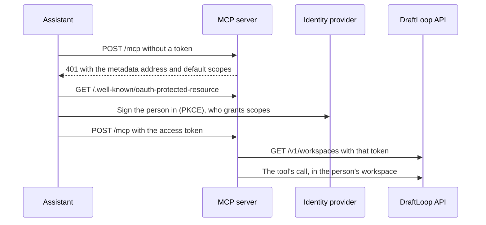

# Agent channel: agents in DraftLoop

An agent here is any AI assistant that pairs a model with a harness able to
call tools over MCP. Claude Code and Codex are the examples this page sets up;
another MCP-capable agent uses the copied configuration.

The candidate's agent can record notable work it helped ship, such as a
payments integration or a database migration, as a note in DraftLoop's work
journal. A note is evidence for review, never a CV claim: it waits as pending
until the candidate approves it on the Career evidence page or from the CLI.
The design is [ADR 0011, D17](../adr/0011-client-server-version.md#d17-agent-channel-an-mcp-server).

The channel is `draftloop-mcp`, a stdio MCP server that calls the
[self-hosted server](../operations/self-hosted.md)'s API with an agent token.
An agent token reaches one workspace, and only the scopes ticked when it was
created: `journal` (file notes and list their titles), `applications:read`,
`jobs:write`, `drafts:read` and `runs:start`. Every other route refuses it.
Candidate data stays on your machine. Without the self-hosted stack, there is
nothing for it to call: the CLI-only path is not served.

Real Claude Code sessions walked this setup on 2026-11-04: the
[work journal walk](../evaluation/work-journal-walk.md) and the
[agent token walk](../evaluation/agent-token-walk.md) list what passed and the
open defects. The [plugin walk](../evaluation/agent-plugin-walk.md) of
2026-11-07 installed the plugin and called every tool.

## Set it up

You need a running [self-hosted server](../operations/self-hosted.md) and
`draftloop-mcp` on your `PATH` (step 1 below). Then pick one way:

| Way                          | For                     | What it adds                                          |
| ---------------------------- | ----------------------- | ----------------------------------------------------- |
| The Claude Code plugin       | Claude Code             | The tools, the [commands](#commands), the Stop hook   |
| A copied configuration       | Claude Code, Codex, any | The tools only                                        |
| `draftloop-mcp init`         | Claude Code, Codex      | The tools, `/log-work` and the hook, in one project   |

The Agents section of Workspace settings on Home shows the first two and
holds the **Accept notes from agents** button; the Work journal panel links
to it.

1. Put `draftloop-mcp` on your `PATH` from a clone of this repository. Run the
   link from inside `apps/mcp`: `pnpm --dir apps/mcp link --global` links the
   root package instead.

   ```text
   pnpm install
   cd apps/mcp
   pnpm link --global
   draftloop-mcp --help
   ```

   If pnpm answers `ERR_PNPM_NO_GLOBAL_BIN_DIR`, run `npm link` in the same
   folder instead, or run `pnpm setup`, open a new shell, and link again. The
   last command prints the tool's usage.

   With nvm, the link lands in the folder of the Node version that was active.
   Claude Code starts `draftloop-mcp` from its own shell, so that shell must
   find both `claude` and `draftloop-mcp`: use one Node version for both, or
   put both versions' `bin` folders on `PATH`.

2. Under **Agents** in Workspace settings, turn on **Accept notes from
   agents**; the server refuses notes while intake is off. Then, in the same
   section, open **Connect an agent** and select **Create agent
   token**. The three scopes the plugin uses are ticked by default; untick
   any the agent should not have. **Read CVs and drafts** stays unticked
   until you choose to share your exported CVs and saved drafts.
3. Pick your agent's tab and copy what it shows:

   | Tab                     | What to do                                                             |
   | ----------------------- | ---------------------------------------------------------------------- |
   | Claude Code plugin      | Run the two `/plugin` lines in Claude Code, then `draftloop-mcp save-token` in a terminal and paste the token |
   | Claude Code             | Run the `claude mcp add --scope user` command, which holds the token, in a terminal |
   | Codex                   | Add the table, which holds the token, to `~/.codex/config.toml`        |
   | Other MCP agents (JSON) | Add the entry, which holds the token, to the agent's `mcpServers` file |

   `save-token` reads the token from standard input, so it stays out of your
   shell history, and keeps it in `~/.config/draftloop/agent-token`
   (`%APPDATA%\draftloop\agent-token` on Windows). The
   plugin's server reads it there and calls `http://127.0.0.1:8080` unless
   `DRAFT_LOOP_SERVER_URL` names another address. Export it before you start
   Claude Code, for example `http://127.0.0.1:8081` for a clone's stack.

The token is shown once. Keep it in your user settings, never in a project file
you commit. The section lists the active tokens with their scopes and revokes
each one.

The desktop client shows its server's screens, so it offers the same steps when
connected to a self-hosted server. On the hosted service, signed-in accounts
get no agent token yet, so the section says so and links here.

### Install it in another agent

`plugins/draftloop` is also an
[Agent Plugins 1.0.0](https://agent-plugins.org/specification) package. An
agent that reads that format installs it from the folder and gets the tools
and the skills, but not the Stop hook, which is Claude Code's own.

| File                                                | Read by                     |
| --------------------------------------------------- | --------------------------- |
| `plugin.json`, `mcp.json`, `skills/`                | Agents that read the format |
| `.claude-plugin/plugin.json`, `.mcp.json`, `hooks/` | Claude Code                 |

The portable `mcp.json` sets no server address, because the format expands no
variables. `draftloop-mcp` then calls `http://127.0.0.1:8080`, or the address
in `DRAFT_LOOP_SERVER_URL` if your agent passes its environment on. Save the
token with `draftloop-mcp save-token` as for the Claude Code plugin.

### Set it up with `init`

`init` writes the project's files, including the `/log-work` skill and, for
Claude Code, the Stop hook. With `draftloop-mcp` on your `PATH` and intake on:

1. In the project whose work you want to record, run `init` for your agent,
   with the owner token for that one command only:

   ```text
   DRAFT_LOOP_SERVER_TOKEN="$(draft-loop-server token)" draftloop-mcp init --host claude-code
   ```

   Use `--host codex` or `--host generic` for the other hosts, and add
   `--hook` for Claude Code's Stop hook. `init` writes the project's files,
   asks the server for an agent token and saves it in your configuration
   folder, then prints `issued: agent token dlat_..., saved to ...`.

2. Start the agent from a shell without the owner token. `draftloop-mcp`
   sends the saved agent token.

`init` merges into existing files, and running it again changes nothing in
them; it issues a new agent token each time. The files hold only names: no
token and no path of your machine is written.

If `init` prints `No agent token issued`, follow the line it prints. A server
older than `server-v0.15.0` issues none: upgrade it, or keep the owner token
in `DRAFT_LOOP_SERVER_TOKEN` as before, which still works.

| Host            | Server entry         | Instructions | Skill                              |
| --------------- | -------------------- | ------------ | ---------------------------------- |
| Claude Code     | `.mcp.json`          | `CLAUDE.md`  | `.claude/skills/log-work/SKILL.md` |
| Codex           | `.codex/config.toml` | `AGENTS.md`  | `.agents/skills/log-work/SKILL.md` |
| Other MCP hosts | `.mcp.json`          | `AGENTS.md`  | `.agents/skills/log-work/SKILL.md` |

Codex reads a project's `.codex/config.toml` only in a trusted project; copy
the marked block into `~/.codex/config.toml` otherwise.

The server reads its token, in order, from `DRAFT_LOOP_SERVER_TOKEN_FILE`, the
saved agent token, then `DRAFT_LOOP_SERVER_TOKEN`. The saved token is in
`$XDG_CONFIG_HOME/draftloop/agent-token`, by default
`~/.config/draftloop/agent-token`, or `%APPDATA%\draftloop\agent-token` on
Windows.

| Variable                      | Default                 | Meaning                                                                      |
| ----------------------------- | ----------------------- | ---------------------------------------------------------------------------- |
| `DRAFT_LOOP_SERVER_URL`       | `http://127.0.0.1:8080` | The self-hosted server's address                                             |
| `DRAFT_LOOP_SERVER_TOKEN`     | none                    | For `init`, the owner token; for the server, a token used when none is saved |
| `DRAFT_LOOP_SERVER_WORKSPACE` | `owner`                 | The workspace that receives the notes                                        |

### Revoke an agent token

An agent token expires 90 days after it is issued; create a new one under
Agents or run `init` again. A workspace holds at most 20 active tokens. Revoke
one under **Show and revoke** in Agents; a revoked token is refused at once
and the others keep working. From a terminal, the owner lists and revokes them
through the API:

```text
export DRAFT_LOOP_SERVER_TOKEN="$(draft-loop-server token)"
curl -s -H "authorization: Bearer $DRAFT_LOOP_SERVER_TOKEN" http://127.0.0.1:8080/v1/workspaces/owner/agent-tokens
curl -s -X DELETE -H "authorization: Bearer $DRAFT_LOOP_SERVER_TOKEN" http://127.0.0.1:8080/v1/workspaces/owner/agent-tokens/dlat_ID
```

Replace `dlat_ID` with the id the list shows; `active` is false once a token
is revoked or expired. Each note names the agent token that filed it.
To review everything one token filed or amended, such as after revoking it:

```text
curl -s -H "authorization: Bearer $DRAFT_LOOP_SERVER_TOKEN" "http://127.0.0.1:8080/v1/workspaces/owner/work-journal/notes?fields=summary&agent_token_id=dlat_ID"
```

Run `init` again to issue a new one. The
[agent token audit](../security/agent-token-audit.md) lists every rule.

### The `/log-work` skill and the Stop hook

- **`/log-work`** takes an optional date range, lists what was merged on the
  default branch from the local git history, and records each notable piece
  once, after `list_work` shows it is not already recorded.
- **The Stop hook** (Claude Code only, with `--hook`) adds one advisory line
  when a turn merged work without calling `record_work`: `gh pr merge`, a push
  to `main` or `master`, or a `merge_pull_request` tool call. A push to a
  feature branch stays quiet. It never blocks the turn, and nothing calls the
  tool by itself.

## What the agent records

The tools are `record_work`, which files a note, and `list_work`, which lists
notes by title, dates, technologies and status, never summaries or links. The
rule travels with the server, in the tool description, the
`draftloop://work-journal/guide` resource and the `log-notable-work` prompt.

- **One note per user-visible feature.** A small unrelated change gets its
  own note or none, never a place in a bigger one.
- **Summaries read as evidence:** the problem, what shipped in plain words,
  and the outcome or scale. Library names go in `technologies`.
- **Record** shipped work a hiring manager would ask about: a merged feature,
  integration or migration, an adopted technology, or a measured improvement
  with how it was measured.
- **Never record** typo fixes, formatting, dependency bumps, refactors without
  an outcome, work in progress, or work the candidate did not take part in.
- **Never include** keys, tokens, passwords, connection strings, customer or
  personal data, or private document text. The server refuses a note that
  looks like it holds a secret.
- **The role is stated as it was:** designed, implemented, directed or
  reviewed.

### When a tool call fails

A failed call answers `isError` with one JSON object:
`{"error": {"code", "message", "fields", "retryable"}}`. The message is one
sentence, and `fields` names the note fields to fix.

| `retryable` | When                                                                                       | What the agent does              |
| ----------- | ------------------------------------------------------------------------------------------ | -------------------------------- |
| `true`      | The server is unreachable, or answers 408, 425, 429, 500, 502, 503 or 504                  | Tries the same call again later  |
| `false`     | Validation, permission, not found, conflict, no token (`not_signed_in`), or `internal_error` | Fixes the input or asks the user |

## Job applications and runs

With the matching scopes, the agent can also see the candidate's job
applications, read the job description one keeps, and add one. With
`drafts:read`, it reads what the candidate already exported or saved. No tool
returns a run's open draft, its findings or career evidence.

| Tool                | Scope               | What it does                                                               |
| ------------------- | ------------------- | -------------------------------------------------------------------------- |
| `list_applications` | `applications:read` | Lists applications with status, folder and latest run; archived on request |
| `get_application`   | `applications:read` | Reads one application by id                                                |
| `get_job_text`      | `applications:read` | Reads the job text an application keeps, or its page's address and copy    |
| `get_run_status`    | `applications:read` | Says where a CV run stands and what waits for the candidate                |
| `add_job`           | `jobs:write`        | Adds an application from a job description pasted as text                  |
| `get_cv`            | `drafts:read`       | Reads the newest Markdown export of the CV the application uses            |
| `list_materials`    | `drafts:read`       | Lists saved cover letters, interview guides and question sets, without text |
| `get_material`      | `drafts:read`       | Reads one saved letter, guide or question set, without its cited facts or a guide's never-say list |
| `estimate_run`      | `runs:start`        | Prices a run and says what remains of the token's monthly spend cap        |
| `start_cv_run`      | `runs:start`        | Starts a CV run on the newest reviewed brief, within the cap               |
| `draft_cover_letter` | `runs:start`       | Drafts and saves a cover letter, within the cap                            |
| `draft_interview_prep` | `runs:start`     | Drafts and saves interview questions with talking points, within the cap   |

`add_job` refuses a job page address, because fetching a page needs the
candidate's approval in DraftLoop. The job text is screened like an upload
when its requirements are extracted. Approving a draft, deciding findings,
exporting and every setting stay with the candidate in DraftLoop. A token
without the scope a tool needs is refused with a message naming that scope,
its name on the token form, and where to create a new token.

`get_cv` needs a Markdown export. When the CV has none, the agent asks the
candidate to export it in DraftLoop; it never exports or writes one itself.
The material route returns the cited facts too, so a `drafts:read` token can
read them by calling the API directly; the tools leave them out.

### Starting runs and drafts within a monthly spend cap

A token with `runs:start` can price a run, start a CV run on an
application's reviewed brief, and draft a cover letter or interview
questions. The candidate gives it a monthly spend limit in
US dollars when creating it; the token form and the API refuse one without
the other.

| Route                | What an agent token may do                                                |
| -------------------- | ------------------------------------------------------------------------- |
| `GET runs/estimate`  | Price a run; the answer adds `agentSpend`: cap, spent, remaining, per run |
| `POST runs`          | Start a run with `applicationId` and `opportunityBrief` only              |
| `POST applications/:id/material` | Draft a cover letter or interview questions on the default model |

- **Reservation.** Each run reserves the workspace's per-run cost limit
  against the cap for the UTC month, before it is saved; each draft reserves
  its own cost cap, US$0.50 by default. Neither can cost more, so the cap is
  never passed.
- **Retries.** A retry with the same `Idempotency-Key` reserves nothing more,
  and a start the server refuses gives its reservation back.
- **Past the cap.** The start answers 429 `agent_spend_cap_reached` with the
  cap and what was spent. It works again next month, or with a new token.
- **Stays human.** The models, the career profile, the budget, approving the
  draft and deciding findings stay with the candidate in DraftLoop.

The token list in Workspace settings shows what each token used this month.
`start_cv_run` sends a new `Idempotency-Key` on each call, so the agent never
calls it twice for one request. `init` never issues `runs:start`: the
candidate sets the spend limit on the token form.

`init` issues a token with `journal`, `applications:read` and `jobs:write`.
To choose others, name them with `--scope`, repeated; `drafts:read` is given
only when named. Its token always keeps `journal`, which the skill and hook it
writes need:

```text
draftloop-mcp init --host claude-code --hook --scope applications:read --scope drafts:read
```

## Commands

A host's command menu, such as Claude Code's `/` menu, lists skills and MCP
prompts, never tools. To use a tool without a command, ask in plain words, for
example "list my DraftLoop applications". In Claude Code, `/mcp` lists every
tool the server offers.

| Task                     | Plugin skill              | MCP prompt, any host | What it does                                        |
| ------------------------ | ------------------------- | -------------------- | --------------------------------------------------- |
| List applications        | `/draftloop:applications` | `applications`       | Lists applications with status and latest run state |
| One application's status | `/draftloop:status`       | `application-status` | Says where one application stands and the next step |
| Tailor a CV              | `/draftloop:tailor-cv`    | none                 | Adds a pasted job and follows its CV run            |
| Start a CV run           | `/draftloop:start-run`    | none                 | Prices a run, asks to confirm, then starts it       |
| Log work                 | `/draftloop:log-work`     | `log-notable-work`   | Records notable merged work in the work journal     |

With the plugin installed, Claude Code also lists each MCP prompt, as
`/plugin:draftloop:draftloop:<prompt> (MCP)`.

## Serve the tools over HTTP

Some assistants connect to an MCP server by address instead of starting a
command. `draftloop-mcp serve-http` serves the same tools over Streamable HTTP:

```sh
DRAFT_LOOP_SERVER_URL=http://127.0.0.1:8080 draftloop-mcp serve-http
```

It prints `DraftLoop MCP tools on http://127.0.0.1:8090/mcp`. The caller sends
its own agent token as `Authorization: Bearer`, and the server forwards it to
the API on each call. It keeps no token, no session and no candidate data.

| Setting                       | Default                 | What it sets                         |
| ----------------------------- | ----------------------- | ------------------------------------ |
| `DRAFT_LOOP_SERVER_URL`       | `http://127.0.0.1:8080` | The DraftLoop API the tools call     |
| `DRAFT_LOOP_SERVER_WORKSPACE` | `owner`                 | The workspace the tools act in       |
| `DRAFT_LOOP_MCP_PORT`         | `8090`                  | The port it listens on               |
| `DRAFT_LOOP_MCP_HOST`         | `127.0.0.1`             | The address it binds                 |

A request without a credential answers `401`, and `GET /healthz` answers
`200`. It speaks plain `http` on this computer only: to reach it from another
machine, put a TLS proxy in front of it.

### With OAuth sign-in

On a server in sign-in mode, set both addresses and the server asks
assistants to sign the person in instead of taking an agent token:

| Setting                     | What it sets                                                 |
| --------------------------- | ------------------------------------------------------------ |
| `DRAFT_LOOP_MCP_PUBLIC_URL` | This server's `https` address as people enter it, ending `/mcp` |
| `DRAFT_LOOP_OIDC_ISSUER`    | The identity provider's issuer, the same one the API trusts  |



- **Default scopes.** The server asks for `journal`, `applications:read` and
  `jobs:write`. `drafts:read` is granted only when the person adds it.
- **Workspace.** The tools act in the signed-in person's workspace. A person
  who reaches several gets the first by id; choosing one is not built.
- **A dead token** answers `401` with `invalid_token`, so the assistant
  refreshes it. An account without a workspace answers `403`.
- **Identity provider.** It needs one confidential client per assistant with
  that assistant's redirect address, PKCE with S256, refresh tokens, the API's
  audience on the token and the `draftloop:` scopes as optional client scopes.

Not built yet: runs and drafts from a connection, which wait for a spend cap
per connection.

## How the candidate reviews

Each pending note shows its title, period, project, technologies, role,
summary, screening result and the agent that filed it, by its token's name.
Its links are folded behind a count. Approve is preselected. The candidate can:

- **Approve** it into a knowledge base. It becomes a Markdown source of the
  `work-journal` evidence kind, so runs can cite it like any other source.
- **Edit** any field first. The edit is checked and screened again.
- **Merge** it with a likely duplicate shown beside it. Links and technologies
  are combined, the period is widened and one summary is kept.
- **Discard** it. A discarded note's text is forgotten after 30 days, and the
  same work is not recorded again.

A pending note's review link, `/#work-journal`, opens this panel, and the
workspace home shows how many notes wait. The same review runs from the CLI
with `draft-loop work-journal`; see the
[self-hosted server](../operations/self-hosted.md#work-journal) guide.

## On the hosted service: an assistant's sign-in

The hosted service issues no agent tokens. An assistant instead signs the
person in through the identity provider and holds an access token issued to
its own client. The API treats that token as an **agent grant**:

- **Same routes.** The grant acts as the signed-in member, on the routes the
  agent scopes admit and no other. A decision, a setting or sign-up answers
  `403`.
- **Scopes.** The token's `scope` claim carries each granted scope as
  `draftloop:<scope>`, such as `draftloop:applications:read`. A token of any
  client other than the web screen's is a grant, even with no scope.
- **Spending needs a cap.** A grant with `runs:start` starts a run or a draft
  only within the monthly cap its person set for that assistant in the
  workspace. Without a cap it answers `429`, like a token past its cap.

### The connection's spend cap

The person sets the cap from their own sign-in; an assistant never reaches
these routes. One cap holds for one workspace and one assistant client.

| Route                                                       | What it does                                 |
| ----------------------------------------------------------- | -------------------------------------------- |
| `GET /v1/workspaces/{id}/agent-connections`                 | Lists each cap and what it reserved this month |
| `PUT /v1/workspaces/{id}/agent-connections`                 | Sets or changes a cap: `client_id`, `monthly_cap_usd` |
| `DELETE /v1/workspaces/{id}/agent-connections?client_id=…` | Removes a cap; the connection stops spending |

Each start reserves its worst case against the cap, as an
[agent token's](#starting-runs-and-drafts-within-a-monthly-spend-cap) does: a
run reserves the workspace's per-run cost limit and a draft its cost cap. The organisation's plan and credits still
apply to each run. A server that keeps no caps refuses every grant's start
with `403`.

The assistant gets that token through the
[remote server's OAuth sign-in](#with-oauth-sign-in). A grant also lists the
ids of the workspaces its member reaches, and nothing else outside a workspace.

## Privacy lines

- **Duplicates.** The same pull request in the same repository, or the same
  title in the same project, is recorded once. A note about the same project
  over overlapping dates that shares a link or nearly the same title is
  recorded and shown as a likely duplicate. Shared technologies alone do not
  count, since one project's notes share its stack.
- **Screening.** Each note is screened for instructions to a model, like an
  upload. A held note cannot be approved until an edit screens clear.
- **Default tiers.** An approved note from a public project is `normal`, and
  one from a private or unknown project is `sensitive`. The candidate can
  choose another tier at approval.
- **Repositories and links.** For a private or unknown project, the note's
  repository and links are `never-share`, so they never reach a model
  provider while the work itself stays usable.
- **What the agent sees.** Everything a tool returns reaches the agent's model
  provider, so `list_work` returns only titles, dates, technologies and
  status.
- **Limits.** The server takes up to 60 notes an hour per workspace and keeps
  up to 500 pending notes.
