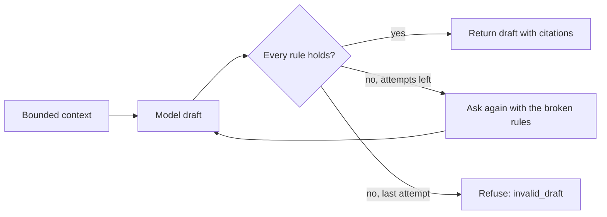

# Application material

This guide is for the developer or reviewer who changes how DraftLoop drafts a
cover letter or a set of interview questions for one application (#2215). It
states what the drafter sends to the model and which drafts it refuses. The
code is `packages/application/src/application-material.ts` and its model
adapter `application-material-model.ts`.

## What the drafter sends

The drafter builds a bounded context, then asks the model behind
`ApplicationMaterialPort` for one draft.

| Input            | Rule                                                                                                                        |
| ---------------- | --------------------------------------------------------------------------------------------------------------------------- |
| Career facts     | Identity and contact facts are always withheld; the host's rules may withhold more. At most 60, each cut to 300 characters. |
| Job requirements | Third-party text from the job post. Sent as data, never as instructions. At most 20, critical first.                        |
| Refused rules    | Empty on the first call; the second call lists what the first draft broke.                                                  |

The default model is Claude Sonnet; Claude Haiku is the economy option. The
host picks the model and records it with the draft.

## Which drafts it refuses

Each paragraph, or each question with its talking point, must pass all rules:

- It cites at least one fact id.
- Every cited id is a fact in the context. An id the record holds but the
  candidate did not allow is `fact_not_allowed`; any other is `unknown_fact`.
- Every number in the text appears in a cited fact. A question may also repeat
  a number from the job's requirements.
- A cover letter has at most 6 paragraphs and interview questions at most 10
  items, each at most 1,200 characters.

A record with no fact the draft may cite is refused before any model call
(`no_facts`). The drafter never stores a draft.
