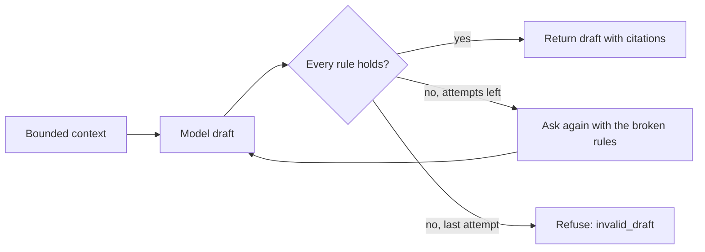
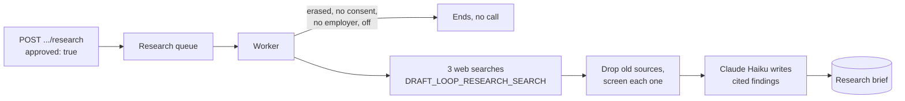

# Application material

This guide is for the developer or reviewer who changes how DraftLoop drafts a
cover letter or a set of interview questions for one application (#2215). It
states what the drafter sends to the model and which drafts it refuses. The
code is `packages/application/src/application-material.ts` and its model
adapter `application-material-model.ts`.

## What the drafter sends

The drafter builds a bounded context, then asks the model behind
`ApplicationMaterialPort` for one draft.

| Input            | Rule                                                                                                                        |
| ---------------- | --------------------------------------------------------------------------------------------------------------------------- |
| Career facts     | Identity and contact facts are always withheld; the host's rules may withhold more. At most 60, each cut to 300 characters. |
| Job requirements | Third-party text from the job post. Sent as data, never as instructions. At most 20, critical first.                        |
| Guidance         | Optional, the candidate's own: what to stress (400 characters), tone, length and, for a cover letter, the addressee.        |
| Voice            | Optional: up to three writing samples (2,000 characters each sent), the writing policy's forbidden terms, tone and spelling. Style only. |
| Company facts    | Optional: the newest research brief's findings, at most 12, each with its newest source date. About the employer only.     |
| Refused rules    | Empty on the first call; the second call lists what the first draft broke.                                                  |

Guidance steers the writing and is never a fact. The model may not cite it,
and the refusal rules below check claims and numbers against cited facts
only, so a number stated only in the guidance is refused. The prompt is
`application-material-v9`.

A cover letter also follows a human writing brief: 250 to 350 words, plain
words, varied sentences, one concrete detail from a cited fact, no stock
phrase, no list of three, no paragraphs that open alike, and at most one dash.

## Your own voice

Up to three texts the candidate wrote, such as an old letter or a long email,
make drafts sound like them. They are kept as the `writing-samples.json`
workspace setting, so they are archived and erased with the record.

| Route                                       | Does                                                                           |
| ------------------------------------------- | ------------------------------------------------------------------------------ |
| `GET /v1/workspaces/{workspaceId}/writing-samples` | Returns the samples.                                                     |
| `PUT /v1/workspaces/{workspaceId}/writing-samples` | Replaces them: at most 3, each 80 to 4,000 characters; `[]` removes them. |

The model copies their sentence length, tone and words, never their content.
The refusal rules check cited facts only, so a number only a sample states is
refused. The writing policy's forbidden terms, tone and spelling reach the
model with the samples.

## Writing check

Each cover letter view carries `tells`: sentences with habits readers notice
in model-written text, from `packages/application/src/writing-tells.ts`. It is
deterministic, runs on every read, and is never stored. It is not an AI
detector, and the app never says a letter would pass one.

| Tell                | Flags                                                                          |
| ------------------- | ------------------------------------------------------------------------------ |
| `stock_phrase`      | Phrases such as "I am writing to express", "passionate about" or "tirer parti" |
| `heavy_dashes`      | Every sentence with a dash, once the letter uses two or more                   |
| `list_of_three`     | Three single words in a row, such as "fast, reliable and calm"                 |
| `mirrored_openings` | A paragraph that opens with the same two words as an earlier one               |
| `word_count`        | A letter under 250 or over 350 words                                           |

**Critic pass.** Saving a cover letter queues one check on the worker. A critic
from another company, the workspace's critic (OpenAI by default), quotes the
sentences that read as machine-written. The author then revises the letter
once.

- **When it runs:** the server has a queue, the record's consent names both
  companies, and the critic's company differs from the author's. Otherwise no
  pass is queued and the letter stands as drafted.
- **What it saves:** a revision that passes every citation rule becomes the
  next version, with `based_on`, `critic_findings` and `critic_model`. A
  finding that does not quote the letter is dropped.
- **What it skips:** edited versions, interview questions and versions the
  pass already wrote. A newer version the candidate saved meanwhile wins.
- **Cost:** two calls under one US$0.30 cap; a failed job is retried once.

The draft's view carries `review: {status: "pending"}` when a pass was queued.
`GET .../material/:materialId/review` answers `none`, `pending`, `failed` or
`done` with its `outcome` and, for `revised`, the new version's `revision_id`.

The default model is Claude Sonnet; Claude Haiku is the economy option. The
request's optional `model` picks one, and the saved draft records it.
`GET /v1/application-material/models` lists both, the default first, each
with the estimated cost of a typical draft (6,000 input and 2,000 output
tokens) from the catalog's prices.

## Which drafts it refuses

Each paragraph, or each question with its talking point, must pass all rules:

- It cites at least one fact id. The one exception is a cover letter's first
  or last paragraph when it is a courtesy sentence: at most 300 characters,
  no number, and no word of five letters or more taken from a fact.
- It joins facts only within one role or project: each fact reaches the
  model with its subject as `group`, and the prompt forbids joining facts
  across groups. A walk checks this; no rule can.
- It speaks as the candidate. Text about "my record", "listed skills",
  "citations" or claiming "more than" the record is `record_language`.
- Every cited id is a fact in the context. An id the record holds but the
  candidate did not allow is `fact_not_allowed`; any other is `unknown_fact`.
- Every number in the text appears in a cited fact, in digits or in words:
  "five" needs a fact holding "five" or "5". "One" is not read as a count. A
  question may also repeat a number from the job's requirements.
- A company fact supports only a statement about the employer. It is cited
  in `company_fact_ids`, never in `fact_ids`; one cited as a career fact is
  `company_fact_as_candidate_fact`, and one the brief does not hold is
  `unknown_company_fact`. A cited company fact may supply a number about the
  employer. A paragraph still needs a career fact unless it is a courtesy
  sentence.
- A cover letter has at most 6 paragraphs and interview questions at most 10
  items, each at most 1,200 characters.

A record with no fact the draft may cite is refused before any model call
(`no_facts`). The drafter never stores a draft.

## The hosted route

`POST /v1/workspaces/{workspaceId}/applications/{applicationId}/material` with
`{"kind": "cover-letter"}` or `{"kind": "interview-questions"}` returns the
draft. Each item carries its citations as the record stores them, and
`company_citations` when it uses the application's newest research brief,
whose id is `research_brief_id`. The critic's revision keeps those citations
and may not add new ones. A hosted or
self-hosted server saves each draft as a new version and returns its `id` and
`created_at`. It follows the career interview's rules:

| Answer                                              | When                                                                                      |
| --------------------------------------------------- | ----------------------------------------------------------------------------------------- |
| 200                                                 | A validated draft, its id, model, prompt version and recorded cost.                       |
| 404 `not_found`                                     | The application does not exist.                                                           |
| 503 `material_model_unavailable`                    | The server has no Claude route (screening is not `rules+model`) or refuses provider data. |
| 403 `consent_required`                              | The record's consent does not name Anthropic.                                             |
| 409 `material_quarantined` or `material_unscreened` | The newest brief's job source is quarantined or unscreened, as for a run.                 |
| 409 `no_citable_facts`                              | The career record holds no fact the draft may cite.                                       |
| 409 `cost_cap_reached`                              | The next call could pass the request's cap, US$0.50 by default.                           |
| 422 `invalid_draft`                                 | Both drafts broke the rules above.                                                        |
| 502 `material_model_failed`                         | The model's answer could not be used, such as one cut off at its output limit.            |

Each model call is logged with its model, tokens and cost, never the draft. A
refused or failed draft is not saved.

## Saved drafts

Every draft is kept with its application, so you can reopen, compare and delete
it. A saved draft never changes: drafting again, or saving an edit, adds a
newer version.

| Route                                                                  | Does                                                                                           |
| ---------------------------------------------------------------------- | ---------------------------------------------------------------------------------------------- |
| `GET .../applications/{applicationId}/material?kind=cover-letter`      | Lists the application's saved drafts, newest first, at most 50. `kind` is optional.            |
| `POST .../applications/{applicationId}/material/{materialId}/versions` | Saves the candidate's edit as a new version. Body: `{"items":[{"text":...}]}`, one per item. |
| `GET .../material/{materialId}/document?format=docx&template=modern`  | Draws the saved draft as Word or PDF with a CV template, Modern by default. Nothing is stored. |
| `DELETE .../applications/{applicationId}/material/{materialId}`        | Deletes one saved draft for good. 404 when the application has no such draft.                  |

Saved drafts are candidate material. They live in the record's Postgres table
`application_material_drafts`, are part of the record archive, and are erased
with the record or the organisation.

## Research briefs

A research brief holds public facts about the employer, gathered after the
candidate approves a research run (#2482). Each brief keeps what was searched,
the sources kept, and short findings that cite those sources. The candidate
starts a run from the Prepare panel (see [The web panel](#the-web-panel)) or
the API.

A run reads the employer and role from the application's newest job brief,
never the candidate's material. It searches the employer with the role, its
news, and its culture and values. Sources older than the window (12 months by
default) are dropped, and the rule screener drops any source that reads like an
injection. The searches and the findings call share a US$0.20 cap.

| `DRAFT_LOOP_RESEARCH_SEARCH` | Searches with                                                                 |
| ---------------------------- | ----------------------------------------------------------------------------- |
| `claude` (default)           | Claude's web search on the deployment's Claude route; no other account        |
| `linkup`                     | Linkup, with the key `linkup` (`keys/linkup_api_key` on a self-hosted stack)  |
| `off`                        | Nothing: each run ends as `unavailable`                                       |

A run ends as `unavailable` without a call when the setting is `off`, the
search has no key, provider data is not allowed, or the workspace runs on
fixtures. The worker logs ids, counts and cost only, never sources or findings.

| Field       | Holds                                                                                          |
| ----------- | ---------------------------------------------------------------------------------------------- |
| `queries`   | What the run searched for.                                                                     |
| `from_date` | The oldest publication date kept; older sources are dropped and counted in `dropped.outdated`. |
| `sources`   | Uploads, company pages and web results, each with an excerpt; no `published_on` means undated. |
| `findings`  | Facts about the employer, each citing one to five of the brief's sources.                      |
| `dropped`   | Sources the run dropped: `flagged` by screening, `outdated` by the window.                     |
| `cost_usd`  | What the run's searches and model calls cost.                                                  |

| Route                                                         | Does                                                       |
| ------------------------------------------------------------- | ---------------------------------------------------------- |
| `GET .../applications/{applicationId}/research-briefs`        | Lists the application's briefs, newest first, at most 20.  |
| `GET .../research-briefs/{briefId}`                           | Reads one brief. 404 when the application has no such one. |
| `DELETE .../applications/{applicationId}/research-briefs/{briefId}` | Deletes one brief for good.                          |
| `POST .../applications/{applicationId}/research`              | Queues a run; the body needs `"approved": true`. 503 when the server researches nothing. |
| `GET .../applications/{applicationId}/research`               | The newest run's state: `none`, `pending`, `done` with its outcome and `brief_id`, or `failed`. |

These routes are for the person only; agent tokens cannot reach them. Briefs
live in the record's Postgres table `application_research_briefs`, are part of
the record archive, and are erased with the record or the organisation.

## Editing a draft

An edit is the candidate's own text, so it is checked and flagged, never
refused. The new version copies the draft, keeps every citation and calls no
model, so it costs nothing.

| Field                         | Means                                                                    |
| ----------------------------- | ------------------------------------------------------------------------ |
| `items[].edited`              | The candidate rewrote this item.                                         |
| `items[].unsupported_numbers` | Numbers in an edited item that none of the draft's cited facts states.   |
| `based_on`                    | The saved draft this version was edited from.                            |
| `tells`                       | The writing check, run again on the edited cover letter.                 |

The request must send one text for each item, in order; another count answers
400. The route is for the person only: agents cannot reach it.

## The web panel

Each application page on the web shows an optional **Prepare** panel after the CV. It starts folded to one line, and the browser remembers when you open it.
The candidate picks a cover letter or interview questions on its toggle and
selects **Draft**. **Guide this draft** opens optional fields: what to stress,
tone, length and, for a cover letter, whom to address. A saved draft keeps the
guidance it was written with. With two models offered, a **Model** list in
the same fields names each with its cost. Under a cover letter, **Writing check** lists the
flagged sentences and why. Before the first draft, the panel names what goes
to Anthropic. On the job page the panel takes the setup card's column; on a run's
review it keeps the run's column.

**About the employer** opens the panel. **Research this application** first
shows what the run searches, that excerpts go to Anthropic, that nothing about
the candidate is sent, and the US$0.20 cap; nothing runs until **Approve and
research**. The panel then asks every three seconds until the run ends. It
lists each finding with its sources, each linked and dated, or marked
**undated**, and offers **Research again** and **Delete this research**. A
paragraph that cites a finding lists it under **About the company**, beside
its career facts, and Markdown adds an `> About the company:` line.

While the critic checks a new cover letter, the panel says so and asks every
three seconds. A revised version then opens, named "revised after the critic's
check", with **What the critic flagged** listing each sentence and why. The
first draft stays in the version list.

Each paragraph or question shows its cited facts beside it. The newest saved
draft of the chosen kind opens first. With two or more, a **Version** list
names each by time and model; **Delete this version** removes the one on
screen after a confirmation. **Edit** turns each item into a text box;
**Save as a new version** keeps the edit, marks changed items **Edited by
you** and names any number no source states. **Download Word** and
**Download PDF** draw a saved draft with the **Template** chosen beside them:
a cover letter opens with the application's name, and each interview question
is a heading. **Download Markdown** saves the draft with a
`> Source:` line under each item. A refusal,
such as a 503 from a server without a Claude route, shows in the panel; the
rest of the page keeps working. The panel lives in
`apps/web/src/application-material.tsx` and fills the shared screens'
`application` host slot; a host that leaves the slot empty shows nothing new.

## Validation walk

The [application material walk](../evaluation/application-material-walk.md)
drafts both kinds with Claude Sonnet on an invented record, capped at US$1. It
runs only with the owner's go. Its fourth run, on prompt
`application-material-v4`, passed every check; `v5` and `v6` add guidance and
the human brief and have not been walked yet (#2483).
