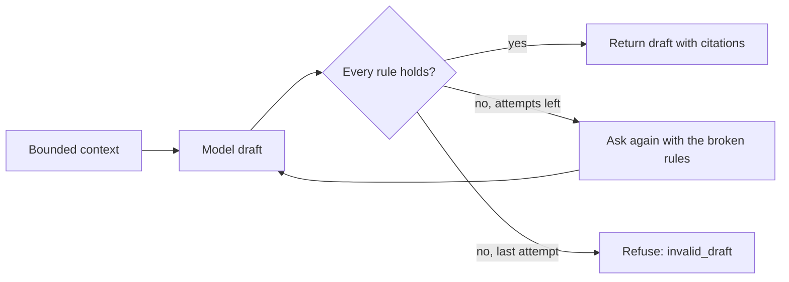

# Application material

This guide is for the developer or reviewer who changes how DraftLoop drafts a
cover letter or a set of interview questions for one application (#2215). It
states what the drafter sends to the model and which drafts it refuses. The
code is `packages/application/src/application-material.ts` and its model
adapter `application-material-model.ts`.

## What the drafter sends

The drafter builds a bounded context, then asks the model behind
`ApplicationMaterialPort` for one draft.

| Input            | Rule                                                                                                                        |
| ---------------- | --------------------------------------------------------------------------------------------------------------------------- |
| Career facts     | Identity and contact facts are always withheld; the host's rules may withhold more. At most 60, each cut to 300 characters. |
| Job requirements | Third-party text from the job post. Sent as data, never as instructions. At most 20, critical first.                        |
| Refused rules    | Empty on the first call; the second call lists what the first draft broke.                                                  |

The default model is Claude Sonnet; Claude Haiku is the economy option. The
host picks the model and records it with the draft.

## Which drafts it refuses

Each paragraph, or each question with its talking point, must pass all rules:

- It cites at least one fact id. The one exception is a cover letter's first
  or last paragraph when it is a courtesy sentence: at most 300 characters,
  no number, and no word of five letters or more taken from a fact.
- It joins facts only within one role or project: each fact reaches the
  model with its subject as `group`, and the prompt forbids joining facts
  across groups. A walk checks this; no rule can.
- It speaks as the candidate. Text about "my record", "listed skills",
  "citations" or claiming "more than" the record is `record_language`.
- Every cited id is a fact in the context. An id the record holds but the
  candidate did not allow is `fact_not_allowed`; any other is `unknown_fact`.
- Every number in the text appears in a cited fact, in digits or in words:
  "five" needs a fact holding "five" or "5". "One" is not read as a count. A
  question may also repeat a number from the job's requirements.
- A cover letter has at most 6 paragraphs and interview questions at most 10
  items, each at most 1,200 characters.

A record with no fact the draft may cite is refused before any model call
(`no_facts`). The drafter never stores a draft.

## The hosted route

`POST /v1/workspaces/{workspaceId}/applications/{applicationId}/material` with
`{"kind": "cover-letter"}` or `{"kind": "interview-questions"}` returns the
draft. Each item carries its citations as the record stores them. It follows
the career interview's rules:

| Answer                                              | When                                                                                      |
| --------------------------------------------------- | ----------------------------------------------------------------------------------------- |
| 200                                                 | A validated draft, its model, prompt version and recorded cost.                           |
| 404 `not_found`                                     | The application does not exist.                                                           |
| 503 `material_model_unavailable`                    | The server has no Claude route (screening is not `rules+model`) or refuses provider data. |
| 403 `consent_required`                              | The record's consent does not name Anthropic.                                             |
| 409 `material_quarantined` or `material_unscreened` | The newest brief's job source is quarantined or unscreened, as for a run.                 |
| 409 `no_citable_facts`                              | The career record holds no fact the draft may cite.                                       |
| 409 `cost_cap_reached`                              | The next call could pass the request's cap, US$0.50 by default.                           |
| 422 `invalid_draft`                                 | Both drafts broke the rules above.                                                        |

Each model call is logged with its model, tokens and cost, never the draft. The
draft is not stored: download it or ask again.

## The web panel

Each application page on the web shows an optional **Prepare** panel after the CV. It starts folded to one line, and the browser remembers when you open it.
The candidate picks a cover letter or interview questions on its toggle and
selects **Draft**. Before the first draft, the panel names what goes to
Anthropic. On the job page the panel takes the setup card's column; on a run's
review it keeps the run's column.

Each paragraph or question shows its cited facts beside it. **Download
Markdown** saves the draft with a `> Source:` line under each item. A refusal,
such as a 503 from a server without a Claude route, shows in the panel; the
rest of the page keeps working. The panel lives in
`apps/web/src/application-material.tsx` and fills the shared screens'
`application` host slot; a host that leaves the slot empty shows nothing new.

## Validation walk

The [application material walk](../evaluation/application-material-walk.md)
drafts both kinds with Claude Sonnet on an invented record, capped at US$1. It
runs only with the owner's go. Its fourth run, on prompt
`application-material-v4`, passed every check.
