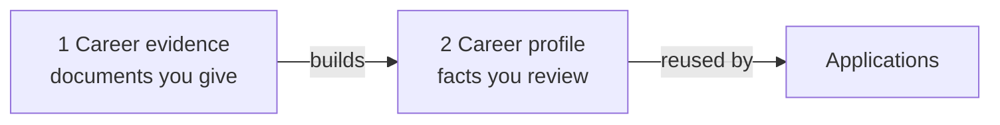
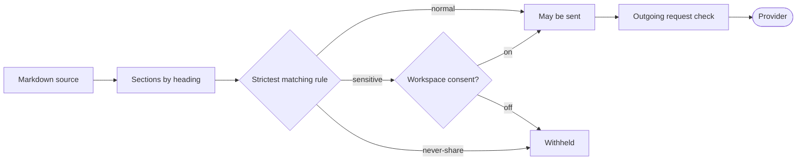

# CLI and desktop reference

This page is the reference for two clients. The first is the **desktop client**, a
window over a DraftLoop server. The second is the source-only **CLI**, which
runs a local workspace. It is for a developer or power user who needs the exact
command, the setting file it writes, and what the screen shows for the same
action.

To install and run the fixture demo, start from the
[developer quick start](../../README.md#developer-quick-start). Run every
command below from the repository root, using Node.js 24.22.1 and pnpm 10.18.3.

> **Before a live run.** A live run needs three things: an explicit
> provider-transmission approval in the workspace, provider keys (see
> [Provider credentials](#provider-credentials)), and a budget, because it costs
> provider money. Keep real candidate material out of the repository.

## Contents

- [Desktop client](#desktop-client)
- [Command groups at a glance](#command-groups-at-a-glance)
- [CLI model profiles](#cli-model-profiles)
- [Provider credentials](#provider-credentials)
- [Autopilot](#autopilot)
- [Applications](#applications)
- [Compacting run history](#compacting-run-history)
- [Opportunity briefs](#opportunity-briefs)
- [Review and approval](#review-and-approval)
- [Candidate profiles](#candidate-profiles)
- [Writing policies](#writing-policies)
- [Candidate knowledge bases](#candidate-knowledge-bases)
- [Requirement coverage in run output](#requirement-coverage-in-run-output)

Notes marked **On screen** describe the shared screens (`packages/ui`). The
server's web screen shows them, and the desktop client shows that same web
screen.

## Desktop client

The desktop client (`apps/desktop-client`, ADR 0011, D9) is an Electron window
over a DraftLoop server's own web screen. Every screen and action it offers is
the web's. To run it from a clone:

```sh
pnpm --filter @draft-loop/desktop-client start
```

| Topic                       | Behaviour                                                                                                                                                                                                                                                                                                                                                                                                                                                  |
| --------------------------- | ---------------------------------------------------------------------------------------------------------------------------------------------------------------------------------------------------------------------------------------------------------------------------------------------------------------------------------------------------------------------------------------------------------------------------------------------------------- |
| Servers                     | It opens the last server when `GET /v1/health` and `/v1/auth/config` answer. Otherwise it shows a picker that says why. The picker adds a server by address (`https` only, except for this computer), and opens or removes one. The **Server** menu switches servers. The client never starts a server.                                                                                                                                                    |
| What stays on this computer | The server list, the window size, and each server's browser storage in its own partition. Removing a server clears that partition. In owner-token mode the token is remembered per server, encrypted by the system keychain, and forgotten on sign-out. It is handed only to a server that proves it holds the same token, checked again before every page load and reload; otherwise you sign in again. On Linux without a keyring nothing is remembered. |
| Isolation                   | The window stays on its server and, in sign-in mode, on its identity provider. Other web links open in the system browser, and every other scheme is refused. The page gets no device permissions and no Node.                                                                                                                                                                                                                                             |
| Exports                     | Saved through the system Save dialog.                                                                                                                                                                                                                                                                                                                                                                                                                      |
| New versions                | At launch the packaged client asks GitHub Releases for a newer `v*` tag. It offers the releases page once per version and never downloads anything. `DRAFT_LOOP_DESKTOP_RELEASE_CHECK=off` turns the check off, and **Help > Check for a new version** runs it on demand.                                                                                                                                                                                  |

## Command groups at a glance

Every command runs as `pnpm --filter @draft-loop/cli start <command> ...`.
Most commands accept `--json` for machine-readable output.

| Command                                         | What it does                                                                                                                       | Section                                                                              |
| ----------------------------------------------- | ---------------------------------------------------------------------------------------------------------------------------------- | ------------------------------------------------------------------------------------ |
| `model-profiles`                                | List, apply or clear model pairs                                                                                                   | [CLI model profiles](#cli-model-profiles)                                            |
| `start`                                         | Start a run, optionally with a pair, brief, profile or policy override                                                             | [CLI model profiles](#cli-model-profiles), [Opportunity briefs](#opportunity-briefs) |
| `approve`, `revise`, `pause`, `stop`, `recover` | Act on a run: approve (optionally with an override), ask for a revision, pause, stop, or return to review after a provider failure | [Review and approval](#review-and-approval)                                          |
| `status`, `evidence-usage`                      | Show a run's coverage and evidence use                                                                                             | [Requirement coverage](#requirement-coverage-in-run-output)                          |
| `autopilot`                                     | Switch autopilot on or off                                                                                                         | [Autopilot](#autopilot)                                                              |
| `application`                                   | List, create, import, rename, archive, restore or delete applications                                                              | [Applications](#applications)                                                        |
| `workspace compact`                             | Shrink an old run history                                                                                                          | [Compacting run history](#compacting-run-history)                                    |
| `opportunity`                                   | Create, edit and review job briefs                                                                                                 | [Opportunity briefs](#opportunity-briefs)                                            |
| `profile`                                       | Derive, edit and review candidate profiles                                                                                         | [Candidate profiles](#candidate-profiles)                                            |
| `policy`                                        | Import and activate writing policies                                                                                               | [Writing policies](#writing-policies)                                                |
| `preferences`                                   | List, accept or dismiss writing preferences suggested from your review choices                                                     | [Suggested preferences](#suggested-preferences)                                      |
| `knowledge`                                     | Manage stores, knowledge bases, sources and sensitivity                                                                            | [Candidate knowledge bases](#candidate-knowledge-bases)                              |
| `evidence mode`, `retrieval mode`, `embeddings` | Choose what a run receives and how it searches                                                                                     | [Evidence mode](#evidence-mode), [Retrieval mode](#retrieval-mode)                   |

## CLI model profiles

A run uses a **pair**: an author profile and a critic profile, each an exact
`profile-id@version`. Choose one with a preset, or name both profiles.

```sh
pnpm --filter @draft-loop/cli start model-profiles
pnpm --filter @draft-loop/cli start start ./workspace --model-preset balanced
pnpm --filter @draft-loop/cli start start ./workspace \
  --author-profile standard-anthropic-author@2 \
  --critic-profile standard-openai-critic@2
pnpm --filter @draft-loop/cli start start ./workspace --model-preset balanced --author-effort high
```

`model-profiles` prints the catalog and presets as JSON. The output includes
exact versions, roles, the bounded pricing scope, and separate quality and
availability statuses. Listing it calls no provider and sends no content.

### Presets

Every preset is an unvalidated opt-in pair: catalog quality is unvalidated,
and account or provider availability is unchecked.

| Preset                | Author                                         | Critic                                                        | Keys needed                |
| --------------------- | ---------------------------------------------- | ------------------------------------------------------------- | -------------------------- |
| `economy`             | Claude Haiku 5.5                               | GPT-6 Luna                                                    | Anthropic, OpenAI          |
| `balanced`            | Claude Sonnet 5.5                              | GPT-6.1 Terra                                                 | Anthropic, OpenAI          |
| `standard`            | Claude Opus 5.5                                | GPT-6.1 Sol                                                   | Anthropic, OpenAI          |
| `balanced-anthropic`  | Claude Sonnet 5.5                              | Claude Opus 5.5 (`standard-anthropic-critic@1`), low effort   | Anthropic                  |
| `standard-anthropic`  | Claude Opus 5.5                                | Claude Sonnet 5.5 (`balanced-anthropic-critic@1`), low effort | Anthropic                  |
| `development-glm`     | Z.ai `zai-org/GLM-5.3-Flash` through DeepInfra | GPT-6 Luna                                                    | DeepInfra, OpenAI          |
| `development-gemini`  | Gemini 3.8 Flash                               | GPT-6 Luna                                                    | Gemini (paid tier), OpenAI |
| `development-mistral` | Mistral Large 4 (public preview)               | GPT-6 Luna                                                    | Mistral, OpenAI            |

- **Balanced** sits between economy and standard on cost.
- **The two Anthropic-only pairs** suit a deployment without an OpenAI budget.
  A different Claude model reviews each draft, so author and critic still
  differ.
- **The active catalog** holds eleven exact profile versions. Older versions
  stay resolvable so that saved runs resume, but they are not offered as
  choices.

### How a pair applies to a run

- **Recorded per run.** A pair passed to `start` applies to that run only. It
  does not change workspace models, transmission approval or credentials.
- **Resume** reuses the pair recorded in the run history.
- **Reasoning level.** `--author-effort` and `--critic-effort` take one of the
  `effortLevels` that the profile lists in `model-profiles`. They need a preset
  or both profile options. A role without one uses its profile's own level.
- **Cost of effort.** A higher level usually costs more output tokens, and can
  improve the draft or the review. On the hosted service, `high`, `xhigh` or
  `max` doubles a run's credits, like a premium model.

### Applied profile pair

A workspace can keep an **applied pair**, so new runs still have profiles after
a restart. A workspace created by `init` without an explicit model choice gets
the economy pair already applied (`economy-anthropic-author@2` and
`economy-openai-critic@1`). An explicit model or pair wins, and existing
workspaces keep their stored models.

```sh
pnpm --filter @draft-loop/cli start model-profiles apply ./workspace --model-preset development-gemini
pnpm --filter @draft-loop/cli start model-profiles apply ./workspace \
  --author-profile standard-anthropic-author@2 \
  --critic-profile standard-openai-critic@2
pnpm --filter @draft-loop/cli start model-profiles applied ./workspace
pnpm --filter @draft-loop/cli start model-profiles clear ./workspace
```

The pair is stored in `.draft-loop/model-profile-selection.json` as exact ids
and versions, with the time it was applied. Each role may also store an
`effort`. Each run records the level it actually used in its profile snapshot.

| Situation                                                                                                                  | What happens                                                                                                     |
| -------------------------------------------------------------------------------------------------------------------------- | ---------------------------------------------------------------------------------------------------------------- |
| `apply` with a pair not registered for its roles, or whose company and model differ from the workspace's author and critic | Refused                                                                                                          |
| `start` without profile options                                                                                            | Uses the applied pair when it still matches the workspace models                                                 |
| `start` with profile options                                                                                               | The options always win                                                                                           |
| The saved pair no longer matches                                                                                           | Ignored, and the run preflight says why                                                                          |
| No applied pair                                                                                                            | The preflight says no profiles are attached. The run uses provider-default controls and unknown context windows. |
| A corrupt selection file                                                                                                   | `start` stops before any provider work. Fix it with `apply` or `clear`.                                          |
| Resume                                                                                                                     | Never reads the applied pair. It reuses the profiles recorded in the run.                                        |

### Development authors

The three development authors are opt-in, and their quality is unvalidated.

| Author           | Select it with                                                                                              | Notes                                                                                                                                                                                                               |
| ---------------- | ----------------------------------------------------------------------------------------------------------- | ------------------------------------------------------------------------------------------------------------------------------------------------------------------------------------------------------------------- |
| Gemini 3.8 Flash | `--author-profile dev-google-gemini-author@2`, or `--author-company google --author-model gemini-3.8-flash` | The key must come from a paid-tier Gemini API project, because free-tier terms let Google use submitted content. Profile `@1` (Gemini 3.7 Flash) stays accepted so old runs resume.                                 |
| Mistral Large 4  | `--author-profile dev-mistral-author@1`, or `--author-company mistral --author-model mistral-large-4`       | Sends material to `https://api.mistral.ai/v1/chat/completions` with its own `MISTRAL_API_KEY`. The model has no thinking or effort control, so the profile uses provider defaults at a 32,768-token output ceiling. |
| GLM-5.3-Flash    | `--model-preset development-glm`                                                                            | Through DeepInfra with `DEEPINFRA_API_KEY`. The normal author profile uses `low` reasoning.                                                                                                                         |

Pair a development author named by profile with an exact critic profile, such as
`economy-openai-critic@1`. Model discovery for Gemini and Mistral is manual,
so enter the exact model id.

**Mistral is slow.** In a live check it wrote about 2,000 to 4,000 output
tokens even for short structured tasks, and took 20 to 40 seconds per call.
Responses stream, so a long answer fails only after 90 seconds without data or
at a 30-minute cap per attempt. Before sending candidate material, review
Mistral's
[data-training controls](https://help.mistral.ai/en/articles/455207-can-i-opt-out-of-my-input-or-output-data-being-used-for-training)
and
[Zero Data Retention terms](https://help.mistral.ai/en/articles/347612-can-i-activate-zero-data-retention-zdr).
The roadmap's [model strategy](../roadmap.md#model-strategy) summarizes them.

### Authentication routes and retries

- **A supported route is required.** Profile selection needs a supported
  authentication route. OpenAI Codex user-session routes and local routes
  reject profile selections.
- **No automatic switching.** The CLI never switches authentication modes on
  its own. When a Codex ChatGPT session rejects a selected model, the
  diagnosis suggests a supported model, or switching OpenAI to an API key
  yourself.
- **Retries.** An OpenAI API-key adapter call makes one provider request unless
  the caller configures retries. Anthropic, local and user-session adapters
  keep their own retry behaviour. This does not change orchestration recovery.

### The live availability check

The local release preflight sends one synthetic request to each
provider and model in the registry before its end-to-end gate. The result
covers availability under that check only. It says nothing about account
guarantees, profile controls or CV quality.

```sh
pnpm test:model-suggestions:live --plan
```

`--plan` prints the requests without creating adapters or reading credentials.
Without it, the command makes the live check, which can use paid API or
subscription routes. Run it only for an approved availability check or a
release preflight.

The paid validation cohort is the required Economy and Standard Anthropic and
OpenAI destinations, plus supported optional entries from the same two
companies. It leaves out the Balanced pair, the two Claude critics of the
Anthropic-only presets, and the development authors. Listing a development
preset does not add its provider to release checks.

### Choosing models on screen

**On screen**, **Change models** opens one editor with **Presets** and
**Custom** choices. It fits a 1280×800 window without scrolling.

| Part                          | What it shows                                                                                                                                                                                                               |
| ----------------------------- | --------------------------------------------------------------------------------------------------------------------------------------------------------------------------------------------------------------------------- |
| Summary line                  | What new runs use now, for example "Now: Standard — Claude Opus 5.5 writes · GPT-6.1 Sol reviews". Exact ids, versions and runtime controls sit under a collapsed **Details**.                                              |
| Preset cards                  | Up to three columns. Each names the writer → reviewer pair, the providers and the public per-million-token prices on one line. Badges read **Unvalidated**, **Development** or **Not available with your current sign-in**. |
| Custom pair                   | A card of the same size that reveals exact author and critic profile selects.                                                                                                                                               |
| Writer and Reviewer reasoning | The levels each profile allows, with its own level marked as the default. Choosing another preset or profile resets the level. A changed level is added to the preset's name, as in "Balanced · writer high".               |
| Quality and sign-in note      | One line, with the full text behind **More**.                                                                                                                                                                               |
| Cancel, Apply for future runs | A bar pinned to the bottom of the window.                                                                                                                                                                                   |

- **Choices stay a draft** until **Apply for future runs**. Saving replaces
  the pair for future runs. It keeps the workspace name, the round limit and
  existing run records.
- **Transmission consent.** A changed provider identity needs fresh
  acknowledgement before the next run starts or resumes. Saving never sends
  candidate material.
- **Unsupported routes** block profile-backed starts. Codex user-session
  routes support no profiles.
- **The applied pair** is the same one the CLI saves. After a restart, the
  summary line names it. Saving custom models clears it, and a saved pair that
  no longer matches is not used. The editor says why.
- **No profiles.** The configured-models card warns "No model profiles:
  provider defaults, unknown context windows." when the next run would attach
  none.
- **Suggested model ids.** When provider model discovery fails or returns
  nothing, the setup and **Change models** forms suggest exact ids from the
  catalog. A suggestion is not guaranteed to work with your account or plan.
  You can still enter any exact id. Local endpoints stay free text.

### Prices and cost estimates

The picker offers an editable token-cost scenario for a draft pair. The
default example plans two author calls and one critic call, at 10,000 input
and 1,000 output tokens. The estimate is not a forecast, a cap or a bill, and
it sets no runtime budget. The reusable code is
`@draft-loop/application/model-profile-budget`.

The estimate leaves out:

- extra calls and retries
- input growth
- cache
- tools and batch
- regional premiums
- unsupported long context

User-session routes show public rates only.

| Model                     | Input / output per million tokens | Notes                                                              |
| ------------------------- | --------------------------------- | ------------------------------------------------------------------ |
| GLM-5.3-Flash (DeepInfra) | $0.15 / $0.50                     | Reviewed 2026-10-02                                                |
| Gemini 3.8 Flash          | $0.75 / $3.75                     | Reviewed 2026-10-04                                                |
| Mistral Large 4           | $1.36 / $4.18                     | Reviewed 2026-10-08, without the launch discount; 1M-token context |

Claude and OpenAI rates are in the catalog (`model-profiles`).

- **Standard text API only.** Prices cover up to 200,000 input tokens by
  default.
- **Claude Opus 5.5 and Sonnet 5.5** bill their whole 1,000,000-token window at
  standard rates, so their cap is 1,000,000.
- **Claude Haiku 5.5** bills a prompt above 100,000 tokens at a higher rate.
  DraftLoop applies that rate to every Haiku call, which gives an upper bound,
  with a 1,000,000 cap.
- **OpenAI critics** are capped at 272,000, and a longer prompt leaves the
  estimate unknown.
- **Cache rates.** The Claude authors and the OpenAI critics carry cache-read
  and cache-write rates. The OpenAI adapter keeps cached-input, cache-write and
  reasoning token details. Missing usage, or a missing rate, leaves the cost
  unknown.
- **Reasoning levels.** Each current Anthropic and OpenAI profile lists the
  levels it accepts, `low` to `max`, from the [Claude effort page] and each
  OpenAI model page. Development profiles keep a fixed level.
- **Haiku 5.5** gets no sampling parameters, thinking budget or assistant
  prefill, which it rejects. The Claude session route reports an unknown model
  with a prompt to update the installed `claude` CLI.

Each catalog entry shows its metadata review date, which is not a live probe.
Sources: [Anthropic model overview], [Claude models overview],
[Claude Sonnet 5.5 overview], [GPT-6.1 Sol], [GPT-6.1 Terra], [GPT-6 Luna],
the DeepInfra [GLM-5.3-Flash API page] and [model announcement],
[Gemini API pricing], [Gemini models] and the [Mistral Large 4 model page].

[Anthropic model overview]: https://platform.claude.com/docs/en/models/overview
[Claude models overview]: https://platform.claude.com/docs/en/about-claude/models/overview
[Claude Sonnet 5.5 overview]: https://platform.claude.com/docs/en/models/sonnet-5-5/overview
[Claude effort page]: https://platform.claude.com/docs/en/build-with-claude/effort
[GPT-6.1 Sol]: https://developers.openai.com/api/docs/models/gpt-6.1-sol
[GPT-6.1 Terra]: https://developers.openai.com/api/docs/models/gpt-6.1-terra
[GPT-6 Luna]: https://developers.openai.com/api/docs/models/gpt-6-luna
[GLM-5.3-Flash API page]: https://deepinfra.com/zai-org/GLM-5.3-Flash/api
[model announcement]: https://deepinfra.com/blog/glm-5-3-flash-deepinfra
[Gemini API pricing]: https://ai.google.dev/gemini-api/docs/pricing
[Gemini models]: https://ai.google.dev/gemini-api/docs/models
[Mistral Large 4 model page]: https://docs.mistral.ai/models/mistral-large-4

## Provider credentials

The CLI reads provider keys from the environment. Each key is sent only to its
own provider.

| Variable            | Provider  | Needed for                                              |
| ------------------- | --------- | ------------------------------------------------------- |
| `ANTHROPIC_API_KEY` | Anthropic | Claude authors and critics                              |
| `OPENAI_API_KEY`    | OpenAI    | GPT critics                                             |
| `DEEPINFRA_API_KEY` | DeepInfra | The GLM development author                              |
| `GEMINI_API_KEY`    | Google    | The Gemini development author, from a paid-tier project |
| `MISTRAL_API_KEY`   | Mistral   | The Mistral development author                          |

## Autopilot

By default, a review pauses whenever the critic reports a blocking finding, so
you decide each finding before the next revision. With **autopilot**, the
author revises from every finding, blocking or warning, and the loop runs to
the workspace's maximum rounds. Autopilot is off by default in a CLI workspace,
and on for a new hosted workspace.

```sh
pnpm --filter @draft-loop/cli start autopilot on ./workspace
pnpm --filter @draft-loop/cli start autopilot off ./workspace
```

You can also pass `--autopilot` to `init`. The setting applies from the next
run action, including **Request revision** on a run that is awaiting approval.
**On screen**, the **Autopilot** checkbox is in an application's Review step and
in **Run progress**, or in **Run details** once the run stops.

An autopilot review still pauses early when:

- the draft is ready
- the same blocking finding persists for two rounds in a row
- a claim is disputed
- a blocking factuality finding says the draft contradicts your materials, such
  as a date or metric that disagrees with the source
- a provider or validation error stops a step

The last round always ends in review, and approval and export stay with you. A
pause on a disputed claim or a factuality finding reads "Paused: autopilot
found a conflict only you can settle".

### Stop and pause reasons

**Run details** and the review footer say why the loop stopped or paused. The
CLI run output shows the raw reason after `stop=`.

| Reason                | Shown as                                                                           | Meaning                                                                                                                                                  |
| --------------------- | ---------------------------------------------------------------------------------- | -------------------------------------------------------------------------------------------------------------------------------------------------------- |
| `consensus-ready`     | Stopped: author and critic agree it's ready                                        | The draft is ready, and the previous round's blocking findings are resolved.                                                                             |
| `persisting-findings` | Paused: the same blocking finding persisted for two rounds — decide it to continue | The same finding blocked two rounds in a row, with or without autopilot. Only an exact match counts. The footer line clears once you decide the finding. |

## Applications

A workspace is the candidate's home, and each job is an **application** inside
it ([ADR 0010](../adr/0010-workspace-as-candidate-home.md)). An application has
a name, a job source, and its own briefs, runs and exports. Its status is
derived from them, never stored:

| Status      | Meaning                                                             |
| ----------- | ------------------------------------------------------------------- |
| `drafting`  | No run yet, or every run is still collecting, ingesting or drafting |
| `in-review` | A run is past drafting, including paused, stopped or out of budget  |
| `approved`  | A run was approved                                                  |
| `exported`  | An export completed                                                 |

```sh
pnpm --filter @draft-loop/cli start application list ./workspace
pnpm --filter @draft-loop/cli start application create ./workspace \
  --name "Acme, Staff Engineer" --job-file ./acme.md
pnpm --filter @draft-loop/cli start application create ./workspace \
  --name "Beta, Designer" --job-text "Paste the job description here"
pnpm --filter @draft-loop/cli start start ./workspace --application app-0123456789ab
```

| Topic      | Rule                                                                                                                                                                                                                            |
| ---------- | ------------------------------------------------------------------------------------------------------------------------------------------------------------------------------------------------------------------------------- |
| Name       | Trimmed, 1 to 120 characters.                                                                                                                                                                                                   |
| Job file   | `--job-file` is referenced, not copied. `--job-text` is stored at `.draft-loop/applications/<id>/job.md`.                                                                                                                       |
| URL source | The application service also accepts an approved URL as a job source. A URL application starts a run only with a reviewed brief.                                                                                                |
| Runs       | `start --application <id>` reads that application's job and binds the run to it. Without the option, the run belongs to the default application.                                                                                |
| Briefs     | `opportunity create --application <id>` binds the brief. Each application keeps its own latest and reviewed brief, and editing or reviewing another application's brief is refused.                                             |
| Model pair | A created application can hold its own pair from two different companies. Its new runs use and record that pair, even when a start names the workspace's applied profiles. Switching to it asks for transmission consent again. |

**The default application.** An existing workspace reads as one application
with the id `default`, built from its configured `job.md`. It is named after
that file's first Markdown heading, or "Default application" when there is
none. Its runs, briefs and exports belong to it, as does any run or brief with
no application. It always uses the workspace's pair, and listing it writes
nothing.

**On screen**, the web screen reaches the same service through its bridge. Its
commands include `application.list`, `get`, `create`, `archive`, `rename` and
`set-models`. `application.create` takes the job as `jobText`, or as a
`jobUrl` with `jobUrlApproved: true`. `set-models` takes
`modelProfiles: { author, critic }`, or `null` to use the workspace's pair
again. Results carry counts, status and timestamps, never a path, URL or job
text.

### Importing a workspace

Before applications existed, one workspace held one job.
`application import` brings such a workspace into the current one as a new
application:

```sh
pnpm --filter @draft-loop/cli start application import ./home-workspace \
  --from ./hc4 --name "Hc4, Platform Engineer"
```

| Topic          | Rule                                                                                                                                                                                                                                     |
| -------------- | ---------------------------------------------------------------------------------------------------------------------------------------------------------------------------------------------------------------------------------------- |
| What to choose | The other workspace's folder.                                                                                                                                                                                                            |
| Name           | Defaults to the job's first Markdown heading, then to the folder name.                                                                                                                                                                   |
| What is copied | The job description, every brief version, and every run with its rounds, executions, findings, decisions, artifact versions, snapshots and event log. Each completed export is copied with its file, to `exports/<application id>/`.     |
| Not copied     | Profiles (this workspace's own profile is reused), evidence sources and chunks, writing policy versions, and review overrides. A completed export whose file is missing is skipped and counted.                                          |
| Ids            | Run, brief, export, artifact and context ids are kept exactly. Runs take this workspace's id, so they read as its own. Pinned profile and brief references inside a run stay as history.                                                 |
| Collisions     | An id that already exists here refuses the import before anything is written. Ids embed a timestamp or a UUID, so this only happens with a copied workspace folder.                                                                      |
| Source         | Opened read-only. Only its default application is imported.                                                                                                                                                                              |
| Repeats        | The application id derives from the source workspace id, and the import is recorded as an `application.imported` event. Importing the same source again is refused ("already imported"). Running an interrupted import again resumes it. |
| Refusals       | A folder that is not a workspace, the current workspace, and a workspace without a job description. The message names no path.                                                                                                           |

The `draft-loop server import` command, which moves v0.8 desktop workspaces to
a server, is a different command. It is covered in the
[self-hosted guide](../operations/self-hosted.md#coming-from-the-desktop-app).

### Renaming

Any application can be renamed, including the default one:

```sh
pnpm --filter @draft-loop/cli start application rename default "Acme, Staff Engineer" ./workspace
```

- **Name rules** are the same as for creating one.
- **The default application's name** comes from `job.md`, so a chosen name is
  stored beside it in the history.
- **On screen.** Double-click the name on the application's page, or use the
  pencil there or on its Home card. Enter or leaving the field saves, and
  Escape cancels.
- **Naming nudge.** Until the default application has a chosen name, its page
  and Home card ask for one. When its newest brief names the role or employer,
  the page offers "Role at Employer" in one click. Keeping the current name
  ends the nudge.

### Archiving and deleting

```sh
pnpm --filter @draft-loop/cli start application archive app-0123456789ab ./workspace
pnpm --filter @draft-loop/cli start application restore app-0123456789ab ./workspace
pnpm --filter @draft-loop/cli start application delete app-0123456789ab ./workspace
```

- **Archive** takes any application off the main list, including the default
  one. Nothing it holds changes. `application list` marks it `(archived)`, and
  it can still be opened or restored.
- **Delete** only works on a created application with no runs, briefs or
  exports. It removes the stored job text, but leaves a referenced job file in
  place. An application that holds history is refused with "can only be
  archived".
- **The default application** is the workspace's own job and is never deleted.

### Finding an application on Home

With more than six applications, Home shows a toolbar above the list:

| Control      | What it does                                                                               |
| ------------ | ------------------------------------------------------------------------------------------ |
| Search       | Keeps applications whose name holds every word typed, ignoring case and accents            |
| Status chips | All, Drafting, In review, Approved or Exported, each with its count                        |
| Sort         | Last activity (the default), Name (A to Z), Date created or Status                         |
| View         | Cards, or List with one row per application and a "⋯" menu for Archive, Restore and Delete |

- **Remembered.** View and sort are kept on this device in browser storage;
  they never reach the server. Search and status filter start empty each time.
- **Archived applications** follow the same search, filter, sort and view
  under "Show archived".
- **Nothing matches.** The list says so and offers "Clear search and filter".

### Folders on Home

On the client-server version, folders group applications into sections. The
local-first desktop has no folders and shows none of these controls.

| Control                       | What it does                                                                      |
| ----------------------------- | --------------------------------------------------------------------------------- |
| New folder                    | Names a folder: up to 60 characters, unique ignoring case and accents, 50 at most |
| Section header                | Folds or unfolds the section; Rename and Delete sit beside it                     |
| Move to (in the "⋯" menu)     | Puts the application in another folder, or "Remove from folder"                   |
| By folder or All together     | Shows sections, or the plain list; kept on this device                            |
| Folder (New application form) | Files the new application straight away; "No folder" by default                   |

- **One level, one folder.** Folders do not nest, and an application sits in
  at most one. Sections follow the folders' creation order, then No folder.
- **Deleting a folder** asks first and says how many applications it holds.
  They go back to No folder; no application is deleted.
- **Archived applications** keep their folder but stay under "Show archived".
  Restoring one puts it back in its section.
- **Search and filters** narrow every section; a section with no match hides.

## Compacting run history

Workspaces created before slim run snapshots keep a full copy of each run's
draft in every snapshot and audit event. Their history file can grow to
gigabytes. Compaction rewrites it to the slim shape:

```sh
pnpm --filter @draft-loop/cli start workspace compact ./workspace --yes
```

1. **Backup.** The command refuses without `--yes`. It copies
   `.draft-loop/history.sqlite` to `history.sqlite.pre-compaction-<UTC time>`
   and checks the copy. The backup needs as much disk space as the history.
2. **Rewrite and check.** It rewrites a working copy, never the live file.
   The copy's audit chain must verify, and every run and snapshot must read back
   equal to the original.
3. **Swap.** Only then does the copy replace the history file. A
   `workspace.history-compacted` event records the old chain's head checksum,
   the backup's name and the sizes.
4. **Output.** It prints the sizes before and after.

It refuses while a run is working, when the audit chain does not verify, or
when the disk cannot hold the backup and the copy. Any failure leaves the
history as it was. Delete the backup yourself once you are satisfied.

## Opportunity briefs

A **brief** is the reviewed version of a job post: its role, requirements,
priorities and responsibilities, each citing its source. The `opportunity`
group creates one brief, lists its immutable versions, and creates edited or
reviewed successors.

```sh
pnpm --filter @draft-loop/cli start opportunity create ./workspace \
  --input ./opportunity.json --allow-provider-data
pnpm --filter @draft-loop/cli start opportunity create ./workspace \
  --input ./opportunity.json --application app-0123456789ab
pnpm --filter @draft-loop/cli start opportunity get ./workspace \
  --brief-id target-role
pnpm --filter @draft-loop/cli start opportunity edit ./workspace \
  --brief-id target-role --expected-version 1 --patch ./opportunity-patch.json
pnpm --filter @draft-loop/cli start opportunity review ./workspace \
  --brief-id target-role --expected-version 2
pnpm --filter @draft-loop/cli start start ./workspace \
  --opportunity-brief-id target-role --opportunity-version 3 \
  --candidate-profile-id default-profile --candidate-profile-version 3 \
  --allow-provider-data
```

- **Input.** `create` reads a JSON manifest with an `id` and ordered `sources`.
  Local file paths exist only in that input.
- **Provider data.** Add `--allow-provider-data` only when the source text may
  go to the configured author model for structured extraction.
- **Fixture workspaces** always extract with their local fixture extractor.
  This reaches no provider and needs no flag, and the hosted service's fixture
  workspaces do the same.

### Extracting requirements

**On screen**, the application's **Job & requirements** step offers **Extract
requirements** when the application has a job and no reviewed brief is
selected. It first asks for consent, naming the writing model, and says that
only the job description is sent. **Cancel** stops the provider request and
saves no brief.

For a job page address or a saved job page, extraction reads only that page:

| Case                                      | What happens                                                                                                                                                                                                                                                                                                                         |
| ----------------------------------------- | ------------------------------------------------------------------------------------------------------------------------------------------------------------------------------------------------------------------------------------------------------------------------------------------------------------------------------------ |
| The page has schema.org `JobPosting` data | DraftLoop reads the job from it: title and company as a heading, then the description with its headings and lists. This makes pages rendered by JavaScript readable. No other address is fetched, and the review says "Read from the page's job posting data."                                                                       |
| Under 400 characters of job text          | Fails before any provider call, and no brief is saved: "DraftLoop could not read enough job text from this page. It may show the job only with JavaScript. Paste the job text instead."                                                                                                                                              |
| Garbled text                              | Ligatures such as "fi" are expanded first. Text with at least 30 Latin-script words, a quarter or more of them implausible (such as "FsaocG" from a broken PDF), fails before any provider call: "The job text looks garbled, so DraftLoop did not extract requirements from it. …" Camel-case names and acronyms count as plausible. |
| No requirements found                     | The step says "No requirements were found in this job text" and offers **Extract again**. The start checklist offers **Extract requirements again**.                                                                                                                                                                                 |
| A job document over 64 KiB                | Fails with a message.                                                                                                                                                                                                                                                                                                                |

A draft brief cannot start a run until it is reviewed. The step shows the
latest brief as "Requirements brief vN (draft)" or "(reviewed)". **Review
requirements** reopens a draft after a restart, and **View requirements** opens
a reviewed one.

### Reviewing a brief

**Review requirements** shows each requirement's text, priority (critical,
high, medium or low) and source, then the responsibilities. Sources carry plain
labels such as "Job posting" or "Pasted job text", never internal ids.

- **Quotations.** Each entry shows the job text it came from under "From the
  job text". A quotation is kept only if it appears in a cited source, ignoring
  whitespace, and is at most 300 characters. Otherwise it is left out, not
  corrected.
- **Editing a draft.** You can edit a requirement's text, change its priority,
  drop or restore it, or acknowledge an issue. **Save changes** creates the next
  draft, and the dialog says "Saved as draft vN". A version conflict reloads the
  latest version.
- **No hand-added requirements.** Every requirement must cite a source.
- **Missing employer.** The brief shows "Not named in the job posting". While
  you edit, an employer field marked "Entered by you" appears. Your entry is
  saved as your own, on a source of its own, and never overwrites an employer
  the posting names. It does not block review.
- **Mark reviewed** needs a role, at least one requirement and no open issues.
  While it is disabled, the reason appears beside it. A reviewed version is
  read-only, and **Edit** creates a draft successor.

### Starting a run with a brief

When the latest brief is reviewed, the step shows "Using reviewed requirements:
brief vN · R requirements · C critical · P responsibilities". The run starts with
that exact version.

- **Exact versions.** `start` takes each brief or profile id and version only as
  a pair, and both must be reviewed. DraftLoop pins the versions and their
  checksums in the run, so later edits do not change it.
- **Profile check.** A pinned profile's checksum is checked again at start and
  resume. Its grounded facts lead the evidence
  ([fact-first retrieval](../architecture/candidate-evidence.md#canonical-candidate-profile-contract)).
- **Preflight.** The preflight names the source: "Requirements: reviewed
  opportunity brief ID vN (R requirements)" or "Requirements: job description
  (unreviewed source units)".
- **Responsibilities** are checked like requirements, at medium priority, so
  coverage and critique ask for them. The relevance score counts only the
  brief's requirements, so an unmet responsibility shows in coverage without
  blocking approval. The screens keep the two apart, as in "Coverage · 0/9 +
  2/4" (#1857).
- **Raw job description.** **Use the raw job description instead** starts
  without the brief. It is refused when the run's policy override belongs to
  the reviewed brief.

### Without a brief

Without a reviewed brief, the local job document supplies source units. These
are complete list items and paragraphs, at neutral priority. They are syntactic
units, not reviewed criteria, so use a brief before reading relevance as job
fit.

| Limit                      | Value  |
| -------------------------- | ------ |
| Document size              | 64 KiB |
| Units                      | 100    |
| Characters per unit        | 2,000  |
| Meaningful tokens per unit | 40     |

- **Over a limit.** A document over a limit, or one with code fences or tables,
  is refused at start, never truncated.
- **Long units.** A unit over 40 meaningful tokens is refused before any
  provider call, because no CV block could cover half of it. This usually means
  a web page was pasted with its navigation. List each requirement on its own
  line, or use a brief.
- **Parsing.** Headings are excluded, wrapped lines are joined, and later units
  are kept.

### How relevance is matched

Deterministic relevance uses lexical overlap inside one CV block. At least half
of a requirement's meaningful tokens must appear in that block, so words
scattered across blocks cannot satisfy it. Three rules refine the match:

- **Degrees.** An explicit degree entry answers a computer-science or
  quantitative degree requirement. Coursework and unfinished or negated
  credentials do not. The degree clause is read on its own, so
  `MSc in Computer Science; training in secure development.` still counts.
- **Alternatives.** `Prometheus or OpenTelemetry` is satisfied by a block that
  names one of them, and any surrounding condition is still required.
- **Maturity.** A qualifier such as `early-stage` must appear in the block. It
  is never inferred from headcount, funding or the word `startup`.

Other equivalent phrasing can be missed, including inflections such as
`implemented` for `implement`. These signals do not prove semantic coverage or
verify a credential. See the
[coverage contract](../architecture/drafting-and-review.md#degree-coverage).

## Review and approval

Above the approval gate, a reviewed draft shows one verdict: **Ready to send**,
or **Not ready to send yet** with its reasons. The reasons are:

- unresolved blocking findings
- final-check blockers
- the critic's unresolved editorial warnings: copied source notes or
  narration, fragments, negative asides, and job-relevant evidence left out

Editorial warnings alone never block approval. A rubric blocker shows its score
and the required threshold. That score is a check result, not a confirmed gap,
because token matching can miss equivalent phrasing. Accepting a finding does
not change coverage or bypass the gate.

### Editing the draft

Text you change in the review is part of what you approve. Approving creates
the next version with your edits, runs the final checks on it again, and
exports that version. The critic has not reviewed your wording.

- **Saving.** Each line saves when you pause typing or leave it, and **Approve**
  waits while an edit saves. Edited lines keep an **edited** mark.
- **When you can edit.** The draft is read-only while a round runs and once it
  is approved (#1925).
- **Edits can fix failed checks.** With edits, **Approve** stays available even
  when the final checks failed, since your edits may fix them. The usual case is
  replacing header placeholders such as `[Your name]`, which block approval
  (#1902). The footer reads "Approving checks your edits again".
- **When edits still fail.** If the edited version fails, nothing is saved and
  the footer names the checks. Change the edits, or approve with an override
  (#1939).

### Approving with an override

Once blocking findings are resolved, you can approve a draft whose final checks
fail. Type a reason and choose **Approve with override**, or run:

```sh
pnpm --filter @draft-loop/cli start approve ./workspace --override-final-checks "Checked by hand"
```

The reason and the blocker codes it covers are bound to that exact artifact and
recorded in the run history. Export accepts only that recorded override. This
keeps a review finishable at the round limit, when **Request revision** is
unavailable.

## Candidate profiles

A **candidate profile** is a reviewed set of facts derived from the workspace's
selected knowledge bases, each fact citing an exact quote. The `profile` group
derives a profile, reloads versions, and creates immutable edited or reviewed
successors.

```sh
pnpm --filter @draft-loop/cli start profile derive ./workspace \
  --profile-id default-profile --allow-provider-data
pnpm --filter @draft-loop/cli start profile derive ./workspace \
  --profile-id default-profile --allow-provider-data --full-extraction
pnpm --filter @draft-loop/cli start profile get ./workspace \
  --profile-id default-profile
pnpm --filter @draft-loop/cli start profile edit ./workspace \
  --profile-id default-profile --expected-version 1 --patch ./profile-patch.json
pnpm --filter @draft-loop/cli start profile review ./workspace \
  --profile-id default-profile --expected-version 2
```

- **Provider data.** Only `derive` calls a provider, and it needs
  `--allow-provider-data`. The other commands work on local history and never
  take a store root.
- **Selection must match.** A draft can become reviewed, and a reviewed version
  can enter a new run, only while its exact CKB selection still matches the
  workspace's current ready selection. Old versions and run records stay
  available for audit.
- **Listing all histories.** Leaving out `profileId` lists every profile
  history in the workspace, ordered by name and version. The list is capped at
  256 names, and a longer list fails closed.
- **Limits.** One profile holds at most 2,048 facts and 1,024 review issues.
  Going over a limit saves nothing. An incremental derivation over a limit is
  recorded as a failed version, with an issue that names the limit.

### What extraction produces

- **One fact per entry.** Each achievement bullet, degree, certification,
  language or skill group is one fact. Its numbers and context stay in the
  value, and the entry's exact source text is the evidence.
- **Employment.** Each job keeps separate employer, role title and date facts
  for one subject. Achievement facts do not repeat them.
- **Merged duplicates.** Facts with the same category, subject, field and value
  merge into one fact that keeps all their sources. A duplicate warning remains
  only when the merged sources would exceed the per-fact limit.
- **Conflicts.** These apply only to single-valued fields of one subject, such
  as role title, dates, employer, degree, institution, certification issuer,
  contact email or phone, or a metric. Skills and other fields are collections.
  Conflicts the model proposes stay visible for every field.
- **Quotes.** Each fact keeps, for each cited source version, an exact quote of
  up to 2,000 characters from that version's normalized text. A quote that
  cannot be resolved is left out.
- **Subject keys.** Each subject key names one real-world entity. Separate
  credentials stay separate even when they share an issuer, and a launch date
  differs from a publication date.
- **Coverage.** The extractor is told to scan every source, not only
  highlights. That does not guarantee every fact is found.

### Quote matching

Quote and value checks ignore formatting that keeps the meaning. When a quote
matches only this way, it is replaced with the exact source text, provided that
text still holds the whole value. Paraphrases, changed numbers and elided text
fail closed, and values and source text are never rewritten.

The checks ignore:

- Markdown emphasis and inline-code markers
- leading list, heading and blockquote markers
- link markup, reduced to its text
- whitespace and line breaks
- case
- typographic quotes, dashes and ellipses

### Grounding recovery

1. **Retry once.** On a smaller input, a grounding failure can trigger one more
   full-context request with the same sources and fixed diagnostic counts.
   Failed values and quotes are not sent back.
2. **Drop what is ungrounded.** If the retry still fails, DraftLoop keeps the
   grounded facts and drops the rest, along with any issue that cites them. One
   warning, with no quoted text, says how many were dropped. Acknowledge it
   after checking for missing facts.
3. **Nothing grounded.** If no grounded fact remains, the profile shows as
   empty, not as a failed extraction.

An ungrounded fact is never saved.

- **Model output repairs.** A source-backed omission that names a fact the model
  did not return keeps its warning, and only that dangling reference is
  removed. Repeated fact keys are repaired only when no issue refers to the
  key. Other dangling references fail without saving facts.
- **Schema repairs.** Validation removes redundant entries only when the
  failures are repeated evidence tuples or repeated references. Any other
  schema failure rejects the whole proposal.

### Extraction failures

A failed extraction saves no facts. It returns one omission issue with opaque
source references, and the guidance never shows provider diagnostics, values
or paths.

| Failure                                       | Guidance                                                                                                                                                                        |
| --------------------------------------------- | ------------------------------------------------------------------------------------------------------------------------------------------------------------------------------- |
| A recognized provider failure                 | Fixed action guidance                                                                                                                                                           |
| Input preparation, response format, grounding | A distinct message for each                                                                                                                                                     |
| Anthropic credit balance or spending limit    | Billing guidance, with no estimate of charges                                                                                                                                   |
| DeepInfra malformed stream                    | Up to two protocol reason counts and a remainder                                                                                                                                |
| DeepInfra timeout                             | Says whether the initial response, an idle stream or the total deadline failed. Idle and total timeouts may count the answer and reasoning characters received, never the text. |
| DeepInfra transient error                     | Names only HTTP 500, 502, 503 or 504                                                                                                                                            |
| Values or quotes over 2,000 characters        | Bounded reason counts                                                                                                                                                           |

Older saved generic failures cannot be reconstructed. Before retrying, follow
the recorded cause. Renaming the profile does not fix a failure, and a retry
sends the selected material again, which may cost credits.

### The profile on screen

**On screen**, the profile surface handles derivation approval, version
selection, editing fact values and issue statuses, review, and choosing the
reviewed version for the next run.

- **States.** It tells apart a saved failure, an empty profile, a draft that
  needs review, open issue blockers and a reviewed version.
- **A failed version** shows one callout with up to three deduplicated
  reasons. Its action is **Retry profile generation**, and the send approval
  must be ticked again first.
- **Progress.** While a profile generates, the screen shows a spinner, the
  elapsed time and, once known, the parts done, such as **1 of 4 parts done**.
  Parts run in parallel, and no completion time is estimated. Large knowledge
  bases take several minutes. **Cancel generation** stops further provider
  calls and saves nothing.
- **Pickers.** **Saved profiles** lists every profile, drafts included, newest
  first, and loads the latest one when no name is entered. **Existing reviewed
  profiles** loads a reviewed version without deriving or sending anything.
  Source compatibility is checked again before a review starts.
- **Review blockers.** Empty profiles and drafts with open issues cannot be
  marked reviewed. Warnings block until they are acknowledged or resolved. A
  severity group with several issues has one control that sets them all.
- **Re-extract all sources** does what `--full-extraction` does.

A reviewed profile is a human-reviewed record. It is not a claim about
application readiness or quality.

### Career evidence and Career profile on screen

The shared screens keep the documents a person gives apart from the facts
DraftLoop builds, on the web and the desktop alike.



| Where                | What it shows                                                                                     |
| -------------------- | ------------------------------------------------------------------------------------------------- |
| Home                 | A "Your career" panel: step 1 **Add or manage documents**, an arrow, step 2 **Review facts**      |
| Both career pages    | Numbered tabs, "1 Career evidence" and "2 Career profile", then an Applications link              |
| Career profile page  | "Looking to add or replace a CV?" with **Go to Career evidence**; a dropped file is refused there |
| Career evidence page | "Looking for your facts?" with **Open Career profile**                                            |

A host without a profile workflow shows no Career profile tab or signpost.

### Incremental derivation

Derivation extracts only new or changed sources, and reuses the facts of
unchanged sources from the latest version. It then recomputes duplicates,
conflicts and omissions over the merged facts. A source's facts are reused only
when all of these hold:

- **Same route.** The latest version records the same provider, model, prompt
  and extraction profile. Older versions without a recorded route are
  extracted in full.
- **Same source and filter.** The source version is unchanged, no earlier error
  cites it, and its knowledge base was filtered the same way. That means the
  same sensitivity rules version, checksum and excluded tiers.
- **Same kind.** The source's [evidence kind](#source-evidence-kind) is
  unchanged. Changing the kind extracts it again under the new guidance.

A fact is kept only when every source it cites is unchanged. When nothing
changed, derivation calls no provider and still saves a new version. The result
reports `reusedSourceCount` and `extractedSourceCount`. `--full-extraction`
extracts every source again.

### Output ceilings and reasoning

| Route                                            | Output ceiling                                                                        | Extraction reasoning                                                                                  |
| ------------------------------------------------ | ------------------------------------------------------------------------------------- | ----------------------------------------------------------------------------------------------------- |
| Claude Haiku 5.5, Sonnet 5.5, Opus 5.5 (API key) | 32,768 tokens                                                                         | Profile default                                                                                       |
| GLM through DeepInfra                            | 32,768 tokens                                                                         | `reasoning_effort: "none"` ([DeepInfra reasoning control](https://docs.deepinfra.com/chat/reasoning)) |
| Gemini                                           | 32,768 tokens                                                                         | `thinkingBudget: 0`                                                                                   |
| Mistral Large 4                                  | 32,768-token answer budget, sent as the 65,536-token model limit when reasoning is on | `reasoningEffort: "none"`                                                                             |
| User-session, local and other routes             | 8,192 tokens                                                                          | Route default                                                                                         |

Extraction uses a detached profile with these settings, and review runs keep the
author's own settings. Mistral counts hidden reasoning against the request
limit, which is why its limit is raised. If Mistral still stops at the limit,
the error counts the characters returned, never the text. None of these
settings promises speed or quality.

### Large inputs

Above 65,536 UTF-16 text units, across one to four sources, extraction plans one
call per source, and splits larger sources into contiguous windows.

| Setting                      | Value                                                                                                                        |
| ---------------------------- | ---------------------------------------------------------------------------------------------------------------------------- |
| Window size                  | Three quarters of the output budget divided by 1.6, clamped to 8,192 to 32,768 units                                         |
| Resulting windows            | 8,192 units on 8,192-token routes, 15,360 units at the 32,768-token ceiling                                                  |
| Planning ratio               | 1.6 output tokens per character of dense career text. Mistral Large 4 measured at most 1.33 on dense text and 0.85 on prose. |
| Calls per plan               | At most 96, or the plan is declined                                                                                          |
| Calls with grounding retries | At most 192 without output-limit splits                                                                                      |
| Parallel calls               | 4 at a time, 8 for Mistral                                                                                                   |
| Largest source               | 524,288 characters, the same as the whole selection                                                                          |
| Largest request              | 131,072 characters of one source                                                                                             |

- **Headings.** Markdown sources are cut at ATX headings outside code fences,
  and whole sections are packed in order. A section larger than a window is
  split by size, and each piece carries its heading path (for example
  `Experience > Senior Engineer at X`) as context that is never quotable.
  Ingestion turns HTML and DOCX headings into the same markers. Text without
  headings is cut by size alone.
- **One window per call.** A call sends only its own source or window, with the
  source id, media type and offsets.
- **Grounding.** Each result is grounded as it arrives. A failing call gets one
  replacement, and after that only its ungrounded facts are dropped.
- **Failures.** A call that still fails is retried once alone. If it fails
  again, the extraction fails and saves nothing. While the host stays open, a
  user retry re-runs only the failed calls.
- **Output-limit splits.** A call that hits the output limit is split into two
  halves, cut at the heading or newline nearest the middle. Halves split again up
  to three levels and never below 1,000 characters, and the splits count toward
  the 96-call cap.
- **Sources too large.** A source that cannot be windowed, for example with more
  than four sources selected, is left out with a source-too-large issue. Sources
  over 524,288 characters are skipped the same way.
- **Conflicts and duplicates** across calls come from local detection, which
  depends on consistent subject naming.
- **Checking the ratio.** `pnpm test:profile-windows:live` checks the ratio on a
  developer machine with made-up career text.

Smaller inputs use a fallback instead. An output-limit truncation can trigger
one focused call per source, for two to four sources. A focused call that also
truncates can retry its source in four windows. The fallback makes at most 21
calls, and the focused calls keep the full source set as context.

Exact duplicate source contents are sent once per group, while every original
version stays attached to facts as provenance.

## Writing policies

A **writing policy** tells the author how to write. A new real workspace starts
with a default policy, which asks for:

- a professional, concise, two-page CV
- plain punctuation without em dashes
- exact facts, with no rounding up
- every listed certification kept
- employment kept distinct from consulting, training and personal projects
- personal circumstances left out

Existing workspaces and fixture workspaces are not changed.

```sh
pnpm --filter @draft-loop/cli start policy activate ./writing-policy.md ./workspace
pnpm --filter @draft-loop/cli start policy import ./opportunity-policy.md ./workspace
pnpm --filter @draft-loop/cli start policy current ./workspace
pnpm --filter @draft-loop/cli start policy list ./workspace
pnpm --filter @draft-loop/cli start policy show <checksum> ./workspace --content
```

- **Versions.** Policies are local, immutable versions.
- **`activate`** imports a file and makes it the default for future runs.
- **`import`** adds a version without changing the default.
- **Reading.** Reads show metadata only, unless you pass `--content`.
- **Directives.** A policy may hold `Tone`, `Spelling locale`, `Verbosity`,
  `Page target`, `Section order`, `Emphasis areas` and
  `Anti-formulaic defaults` directives in `Name: value` form. It can also hold
  forbidden-term and punctuation rules.
- **Anti-formulaic defaults** are on unless the policy says
  `Anti-formulaic defaults: disabled`.

**On screen**, **Edit policy** in Home's Workspace settings opens the active
policy as text, or the default when there is none. Selectors for tone,
verbosity, page target and spelling locale rewrite the matching lines. Saving
creates a new version for future runs, as `policy activate` does, and rejected
text saves nothing.

**History** in the same dialog lists the saved versions, newest first, with
the active one marked. Pick a version to read its text, with the lines that
differ from the active version marked. **Restore as new version** puts that
text in the editor; saving it makes a new version, and nothing is deleted.
`policy list` and `policy show <checksum> --content` do the same from the CLI.

### Suggested preferences

DraftLoop suggests a writing preference when your review choices repeat, and
you decide. Nothing changes until you accept one, and no model is called.

```sh
pnpm --filter @draft-loop/cli start preferences list ./workspace
pnpm --filter @draft-loop/cli start preferences accept ./workspace preference-0123456789abcdef
pnpm --filter @draft-loop/cli start preferences dismiss ./workspace preference-0123456789abcdef
```

- **What is suggested.** A word you removed from at least 3 drafts across at
  least 2 applications becomes a forbidden term. A section order you approved
  as often becomes `Section order`.
- **Why.** Each suggestion shows the pattern it comes from, so you can check it.
- **Accept** adds the preference to the policy as a new version for future runs.
- **Dismiss** keeps the policy as it is, and the suggestion is never offered
  again. Only its id is stored.
- **On screen**, **Suggested preferences** under Home's Workspace settings
  shows each suggestion with **Add to policy** and **Dismiss**, on the web and
  the desktop client.
- **Server.** The same suggestions are at
  `GET /v1/workspaces/{workspaceId}/preference-suggestions`, with `accept` and
  `dismiss` routes beside them.

An imported version can override the policy for one reviewed brief. The
workspace policy is unchanged, and the run records both versions:

```sh
pnpm --filter @draft-loop/cli start start ./workspace \
  --opportunity-brief-id target-role --opportunity-version 3 \
  --writing-policy-override <checksum> --allow-provider-data
```

## Candidate knowledge bases

A **store** holds one or more **knowledge bases** of career sources (the
portable CKB, [ADR 0007](../adr/0007-portable-candidate-knowledge-store.md)).
A workspace selects one or more ready knowledge bases, and combining them needs
`--approve-combination`. Every listing is path-free.

| Task                          | Command                                                                                |
| ----------------------------- | -------------------------------------------------------------------------------------- |
| Create, list or count a store | `knowledge store init`, `list`, `inventory`                                            |
| Back up and restore           | `knowledge store backup`, `inspect-backup`, `restore`                                  |
| Manage knowledge bases        | `knowledge base create`, `archive`, `delete-preview`, `delete`                         |
| Import material               | `knowledge source import` (file), `import-directory`, `import-url --approve`           |
| Update a file source          | `knowledge source append-file-version`, `origin-status`, `refresh-file`, `rebind-file` |
| Update a URL source           | `knowledge source refresh-url --approve`                                               |
| Retire a source               | `knowledge source retirement-state`, `retire --confirm`                                |
| Manage a directory source     | `knowledge source directory-*` (see below)                                             |
| Inspect sources               | `knowledge source list`, `duplicates`, `kind`                                          |
| Select for a workspace        | `knowledge select`                                                                     |

```sh
pnpm --filter @draft-loop/cli start knowledge store init ./candidate-knowledge
pnpm --filter @draft-loop/cli start knowledge store list ./candidate-knowledge
pnpm --filter @draft-loop/cli start knowledge store inventory ./candidate-knowledge
pnpm --filter @draft-loop/cli start knowledge store backup \
  ./candidate-knowledge ./candidate-knowledge-backup --yes
pnpm --filter @draft-loop/cli start knowledge store inspect-backup \
  ./candidate-knowledge-backup
pnpm --filter @draft-loop/cli start knowledge store restore \
  ./candidate-knowledge-backup ./restored-candidate-knowledge \
  --collision fail-if-destination-exists --yes
pnpm --filter @draft-loop/cli start knowledge base create ./candidate-knowledge "Public projects"
pnpm --filter @draft-loop/cli start knowledge base archive \
  ./candidate-knowledge KNOWLEDGE_BASE_ID --confirm
pnpm --filter @draft-loop/cli start knowledge base delete-preview \
  ./candidate-knowledge KNOWLEDGE_BASE_ID
pnpm --filter @draft-loop/cli start knowledge base delete \
  ./candidate-knowledge KNOWLEDGE_BASE_ID \
  --confirmation-token TOKEN_FROM_PREVIEW --yes
pnpm --filter @draft-loop/cli start knowledge source import \
  ./candidate-knowledge KNOWLEDGE_BASE_ID ./career-history.md
pnpm --filter @draft-loop/cli start knowledge source import-directory \
  ./candidate-knowledge KNOWLEDGE_BASE_ID ./career-material
pnpm --filter @draft-loop/cli start knowledge source import-url \
  ./candidate-knowledge KNOWLEDGE_BASE_ID https://example.com/profile --approve
pnpm --filter @draft-loop/cli start knowledge source append-file-version \
  ./candidate-knowledge KNOWLEDGE_BASE_ID SOURCE_ID ./updated-career-history.md
pnpm --filter @draft-loop/cli start knowledge source origin-status \
  ./candidate-knowledge KNOWLEDGE_BASE_ID SOURCE_ID
pnpm --filter @draft-loop/cli start knowledge source refresh-file \
  ./candidate-knowledge KNOWLEDGE_BASE_ID SOURCE_ID
pnpm --filter @draft-loop/cli start knowledge source refresh-url \
  ./candidate-knowledge KNOWLEDGE_BASE_ID SOURCE_ID --approve
pnpm --filter @draft-loop/cli start knowledge source rebind-file \
  ./candidate-knowledge KNOWLEDGE_BASE_ID SOURCE_ID ./relocated-career-history.md
pnpm --filter @draft-loop/cli start knowledge source retirement-state \
  ./candidate-knowledge KNOWLEDGE_BASE_ID SOURCE_ID
pnpm --filter @draft-loop/cli start knowledge source retire \
  ./candidate-knowledge KNOWLEDGE_BASE_ID SOURCE_ID --confirm
pnpm --filter @draft-loop/cli start knowledge source list \
  ./candidate-knowledge KNOWLEDGE_BASE_ID
pnpm --filter @draft-loop/cli start knowledge source duplicates \
  ./candidate-knowledge KNOWLEDGE_BASE_ID
pnpm --filter @draft-loop/cli start knowledge select ./workspace \
  ./candidate-knowledge KNOWLEDGE_BASE_ID
```

`append-file-version` adds a later version of a file source and keeps its
remembered origin.

### Directory sources

An imported directory keeps its members together. Rebinding, refreshing and
reconciling each have a `-preview` command that writes nothing, and an `-apply`
command that needs `--confirm`.

```sh
pnpm --filter @draft-loop/cli start knowledge source directory-rebind-preview \
  ./candidate-knowledge KNOWLEDGE_BASE_ID DIRECTORY_ID ./relocated-career-material
pnpm --filter @draft-loop/cli start knowledge source directory-rebind-apply \
  ./candidate-knowledge KNOWLEDGE_BASE_ID DIRECTORY_ID ./relocated-career-material --confirm
pnpm --filter @draft-loop/cli start knowledge source directory-refresh-preview \
  ./candidate-knowledge KNOWLEDGE_BASE_ID DIRECTORY_ID
pnpm --filter @draft-loop/cli start knowledge source directory-refresh-apply \
  ./candidate-knowledge KNOWLEDGE_BASE_ID DIRECTORY_ID --confirm
pnpm --filter @draft-loop/cli start knowledge source directory-moved-candidates \
  ./candidate-knowledge KNOWLEDGE_BASE_ID DIRECTORY_ID
pnpm --filter @draft-loop/cli start knowledge source directory-member-move \
  ./candidate-knowledge KNOWLEDGE_BASE_ID DIRECTORY_ID SOURCE_ID --confirm
pnpm --filter @draft-loop/cli start knowledge source directory-reconciliation-preview \
  ./candidate-knowledge KNOWLEDGE_BASE_ID DIRECTORY_ID
pnpm --filter @draft-loop/cli start knowledge source directory-reconciliation-apply \
  ./candidate-knowledge KNOWLEDGE_BASE_ID DIRECTORY_ID \
  --approved-retirement-source-id SOURCE_ID --confirm
pnpm --filter @draft-loop/cli start knowledge source directory-add-members \
  ./candidate-knowledge KNOWLEDGE_BASE_ID DIRECTORY_ID --confirm
```

### Source sensitivity

A knowledge base can hold **sensitivity rules** that sort the sections of its
Markdown sources into three tiers. Rules are immutable versions, so every add
or remove writes a new version. A knowledge base with no saved version has no
rules.

| Tier          | Sent to a provider?                                                        |
| ------------- | -------------------------------------------------------------------------- |
| `normal`      | Yes                                                                        |
| `sensitive`   | No, unless the workspace allows it ([consent](#sensitive-section-consent)) |
| `never-share` | Never                                                                      |



**Where rules apply.**

- **Derivation** removes excluded sections before extraction. It drops any fact
  whose quote is not in allowed text, and reports it in the dropped-fact
  warning. A source with every section excluded is skipped, with a warning. The
  command result lists the rules version used.
- **Runs** drop every retrieved chunk that overlaps an excluded section, on
  every retrieval path, before it is selected, traced or sent. A second check
  refuses any author or critic request that still holds a distinctive line of an
  excluded section, without calling the provider. If the rules or source cannot
  be read, the run stops. Runs do not record the rules version yet.

**How rules classify a source.**

- **Heading matching.** A rule matches a section's own heading or an
  ancestor's. It matches by text (`--heading-contains`, ignoring case, accents
  and emphasis) or by an exact path from the top level (`--heading-path`).
  Rules use no offsets, so they survive a refresh.
- **Strictest wins.** `never-share` beats `sensitive`, and `sensitive` beats
  `normal`.
- **Only ATX headings** (`#` to `######`) start a section. Text that is not
  under its own heading cannot be tiered separately, so add a heading. Setext
  headings and `#` lines in code fences do not count.
- **Markdown only.** Plain-text, HTML, PDF and DOCX sources are not split, so
  `preview` shows one root section that no rule can match.
- **Suggestions are never applied silently.** `suggestions` lists defaults, such
  as compensation and contact headings, and `adopt ... --confirm` adds the ones
  you name.

```sh
pnpm --filter @draft-loop/cli start knowledge sensitivity list \
  ./candidate-knowledge KNOWLEDGE_BASE_ID
pnpm --filter @draft-loop/cli start knowledge sensitivity add \
  ./candidate-knowledge KNOWLEDGE_BASE_ID --tier never-share \
  --heading-contains "Salary expectations"
pnpm --filter @draft-loop/cli start knowledge sensitivity add \
  ./candidate-knowledge KNOWLEDGE_BASE_ID --tier sensitive \
  --heading-path "Experience" "Acme" --id acme-details
pnpm --filter @draft-loop/cli start knowledge sensitivity remove \
  ./candidate-knowledge KNOWLEDGE_BASE_ID acme-details
pnpm --filter @draft-loop/cli start knowledge sensitivity suggestions
pnpm --filter @draft-loop/cli start knowledge sensitivity adopt \
  ./candidate-knowledge KNOWLEDGE_BASE_ID suggest-compensation --confirm
pnpm --filter @draft-loop/cli start knowledge sensitivity preview \
  ./candidate-knowledge KNOWLEDGE_BASE_ID SOURCE_ID
```

- **`add`** takes exactly one of `--heading-contains <text>` or
  `--heading-path <heading...>`, with one argument per heading. `--id` is
  optional, and a duplicate id or an equivalent rule is refused.
- **`preview`** prints each section's heading path, tier, matching rule ids and
  character count, for the latest version (`--version` picks another). It
  prints section text only with `--text`.

#### Sensitive-section consent

A workspace can allow `sensitive` sections to be sent, for example contact
details for a CV header. Consent is off by default, and is stored in
`.draft-loop/sensitive-knowledge-consent.json`.

```sh
pnpm --filter @draft-loop/cli start knowledge sensitivity consent ./workspace
pnpm --filter @draft-loop/cli start knowledge sensitivity consent ./workspace --allow
pnpm --filter @draft-loop/cli start knowledge sensitivity consent ./workspace --deny
```

- **`never-share` is unaffected.** It is never sent, whatever the consent.
- **One reading per send.** Derivation reads consent once. A run reads it at
  start and at resume, and uses it for both retrieval and the outgoing check.
- **Fails closed.** A missing file means off. A corrupt file stops the
  derivation or run before anything is sent, and the message says to reset it
  with `--deny`.
- **Counts only.** Without a flag the command prints the state, with section
  and character counts now and under the opposite setting. It never prints
  headings or text.

`--allow` and `--deny` cannot be combined. The screens have no control for
this setting yet ([#897](https://github.com/akoita/draft-loop/issues/897)), so
use the CLI.

### Source evidence kind

Each source has an **evidence kind** that says what the material is. Extraction
sends the kind with the text, with short guidance per kind. The never-invent
and exact-quote rules are the same for every kind.

| Kind                 | Extraction guidance                                                                                                                                |
| -------------------- | -------------------------------------------------------------------------------------------------------------------------------------------------- |
| `cv`                 | Standard extraction                                                                                                                                |
| `linkedin-export`    | Sections map to roles, dates and skills                                                                                                            |
| `performance-review` | Judgements stay attributed to the reviewer                                                                                                         |
| `notes`              | Only explicit statements                                                                                                                           |
| `transcript`         | Only the candidate's own turns                                                                                                                     |
| `work-journal`       | Credits only the role the note states. It is an approved note from a coding agent (#2018): its writer sets the kind, and detection never picks it. |
| `other`              | Standard extraction                                                                                                                                |

- **Detection.** Other kinds are detected locally from the latest version's
  text. Nothing is sent to a provider, and the result is not stored.
- **Override.** A user can override the kind per source. The override survives
  refreshes, and clearing it returns to detection.
- **Recorded.** Each profile version records the kind used for every source
  version.
- **Service.** The code is `source-evidence-kind-service`.

`knowledge source list` shows each source's `evidenceKind` and
`evidenceKindOrigin` (`detected` or `user`).

```sh
pnpm --filter @draft-loop/cli start knowledge source kind \
  ./candidate-knowledge KNOWLEDGE_BASE_ID SOURCE_ID
pnpm --filter @draft-loop/cli start knowledge source kind \
  ./candidate-knowledge KNOWLEDGE_BASE_ID SOURCE_ID performance-review
pnpm --filter @draft-loop/cli start knowledge source kind \
  ./candidate-knowledge KNOWLEDGE_BASE_ID SOURCE_ID --clear
```

### Evidence mode

The **evidence mode** chooses what candidate material a run's author and critic
receive. It is stored in `.draft-loop/evidence-mode.json` and read each time a
run starts or resumes.

| Mode                    | What is sent                                                                                            |
| ----------------------- | ------------------------------------------------------------------------------------------------------- |
| `full-source` (default) | Every eligible chunk of the selected sources, in selection, source and chunk order                      |
| `retrieval`             | The top composed excerpts, at most twenty chunks, plus up to eight facts from a pinned reviewed profile |

```sh
pnpm --filter @draft-loop/cli start evidence mode ./workspace
pnpm --filter @draft-loop/cli start evidence mode ./workspace full-source
pnpm --filter @draft-loop/cli start evidence mode ./workspace retrieval --json
```

The workspace argument is required. Without a mode, the command shows the
current one. It never starts a run.

- **Why full source is the default.** In two real comparisons, the twenty-chunk
  limit gave the author 20 of 282 chunks, mostly role headings, so it missed
  what the reference CVs used. Choose `retrieval` for a smaller request.
- **Size budget.** The evidence must fit half the smaller known context window
  of the two profiles, at four characters per token, or 240,000 characters when
  a window is unknown. Serialized chunks and their ids count.
- **Fallback.** When the evidence does not fit, or no chunk is eligible, the run
  uses retrieval. The preflight prints an `Evidence mode:` line with the chunk
  count and budget, or the reason. A `run.evidence-mode` audit event records the
  decision.
- **Errors.** A missing setting means `full-source`, and an unreadable one stops
  the run before anything is sent.
- **Unchanged rules.** Sensitivity, evidence ids, citation rules and validation
  are the same in both modes.

Each author step also records a `run.author-input` event. It holds the round,
the counts of chunks and facts sent, the totals in the selection, and the ids of
requirements no sent item matched. It holds no evidence text.

**On screen**, the evidence strip and **Run details** show the recorded
decision, for example "Full source: 181 chunks from 1 source", or say why
retrieval was used. **Run details** also shows the latest "Author input".

### Local embedding model

Semantic retrieval ([ADR 0009](../adr/0009-local-semantic-retrieval.md)) uses a
pinned local embedding model. It is optional, and is never downloaded without
your approval.

| Tier                      | Model                              | Dimensions | Size         |
| ------------------------- | ---------------------------------- | ---------- | ------------ |
| `311m` (default)          | Granite Embedding Multilingual R2  | 768        | About 313 MB |
| `97m`                     | Granite, for low-resource machines | 384        | About 98 MB  |
| `eg2-text` (experimental) | The text model of EmbeddingGemma 2 | 768        | About 175 MB |

`eg2-text` scored higher on the
[evaluation fixtures](../evaluation/semantic-retrieval-comparison.md#embeddinggemma-2),
but embeds about three times slower than `311m`.

```sh
pnpm --filter @draft-loop/cli start embeddings status --tier 311m --verify
pnpm --filter @draft-loop/cli start embeddings install --tier 311m
pnpm --filter @draft-loop/cli start embeddings install --tier 311m --confirm
pnpm --filter @draft-loop/cli start embeddings install --tier 97m --from ./model-files --confirm
pnpm --filter @draft-loop/cli start embeddings remove --tier 97m
```

| Command             | Behaviour                                                                                                                                                                                                   |
| ------------------- | ----------------------------------------------------------------------------------------------------------------------------------------------------------------------------------------------------------- |
| `status`            | Reports `absent`, `installing`, `ready`, `corrupt` or `unsupported-platform`. `--verify` also checks SHA-256 checksums. No network calls.                                                                   |
| `install`           | Prints the approval details and downloads nothing: the Hugging Face source at the pinned revision, file sizes, the license and the destination.                                                             |
| `install --confirm` | Downloads into a staging folder, checks every size and checksum, then moves it into place in one rename. A failed install leaves nothing behind. `--from <dir>` imports the same files from a local folder. |
| `remove`            | Deletes only that tier's files.                                                                                                                                                                             |

Models live in one per-user folder, outside every knowledge base, workspace and
backup:

| System  | Folder                                                                    |
| ------- | ------------------------------------------------------------------------- |
| Windows | `%LOCALAPPDATA%\DraftLoop\models`                                         |
| macOS   | `~/Library/Application Support/DraftLoop/models`                          |
| Linux   | `$XDG_DATA_HOME/draft-loop/models`, or `~/.local/share/draft-loop/models` |

Set `DRAFT_LOOP_EMBEDDING_MODEL_ROOT`, or pass `--model-dir`, to use another
folder. The runtime supports Linux x64 and arm64, Windows x64 and arm64, and
macOS on Apple silicon.

### Retrieval mode

The **retrieval mode** chooses how a workspace's knowledge is searched. It is
stored in `.draft-loop/retrieval-mode.json` and read when a run starts or
resumes.

| Mode                | Search                                                                                  |
| ------------------- | --------------------------------------------------------------------------------------- |
| `lexical` (default) | Keywords only                                                                           |
| `semantic`          | By meaning, with the [local embedding model](#local-embedding-model) of the chosen tier |
| `hybrid`            | Keyword and semantic results fused                                                      |

```sh
pnpm --filter @draft-loop/cli start retrieval mode ./workspace
pnpm --filter @draft-loop/cli start retrieval mode ./workspace semantic
pnpm --filter @draft-loop/cli start retrieval mode ./workspace hybrid --tier 97m
pnpm --filter @draft-loop/cli start retrieval mode ./workspace hybrid --json
```

- **The command.** The workspace argument is required. Without a mode, it shows
  the mode and tier.
- **`--tier`.** It takes `311m`, `97m` or `eg2-text`, and only with a mode. When
  it is left out, the saved tier is kept, starting from `311m`.
- **`--model-dir`** works as for `embeddings`.
- **Model state.** For `semantic` and `hybrid`, the command checks the local
  model state. When it is not `ready`, it prints the `embeddings install`
  command. The mode is saved either way, and nothing is downloaded.

In a run:

- **Scope.** The mode applies only to the main job-requirement query. The
  contact, chronology, priority, skills and required-section queries stay
  lexical, and the byte and chunk limits are unchanged.
- **Sensitivity.** Withheld chunks are removed from semantic and hybrid hits too.
- **Visible fallback.** When the model is absent, corrupt or unsupported, the
  runtime fails, or an index is stale, the run uses lexical retrieval. Its
  preflight says so, for example
  `Retrieval mode: semantic requested; using lexical (model-absent).` A
  `run.retrieval-mode` event and `semantic-unavailable` traces record the
  reason. A run that uses the mode records `semantic-used` traces with the
  model identity.
- **Vectors.** Missing vectors are built from the selected source versions when
  a run starts, which takes a moment the first time.

## Requirement coverage in run output

When the critic judges requirement coverage, the run output prints a count-only
summary for that step:

```text
Coverage judgement: 3 requested, 2 satisfied, 1 not satisfied (coverage-judgement-v1)
```

Invalid and unanswered counts appear only when they are not zero. A run
without an instructions version shows `unversioned`, and no line is printed when
no judgement ran.

`status` lists each requirement's assessment from the latest completed critic
execution of the current round, in requirement order. It never prints
requirement or block text.

```text
Requirement coverage (round 1):
  [covered] req-1 — critic judgement — The block shows production Kubernetes work.
    evidence: block-a, block-b
  [uncovered] req-2 — strict rule — Not covered under the strict degree rule.
```

Each row's basis is one of `matching wording`, `strict rule`,
`semantic candidate (needs judgement)` or `critic judgement`.

`evidence-usage [workspace] [--run-id <id>] [--json]` reads a saved run. For
each author or revision call that recorded its evidence, it prints:

- the chunks sent
- the chunks a claim cites
- the ranks that were not cited
- the claims outside the retrieved evidence, or without evidence

It prints counts, ranks and ids only. Runs from before retrieved references
were kept show no calls.

**On screen**, the side panel's **Coverage** tab shows the same assessments
under **Requirement coverage**, with a summary such as
`3 judged · 2 satisfied · 1 not satisfied`. Unlike `status`, it names each
requirement by its recorded text and each block by its section and opening
words. A cited block jumps to the draft. Without a recorded judgement there is
no Coverage tab.
