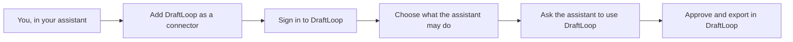

# Connect DraftLoop to your assistant

This page is for a candidate who wants Claude, ChatGPT or another assistant to
work with their DraftLoop account. It says what the assistant can do, what it
sees, and how to stop it.

**Status:** the connection is built and tested in the code. The hosted
service does not offer it yet, because its sign-in service and its MCP server
are not deployed. Today it works with a
[self-hosted server](agent-channel.md#set-it-up) and an agent token.

## How it works

1. Add DraftLoop in your assistant's connector settings.
2. Sign in with your DraftLoop account. The assistant never sees your password.
3. Choose what the assistant may do. Each choice is a permission below.
4. Ask in plain words, such as "list my job applications in DraftLoop".

An assistant cannot create a DraftLoop account. Sign up in DraftLoop first.

## What each permission allows

| Permission              | Asked by default | The assistant can                                                              |
| ----------------------- | ---------------- | ------------------------------------------------------------------------------ |
| Work journal            | Yes              | Record notable work as a note you review, and list its notes by title          |
| Read applications       | Yes              | List your job applications, read a job description and follow a CV run         |
| Add jobs                | Yes              | Add a job application from a job description you paste                         |
| Read CVs and drafts     | No               | Read a CV you exported and your saved cover letters and interview preparation  |
| Start runs and drafts   | No               | Start a CV run and draft a cover letter or interview questions, within a limit |

The tool behind each permission is listed in the
[agent channel reference](agent-channel.md#job-applications-and-runs).

## What always stays with you

The assistant can never do these, whatever you grant:

- Approve a draft, decide a critic's finding or edit a draft.
- Export a document.
- Give or withdraw consent, or erase data.
- Change models, budgets, members or any setting.
- Read your career evidence, an open draft or its findings.
- Fetch a job page from the web. It adds a job only from pasted text.

## Spending

Starting a CV run or a draft costs model usage on your account. An assistant
starts none until you set its monthly limit:

1. In DraftLoop, open **Workspace settings > Agents**.
2. Under "Spending by connected assistants", type the assistant's id and a
   monthly limit in US dollars.
3. Select **Set spend limit**.

An assistant without a limit tells you its id when it is refused. Each run
counts at your workspace's cost limit per run, and each draft at its cost
cap, so the limit is never passed. Your plan and credits still apply.

## What your assistant's provider sees

Everything a DraftLoop tool returns is read by your assistant's model, under
your own account with that provider. DraftLoop limits what a tool returns:

- A list returns titles, dates and status, not whole documents.
- Reading a CV or a saved draft needs the permission you add yourself.
- No tool returns your career evidence, an open draft or its findings.
- A saved draft is returned without the career facts it cites.

DraftLoop keeps your data on its own service. A directory that lists
DraftLoop stores none of it. The assistant's provider handles what it reads
under its own privacy terms.

## Stop or change the connection

| To                               | Do this                                                                |
| -------------------------------- | ---------------------------------------------------------------------- |
| Stop the assistant from spending | In Workspace settings > Agents, select **Stop spending** for it        |
| Change what it may do            | Disconnect it in your assistant, then connect again with other choices |
| Disconnect it                    | Remove DraftLoop in your assistant's connector settings                |

Not built yet: a list of connected assistants in DraftLoop with a disconnect
button. Until then, removing the connector in the assistant is the way to
disconnect.

## When it fails

| The assistant says                         | What to do                                                |
| ------------------------------------------ | --------------------------------------------------------- |
| It was not granted a permission            | Connect again and add that permission                     |
| It has no monthly spend cap                | Set its limit in Workspace settings > Agents              |
| It reached its monthly cap                 | Raise the limit, or wait for next month                   |
| The account has no DraftLoop workspace     | Sign up in DraftLoop first, then connect again            |
| It needs a Markdown export to read your CV | Export the CV as Markdown in DraftLoop                    |

## Related

- [Agent channel](agent-channel.md) for the tools, scopes and server settings
- [Privacy policy (draft)](../legal/privacy-policy.md)
