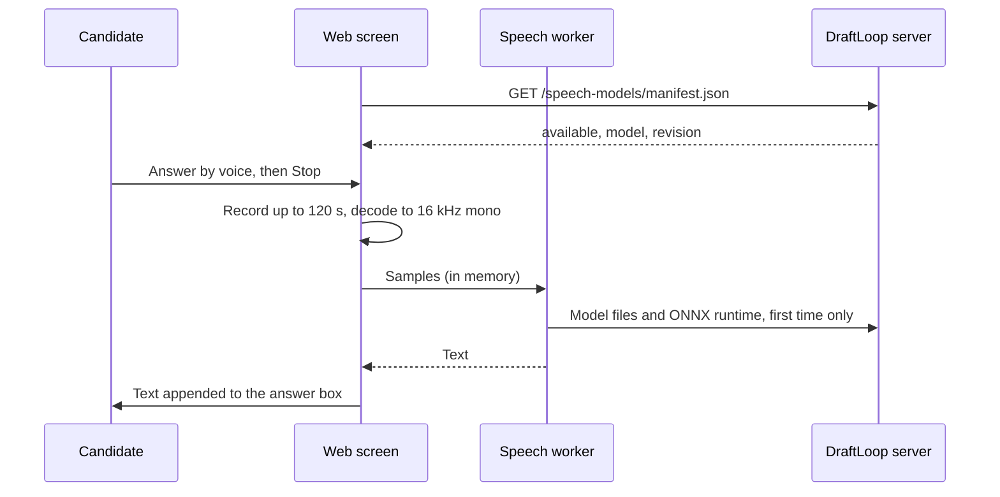

# Voice input

This page tells an operator what voice input in the career interview needs and
what it sends. The candidate presses **Answer by voice**, speaks, and gets the
text in the answer box to edit before **Send**.

**Audio never leaves the browser.** Whisper base runs in a worker on the
candidate's device. Only the model files travel, once, from the DraftLoop
server's own origin.

## How it works



| Part | Where |
| --- | --- |
| Model | `onnx-community/whisper-base`, pinned revision, q8 weights, Apache-2.0 ([pin](../../packages/application/src/speech-model.ts)) |
| Model files | `GET /speech-models/whisper-base/<revision>/<path>`, refused unless size and SHA-256 match the pin |
| ONNX runtime | `/ort/`, copied into the web build |
| Recording | MediaRecorder, at most 120 seconds, released when stopped or discarded |
| Content security policy | `script-src 'self' 'wasm-unsafe-eval'`, which allows WebAssembly and nothing from another origin |

The button appears only when the manifest says `available: true`. The
first transcription downloads about 80 MB of model files, which the browser
then caches.

## Install the model

The API image installs it at build time. For a server run from a clone, set an
absolute folder and install into it:

```text
export DRAFT_LOOP_SPEECH_MODEL_DIR="$HOME/draft-loop-speech-models"
pnpm speech-model:install
```

Expected result: one `checked` line per file. A file whose bytes differ from
the pin stops the install, and nothing partial is left in the folder. Without
the folder, the manifest answers `available: false` and the button stays
hidden.

## Limits

- Whisper base on WebAssembly takes a few seconds per answer on a laptop.
  WebGPU is not used, because only the q8 weights are pinned.
- French and English are the tested languages; the model detects the
  language.
