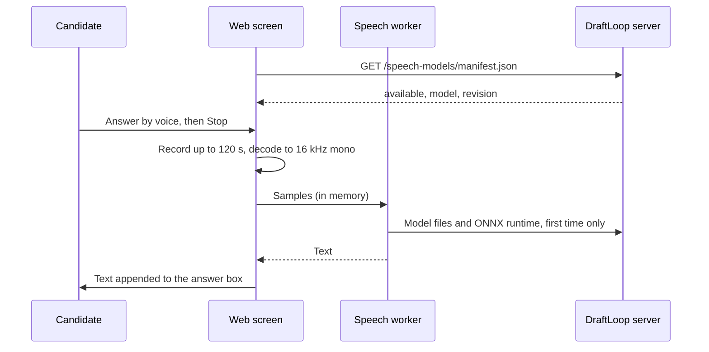

# Voice input

This page tells an operator what the two voice modes of the career interview
need and what they send.

| Mode | The candidate | Audio goes to | Turn on with |
| --- | --- | --- | --- |
| **Answer by voice** | Speaks one answer, edits the text, presses **Send** | Nowhere: Whisper runs in the browser | The speech model on the server ([Install the model](#install-the-model)) |
| **Talk live** | Talks the topic through and hears each question | Google Cloud speech in the EU | `DRAFT_LOOP_LIVE_SPEECH=google` ([Live conversation](#live-conversation)) |

## Answer by voice

**Audio never leaves the browser.** Whisper base runs in a worker on the
candidate's device. Only the model files travel, once, from the DraftLoop
server's own origin.

### How it works



| Part | Where |
| --- | --- |
| Model | `onnx-community/whisper-base`, pinned revision, q8 weights, Apache-2.0 ([pin](../../packages/application/src/speech-model.ts)) |
| Model files | `GET /speech-models/whisper-base/<revision>/<path>`, refused unless size and SHA-256 match the pin |
| ONNX runtime | `/ort/`, copied into the web build |
| Recording | MediaRecorder, at most 120 seconds, released when stopped or discarded |
| Content security policy | `script-src 'self' 'wasm-unsafe-eval'`, which allows WebAssembly and nothing from another origin |

The button appears only when the manifest says `available: true`. The
first transcription downloads about 80 MB of model files, which the browser
then caches.

### Install the model

The API image installs it at build time. For a server run from a clone, set an
absolute folder and install into it:

```text
export DRAFT_LOOP_SPEECH_MODEL_DIR="$HOME/draft-loop-speech-models"
pnpm speech-model:install
```

Expected result: one `checked` line per file. A file whose bytes differ from
the pin stops the install, and nothing partial is left in the folder. Without
the folder, the manifest answers `available: false` and the button stays
hidden.

### Limits

- Whisper base on WebAssembly takes a few seconds per answer on a laptop.
  WebGPU is not used, because only the q8 weights are pinned.
- French and English are the tested languages; the model detects the
  language.

## Live conversation

**Talk live** turns an open topic into a spoken conversation. Claude stays the
interviewer, and each question passes the same method-guide check as a
written one before it is spoken.

```mermaid
sequenceDiagram
  participant C as Candidate
  participant P as Web screen
  participant A as DraftLoop API
  participant G as Google Cloud speech (EU)
  participant M as Claude interviewer
  P->>A: WebSocket /live, owner or sign-in token as subprotocol
  A-->>P: ready
  loop Each turn
    C->>P: Speaks
    P->>A: 16 kHz PCM16 frames
    A->>G: Chirp 3 streaming recognition
    G-->>A: Words as spoken, then a pause
    A-->>P: partial words, then the answer
    A->>M: The answer, as a typed answer
    M-->>A: Next question, checked against the method guide
    A->>G: Chirp 3 HD voice
    G-->>A: Ogg Opus audio
    A-->>P: The session, the question and its audio
    P->>C: Plays the question; the microphone is muted
  end
```

| Part | What it does |
| --- | --- |
| Recognition | Chirp 3 at `eu-speech.googleapis.com`; a turn ends after 1.5 s of silence, at 120 s, or on **Done speaking** |
| Voice | Chirp 3 HD `Charon` at `eu-texttospeech.googleapis.com`, in French or English from the browser's language |
| Consent | The record's transmission grant must name Anthropic and Google Cloud; the screen offers to add Google Cloud |
| Limits | 30 minutes of audio per conversation, then `live_limit_reached`; one topic per conversation |
| Logs | Turn count, audio seconds, spoken characters and estimated cost; never words or audio |
| Content security policy | `media-src 'self' blob:` lets the question play from memory |

The list prices put a 20-minute interview at about US$0.30 to US$0.45.
Speech-to-Text keeps audio only when a project opts in to data logging, so
leave that off.

### Turn on live speech

On the hosted service, the infrastructure repository enables the Speech and
Text-to-Speech APIs and gives the API's service account `roles/speech.client`.
The API signs in as that account, so no key exists.

On a self-hosted server:

1. In a Google Cloud project, enable the Speech-to-Text and Text-to-Speech
   APIs.
2. Create a service account with the `Cloud Speech Client` role, and download
   a JSON key for it.
3. Save the key as `keys/google_speech_api_key` in the installed folder.
4. In `.env`, set:

   ```text
   DRAFT_LOOP_LIVE_SPEECH=google
   DRAFT_LOOP_SPEECH_PROJECT_ID=your-project-id
   ```

5. Run `draft-loop-server up` again.

Expected result: an open interview topic shows **Talk live**. It stays hidden
while the interviewer is off (`DRAFT_LOOP_SCREENING=rules+model` and a Claude
key turn it on). A wrong project or key ends the first turn with "The live
conversation stopped", and the API log says `live career interview failed`.
