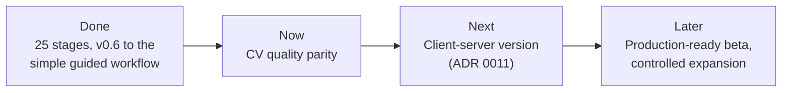

# Product vision and roadmap

**Status:** Living document 
**Last reviewed:** 2026-11-05 
**Current stage:** CV quality parity

This page says where DraftLoop is going and what is being built now. It is for
anyone deciding what to work on next. Finished stages, their evidence and the
older change log are in the [roadmap history](roadmap-history.md).

- **Now** is the current commitment.
- **Next** is planned work that may change after discovery or pilot evidence.
- **Later** is directional.

The [status model](#status-model) describes evidence for a product outcome, not
lines of code or package capabilities.

## Contents

- [Vision](#vision)
- [Product principles](#product-principles)
- [Status model](#status-model)
- [Current state](#current-state)
- [Reference workflow and parity target](#reference-workflow-and-parity-target)
- [Candidate knowledge-base model](#candidate-knowledge-base-model)
- [Roadmap](#roadmap)
- [Explicitly deferred](#explicitly-deferred)
- [Success measures](#success-measures)
- [Stage evidence](#stage-evidence)
- [Review cadence and change log](#review-cadence-and-change-log)

## How sprints are planned

GitHub milestones are dependency-closed delivery sprints. Every open
prerequisite of a sprint issue belongs to the same milestone and comes before
the work it enables; completed prerequisites stay in their historical
milestones.

- **Rollups are not sprint work.** A broad outcome issue may stay open as a
  rollup for a milestone exit, but it is never implemented until ordered child
  issues exist.
- **One issue, one PR.** Each execution issue targets one observable outcome,
  one primary architecture boundary and one focused test surface.
- **A 20-minute budget.** Active implementation and review is limited to 20
  minutes, excluding test and CI waits. Reaching the limit means another
  split, never silent continuation. Quality gates stay the same.

Issue count is not a capacity measure.

## Vision

DraftLoop helps a candidate produce a job-specific CV that is relevant,
source-traceable, and genuinely theirs. Independent author and critic agents
can propose and challenge changes, but the candidate controls source material,
provider exposure, factual claims, and final approval.

The initial product is a local-first desktop workspace for one CV and one job
application. Expansion to other artifacts follows only after this workflow
demonstrates better quality or lower effort on real, consented cases.

The reference workflow combines approved opportunity material with a persistent
local career corpus. An Anthropic author produces a complete draft, an
independent OpenAI critic challenges it, the author adjudicates findings, and
the candidate approves a professional export. Roles remain configurable, but
the default pair is cross-company and provider/model identities are recorded.

### Model strategy

Model choice balances capability, cost, and the amount of configuration the
project can maintain. The current scope is three Anthropic authors and three OpenAI
critics: Claude Haiku 5.5, Claude Sonnet 5.5, Claude Opus 5.5, GPT-6 Luna,
GPT-6.1 Terra, and GPT-6.1 Sol, plus opt-in development authors (GLM-5.3 Flash, Gemini 3.8 Flash, and Mistral Large 4). Representative
CV quality has not been validated for these choices.

The current curated choices use three tiers:

| Tier         | Pair                              | Purpose                                      |
| ------------ | --------------------------------- | -------------------------------------------- |
| **Economy**  | Claude Haiku 5.5 + GPT-6 Luna     | Lower-cost configuration and workflow checks |
| **Balanced** | Claude Sonnet 5.5 + GPT-6.1 Terra | Middle-cost configuration                    |
| **Standard** | Claude Opus 5.5 + GPT-6.1 Sol     | Opt-in configuration for more demanding work |

These are configuration choices, not validated CV-quality rankings. Premium
choices are deferred. Older exact profile versions remain available for
compatibility with existing selections and saved runs. The Sonnet 5.5 profile,
the economy author before Haiku 5.5, is reused as the Balanced author. GPT-6.1
Terra is the Balanced reviewer at half of GPT-6.1 Sol's price (#1887). Each
role's reasoning level can be raised or lowered within the levels its model
allows, and runs record the level they used (milestone 57).

Validation has two levels, and each claim applies only to the models that
produced it:

- **Use case validation.** The economy pair shows that a use case works end
  to end: draft, critique, human review, revision, and export. Attempts are
  cheap, so workflow defects surface before costlier models are used.
- **Quality validation.** Only the standard frontier pair can support claims
  about the quality of the CV, the result a candidate pays for.

The evaluation proceeds **step by step**:

1. Make the basic scenario work end to end on the economy pair.
2. Validate quality on the standard pair (Opus 5.5 and GPT-6.1 Sol).
3. Reconsider premium choices only after the current curated choices are validated.

Two opt-in Anthropic-only presets keep runs possible without an OpenAI budget:
`balanced-anthropic` (Sonnet 5.5 author, Opus 5.5 critic) and
`standard-anthropic` (Opus 5.5 author, Sonnet 5.5 critic). A different Claude
model reviews, so the lineages differ, but the critic shares the author's
company. The owner chose them on 2026-10-30 for the F–I re-score. On
2026-11-04 the owner confirmed that the OpenAI critic stays the default, so
these presets remain opt-in.

Anthropic and OpenAI stay the first and default providers. Other providers,
including local models, are integrated only after the main CV use cases work
with the reference pair.

**The immediate priority is unchanged:** a first working version on one
reference Anthropic author and OpenAI critic pair.

An opt-in provider adapter supports DeepInfra's GLM-5.3-Flash for development
experiments. This exception does not change the default Anthropic/OpenAI pair
or imply representative-CV quality validation.

An opt-in adapter also supports Gemini 3.8 Flash (3.7 remains accepted for resume) through Google's Gemini API
for development ([#813](https://github.com/akoita/draft-loop/issues/813)).
The opt-in `development-gemini` preset pairs it with the GPT-6 Luna critic in
the CLI and desktop. Default pairs and representative quality claims are
unchanged. Free-tier Gemini API terms may allow Google to use submitted content,
so candidate material needs a paid-tier key.

The opt-in `development-mistral` preset pairs Mistral Large 4 (public preview)
with the GPT-6 Luna critic. Mistral says that
[free-mode API content may be used for training](https://help.mistral.ai/en/articles/347617-do-you-use-my-user-data-to-train-your-artificial-intelligence-models),
that pay-as-you-go customers can
[opt out of training](https://help.mistral.ai/en/articles/455207-can-i-opt-out-of-my-input-or-output-data-being-used-for-training),
and that
[Zero Data Retention](https://help.mistral.ai/en/articles/347612-can-i-activate-zero-data-retention-zdr)
is available only on pay-as-you-go for stateless calls such as chat completions,
by request and at Mistral's discretion. Use a pay-as-you-go key and review these
terms before sending candidate material.

Current cost-reporting work preserves validated OpenAI cached-input,
cache-write, and reasoning-output counts in adapter results. Estimates use
explicitly supplied rates and remain unknown when usage or an applicable rate
is missing or malformed; they are not persisted billing records.

The reusable corpus is a Candidate Knowledge Base (CKB). A candidate normally
maintains one default CKB, with additional isolated CKBs available when
separation is intentional. Selection for an application must be explicit.

## Product principles

- Sources before eloquence: substantive claims remain traceable to
  candidate-owned material.
- Agents advise; people decide: export requires a visible approval boundary.
- Local by default: provider transmission is explicit and scoped.
- Independent review: provider and model identities are visible, with
  cross-company diversity as the default.
- Explicit model choice: economy and standard presets expose four current
  Anthropic/OpenAI models. Preset labels do not establish CV quality; default
  promotion requires an explicit decision and preserves existing workspaces.
- Validation names its models: every quality claim records the exact model
  profile, provider, model ID, prompt version, and runtime controls, and
  applies only to that profile.
- Durable candidate memory: reusable material is separate from an opportunity
  and selected explicitly for each application.
- Measured expansion: retrieval, providers, and workflows must improve a
  defined outcome rather than only add capability.

Candidate-source traceability is not independent factual verification. A
candidate's private CV, profile, or project description is legitimate source
material even when no public proof exists. DraftLoop surfaces contradictions
and model-added facts; it does not conduct background checks, contact
employers, or replace references, interviews, or technical evaluation.

## Status model

| Level       | Meaning                                                                                                        | Required evidence                                |
| ----------- | -------------------------------------------------------------------------------------------------------------- | ------------------------------------------------ |
| Designed    | Outcome, boundaries, and acceptance criteria are documented.                                                   | Roadmap scope plus relevant architecture or ADR  |
| Implemented | Capability exists behind package contracts with focused automated checks.                                      | Code and deterministic tests                     |
| Integrated  | Capability is connected through the intended CLI or desktop workflow.                                          | End-to-end or packaged workflow evidence         |
| Validated   | Outcome is demonstrated under representative conditions, using real or safely sanitized inputs where required. | Recorded acceptance results and product measures |
| Released    | Versioned artifact is published with manifests, checksums, platform results, and limitations.                  | Linked release evidence                          |

Implementation is not validation. Synthetic fixtures and benchmarks do not by
themselves prove a real-user outcome, and a release does not become Validated
unless its exit criterion was demonstrated.

## Current state

The product status is easiest to read by outcome:

| Outcome                            | Current evidence                                                                                                                                                                                      | What is true now                                                                                                                                                                                                                                                                                                                                                                                                                                              |
| ---------------------------------- | ----------------------------------------------------------------------------------------------------------------------------------------------------------------------------------------------------- | ------------------------------------------------------------------------------------------------------------------------------------------------------------------------------------------------------------------------------------------------------------------------------------------------------------------------------------------------------------------------------------------------------------------------------------------------------------- |
| Integrated author–critic workspace | [Released v0.8.0-alpha.5 checkpoint](releases/stage-evidence-v0.8.0-alpha.5.md); [v0.8.0-alpha.2](releases/stage-evidence-v0.8.0-alpha.2.md) closed milestone 17; representative outcome not recorded | CLI and packaged Electron share the application driver for local intake, provenance, SQLite run history, orchestration, review, recovery, and Markdown/DOCX/PDF export. Versioned profile controls are snapshotted and reused on resume; CLI/desktop selection, public API price scenarios, and bounded local availability checks are integrated. Representative CV quality remains unvalidated.                                                              |
| Application-grade quality          | v0.6 release; validation failed                                                                                                                                                                       | The sanitized representative run exported, but omitted major CV sections and chronology, changed seniority, and introduced unsupported quantification. v0.6.0 is an explicitly non-validated alpha baseline; this failure is the defining input to v0.7.                                                                                                                                                                                                      |
| Workspace retrieval and policy     | Policy and CKB lexical runtime integrated                                                                                                                                                             | Explicit CKB selections rebuild and query exact source-version indexes, fail visibly on unavailable retrieval, persist immutable content-free traces, and provide only selected opaque chunk references and bounded text to live author/critic requests. Legacy unselected workspaces retain the earlier evidence path. Writing policies remain integrated with immutable lineage and shared controls.                                                        |
| Opportunity brief                  | Integrated reviewed-version handoff                                                                                                                                                                   | A strict provider-independent contract and shared CLI/packaged-desktop host workflows assemble approved URLs, selected files, pasted content, and typed local candidate instructions into immutable draft/review versions with honest provenance and visible failures. New runs can pin one exact checksum-verified reviewed version; resume reuses the immutable context. Provider extraction and run transmission each retain explicit approval boundaries. |
| Portable CKB                       | [Released Sprint 2 checkpoint](releases/stage-evidence-v0.7.0-alpha.2.md); [Released alpha.3 checkpoint](releases/stage-evidence-v0.7.0-alpha.3.md); #78 accepted; v0.7 incomplete/unvalidated        | The reusable CKB foundation is complete: stable source identity and immutable versions, explicit lifecycle/readiness evidence, isolated application/run selection, shared CLI/desktop controls, coordinated recovery, retention, backup/restore, exact-plan deletion, and exact-version lexical retrieval.                                                                                                                                                    |
| CKB directory recovery             | Implemented bounded components                                                                                                                                                                        | Root rebind and one-source member move are guarded, one-scan operations. The #135 reconciliation contract partitions every member path-free, requires explicit retirement selections, and processes them in deterministic source-ID order. Each marker is atomic; a later failure returns explicit partial progress. No operation accepts or returns a path.                                                                                                  |
| Product CKB workflow               | [Released alpha.3 checkpoint](releases/stage-evidence-v0.7.0-alpha.3.md); #111 accepted                                                                                                               | Shared CLI/desktop controls create, open, select, rename, archive, preview/delete, export, inspect, and restore CKB stores without projecting roots through the renderer. Workspace bindings produce immutable path-free source-version snapshots for new runs, survive restart and legacy migration, and block lifecycle drift before provider execution. Retrieval, reactivation, visual lifecycle UI, and provider use remain outside the product path.    |

The release checkpoints behind these rows, including the v0.7 alpha history,
are in the [roadmap history](roadmap-history.md#current-state-checkpoints).
Stable boundaries are in [the architecture](architecture/overview.md), and
[ADR 0007](adr/0007-portable-candidate-knowledge-store.md) is the canonical CKB
contract. The [privacy and evaluation policy](security/privacy-and-evaluation.md)
the [threat model](security/threat-model.md) and the
[server threat model](security/server-threat-model.md) remain authoritative for
their concerns.

## Reference workflow and parity target

The private parity baseline is the proven manual workflow using approved
opportunity URLs and instructions together with a persistent local career
corpus. For each application, the candidate selects the CKBs the agents may
use; retrieval recalls relevant facts and source excerpts; the workflow
produces a complete factual CV, checks requirements, adjudicates edits, and
creates a professional export after human approval.

Repository fixtures, reports, and stage evidence must be sanitized. They must
not contain personal CV content, real names, contact details, real employers,
or private opportunity URLs or instructions.

The [manual author–critic refinement reference](../packages/evaluations/fixtures/manual-author-critic/README.md)
illustrates sourced claims, evidence-backed reconciliation, and visible gaps;
it is fictional reference data, not a provider run or parity result.

## Candidate knowledge-base model

A CKB is durable candidate memory, not a per-application upload bucket. It may
contain CVs, experience notes, certification references, project descriptions,
authored work, and candidate-maintained fact documents. Combining CKBs always
requires explicit selection.

The portable component gives each source a stable CKB-scoped identity and
ordered immutable versions. Versions retain checksum, media type, size,
timestamp, and lineage; source labels and exact local origins remain sensitive.
Approved files are captured only after extraction and stable-file checks, and
raw bytes are stored under opaque ID-derived names. Approved URLs use the
bounded HTTPS boundary and retain exact fetched bytes plus local per-version
provenance. Explicit refresh, append, rebind, retirement, inventory, and
directory operations never imply background monitoring or provider exposure.

Directory intake is bounded and deterministic. A complete import records a
sensitive local root binding and immutable hashes of normalized relative
membership; observation, existing-member refresh, missing-member
retirement, root rebind, one-source member move, and complete explicit
missing-member reconciliation each have bounded contracts. These are
component/application-contract capabilities. They do not automatically infer
renames, retire sources, or authorize cleanup. The exact constraints and
privacy invariants live in [ADR 0007][adr-0007].

RAG for an application is scoped to the CKB and source versions recorded by
that application. [ADR 0008](adr/0008-ckb-scoped-lexical-retrieval.md) defines
the local lexical baseline: each CKB owns a replaceable exact-version FTS index,
the application queries only the selected source versions, and the workspace
retains immutable content-free retrieval traces. Missing, stale, fallback, and
empty-query outcomes remain visible rather than becoming silent zero-context
runs. Vector or hybrid retrieval requires measured gains in
relevant-achievement recall and citation accuracy without more unsupported
claims. [ADR 0009](adr/0009-local-semantic-retrieval.md) selects the local
model and runtime for that work. Remote embeddings or vector storage require a separate architecture
and privacy decision. User-approved research remains distinct from candidate
evidence and cannot create experience, contact employers, or submit
applications.

## Roadmap

| Horizon | Stage                                                                                                           | Outcome                                                                                                                                    | Remaining gate                                                                                                                                                                                                                                                                                       |
| ------- | --------------------------------------------------------------------------------------------------------------- | ------------------------------------------------------------------------------------------------------------------------------------------ | ---------------------------------------------------------------------------------------------------------------------------------------------------------------------------------------------------------------------------------------------------------------------------------------------------- |
| Now     | CV quality parity ([milestone](https://github.com/akoita/draft-loop/milestone/31))                              | Make DraftLoop's CVs as good as the manual Claude/Codex loop before production (#1309)                                                     | On 3 of 4 private references: requirement coverage at least the manual CV's, recall at least 85%, no leaks, a sendable DOCX, and 3 or fewer edits before sending (#1302–#1307, #1108, #1112, #1113), with a two-page layout as dense as a hand-made CV (#1327) and rendering templates (#1328–#1331) |
| Next    | [Client-server version](#next--client-server-version) ([ADR 0011, accepted](adr/0011-client-server-version.md)) | A professional, hosted version with traceability, reusing the local-first packages, while the local-first version keeps evolving beside it | A hosted parity run matches the local result under the [hosted parity rules](evaluation/hosted-parity.md) (#1358); the owner decisions phase 2 needs are recorded (#1357); deferred local-first issues are reassessed for either version                                                             |
| Next    | [Manual parity: review and export](#next--manual-parity-review-and-export)                                      | Review and export at parity with the manual loop                                                                                           | See the section below                                                                                                                                                                                                                                                                                |
| Later   | Production-ready beta                                                                                           | Distribute a safe, dependable desktop application                                                                                          | Signed installers, safe migrations, recovery, accessibility, and platform evidence                                                                                                                                                                                                                   |
| Later   | Controlled expansion                                                                                            | Extend a proven workflow without weakening trust boundaries                                                                                | Core CV evidence plus separate integration, privacy, and threat decisions                                                                                                                                                                                                                            |

**Now: evidence so far.** Planned 2026-10-15 (#1309); the run comparison is done
(#1276); the [v0.8.0-alpha.5 checkpoint](releases/stage-evidence-v0.8.0-alpha.5.md)
was released 2026-10-31 with the exit not met.

### Completed stages

Each stage's full scope, evidence and decision are in the
[roadmap history](roadmap-history.md#stages).

| Stage                                                                                                             | Result                                                                                                                                                      |
| ----------------------------------------------------------------------------------------------------------------- | ----------------------------------------------------------------------------------------------------------------------------------------------------------- |
| Integration hardening and outcome validation ([v0.6.0](https://github.com/akoita/draft-loop/releases/tag/v0.6.0)) | Released                                                                                                                                                    |
| Evidence-backed CV drafting (v0.7 program)                                                                        | [Released alpha.5 checkpoint](releases/stage-evidence-v0.7.0-alpha.5.md)                                                                                    |
| Usable CV MVP ([v0.8.0-alpha.1](https://github.com/akoita/draft-loop/releases/tag/v0.8.0-alpha.1))                | [Released alpha](releases/stage-evidence-v0.8.0-alpha.1.md)                                                                                                 |
| Workflow parity and release ([milestone v0.9.0](https://github.com/akoita/draft-loop/milestone/4))                | [Ended indeterminate and unreleased](evaluation/consented-pilot-v0.9.md)                                                                                    |
| Retrieval and provider quality ([milestone](https://github.com/akoita/draft-loop/milestone/6))                    | [Completed with deterministic and packaged evidence](evaluation/retrieval-provider-quality.md)                                                              |
| Broader real-application pilot ([milestone](https://github.com/akoita/draft-loop/milestone/7))                    | [Ended early                                                                                                                                                |
| Author-draft acceptance reliability                                                                               | [Provider-free exit met](evaluation/author-draft-acceptance-reliability.md): unchanged replay improved from 2/6 to 3/6 accepted and bounded retry succeeded |
| Representative author-draft revalidation ([milestone](https://github.com/akoita/draft-loop/milestone/9))          | [Ended indeterminate](evaluation/representative-author-draft-revalidation.md)                                                                               |
| Author route readiness ([milestone](https://github.com/akoita/draft-loop/milestone/10))                           | Exit met: synthetic preflight `available`                                                                                                                   |
| Author-draft revalidation retry ([milestone](https://github.com/akoita/draft-loop/milestone/11))                  | [Failed](evaluation/representative-author-draft-revalidation.md#retry-observation): both validated drafts were rejected                                     |
| Author correction reliability ([milestone](https://github.com/akoita/draft-loop/milestone/12))                    | [Exit met on replay](evaluation/author-correction-reliability.md#stage-decision): both wrongly rejected supported cases accepted                            |
| Live author revalidation ([milestone](https://github.com/akoita/draft-loop/milestone/13))                         | [Failed](evaluation/live-author-revalidation.md): three drafts rejected, captures analysed content-free                                                     |
| Structural claim coverage ([milestone](https://github.com/akoita/draft-loop/milestone/14))                        | [Exit not met](evaluation/structural-claim-coverage.md): capture issues 37 → 28 against a target of 18                                                      |
| Structured-block author guidance ([milestone](https://github.com/akoita/draft-loop/milestone/15))                 | [Guidance not effective](evaluation/structured-block-author-guidance.md): v3 drafts averaged 15.3 capture issues against 9.3 under v1                       |
| Reference model pair ([milestone](https://github.com/akoita/draft-loop/milestone/16))                             | [Candidate-accepted bounded normal observation](evaluation/author-model-revalidation.md#bounded-normal-reference-observation-601)                           |
| Software-engineering generalization ([milestone](https://github.com/akoita/draft-loop/milestone/18))              | Closed with indeterminate live observation                                                                                                                  |
| Model profiles and tiers ([milestone](https://github.com/akoita/draft-loop/milestone/17))                         | [Released v0.8.0-alpha.2 evidence](releases/stage-evidence-v0.8.0-alpha.2.md)                                                                               |
| Manual parity: inputs ([milestone](https://github.com/akoita/draft-loop/milestone/22))                            | Closed 2026-10-15                                                                                                                                           |
| Local semantic retrieval ([milestone](https://github.com/akoita/draft-loop/milestone/23))                         | [Completed](evaluation/semantic-retrieval-comparison.md): 30/30 issues closed                                                                               |
| Inputs and setup clarity ([milestone](https://github.com/akoita/draft-loop/milestone/24))                         | Completed in code: 21/21 issues closed                                                                                                                      |
| Development model providers ([milestone](https://github.com/akoita/draft-loop/milestone/25))                      | Completed in code: 11/11 issues closed                                                                                                                      |
| Any-format career intake ([milestone](https://github.com/akoita/draft-loop/milestone/26))                         | Completed: 51/51 issues closed                                                                                                                              |
| Candidate home and applications ([milestone](https://github.com/akoita/draft-loop/milestone/28))                  | Completed in code: 29/29 issues closed                                                                                                                      |
| Tailored, sendable CVs ([milestone](https://github.com/akoita/draft-loop/milestone/30))                           | [Completed](evaluation/manual-parity.md#observation-reference-e-2026-10-14-1172): 29/29 issues closed                                                       |
| Simple guided workflow ([milestone](https://github.com/akoita/draft-loop/milestone/29))                           | [Exit met in a fixture walk](evaluation/first-run-journey.md) on 2026-10-15                                                                                 |

### Next — Client-server version

The client-server version is a hosted, professional DraftLoop that reuses the
local-first packages ([ADR 0011](adr/0011-client-server-version.md)). The
architecture was accepted on 2026-10-17, with region `europe-west1` and the
cost per run recorded (#1357). Phase 0 (#1347) merged the same day.

**Where it stands:**

- **Staging runs** every server release; production is held by the owner.
- **Cost:** hosted parity runs matched on quality and failed on cost. With the
  prompt cache working, two rounds cost US$3.64 (#1357); a complete run on the
  cost fixes is still to measure (#1597).
- **Quality:** the check of 2026-10-29 (#1307) scored four new private
  references. The default Balanced draft is not sendable and the Standard
  draft is close, so a quality sprint followed (see
  [manual parity](evaluation/manual-parity.md)).
- **Sign-in:** staging still uses the owner token until Keycloak is hosted;
  consent and entitlements are enforced in sign-in mode only.
- **Later phases** are rollups (#1360–#1361). The deferred local-first issues
  were reassessed on 2026-11-05: done or superseded ones are closed, and the
  rest are unscheduled backlog.

#### Phase 1: the hosted engine (#1358)

| Sprint                                                  | Delivered                                                      | Merged     |
| ------------------------------------------------------- | -------------------------------------------------------------- | ---------- |
| 1a                                                      | Postgres storage                                               | 2026-10-17 |
| [1b](https://github.com/akoita/draft-loop/milestone/35) | Cloud Storage blobs and the local stack                        | 2026-10-21 |
| [1c](https://github.com/akoita/draft-loop/milestone/36) | The API and the worker                                         | 2026-10-21 |
| [1d](https://github.com/akoita/draft-loop/milestone/37) | The model gateway                                              | 2026-10-22 |
| [1e](https://github.com/akoita/draft-loop/milestone/38) | API setup and source intake                                    | 2026-10-22 |
| [1f](https://github.com/akoita/draft-loop/milestone/39) | Review, approval and export through the API                    | 2026-10-22 |
| [1g](https://github.com/akoita/draft-loop/milestone/40) | Cloud deployment; `server-v0.1.0` on staging 2026-10-23        | 2026-10-22 |
| [1h](https://github.com/akoita/draft-loop/milestone/41) | The web review screen                                          | 2026-10-23 |
| [1i](https://github.com/akoita/draft-loop/milestone/42) | Parity readiness; hosted parity runs 2026-10-23 and 2026-10-24 | 2026-10-23 |

#### Phase 2: a service people can use (#1359)

| Sprint                                                              | Delivered                                                                                                                                                                                                                                                                                            | Shipped             |
| ------------------------------------------------------------------- | ---------------------------------------------------------------------------------------------------------------------------------------------------------------------------------------------------------------------------------------------------------------------------------------------------- | ------------------- |
| [1j](https://github.com/akoita/draft-loop/milestone/43) (2a)        | Sign-in and tenancy                                                                                                                                                                                                                                                                                  | 2026-10-24          |
| [1k](https://github.com/akoita/draft-loop/milestone/44) (2b)        | Candidate records and consent                                                                                                                                                                                                                                                                        | 2026-10-24          |
| [1l](https://github.com/akoita/draft-loop/milestone/45) (2c)        | Export as a [record archive](reference/record-archive.md) and deletion, with backups ageing out within 35 days                                                                                                                                                                                       | 2026-10-24          |
| [1m](https://github.com/akoita/draft-loop/milestone/46) (2d)        | The safety stack: injection screening of job posts and uploads with quarantine, a red-team [flow test](security/threat-model.md#hosted-service-prompt-injection-through-job-posts-and-uploads) (#1666) and hardening of 1j–1l; model screening on staging and production still open                  | 2026-10-24          |
| [1n](https://github.com/akoita/draft-loop/milestone/47) (2e)        | Entitlements and credits: plan catalog v1, a credit ledger, run caps, operator routes and a members' balance view, proven by a two-organisation flow test (#1694). Billing, the pricing page and self-serve plan changes come after the validation tests, and prices wait for the cost check (#1597) | 2026-10-24          |
| [1o](https://github.com/akoita/draft-loop/milestone/48)             | The desktop's shared screens on the web (ADR 0011, D9): Home, New application, career evidence and start                                                                                                                                                                                             | 2026-10-25          |
| [1p](https://github.com/akoita/draft-loop/milestone/49)             | The career profile, the shared review, approval, browser export, run details and comparison; a fictional browser walk passed, `server-v0.4.0`                                                                                                                                                        | 2026-10-25          |
| [1q](https://github.com/akoita/draft-loop/milestone/50)             | Hosted run recovery after a failed live run: rejected-output diagnostics, worker retries, no dead retry button, spent credit named; the live run on `server-v0.4.1` passed through an approved DOCX (#1725)                                                                                          | 2026-10-25          |
| [1r](https://github.com/akoita/draft-loop/milestone/51)             | Staging clean-up and web polish: the operator wipe, named knowledge bases, findings in plain words, final checks before approval; `server-v0.4.2`, staging wiped 2026-10-26                                                                                                                          | 2026-10-25          |
| [1s](https://github.com/akoita/draft-loop/milestone/52)             | Fixes from the owner's staging walk: first-run setup on the web, readable export names, the preset in the start dialog, word-match gaps as warnings until confirmed, the template's look in the built-in PDF                                                                                         | 2026-10-26          |
| [1t](https://github.com/akoita/draft-loop/milestone/53)             | Coverage judged on hosted runs, a job by file or approved page address, the review at wide and phone widths; `server-v0.5.0`                                                                                                                                                                         | 2026-10-26          |
| [1u](https://github.com/akoita/draft-loop/milestone/54)             | Job pages through a separate page fetcher, refused exports that say why, Carlito in PDFs, the review at phone width, relevance over the reviewed brief; `server-v0.6.2`                                                                                                                              | 2026-10-27          |
| [1v](https://github.com/akoita/draft-loop/milestone/55)             | Draft quality: `cli-author-v15`, warnings for repeated facts, a missing header, an unlabelled Skills line and lost coverage, grouped "Not ready" reasons; `server-v0.7.0`                                                                                                                            | 2026-10-28          |
| [1w](https://github.com/akoita/draft-loop/milestone/56)             | Fixes from the 0.7.0 re-walk: `cli-author-v16`, emphasis advice no longer confirms a gap, known gaps in one step, semicolon and placeholder warnings; `server-v0.8.0` and `server-v0.8.1`                                                                                                            | 2026-10-28          |
| [1x](https://github.com/akoita/draft-loop/milestone/58)             | Review edits reach the export as a new, re-checked version on every client; header placeholders block approval; settled gaps satisfy approval; reasoning levels per role; `server-v0.9.0` to `server-v0.9.6`                                                                                         | 2026-10-28          |
| [1y](https://github.com/akoita/draft-loop/milestone/59)             | One web flow: the interim tabs removed, storage permission, screening and private-section rules on Career evidence, consent and credit cost in the start dialog; `server-v0.10.0` (#1939)                                                                                                            | 2026-10-29          |
| [1z](https://github.com/akoita/draft-loop/milestone/60)             | The server on your own machine: local secret files, direct and local model routes, blobs on disk, the self-hosted Compose stack and [guide](operations/self-hosted.md); `server-v0.11.0`, validated on the owner's machine                                                                           | 2026-10-29          |
| [Quality](https://github.com/akoita/draft-loop/milestone/61)        | A 64,000-token Opus cap, billed failed calls in a run's cost, autopilot on hosted runs, a coverage judge that credits shown behaviour, `cli-author-v17`, the run's writing policy on the web                                                                                                         | Admitted 2026-10-29 |
| [Local install](https://github.com/akoita/draft-loop/milestone/62)  | Server images on GHCR, the `draft-loop-server` install, upgrade, backup and restore script, a CI job over that stack; the Keycloak sign-in profile deferred                                                                                                                                          | 2026-11-03          |
| [Desktop import](https://github.com/akoita/draft-loop/milestone/63) | `draft-loop server import` sends a career evidence backup and desktop applications with their history to a server (#2056, #2067–#2069)                                                                                                                                                               | 2026-11-03          |

#### Agent channel and the desktop client

- **Agent channel (D17, #1403).** An MCP channel, local first. The work journal
  sprint (#2018, #2019–#2025) added `record_work`, which files notes from the
  candidate's coding agent into a pending inbox for approval, with
  `draftloop-mcp init` for Claude Code and Codex and the
  [agent channel](reference/agent-channel.md) reference. Built 2026-11-03.
- **Desktop client (D9, amended 2026-11-03).** The desktop is a first-class
  client of the server beside the web, built in its
  [milestone](https://github.com/akoita/draft-loop/milestone/65) (#2089–#2094)
  and shipped in v0.9.0. The v0.8 local engine was retired on 2026-11-04
  ([milestone 67](https://github.com/akoita/draft-loop/milestone/67),
  #2117–#2119).
- **Release sprint** ([milestone 66](https://github.com/akoita/draft-loop/milestone/66),
  #2103–#2105, admitted 2026-11-03) ships both: next steps printed by
  `draft-loop-server up`, the work journal in the record archive and the notes
  for `server-v0.14.0`. It was released on 2026-11-04 as `server-v0.14.0` on
  staging and the desktop client [v0.9.0](releases/stage-evidence-v0.9.0.md).
  The work journal's sign-in mode (#2079) waits for hosted sign-in.
- **Harden what shipped** ([milestone 68](https://github.com/akoita/draft-loop/milestone/68),
  #2112, #2140–#2143, admitted 2026-11-04) makes those releases safe to depend
  on without a paid model run. The desktop acceptance passes beside a running
  server, the [server threat model](security/server-threat-model.md) covers
  every server runtime (#2135), and a real Claude Code session
  [walked the work journal](evaluation/work-journal-walk.md). The review's gaps (#2144–#2148) are closed below.
- **Agent channel ready to use** ([milestone 69](https://github.com/akoita/draft-loop/milestone/69),
  #2147, #2149–#2151, #2158–#2161, admitted 2026-11-04) gives coding agents a
  token that reaches only the work journal instead of the owner token. The
  review link opens the panel, Home counts waiting notes, and `draft-loop` runs
  from a clone. A real Claude Code session
  [walked it](evaluation/agent-token-walk.md); `server-v0.15.0` is on staging.
- **Protect self-hosted data and harden the API edge**
  ([milestone 70](https://github.com/akoita/draft-loop/milestone/70), #2144–#2146,
  #2148, #2169, #2170, #2172, #2173, admitted 2026-11-04) closes the server
  threat model's gaps without a paid model run. A clone's stack no longer
  shares an installed stack's data, the API limits request rates, the owner
  token can be replaced, and the desktop hands a remembered token only to a
  server that proves it holds it; `server-v0.16.0` goes to staging.
- **Learn your writing preferences from review**
  ([milestone 74](https://github.com/akoita/draft-loop/milestone/74), #2249–#2253,
  #2256, #2257, #2265, #1102, admitted 2026-11-05) makes memory explicit in
  the [memory model](architecture/memory.md) and its domain catalog. DraftLoop
  now suggests a writing preference when review choices repeat, and the person
  accepts or dismisses it on Home, in the API or with `draft-loop preferences`.
  It also keeps skipped interview answers in transcript evidence and adds a
  content-free [tracing port](architecture/runtime-and-trust.md#run-traces). No
  paid model run.
- **Find an application fast**
  ([milestone 76](https://github.com/akoita/draft-loop/milestone/76), #2277–#2279,
  admitted 2026-11-06) keeps Home usable with many applications: search,
  status chips, sort, and a Cards or List view, remembered per device. Screen
  logic only, with no data change. No paid model run.
- **Folders on Home**
  ([milestone 77](https://github.com/akoita/draft-loop/milestone/77), #2280–#2283,
  admitted 2026-11-06) groups applications into one-level folders on the
  client-server version: a foldable section per folder, then No folder and
  Archived, with Move to in each application's menu. Deleting a folder never
  deletes an application. The local-first desktop shows no folders. No paid
  model run.
- **Tell career evidence and career profile apart**
  ([milestone 78](https://github.com/akoita/draft-loop/milestone/78), #2297–#2299,
  admitted 2026-11-06) makes the two career concepts read as one pipeline.
  Home shows a "Your career" panel with two numbered steps, both career pages
  share numbered tabs, and each page points to the other's job. Shared screens,
  so the web and the desktop both change. No data change and no paid model run.
- **Interview-safe facts and pull request import**
  ([milestone 75](https://github.com/akoita/draft-loop/milestone/75), #2258–#2263,
  admitted 2026-11-05, built 2026-11-06) lets each fact or section say where
  it may be used: CV and interview, interview only, or never said. Unset means
  CV, so nothing changes until the person marks a fact. Interview questions
  and cover letters follow it; CV runs follow in #2304. Merged pull requests
  exported with `gh` become cited evidence, each repository held back until
  the person allows it. Agent channel errors say whether a retry helps. Web
  only; no paid model run. Stored run spans (#1103) moved out of the sprint.

### Next — Guided career interview

DraftLoop helps candidates tell their career story, not only accept files
([#1030](https://github.com/akoita/draft-loop/issues/1030)). The text
interview is built in
[milestone 71](https://github.com/akoita/draft-loop/milestone/71), issues #2174
to #2179 plus #2188 and #2189:

- **Topics.** It proposes what the record leaves untold: roles without an
  outcome, untold periods and themes, and skills target jobs ask for.
- **Method.** A coach-style interviewer follows the
  [method guide](reference/career-interview-method.md); each question is
  checked against its rules before the candidate sees it.
- **Evidence.** A summary becomes `transcript` evidence only once the
  candidate confirms it, with the tier they pick.

A [walk with Sonnet](evaluation/career-interview-walk.md) passed for
US$0.035.

[Milestone 72](https://github.com/akoita/draft-loop/milestone/72) adds
[voice input](reference/voice-input.md) (#2199 to #2203): Whisper base runs
in the browser from files the server serves, so audio never leaves the
device. The archive now holds interview sessions, and the interviewer varies
its openings. Next: showing that a run cites a confirmed answer. Voxtral as an
EU server fallback waits until the browser model proves too slow.

[Milestone 84](https://github.com/akoita/draft-loop/milestone/84) (#2337 to
#2339) makes the interview read as a conversation: chat bubbles, a writing
indicator while the interviewer replies, the session's topics beside the chat,
quick replies as chips, and the summary as a card in the chat. A server with
no interviewer model now says so before offering topics. A voice mode with
one microphone and a live transcript is the planned next step.

### Next — Manual parity: review and export

An editorial critic that judges fit, missing strongest evidence, register and
sendability, with a ready-to-send verdict; a stop rule based on author and
critic agreement or the person's decision; pause and resume when a
subscription session reaches its limit; a professional two-page DOCX/PDF
export; and an observation across all four references. Issues are created
after the #878 stage decision.

### Later — Harness observability and evaluation

The author–critic harness is well guarded but hard to see into
([#1101](https://github.com/akoita/draft-loop/issues/1101)). Failed author
attempts have kept no token usage, no proposal and only capped diagnostics, so
root causes needed one-off studies such as
[author correction reliability](evaluation/author-correction-reliability.md).
Four ordered phases, each closed by a gate:

1. **See every run.** Content-free OpenTelemetry GenAI spans emitted at the
   orchestrator's author, critic and retrieval ports, stored beside run
   history, with an opt-in localhost export for development (#1102–#1104).
   Gate: a failed author attempt can be diagnosed from its trace alone.
2. **Measure the critic.** A binary failure taxonomy labelled on synthetic
   cohorts, critic agreement rates per category, and a local live eval suite
   that never runs in hosted CI (#1105–#1107). Gate: critic rates recorded
   for the economy pair on a held-out set.
3. **Explain each round.** Finding-to-change attribution, a run timeline with
   score trajectory, and a plain reason the loop stopped (#1108–#1110). Gate:
   every revised block links to the finding it addresses.
4. **Tighten the loop.** Bounded `validate_proposal` and `search_evidence`
   author tools on the API adapters, targeted patch revisions, and stopping
   on finding resolution (#1111–#1113). Gate: fewer rejected author attempts
   and no regression on the phase 2 suite.

Spans and eval records stay local and content-free; message content is
captured only for invented fixtures. Model internals are out of scope: the
hosted reference pair cannot be inspected, so interpretation means explaining
behaviour from structured records.

### Later — Production-ready beta

Complete signed installers, safe migrations and updates, backup/restore, crash
recovery, rollback, package diagnostics, accessibility review, ATS and
cross-viewer DOCX/PDF compatibility, dependency and supply-chain checks, and
visible retention/deletion controls with opt-in content-free diagnostics.

The hosted service also needs its legal pack before other users join: privacy
policy, terms, legal notice, record of processing and impact assessment.
Drafts for lawyer review are in [docs/legal](legal/README.md) (#2003); the
open questions listed there go to the lawyer before phase 2.

**Exit criterion:** Signed releases upgrade and roll back repeatably, preserve
workspace history, and pass supported-platform acceptance with known
limitations.

### Later — Interview preparation

The career record can serve the interview as well as the CV
([#1995](https://github.com/akoita/draft-loop/issues/1995)). It is shaped with
the guided career interview (#1030), which shares its debrief and voice parts.

**Built:** questions from the job post.
A **Prepare** panel on each application on the web, built in
[milestone 73](https://github.com/akoita/draft-loop/milestone/73) (issues
2215 to 2218), drafts interview questions, each with a talking point, and a
cover letter. Every item
cites career facts, never a withheld fact or a number no fact holds, and facts
join only within one role. Four capped
[walks](evaluation/application-material-walk.md) cost US$0.089 in all; the
fourth, on prompt `application-material-v4`, passed every check. Drafts are not
stored.

**Built:** usage level, in
[milestone 75](https://github.com/akoita/draft-loop/milestone/75). Each fact or
section says where it may be used: CV and interview, interview only, or never
said. This is separate from the tiers that control what reaches a provider.
Interview questions use only interview-allowed facts, and a cover letter only
CV facts. **Next:** CV runs leave out interview-only and never-say facts
(#2304).

The rest waits for CV quality parity (#1309):

- **Agent channel first.** An approved-facts read tool on the local MCP
  server (#1403) lets a candidate prepare inside Claude or another agent. It
  needs an amendment to ADR 0011 D17, because today's tools cover CV runs only.
- **Then DraftLoop's own steps.** The claim check run on written answers, debriefs saved as candidate-provided evidence after
  approval, rehearsal, and answers to recurring application questions.

A no-code test before two real interviews decides whether the rollup is
admitted.

### Later — Controlled expansion

Multilingual templates, encrypted sync, and coach review remain gated by the
CV workflow. Cover letters are drafted by the Prepare panel (milestone 73,
under Interview preparation), and application answers move there too.
Two items have their own rollups:

- **Freelance mission dossiers**
  ([#1996](https://github.com/akoita/draft-loop/issues/1996)): skills dossiers
  for consultants from the same engine, admitted only after a no-code market
  test and the run cost target (#1597).
- **Pull requests as evidence**
  ([#1997](https://github.com/akoita/draft-loop/issues/1997)): the first
  portfolio import, from a file the candidate exports, defaulting to the
  `sensitive` tier.
- **Work journal from coding agents**
  ([#2018](https://github.com/akoita/draft-loop/issues/2018)): the live
  counterpart of #1997. A coding agent records notable work through the MCP
  server as it ships, and the candidate approves each note into career
  evidence.

Additional providers, including local models, are integrated only after the
main CV use cases work with the Anthropic and OpenAI reference pair, and each
gets its own model profiles. Cloud accounts, shared workspaces, external tools,
and application submission each require a separate architecture and
threat-model decision.

## Explicitly deferred

- Retrieval and index-version enforcement of bound CKB selection snapshots,
  normalized facts, source repair, reactivation, and cross-store writer
  coordination.
- Automatic move inference, reconciliation of unknown entries, background
  refresh, time-based freshness, and automatic retirement or deletion. The
  path-free lifecycle projection does not perform those actions or establish
  index freshness.
- Remote embeddings or a vector database before the local lexical baseline
  proves value and receives a separate architecture/privacy decision.
- Cloud sync, accounts, multi-tenancy, uncontrolled web research, job
  discovery, messaging, publishing, or application submission.
- General availability of additional artifacts before the CV workflow has
  outcome evidence.

## Success measures

Primary product measures are factual-invariant violations, required-section and
chronology preservation, CKB isolation, source/index freshness,
relevant-achievement recall, citation accuracy, irrelevant retrieval context,
requirement coverage, research-approval compliance, policy violations, useful
critic findings, ATS/visual readiness, review time, editing effort versus the
private manual baseline, approval/export completion, provider cost, and user
confidence. Test count, model count, and document count are activity indicators,
not product success.

## Stage evidence

Each stage exit records the achieved status level and date, acceptance criteria
and supported-platform results, product measures and representative-case
limitations, release tag and artifact manifest with checksums/SBOM, known
limitations, unresolved risks, and the next decision. Until those references
are recorded here or in a linked repository artifact, a stage is not Validated
or Released.

## Review cadence and change log

Review this roadmap after each stage decision, material pilot evidence, or at least
monthly while active development continues. A material change states what
changed, why, and what moved out to make room. Every stage exit also produces a
versioned release using [the release procedure](operations/releasing.md) only
when its release criteria are satisfied. A stage ended with unmet criteria
| 2026-11-06 | Admitted [milestone 84](https://github.com/akoita/draft-loop/milestone/84) (#2337–#2339): the career interview as a chat, quick replies, the summary as a card, and a notice when the server has no interviewer model. | The owner found the interview panel rustic and could not see that a conversation had started. No paid model run; voice mode follows. |
records that negative decision explicitly and does not create a release.

The entries below record material product and stage decisions. Git history and
issues retain implementation chronology.

| Date       | Decision                                                                                                                                                                                                                                                                                                                                                                                                                                                                                                                                                              | Product implication                                                                                                                                                                                                                                                                                                                                                                                                                                           |
| ---------- | --------------------------------------------------------------------------------------------------------------------------------------------------------------------------------------------------------------------------------------------------------------------------------------------------------------------------------------------------------------------------------------------------------------------------------------------------------------------------------------------------------------------------------------------------------------------- | ------------------------------------------------------------------------------------------------------------------------------------------------------------------------------------------------------------------------------------------------------------------------------------------------------------------------------------------------------------------------------------------------------------------------------------------------------------- |
| 2026-11-06 | Built [milestone 75](https://github.com/akoita/draft-loop/milestone/75) (#2258–#2263). An unset usage level reads as `cv`, not `never-say`. CV runs filtering usage moved to #2304, and stored run spans (#1103) left the sprint. | The owner chose `cv` for unset levels, so existing CVs keep every fact. CV filtering needs a source-chunk filter, and the span store needs room in two frozen hotspot files: each is its own one-PR issue. |
| 2026-11-06 | Admitted [milestone 78](https://github.com/akoita/draft-loop/milestone/78) (#2297–#2299): a "Your career" panel on Home, numbered tabs on the career pages, and signposts between Career evidence and Career profile.                                                                                                                                                                                                                                                                                                                                                 | The owner saw that people may confuse the documents they give with the facts DraftLoop builds, and approved the recommended set: names and pages kept, structure and wording changed.                                                                                                                                                                                                                                                                         |
| 2026-11-06 | Admitted two Home sprints with no paid model run. [Milestone 76](https://github.com/akoita/draft-loop/milestone/76) (#2277–#2279): search, status filter, sort and a List view for applications. [Milestone 77](https://github.com/akoita/draft-loop/milestone/77) (#2280–#2283): one-level application folders, with storage, API and Home sections.                                                                                                                                                                                                                 | The owner asked for Home to stay usable with many applications and approved the proposal. Folders, not tags, keep one section per application; deleting a folder never deletes applications.                                                                                                                                                                                                                                                                  |
| 2026-11-05 | Admitted two sprints with no paid model run. [Milestone 74](https://github.com/akoita/draft-loop/milestone/74) (#2249–#2253, #2256, #2257, #2265, #1102): the memory model, preferences suggested from review choices, interview transcript turns and a tracing port. [Milestone 75](https://github.com/akoita/draft-loop/milestone/75) (#2258–#2264, #1103): usage level on facts, pull request import, stored spans and retryable agent-channel errors.                                                                                                             | The owner asked for the next milestones, each mixing a user-facing feature with platform work. Usage level and pull request import build features; they claim nothing about CV quality, so they do not wait for #1309.                                                                                                                                                                                                                                        |
| 2026-11-05 | Renamed the current stage from Local-first final to CV quality parity: its gate (#1309) is now the quality check before production. Closed the local-first release (#1308) as superseded by the v0.9.0 desktop client, closed the done interview rollup (#1030) and the desktop-only sensitivity issues (#874, #886, #894, #897), and closed the deferred milestone 32, leaving its other issues in the backlog.                                                                                                                                                      | The roadmap names the gate that still blocks production instead of a retired local-first release.                                                                                                                                                                                                                                                                                                                                                             |
| 2026-11-05 | Admitted the Prepare an application sprint ([milestone 73](https://github.com/akoita/draft-loop/milestone/73), #2215–#2218): a Prepare panel drafts a cover letter or interview questions from the career record, each item citing facts, with consent, screening and a US$0.50 cap per request. Four capped [walks](evaluation/application-material-walk.md), US$0.089 in all, tightened the prompt to `application-material-v4`: numbers in words, joins only within one role, the candidate's own voice.                                                           | The owner asked for a user-facing feature each sprint. It reuses the career record and the interview's Claude route; it does not claim CV quality, so it does not wait for #1309.                                                                                                                                                                                                                                                                             |
| 2026-11-05 | Tightened the critic before the next #1307 scoring run, with no paid model run: findings name their claim, section or requirement (`cli-critic-v11`, #2232), the omission check's slices run four at a time (#2233), and one malformed finding no longer discards a critique (#2234).                                                                                                                                                                                                                                                                                 | Targeted revisions can reach the block a critic finding names; the r12 run after the 2026-11-14 credit measures the effect.                                                                                                                                                                                                                                                                                                                                   |
| 2026-11-05 | Admitted the Answer the career interview by voice sprint ([milestone 72](https://github.com/akoita/draft-loop/milestone/72), #2199–#2203): Whisper base in the browser, served from the DraftLoop server, a microphone button on the answer, interview sessions in the record archive, and interviewer prompt `career-interview-v2`.                                                                                                                                                                                                                                  | Voice keeps audio on the device and costs nothing per answer. Voxtral is deferred until the browser model proves too slow.                                                                                                                                                                                                                                                                                                                                    |
| 2026-11-05 | Moved the guided career interview from Later to Next and built its text version ([milestone 71](https://github.com/akoita/draft-loop/milestone/71), #2174–#2179, #2188, #2189): topics proposed from the record, a coach-style interviewer checked against the [method guide](reference/career-interview-method.md), and confirmed summaries as `transcript` evidence. A capped [Sonnet walk](evaluation/career-interview-walk.md) cost US$0.035.                                                                                                                     | The owner asked for a user-facing feature each sprint (2026-11-04). It does not claim CV quality, so it does not wait for #1309; voice comes next.                                                                                                                                                                                                                                                                                                            |
| 2026-11-04 | Admitted the Protect self-hosted data and harden the API edge sprint ([milestone 70](https://github.com/akoita/draft-loop/milestone/70), #2144–#2146, #2148, #2169, #2170, #2172, #2173), with no paid model run: a clone's stack in its own Compose project, security headers pinned, request rate limits, owner token rotation and a token proof for the desktop.                                                                                                                                                                                                   | The server threat model has no open follow-up; no CV quality claim changes, and the #1309 exit still waits on #1307. Later sprints mix user-facing features with technical work.                                                                                                                                                                                                                                                                              |
| 2026-11-04 | Admitted the Agent channel ready to use sprint ([milestone 69](https://github.com/akoita/draft-loop/milestone/69), #2149–#2151, #2158–#2161), with no paid model run: agent tokens that reach only the work journal, a working review link, waiting notes on Home and the CLI on the PATH.                                                                                                                                                                                                                                                                            | Coding agents no longer hold the owner token; no CV quality claim changes, and the #1309 exit still waits on #1307.                                                                                                                                                                                                                                                                                                                                           |
| 2026-11-04 | Admitted the Harden what shipped sprint ([milestone 68](https://github.com/akoita/draft-loop/milestone/68), #2112, #2140–#2143), with no paid model run: the desktop acceptance beside a running server, the server threat model in two parts (closing #2135), a real Claude Code work journal walk and this roadmap review. The owner confirmed the Anthropic author and OpenAI critic as the default pair.                                                                                                                                                          | The server's known gaps are listed and filed before production; no CV quality claim changes, and the #1309 exit still waits on #1307.                                                                                                                                                                                                                                                                                                                         |
| 2026-11-04 | Published [v0.9.0](https://github.com/akoita/draft-loop/releases/tag/v0.9.0), the desktop client alpha, with [release evidence](releases/stage-evidence-v0.9.0.md) after release prep PR [#2111](https://github.com/akoita/draft-loop/pull/2111) and the release notes fix [#2113](https://github.com/akoita/draft-loop/pull/2113).                                                                                                                                                                                                                                   | The desktop is now a client of a DraftLoop server and holds no engine or provider keys; v0.8 workspaces move with `draft-loop server import`. The release claims no CV quality result; the #1309 exit is scored by #1307.                                                                                                                                                                                                                                     |
| 2026-11-04 | Retired the v0.8 desktop with its own local engine ([milestone 67](https://github.com/akoita/draft-loop/milestone/67), #2117–#2119): the required `Installed app acceptance gate` now packages and checks the desktop client, the credential gate is removed, and `apps/desktop` left the repository.                                                                                                                                                                                                                                                                 | The desktop client is the only desktop app. v0.8 users move their work with `draft-loop server import`; local-first runs stay in the CLI.                                                                                                                                                                                                                                                                                                                     |
| 2026-11-03 | Admitted the release sprint (#2103–#2105): `draft-loop-server up` prints what to do next, the record archive holds the work journal, and the notes for `server-v0.14.0` cover the work journal and desktop client sprints. The sign-in mode part of #2079 waits for hosted sign-in.                                                                                                                                                                                                                                                                                   | Two merged sprints were not released, and staging runs with the owner token, so sign-in mode would add nothing usable yet. No paid run is needed.                                                                                                                                                                                                                                                                                                             |
| 2026-11-03 | Admitted the work journal sprint (#2018, #2019–#2025), planned and decided 2026-11-01: the agent channel's first tools `record_work` and `list_work`, with notes pending until the candidate approves them into a `work-journal` knowledge source, and an amendment to ADR 0011 D17 that makes `apps/mcp` a stdio HTTP client of the API served by the self-hosted stack. No model call is needed to build or test it.                                                                                                                                                | Coding agents can file evidence as work ships without writing CV claims. #1309 still waits on the 2026-11-14 credit, and this sprint needs no paid run, so it goes ahead of it. The CLI-only path without the self-hosted stack is not served.                                                                                                                                                                                                                |
| 2026-11-03 | Split the desktop import out of the local install sprint into its own sprint ([milestone 63](https://github.com/akoita/draft-loop/milestone/63), #2056, #2067–#2069). The import is a CLI command over the server's HTTP API, and the application import route is offered in owner-token mode only.                                                                                                                                                                                                                                                                   | The desktop has no backup button and its history spans many applications, so the import was larger than one issue. Going through the API keeps screening and quarantine on every imported file, and owner-token mode keeps imported history with the one person whose desktop it came from.                                                                                                                                                                   |
| 2026-11-03 | Admitted the local install sprint ([milestone 62](https://github.com/akoita/draft-loop/milestone/62), #2050–#2058): published server images, an install and backup script, a self-hosted CI job and desktop import (D12). The Keycloak sign-in profile is deferred until more than one person uses a self-hosted stack, and the desktop stays in maintenance mode without becoming a launcher.                                                                                                                                                                        | The stage does not move: #1309 waits on the next scored run after the 2026-11-14 credit. A desktop user gets a supported way to the server, so maintenance mode no longer strands their workspace.                                                                                                                                                                                                                                                            |
| 2026-11-02 | Widened the critic's omission check to every retrieved chunk, in slices of 32, and let every omission it finds block, at most twelve per round (`cli-critic-v10`, #2046). No model call was made; the next #1307 scoring run on G, after the 2026-11-14 credit, measures it at a $7 cap over two rounds.                                                                                                                                                                                                                                                              | The 2026-11-02 G run (v9) opened round 2 on three blocking omissions, but its check read only the 20 chunks the plan's themes cite and named one of the twelve accomplishments the draft left out; eight of them sat in uncited chunks, and a cap of three blocking per round could add at most six over two rounds where the bar needs seven. The stage does not move until #1307 scores the change.                                                         |
| 2026-11-01 | Cached the author's prefix for five minutes instead of an hour, with a one-token copy of a long in-flight request every 3.5 minutes keeping it alive (#2043); author profiles now record the five-minute cache-write rate. No model call was made beyond one sub-cent live check of the keep-alive on a synthetic prefix.                                                                                                                                                                                                                                             | On a one-round G run the author's one-hour write was $1.38 of $3.62; the five-minute write is about $0.86 and the keep-alive reads cost cents. A run's author calls land within minutes of each other, so the hour paid for time no run used.                                                                                                                                                                                                                 |
| 2026-11-01 | Sent each retrieved chunk to the models as id, run-local source alias, line range and text, keeping checksum, workspace id, rank and ordinal local (#2041), and corrected the Sonnet 5.5 cache-read price in the profile catalog. No model call was made; the next #1307 scoring run records the smaller cached prefixes.                                                                                                                                                                                                                                             | The 2026-11-01 Console notice reported a 16% cache hit rate; on a one-round G run the two one-hour cache writes were $2.00 of $3.62 and chunk metadata about a sixth of each prefix. A smaller prefix cuts every run's write cost; the author's five-minute lifetime with a keep-alive follows in its own issue.                                                                                                                                              |
| 2026-11-01 | Moved the omission review out of the critique into a separate check call before it (`cli-critic-v9`, #2039): the critic model compares the CV's text with the plan's theme chunks alone, and its answers are the blocking omission findings. No model call was made; the next #1307 scoring run on G measures it.                                                                                                                                                                                                                                                     | The 2026-11-01 G runs with v7 and v8 each reported one omission, as a warning, of 13 and 10 left out: a paragraph inside a 300k-token critique does not get a chunk-by-chunk comparison done, and round 2 never ran. The stage does not move until #1307 scores the change.                                                                                                                                                                                   |
| 2026-11-01 | Replaced the critic's one-pass omission review with a chunk-by-chunk one on the plan's theme chunks (`cli-critic-v8`, #2031) and shortened the model-facing draft (#2030). No model call was made; the next #1307 scoring run measures both.                                                                                                                                                                                                                                                                                                                          | The 2026-11-01 G run (v7) ended ready after one round at 21/34 recall: the critic reported 1 of 13 omissions, as a warning, although 10 of them sat in chunks the plan's themes cite. Its prompt was 345k tokens, mostly the draft's reference id lists, not the evidence.                                                                                                                                                                                    |
| 2026-11-01 | Added an omission review to the critic (`cli-critic-v7`, #2026): a supported, job-relevant accomplishment the draft leaves out is a blocking `coverage-omitted-accomplishment` finding, at most three blocking per critique, so the round revises instead of ending ready. No model call was made; the effect on recall is measured by the next #1307 scoring run.                                                                                                                                                                                                    | The 2026-10-30 G run ended ready after one round at 19/34 recall because nothing in the loop asked what the draft dropped; the plan narrows the draft to its themes and the critic checked only what the draft says and leads with. The stage does not move until #1307 scores the change.                                                                                                                                                                    |
| 2026-10-31 | Ran nine autonomous sprints on the owner's standing instruction, one PR each: critic prompt-cache sharing with cache tokens recorded per call (#1986), the Anthropic-only parity scores on F and G (#2002), legal pack drafts for lawyer review (#2003), the hosted budget route (#1993), the dependency audit (#2007), every stop reason worded in the run details, autopilot's conflict pause included (#1110, #2013), and the retrieved evidence each call saw recorded with an `evidence-usage` report and CLI command (#2010). No model call was made.           | The stage does not move: the #1309 exit is still scored by #1307 on the private references, and the G run (19/34 recall, US$3.59) predates the evidence references, so it cannot be diagnosed retroactively. The next paid run reads its cache tokens and its evidence usage from saved history, so a recall miss is traced to retrieval or to the author instead of being re-run blind.                                                                      |
| 2026-10-31 | Published [v0.8.0-alpha.5](https://github.com/akoita/draft-loop/releases/tag/v0.8.0-alpha.5) with [checkpoint evidence](releases/stage-evidence-v0.8.0-alpha.5.md) after release prep PR [#1999](https://github.com/akoita/draft-loop/pull/1999) and the live-gate fix [#2000](https://github.com/akoita/draft-loop/pull/2000).                                                                                                                                                                                                                                       | Installed desktops get Electron 44.10.0 with Node.js 24.22.1 and its October 2026 security fixes. The checkpoint claims no parity; the #1309 exit is scored by #1307.                                                                                                                                                                                                                                                                                         |
| 2026-10-30 | Added Interview preparation as a later stage (#1995) and gave freelance mission dossiers (#1996) and pull requests as evidence (#1997) their own rollups under Controlled expansion. Interview-loop measurement and claim checking needed no new work: the parity scoring and the reviewer already cover them.                                                                                                                                                                                                                                                        | The career record gets a second use without a new product. Nothing moves ahead of Local-first final (#1309); each rollup starts with a no-code test.                                                                                                                                                                                                                                                                                                          |
| 2026-10-28 | Admitted client-server sprint 1x: the candidate's review edits reach the approved and exported CV ([milestone 58](https://github.com/akoita/draft-loop/milestone/58), #1899–#1905, rollup #1876). Approval builds the next version from the latest edit of each block and runs the final checks on it; the critic does not review the edits.                                                                                                                                                                                                                          | The 0.8.0 re-walk found that edits in the review never reached the export, so a header filled in by hand still exported with placeholders. Header placeholders block approval again now that an edit can fix them.                                                                                                                                                                                                                                            |
| 2026-10-29 | Admitted client-server sprint 1z: the server on your own machine ([milestone 60](https://github.com/akoita/draft-loop/milestone/60), #1946–#1954). The same API, worker, page fetcher and web screen run on one machine with Docker Compose, the operator's own keys or a local model, and files on disk (ADR 0011, D5, D14, D15). A local model may write the CV, with a warning until one passes the evaluation gate.                                                                                                                                               | The owner put the desktop in maintenance mode on 2026-10-28 and still wants a full local option. The server already ran locally except for model calls, keys and blob storage. The sign-in tests wait on hosted Keycloak and the cost check on a paid run, so neither can start first.                                                                                                                                                                        |
| 2026-10-29 | Admitted client-server sprint 1y: one web flow ([milestone 59](https://github.com/akoita/draft-loop/milestone/59), #1935–#1938). The web's interim Workspace, Sources, Job brief and Run tabs go; the hosted-only controls move into the shared screens through optional host panels the desktop does not provide.                                                                                                                                                                                                                                                    | The owner could not follow the tabs, which repeated Home and kept a job brief no application used. With the desktop in maintenance mode, the web is the main screen.                                                                                                                                                                                                                                                                                          |
| 2026-10-28 | Let each role choose a reasoning level from the levels its model allows, on the desktop, the web and the CLI ([milestone 57](https://github.com/akoita/draft-loop/milestone/57), #1891–#1898). A changed level keeps the preset's name, as "Balanced · writer high", and credit rule v2 doubles a hosted run's base for `high`, `xhigh` or `max`.                                                                                                                                                                                                                     | The price and quality trade-off of a level can be as large as a model change, so the person chooses it and every run records it. No paid run measured a level's cost yet, so the cost scenario only notes a raised level.                                                                                                                                                                                                                                     |
| 2026-10-28 | Made GPT-6.1 Terra the Balanced reviewer in place of GPT-6.1 Sol (#1887). Standard keeps Sol.                                                                                                                                                                                                                                                                                                                                                                                                                                                                         | Balanced runs get about 10% cheaper: Terra costs half of Sol and is listed for OpenAI EU data residency. Quality stays unvalidated, and no paid run was made for the change.                                                                                                                                                                                                                                                                                  |
| 2026-10-26 | Admitted client-server sprint 1t: follow-ups from the owner's re-walk ([milestone 53](https://github.com/akoita/draft-loop/milestone/53), #1806–#1808, #1794, #1775, and #1809–#1813 split from #1792 and #1793, rollup #1359).                                                                                                                                                                                                                                                                                                                                       | The re-walk passed, but a hosted run's relevance stayed near 5% because the worker has no embedding model, the web takes a job only as pasted text, and the review screen wastes wide screens and overflows phones.                                                                                                                                                                                                                                           |
| 2026-10-26 | Admitted client-server sprint 1s: fixes from the owner's staging walk ([milestone 52](https://github.com/akoita/draft-loop/milestone/52), #1782–#1791, rollup #1359), ahead of the validation tests.                                                                                                                                                                                                                                                                                                                                                                  | Walking staging as a new user, the owner hit a setup form unlike the desktop's, a Modern PDF that looked Classic, coverage errors for words the draft already covered and warnings repeated once per line. The validation tests would hit the same screens.                                                                                                                                                                                                   |
| 2026-10-25 | Admitted client-server sprint 1r: staging clean-up and web polish ([milestone 51](https://github.com/akoita/draft-loop/milestone/51), #1771–#1774, #1760, rollup #1359), ahead of the validation tests on staging.                                                                                                                                                                                                                                                                                                                                                    | The live run passed, but staging still holds old knowledge bases that no route could erase, and the walk found screens that hide what the person needs: a base they cannot name, ids in findings, blockers shown only after a refused approval and a profile generation that looks stuck.                                                                                                                                                                     |
| 2026-10-25 | Admitted client-server sprint 1q: hosted run recovery ([milestone 50](https://github.com/akoita/draft-loop/milestone/50), #1757–#1759, #1762–#1764, rollup #1359), then the sprint 1p live run again on staging (#1725).                                                                                                                                                                                                                                                                                                                                              | The live run on staging failed twice on provider errors that the hosted service neither explained nor retried, and the web offered a retry that could only fail. Proving approval and export live needs that recovery first.                                                                                                                                                                                                                                  |
| 2026-10-25 | Admitted client-server sprints 1o and 1p: the desktop's shared screens on the web (ADR 0011, D9; [milestone 48](https://github.com/akoita/draft-loop/milestone/48) and [milestone 49](https://github.com/akoita/draft-loop/milestone/49), rollup #1359), ahead of the validation tests on staging and of billing. Sprint 1o moves the screens into `packages/ui` and serves Home, New application, career evidence and the run start over the HTTP API; sprint 1p brings the career profile, the shared review, approval and export, and removes the web's own steps. | Walking staging as an end user showed the web screen far behind the desktop. Validation tests on a screen people will not use would measure the wrong thing, and one set of screens keeps the two versions from drifting apart.                                                                                                                                                                                                                               |
| 2026-10-24 | Admitted client-server sprint 1n, phase 2e: entitlements and credits ([milestone 47](https://github.com/akoita/draft-loop/milestone/47), rollup #1359). Plans are versioned data, and a credit ledger and run caps enforce them in sign-in mode.                                                                                                                                                                                                                                                                                                                      | D13 says services check entitlements, never plan names, so plans can change without code changes. The plan catalog v1 holds the D13 working defaults, and the prices still apply only once the cost check (#1597) passes. Billing stays out of the sprint.                                                                                                                                                                                                    |
| 2026-10-24 | Admitted client-server sprint 1m, phase 2d: the safety stack ([milestone 46](https://github.com/akoita/draft-loop/milestone/46), #1658–#1666 with the follow-ups #1615, #1616, #1636–#1638 and #1654, rollup #1359). Job posts and uploads are screened on the server, and flagged material is quarantined until an owner or admin releases it.                                                                                                                                                                                                                       | The phase 2 gate is a security review with a red-team pass on injection through job posts and uploads, and nothing screened untrusted content. Author and critic prompts stay unchanged, since D16 gates prompt changes on an evaluation run. Entitlements and credits still wait for the cost check (#1597).                                                                                                                                                 |
| 2026-10-24 | Admitted client-server sprint 1l, phase 2c: export and deletion ([milestone 45](https://github.com/akoita/draft-loop/milestone/45), #1640–#1647, rollup #1359). A record is exported as a [record archive v1](reference/record-archive.md), not as the ADR 0007 portable backup.                                                                                                                                                                                                                                                                                      | D7 promises that an organisation can export everything held about a candidate and delete it, objects included, before other users arrive. The ADR 0007 package holds one knowledge store without runs or consents, so converting to it moves to import (D12). Entitlements and credits still wait for the cost check (#1597).                                                                                                                                 |
| 2026-10-24 | Admitted client-server sprint 1k, phase 2b: candidate records and consent ([milestone 44](https://github.com/akoita/draft-loop/milestone/44), #1617–#1625, rollup #1359).                                                                                                                                                                                                                                                                                                                                                                                             | Organisations need per-candidate access before a coach can hold several candidates, and D7 requires recorded consent before material is stored or sent to a provider. Entitlements and credits wait for the cost check (#1597).                                                                                                                                                                                                                               |
| 2026-10-24 | Admitted client-server sprint 1j, phase 2a: sign-in and tenancy ([milestone 43](https://github.com/akoita/draft-loop/milestone/43), #1588–#1596, rollup #1359), starting with one Postgres pool serving many tenants (#1588). The phase 1 cost check finishes beside it.                                                                                                                                                                                                                                                                                              | Every phase 2 feature needs real tenants, and the database is already tenant-scoped, so the groundwork can start now. It admits no other user: staging keeps the owner token until Keycloak is hosted.                                                                                                                                                                                                                                                        |
| 2026-10-23 | Admitted client-server sprint 1i ([milestone 42](https://github.com/akoita/draft-loop/milestone/42)): refusing to review a brief without requirements (#1539), listing hosted briefs and runs (#1538), the writing policy (#1550) and sensitivity rules (#1551) through the API and the web screen (#1552), prompt caching on Claude calls (#1553), and the parity rules fixed before the gate run (#1554). The gate run itself is #1555.                                                                                                                             | A hosted run could not take the candidate's writing policy or sensitivity rules, so it was not comparable with the local parity runs, and no Claude call asked for caching, so it could not meet the US$3 cached-run condition (#1357). The parity rules are written down before any run.                                                                                                                                                                     |
| 2026-10-23 | Admitted client-server sprint 1h ([milestone 41](https://github.com/akoita/draft-loop/milestone/41)): sign-in and a typed client (#1529), the API serving the screen (#1530), workspace setup (#1531), sources (#1532), the job brief (#1533), runs (#1534), review (#1535), approval and export (#1536) in a browser, and a run taken from setup to a downloaded CV through the web client (#1537). Amended ADR 0011 D9.                                                                                                                                             | The owner needs a browser screen before the phase 1 parity run. A small screen built for the owner reaches the gate sooner than extracting the desktop's screens into a shared package, which moves to phase 2. The API serves the screen, so it needs no new infrastructure.                                                                                                                                                                                 |
| 2026-10-23 | Deployed `server-v0.1.0` to staging only. The staging smoke passed, and the owner held the production deploy.                                                                                                                                                                                                                                                                                                                                                                                                                                                         | Staging is enough to build the web screen and the parity run against. Production stays on placeholder images until the owner asks for it; the images that passed staging are tagged for that deploy.                                                                                                                                                                                                                                                          |
| 2026-10-22 | Admitted client-server sprint 1g ([milestone 40](https://github.com/akoita/draft-loop/milestone/40)): the deployment decisions (#1516), Cloud SQL sign-in without a runtime password (#1517), a worker that drains the queue as a job (#1518), the API waking it on enqueue (#1519) and content-free logs (#1520). The infrastructure itself is built in the private infrastructure repository.                                                                                                                                                                       | The worker runs only when there is work, the API serves its Cloud Run address behind the owner token until sign-in arrives, and no runtime holds a database password. Fixed cost stays near US$50 a month for staging and production. A server tag needs the CI gate, and the staging smoke gates production.                                                                                                                                                 |
| 2026-10-22 | Admitted client-server sprint 1f ([milestone 39](https://github.com/akoita/draft-loop/milestone/39)): a run's review (#1499), finding decisions and edits (#1500), approving and stopping a run (#1501), revisions, pause and resume through the worker queue (#1502), export to the tenant's blob storage (#1503), export download (#1504) and smaller server images (#1505) through the API, and a run taken from setup to a downloaded CV through the API only (#1506).                                                                                            | A hosted run stopped at awaiting approval, so neither the web screen nor the parity run could use it. Review comes before infrastructure because a deployed service that cannot approve or export is not usable. The server prints PDFs with the built-in writer, not a browser engine, and downloads stream through the API so the owner token and the checksum check stay in one place. Infrastructure and deploy follow in sprint 1g, then the web screen. |
| 2026-10-22 | Admitted client-server sprint 1e ([milestone 38](https://github.com/akoita/draft-loop/milestone/38)): no provider keys in the API process (#1478), workspace setup (#1479), brief edits and versions (#1480), hosted source intake (#1481), knowledge bases (#1482), source uploads (#1483) and knowledge selection (#1484) through the API, and a run set up through the API only (#1485).                                                                                                                                                                           | The owner must set up a hosted run without database seeding. The API stores uploaded files without parsing them, because PDF and DOCX parsing belongs in workers (D11). The web screen moves to its own sprint on top of these routes, and the API image size to sprint 1f.                                                                                                                                                                                   |
| 2026-10-21 | Admitted client-server sprint 1d ([milestone 37](https://github.com/akoita/draft-loop/milestone/37)): the route of every provider call in run history (#1457), Claude on Vertex AI in a server-only model gateway package (#1458), a route policy with recorded, opt-in fallback (#1459), provider keys from Secret Manager (#1460), a deployment budget ceiling (#1461), run and tenant usage from the API (#1462), a shared idempotency store on Postgres (#1463), and the worker running through the gateway (#1464).                                              | Hosted runs need EU model endpoints, keys outside images and a spending limit before the owner uses the service. The direct Claude API fallback processes material outside the EU, so it is off unless a deployment turns it on. The API's setup, brief-edit and intake routes move to sprint 1e with the web screen that needs them.                                                                                                                         |
| 2026-10-21 | Re-sliced sprint 1c to fit one PR per issue: the knowledge store opener (#1440) and its Postgres store (#1452) split apart, and the hosted driver became #1447. The orchestrator keeps run state as key-value entries, so Postgres gained a tenant-scoped run-state table.                                                                                                                                                                                                                                                                                            | Each issue stays within the execution budget. The API has no workspace-setup, job-brief edit or intake routes yet, so the end-to-end smoke (#1444) seeds its workspace and knowledge in storage; those routes belong to a later sprint.                                                                                                                                                                                                                       |
| 2026-10-21 | Admitted client-server sprint 1c ([milestone 36](https://github.com/akoita/draft-loop/milestone/36)): the `apps/api` foundation (#1437), workspace settings behind a port with a Postgres implementation (#1438, #1439), a hosted application driver (#1440), the first `/v1` routes (#1441), a Postgres run queue (#1442), `apps/worker` (#1443), and both apps in the local Compose stack with an end-to-end offline run (#1444).                                                                                                                                   | The application driver still read each workspace's settings from files in its folder, which a stateless API cannot do, so the settings move behind a port before the routes call the application service. Uploading sources needs managed files on Cloud Storage and sandboxed ingestion, so it waits for a later sprint.                                                                                                                                     |
| 2026-10-21 | Admitted client-server sprint 1b ([milestone 35](https://github.com/akoita/draft-loop/milestone/35)): a shared blob conformance suite (#1422), a server-only Cloud Storage adapter tested against an emulator (#1423), and a local Docker Compose stack for Postgres and the emulator (#1424).                                                                                                                                                                                                                                                                        | Hosted exports and uploaded sources get a tenant-scoped, checksum-verified object store before the API and worker (sprint 1c) need one. Encryption keys stay with the infrastructure, outside this repository.                                                                                                                                                                                                                                                |
| 2026-10-21 | Published [v0.8.0-alpha.4](https://github.com/akoita/draft-loop/releases/tag/v0.8.0-alpha.4) with [checkpoint evidence](releases/stage-evidence-v0.8.0-alpha.4.md) after release prep PR [#1425](https://github.com/akoita/draft-loop/pull/1425).                                                                                                                                                                                                                                                                                                                     | The checkpoint ships the seven stages completed since alpha.3, including the simple guided workflow, and the CV quality work so far. It claims no parity; the #1309 exit is scored by #1307.                                                                                                                                                                                                                                                                  |
| 2026-10-20 | Accepted the proposed price levels and retention defaults as working defaults (ADR 0011 D13 and D7, #1357).                                                                                                                                                                                                                                                                                                                                                                                                                                                           | Prices apply only once phase 1 measures a cached run at US$3 or less. A GDPR lawyer confirms retention before phase 2 admits other users.                                                                                                                                                                                                                                                                                                                     |
| 2026-10-17 | Chose Keycloak managed by Clever Cloud as the sign-in service for the hosted version, and named Scaleway as the European hosting exit with its switch criteria (ADR 0011 D14, #1357).                                                                                                                                                                                                                                                                                                                                                                                 | Google's Identity Platform is out because it processes accounts only in the US. Hosting stays on Google Cloud until Claude can be called with EU processing elsewhere.                                                                                                                                                                                                                                                                                        |
| 2026-10-17 | Added an agent channel to ADR 0011 (D17): DraftLoop as an MCP server for Claude, Codex and other agents, first as a local stdio server, then over the hosted API (#1403). Corrected D9, which still called the desktop app frozen.                                                                                                                                                                                                                                                                                                                                    | Agents become one more client over the same application services. The host agent never writes CV claims itself, and exports still need approval in DraftLoop.                                                                                                                                                                                                                                                                                                 |
| 2026-10-17 | Started client-server phase 1 (#1358) after phase 0 merged. The owner chose `europe-west1` and the cost per run was recorded (#1357). Amended ADR 0011: hosted retrieval stays Postgres-native (D11), the monorepo has explicit revisit criteria, and infrastructure lives in a private repository (D2).                                                                                                                                                                                                                                                              | The first phase 1 sprint is Postgres storage behind the phase 0 ports; the API, worker, model gateway, web screen and infrastructure follow as separately admitted sprints. No cloud identifiers enter this public repository.                                                                                                                                                                                                                                |
| 2026-10-17 | Accepted ADR 0011. Kept the local-first version as a product that can keep evolving in parallel with the client-server version, instead of freezing it (D15). Completed the ADR with entry points, pricing, retention, observability and per-service egress. Planned phase 0 (#1347) and opened rollups for the owner decisions (#1357) and phases 1–4 (#1358–#1361).                                                                                                                                                                                                 | Both versions ship from one repository and one CI gate, with independent releases (`v*` for the desktop, `server-v*` for the server). Shared-package changes must keep both clients green.                                                                                                                                                                                                                                                                    |

Older entries, from 2026-08-12 to 2026-10-16, are in the
[roadmap history](roadmap-history.md#older-change-log).

[adr-0007]: adr/0007-portable-candidate-knowledge-store.md
