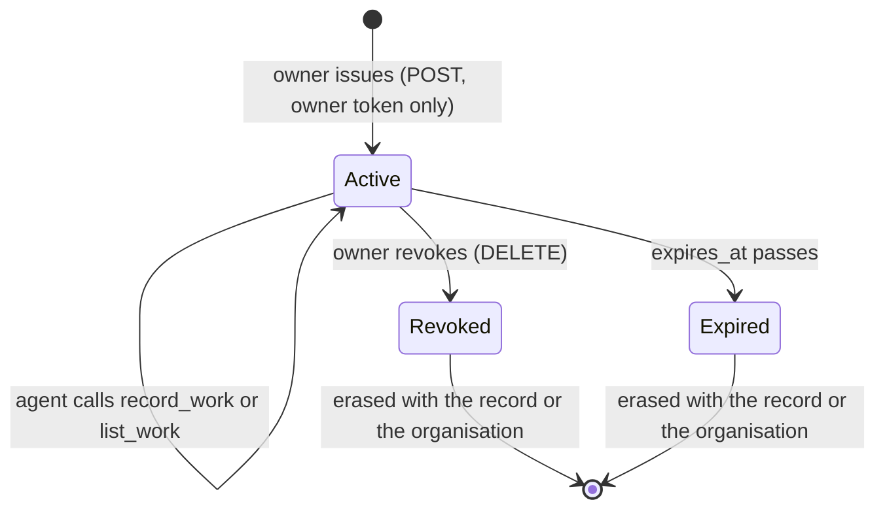

# Agent token audit

This report is for the owner or reviewer who decides whether agent tokens are
safe to hand to a coding agent. It checks how a token is issued, scoped,
expired and revoked against the code on 2026-11-05. It lists the gaps found
and how each one was closed or why it stays open.

**Verdict:** agent tokens are safe to use. Every gap found is closed. Tokens
now expire, a workspace holds a bounded number of them, each accepted request
is logged with its token's id, and each note names the token that filed it.

## Contents

- [Lifecycle](#lifecycle)
- [Findings](#findings)
- [What was checked and holds](#what-was-checked-and-holds)
- [Open recommendations](#open-recommendations)
- [Where the rules live](#where-the-rules-live)

## Lifecycle

| Stage  | Rule now                                                                                                                                                                                |
| ------ | --------------------------------------------------------------------------------------------------------------------------------------------------------------------------------------- |
| Issue  | Owner token only, in owner mode only. 32 random bytes behind a `dlagent_` prefix; the secret is shown once and only its SHA-256 is stored. At most 20 active tokens per workspace.      |
| Scope  | One workspace. Only `POST` and title-only `GET` on that workspace's `/work-journal/notes`. Every other route answers 403, a malformed or unknown token 401.                             |
| Expiry | 90 days by default, `expires_in_days` from 1 to 365. A token stored before expiry existed expires 90 days after it was issued.                                                          |
| Revoke | Immediate: each request looks the token up again. Revoking one leaves the others working. Erasing a record or an organisation deletes its tokens.                                       |
| Audit  | Issue, revoke, each accepted request and each refusal are logged with the token id and the reason, never the secret. Each note names the token that filed it and those that amended it. |

## Findings

| #   | Finding                                                                                                   | Severity | Status                                                                                                                                                                |
| --- | --------------------------------------------------------------------------------------------------------- | -------- | --------------------------------------------------------------------------------------------------------------------------------------------------------------------- |
| A-1 | Tokens never expired. A token copied into a forgotten agent configuration worked for ever.                | Medium   | Fixed. `expires_at` on each token, checked at every request; legacy rows get 90 days from issue.                                                                      |
| A-2 | No cap on active tokens per workspace. A script with the owner token could mint without bound.            | Low      | Fixed. 20 active tokens per workspace; the 21st answers 409 `agent_token_limit`.                                                                                      |
| A-3 | An accepted agent request left no log line naming the token, so a leaked token's use could not be traced. | Low      | Fixed. `agent token accepted` with the token id, method and route.                                                                                                    |
| A-4 | A note did not record which token filed it, so the owner could not find a leaked token's notes.           | Low      | Fixed. Each note keeps `agent_token_id` (never changed) and `amended_by_agent_token_ids`; `GET …/work-journal/notes?fields=summary&agent_token_id=dlat_…` lists them. |

The listing now shows `expires_at` and `active` for each token, so the owner
sees which ones still work.

## What was checked and holds

- **Secret strength:** 256 bits from `randomBytes`, so guessing is not
  practical. The address rate limit also caps refused attempts at 30 a minute.
- **Storage:** only the SHA-256 hash is kept, unique across tenants. The
  Postgres table has forced row-level security per tenant.
- **No owner reach:** an agent token never reaches the agent token routes, the
  operator routes or a whole note. A sweep over every route in the OpenAPI
  document asserts it (`agent-token-routes.test.ts`).
- **Sign-in mode:** agent tokens are refused; they exist in owner mode only.
- **Refusal answers:** unknown, revoked and expired tokens all answer the same
  401, so the answer reveals nothing about the token. The log keeps the reason.
- **Client handling:** `draftloop-mcp` turns a 401 into "run `init` again", so
  an expired token tells the agent what to do.
- **Owner token rotation** does not revoke agent tokens. This is by design: they
  are separate credentials, each revoked on its own.

## Open recommendations

1. Record a last-used time per token, so the owner can revoke idle ones.

## Where the rules live

| Rule                             | Code                                                                                     | Test                                                                                       |
| -------------------------------- | ---------------------------------------------------------------------------------------- | ------------------------------------------------------------------------------------------ |
| Issue, cap, expiry, listing      | `apps/api/src/agent-token-routes.ts`                                                     | `apps/api/src/agent-token-routes.test.ts`                                                  |
| Scope and refusal                | `apps/api/src/agent-token-auth.ts`, `request-auth.ts`                                    | `apps/api/src/agent-token-routes.test.ts`                                                  |
| Note provenance                  | `packages/application/src/work-journal.ts`, `packages/storage/src/work-journal-notes.ts` | `packages/application/src/work-journal.test.ts`, `apps/api/src/agent-token-routes.test.ts` |
| Store contract and lifetimes     | `packages/storage/src/agent-tokens.ts`                                                   | `packages/storage/src/agent-tokens.test.ts`                                                |
| Postgres store and expiry column | `packages/storage-postgres/src/agent-tokens.ts`, `agent-token-expiry-migration.ts`       | `packages/storage-postgres/src/agent-tokens.test.ts`                                       |

The channel's setup and the revoke commands are in the
[agent channel reference](../reference/agent-channel.md).
