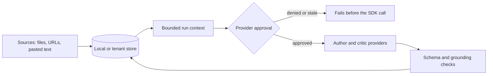

# Privacy and evaluation policy

This page is for anyone who changes how DraftLoop stores, sends or evaluates
candidate material. It states what stays local, what may reach a provider and
under which approval, and how quality is measured without real data.

DraftLoop treats candidate material and confidential employer information as
sensitive by default. Two sets of rules apply:

- **Local CLI and the shared engine:** source material, evidence, drafts and
  run history stay on the user's machine unless the user approves a provider
  transmission.
- **Server (self-hosted or hosted):** [ADR 0011](../adr/0011-client-server-version.md)
  adds recorded consent, EU storage, per-tenant encryption and server-side
  sensitivity tiers. Those rules join this policy before the hosted service
  admits other users. [Hosted service](../architecture/hosted-service.md)
  describes how the server enforces them.

The [threat model](threat-model.md) records the security risks and residual
limits. The [roadmap](../roadmap.md) records the current stage.



## Data classes and defaults

| Data class                          | Default location                                       | Provider boundary                                                         | Retention default                               |
| ----------------------------------- | ------------------------------------------------------ | ------------------------------------------------------------------------- | ----------------------------------------------- |
| Public material                     | Local workspace                                        | Only through an explicit request policy                                   | Until the user deletes it                       |
| Personal material                   | Local workspace                                        | Explicit approval and provider allowlist                                  | Until the user deletes it                       |
| Confidential employer material      | Local workspace                                        | Explicit approval, acknowledgement and allowlist; redaction rules advised | Until the user deletes it                       |
| Structured opportunity brief        | Local workspace and the immutable run context          | Only an explicitly selected, checksum-verified reviewed version           | Until the user deletes it                       |
| Candidate writing policy            | Selected workspace file and the immutable run context  | Sent to author and critic only after provider approval                    | Workspace copy and run history until deleted    |
| Portable CKB metadata and bytes     | User-selected, separate local plaintext store          | Not provider data: paths, URLs, labels, checksums and journals stay local | All six policy classes retained until deletion  |
| Secrets embedded in candidate files | Never in application content or fixtures               | Prohibited                                                                | Do not retain                                   |
| Provider credentials (CLI)          | Environment variables or a provider-managed session    | Authenticate an approved request only                                     | Until the user removes them or ends the session |
| Provider credentials (server)       | Secret Manager, or local secret files when self-hosted | Authenticate an approved request only                                     | Until the operator rotates or removes them      |

The provider contract requires `allowTransmission`, an allowlisted provider
company, and an acknowledgement for sensitive requests. Provider, model,
endpoint, scope, budgets and requested retention are visible in the run
context. An ephemeral preference is a user choice, not proof of a provider's
retention behaviour.

The default retention object exported by `@draft-loop/security` is:

```text
local source: until deleted
run history: until deleted
provider retention: not allowed unless explicitly configured
```

## Provider approval and credentials

Before the first request that carries source or draft material, DraftLoop shows
the data class, provider, model, endpoint, allowed context and retention
choice. A denied or stale policy fails before the SDK call. The complete
candidate corpus never enters the approved context.

| Client                   | How approval is given                                                                                                    |
| ------------------------ | ------------------------------------------------------------------------------------------------------------------------ |
| CLI                      | `--allow-provider-data` on each command that sends material                                                              |
| Server, owner-token mode | `DRAFT_LOOP_ALLOW_PROVIDER_DATA` alone decides                                                                           |
| Server, sign-in mode     | The tenant's recorded consent, with `DRAFT_LOOP_ALLOW_PROVIDER_DATA` as a ceiling; a refusal is a 409 with a stable code |

Credentials never enter workspace history, backups, diagnostics or provider
content. The desktop client holds no provider key: it opens the server's own
web screen, and the server holds the keys.

Experimental local user-session mode hands a structured request to an
installed Codex or Claude runtime. DraftLoop does not extract or store its
OAuth credentials. The runtime, authentication mode and provider-default
retention appear in the approved endpoint identity. Tools, repository
instructions, extensions, MCP servers, web search and session persistence are
disabled where supported, and an observed tool event fails the request. See
[ADR 0006](../adr/0006-provider-authentication-modes.md).

## Opportunity briefs

[Candidate evidence](../architecture/candidate-evidence.md#opportunity-brief-contract)
defines the brief contract. The privacy rules are:

- **Stored:** structured fields, source-linked provenance and content
  checksums. Raw source content and host paths are not stored. Approved-URL
  provenance can hold confidential URLs, so it stays sensitive local state.
- **Quotations:** one exception to "no raw content". A requirement or
  responsibility may keep a verbatim quotation of at most 300 characters, only
  after the application confirms it appears in a cited source.
- **Candidate instructions:** typed apart from opportunity facts. They cannot
  set role, employer, responsibility, requirement or priority fields, and never
  enter extraction requests.
- **Extraction requests:** after approval, normalized text from available,
  partial or stale sources may go to the author provider. Requests omit URLs,
  paths, provenance and candidate input. DraftLoop validates the schema and
  every cited source ID, and stores no raw request or response.
- **Failures:** an unavailable source has no invented checksum. Diagnostics do
  not repeat a path, URL query, raw content or operating-system error.
- **Audit records:** opaque identity, version, status and checksum only.
- **Binding to a run:** no run picks the latest brief. A run binds one reviewed
  brief by ID and version after a checksum check, and resume reuses that
  snapshot.

## Candidate writing policies

The candidate imports or activates each policy file explicitly. DraftLoop keeps
bounded, immutable, checksum-addressed versions. Default views show metadata,
and exact content is returned only by an explicit content read. Edits to the
managed active file become a new version before a run.

The effective policy travels to author and critic only after provider approval.
It carries forbidden terms and punctuation rules, tone, spelling locale,
verbosity, page target, section order, emphasis areas and anti-formulaic
defaults.

Policies are style data with hard limits:

- They cannot authorize provider access, select models, enable tools, create
  candidate facts or relax truthfulness and evidence controls.
- Validation reports rule identity and section or block coordinates, never the
  forbidden value, matched text, nearby text or source paths.
- A run-specific override is an imported immutable version bound to one
  reviewed opportunity. The run records base and override lineage, and the
  workspace's active policy is unchanged.

## Canonical candidate profiles

[Candidate evidence](../architecture/candidate-evidence.md#canonical-candidate-profile-contract)
defines the profile contract. The privacy rules are:

- **Storage:** immutable, checksum-verified versions bound to exact path-free
  CKB store, base, source and source-version identities. Audit events hold
  identity, version, status, lineage, schema and checksum only, never fact
  values.
- **Provenance:** every fact needs candidate-provided provenance, and may keep
  the exact source quote that grounded it. Public corroboration stays
  distinguishable.
- **Derivation:** refuses to read sources or call the provider until the caller
  approves provider data. The request holds bounded normalized text, media
  types, checksums and opaque source IDs. Store roots, managed paths, URL
  provenance and origin bindings never enter it.
- **Grounding:** each proposed fact must cite a quote that occurs in the
  normalized source and contains the value. Provider output cannot author
  provenance, status, severity, messages or identifiers.
- **Local operations:** reload, history, edit and review never call a provider.
- **Binding to a run:** a run binds one reviewed profile by ID and version. Its
  stored CKB selection must match the workspace's current ready selection, and
  resume cannot replace it.

Lifecycle changes do not erase profile history, run references or approved
export records. Single-CKB backups leave out cross-CKB profiles. Whole-workspace
backup and restore keep profiles and exports.

## Candidate Knowledge Base

The portable Candidate Knowledge Base (CKB) is a separate local store. It holds
CKB and source identities, immutable source versions and approved managed
bytes.
[Candidate evidence](../architecture/candidate-evidence.md#portable-candidate-knowledge-base)
describes its model, and ADRs [0007](../adr/0007-portable-candidate-knowledge-store.md)
and [0008](../adr/0008-ckb-scoped-lexical-retrieval.md) set the storage and
retrieval contracts.

### What stays local

| Data                                                       | Where it may appear                                                     |
| ---------------------------------------------------------- | ----------------------------------------------------------------------- |
| File origins, directory roots, URL provenance, path hashes | Sensitive local tables only                                             |
| Source labels and content checksums                        | Local CKB metadata; never in provider requests or content-free surfaces |
| Store roots                                                | The sensitive workspace manifest, so new runs can reopen the stores     |
| Selected excerpts with opaque chunk IDs                    | Provider requests of runs that selected the CKB, after approval         |
| Opaque IDs, status, timestamps, bounded counts             | CLI output, screen results, diagnostics and audit records               |

URL failures never echo query strings. Store roots stay out of workspace
descriptors, context snapshots, run history, diagnostics and provider
requests.

The CKB database and managed blobs are plaintext. DraftLoop sets restrictive
permissions where supported, but they do not protect against another process
running as the same user. Files such as `AGENTS.md` or `.env` stay inert
candidate data and never become instructions, configuration or permissions.

### Intake and lifecycle actions

Every action below is local and needs the user's explicit confirmation. None of
them sends anything to a provider, and each result exposes only opaque
identities, status, time and bounded counts.

| Action                         | Privacy rule                                                                                                                     |
| ------------------------------ | -------------------------------------------------------------------------------------------------------------------------------- |
| File intake and version append | One regular file, stable-file checks, supported type, 20 MiB limit; changed bytes make a new version, identical bytes do nothing |
| URL intake and refresh         | Approval for each request; public-address and redirect checks; a failure records a URL-free `inaccessible` observation           |
| Directory intake               | Bounded scan of a real non-symlink root outside the store; symlinks, special and dot-prefixed entries are skipped unopened       |
| Add members, refresh           | Uses the remembered root without returning it; refresh appends only changed bytes of existing active members                     |
| File or directory rebind       | Replacement path is runtime input only; bytes must match the current managed version; membership is not revised                  |
| Moved-member move              | Needs a unique exact match on type, checksum and size from one scan; names and path similarity are never evidence                |
| Retirement and reconciliation  | Logical and idempotent; each member is chosen by source ID; nothing is deleted and no reactivation exists                        |

Supported types are plain text, Markdown, HTML, PDF and DOCX. Managed bytes use
opaque names from generated IDs. Publication writes the file before the
database row with no-replace targets, so a crash can leave an unreferenced
entry. Unknown entries stay unknown: nothing adopts or cleans them up.

Automatic rename inference, background refresh, automatic deletion and
redirect history remain out of scope.

### Readiness and selection

Readiness is recomputed from stored evidence. Its public view holds identities,
bounded state and reasons, safe timestamps and numeric revisions. It excludes
labels, paths, URLs, checksums, media types, sizes and content.

A selection snapshot holds the store ID, CKB ID, selected source and version
IDs, capture time and lifecycle revision. Combining more than one CKB needs a
separate approval. The snapshot is audit and drift evidence, not consent to send
content.

Before a provider-capable start, resume or revision, DraftLoop compares a fresh
path-free projection with the run's snapshot. Drift requires review before the
provider is called.

### Retention, deletion and backups

| Operation                        | What it covers                                                                                                           | What it does not do                                                                        |
| -------------------------------- | ------------------------------------------------------------------------------------------------------------------------ | ------------------------------------------------------------------------------------------ |
| Workspace backup, restore, purge | Workspace history, profiles and exports                                                                                  | Touch the CKB store; prove copies in older backups or exports are gone                     |
| CKB retention policy             | Six classes, all `retain-until-deletion` by default; day-based expiry only when configured; legal hold wins              | Mark anything but committed managed raw versions as expiry-eligible                        |
| Confirmed CKB deletion           | An archived non-default CKB, with the token from a fresh plan, under the store lease; ownership-proven records and blobs | Secure erasure; touching unknown, unmanaged or held data                                   |
| CKB export                       | A versioned package to an approved destination, when every managed object verifies                                       | Include paths, locks, journals, credentials or run data; sign the package                  |
| CKB restore                      | A new destination, fail-if-existing, full verification before writing                                                    | Rebuild original URLs, directory membership or file bindings; every source returns unbound |

Deleting an original file or workspace does not delete its managed CKB copy. A
database-only backup is incomplete because it omits managed blobs. Users remain
responsible for directories, devices, cloud backups, exported packages and
copies made outside DraftLoop.

## Redaction and logging

`packages/security/src/index.ts` redacts credential-shaped values with
deterministic rules: private keys, bearer tokens, provider key prefixes and
credential assignments. Confidential employer terms are not reliably
detectable, so users or deployments must supply explicit rules for them.

Operational events are allowlisted and always carry `contentRedacted: true`.
They may hold:

- bounded identifiers, provider and model identity, status and duration
- usage, cost, safe error codes and retry classification
- a separately supplied provider request identifier

Prompts, responses, source content, credentials, confidential terms and hidden
chain-of-thought never enter logs, audit records, fixtures or error messages.
Provider failures keep only generic safe explanations. Evidence excerpts and
user-visible rationale are product data under the retention and provider rules
above.

## Evaluation harness

`packages/evaluations` scores three variants with the same deterministic
readiness rubric: `first-draft`, `revised-draft` after the author–critic loop,
and `manual-baseline`. It reports each dimension, readiness status, user-effort
deltas and revised-versus-baseline comparisons. The CI gate is first to
revised: a revised draft must not regress any dimension beyond the configured
tolerance. The manual baseline is a reference, not automatic truth.

A consented real-application outcome needs a private v1 comparison gate,
declared after consent and no later than the first draft:

- **Private record:** recall, coverage and revised-effort thresholds, plus
  factual-invariant, section-preservation, chronology and recall measurements.
- **Zero tolerance:** factual-invariant violations and unsupported claims added
  by a model.
- **Sanitized report:** the overall gate status and `pass`, `fail` or
  `indeterminate` per named dimension. It copies no timestamps, thresholds,
  measurements, identifiers, content or paths.
- **Allowed aggregates:** approval and export completion, round count, provider
  cost, user confidence, misleading-evidence and prompt-injection
  observations, critical-requirement coverage and unsupported-claim counts.

A synthetic fixture or incomplete outcome is indeterminate evidence. The
provider-free [synthetic scenario preflight](../evaluation/synthetic-scenario-preflight.md)
cannot replace the [consented outcome pilot protocol](../evaluation/pilot-protocol.md).

Fixtures must be synthetic: no real candidate documents, provider responses,
credentials, employer secrets or hidden reasoning. A quality regression raises
`EvaluationRegressionError`, so it fails tests deterministically. Scores are
signals, not fact verification. Source references, deterministic validation,
explicit disagreements and human approval remain required.

## Approval boundary

DraftLoop prepares artifacts. It must not submit an application, send a
message, publish a document or run uncontrolled web research without an
explicit user action and a visible approval boundary.
