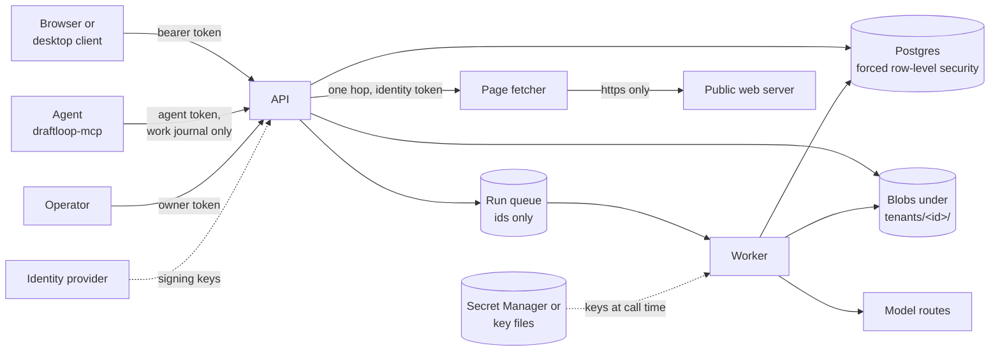

# Server threat model

This page is the security baseline for the DraftLoop server and its clients:
the API, the worker, the page fetcher, the model routes, the desktop client,
the agent channel and the self-hosted Compose stack. It is for anyone who changes a server boundary or reviews
a server release. It lists what is protected, how, which test proves it, and
what risk remains. The engine the server shares with the CLI is covered by the
[threat model](threat-model.md), and this page does not repeat it.

## Contents

- [Scope](#scope)
- [Components and boundaries](#components-and-boundaries)
- [Assets](#assets)
- [Ranked abuse paths](#ranked-abuse-paths)
- [Residual risks and follow-ups](#residual-risks-and-follow-ups)
- [Review triggers](#review-triggers)

## Scope

| Runtime                       | Covered here                                                                                                  |
| ----------------------------- | ------------------------------------------------------------------------------------------------------------- |
| The API and the worker        | Authentication in both modes, tenant isolation, idempotency, operator routes, record and organisation erasure |
| The page fetcher              | Server-side request forgery and the one-hop design                                                            |
| Model routes and keys         | Vertex AI in the EU, the direct Claude API fallback, OpenAI's endpoint, Secret Manager keys, local key files  |
| The desktop client            | The server origin lock, the keychain-held owner token, the release check                                      |
| The agent channel             | `draftloop-mcp`, its token, and notes as untrusted text                                                       |
| The self-hosted Compose stack | Published ports, generated secrets and keys on disk                                                           |

Prompt injection through job posts and uploads is modelled in the
[threat model](threat-model.md#hosted-service-prompt-injection-through-job-posts-and-uploads).
The legal and privacy texts are out of scope.

## Components and boundaries

Each arrow is a boundary. The ones this page reviews are:

- **Caller to API.** Every route but health and the web screen's files needs a
  bearer token. Owner-token mode takes one deployment token; sign-in mode takes
  the identity provider's access tokens and keeps the owner token for operator
  routes.
- **API and worker to storage.** Both act as one tenant at a time, under
  forced row-level security, with blobs under the tenant's prefix.
- **API to queue to worker.** A job carries ids only, never candidate material.
  The worker re-reads state and re-checks consent, screening and erasure as it
  claims each job.
- **API to page fetcher to the web.** The API has no route to the internet. The
  fetcher makes one checked hop for it and holds no database, secret or
  candidate material.
- **Worker to model routes.** Only the worker calls a drafting or review model,
  with keys it reads at call time. The API refuses to build a provider client.
- **Desktop client to server.** The client is a sandboxed window over one
  server's own web screen, with the owner token in the system keychain.
- **Agent to API.** `draftloop-mcp` runs inside the candidate's agent, such
  as Claude Code or Codex, and files notes into a pending inbox.

The architecture behind these boundaries is in
[Storage and tenancy](../architecture/storage-and-tenancy.md#tenant-isolation)
and [Hosted service](../architecture/hosted-service.md).

## Assets

| Asset                        | Where it lives                                                | Why it matters                                                  |
| ---------------------------- | ------------------------------------------------------------- | --------------------------------------------------------------- |
| Candidate material           | Postgres rows and blobs, per tenant                           | Career history, drafts and exports of real people               |
| Consent and audit records    | Postgres, append-only for the runtime role                    | Proof of what the candidate allowed                             |
| The owner token              | The deployment's secret store or secret file                  | Full access in owner-token mode; operator power in sign-in mode |
| Agent tokens                 | A file in the user's configuration folder; a hash in Postgres | Filing and listing one workspace's work journal notes           |
| Members' sign-in tokens      | The caller's browser or desktop keychain                      | One member's access to their organisation                       |
| Credits and plan assignments | Postgres credit ledger                                        | Spend on model calls, and what a plan allows                    |
| The API's network position   | Inside the deployment's network                               | A fetch made from there could reach private services            |
| Provider keys                | Secret Manager, or key files on a self-hosted machine         | Spend and access at the model provider                          |

## Ranked abuse paths

The ratings are qualitative priorities. IDs are stable, so a retired threat
keeps its number. "Evidence" names the test that proves the control.

| ID    | Severity / confidence | Threat                                                                           | Control                                                                                                                                                                                                                                                                                                                                                                                                                                                                    | Evidence                                                                                                                                                                                                                                     | Residual risk                                                                                                                                                                                                |
| ----- | --------------------- | -------------------------------------------------------------------------------- | -------------------------------------------------------------------------------------------------------------------------------------------------------------------------------------------------------------------------------------------------------------------------------------------------------------------------------------------------------------------------------------------------------------------------------------------------------------------------- | -------------------------------------------------------------------------------------------------------------------------------------------------------------------------------------------------------------------------------------------- | ------------------------------------------------------------------------------------------------------------------------------------------------------------------------------------------------------------ |
| S-001 | High / high           | A member of one organisation reads or changes another's material                 | The tenant is bound from the caller before any route runs; a route with no tenant fails closed. Every key includes `tenant_id`, and row-level security is forced on every read and write                                                                                                                                                                                                                                                                                   | `apps/worker/src/tenancy-flow.test.ts` (two organisations, creation to export)                                                                                                                                                               | A query added outside the tenant ports would bypass the binding; review new storage code                                                                                                                     |
| S-002 | High / high           | The runtime role escapes row-level security                                      | The store refuses to open as a superuser or `BYPASSRLS` role. Migrations run as the schema owner; the runtime role gets table access only. The one cross-tenant read, the sign-in lookup, is a `SECURITY DEFINER` function the runtime may only execute                                                                                                                                                                                                                    | `packages/storage-postgres/src/postgres-storage.test.ts`, `packages/storage-postgres/src/owner-role-migration.test.ts`                                                                                                                       | A misconfigured grant on a new table; each migration needs the same review                                                                                                                                   |
| S-003 | High / medium         | A forged or replayed sign-in token is accepted                                   | `jose` verifies the signature against the issuer's published keys, with `iss` and `aud` compared exactly and expiry checked. Discovery refuses a document naming another issuer. The person must hold an active membership, or the API answers 403                                                                                                                                                                                                                         | `apps/api/src/oidc-sign-in.test.ts`                                                                                                                                                                                                          | A stolen, unexpired access token works until it expires; token lifetime is the identity provider's setting                                                                                                   |
| S-004 | High / medium         | The owner token is guessed, leaked or misused                                    | At least 32 characters, compared in constant time over hashes. In sign-in mode it reaches only operator routes, matched on both the route and the raw path, and a member's token never reaches them. `draft-loop-server token --rotate` replaces it on a self-hosted stack, and a new Secret Manager version replaces it on a deployment                                                                                                                                   | `apps/api/src/config.test.ts`, `apps/api/src/operator-plan-routes.test.ts`, `scripts/draft-loop-server.test.mjs`, `scripts/self-hosted-smoke.mjs`                                                                                            | One static credential with no expiry; whoever holds it holds every record in owner-token mode until it is replaced                                                                                           |
| S-005 | Medium / high         | A member reaches a record they are not assigned to                               | Record and knowledge access hooks answer 404, the same as an unknown record. Owners and admins assign members; each change writes an audit line                                                                                                                                                                                                                                                                                                                            | `apps/worker/src/coaching-flow.test.ts`                                                                                                                                                                                                      | Owners and admins reach every record by design                                                                                                                                                               |
| S-006 | Medium / high         | A retried request runs a command twice, such as a run start or a credit grant    | Idempotency keys belong to the tenant, under row-level security. A concurrent retry waits, then answers a retryable 409; a stalled request frees its key after a two-minute lease. Credit grants require a key                                                                                                                                                                                                                                                             | `apps/api/src/idempotency.test.ts`                                                                                                                                                                                                           | Routes that take no key rely on their own state checks                                                                                                                                                       |
| S-007 | High / medium         | Erased material survives in rows, blobs or a queued job                          | A close mark hides the record at once. One `SECURITY DEFINER` erase removes its history, consent, screening, keys, assignments and owned bases in one transaction. Objects are removed by key, then the tenant prefix on organisation deletion. Queued jobs end as `record-erased` or are dropped while the organisation closes                                                                                                                                            | `apps/worker/src/erasure-flow.test.ts`, `apps/api/src/postgres-record-erasure.test.ts`, `apps/api/src/organisation-erasure-routes.test.ts`                                                                                                   | Database backups keep erased rows until they age out, within 35 days; identity-provider accounts are not deleted                                                                                             |
| S-008 | High / medium         | An approved job page address makes the server reach a private service (SSRF)     | The API has no internet route. The fetcher accepts only `https` without credentials, checks literal and resolved addresses, connects only to the address it checked, and makes one hop. The API checks each redirect before asking for the next hop. Requests are capped at 8 KB; pages at intake's size limit and a timeout                                                                                                                                               | `apps/page-fetcher/src/page-fetcher.test.ts`, `packages/ingestion/src/pinned-url-fetcher.test.ts`                                                                                                                                            | Parser bugs on the fetched page stay possible; the fetched text is screened as untrusted (T-001)                                                                                                             |
| S-009 | Medium / medium       | Someone other than the API calls the page fetcher to use it as a proxy           | On the hosted service the fetcher takes internal traffic only, and Cloud Run checks an identity token that only the API's account may get. It logs the host only                                                                                                                                                                                                                                                                                                           | Deployment configuration in the private infrastructure repository                                                                                                                                                                            | On a self-hosted stack the fetcher is reachable from inside the Compose network without a token (S-023)                                                                                                      |
| S-010 | Medium / medium       | A caller runs up model spend or exhausts the service                             | Runs reserve credits before queueing and settle on the run's real cost; plan limits cap runs; each run has a cost cap. Bodies are size-limited per route. The work journal intake rate-limits notes. Each source address has a request limit per minute and a much smaller budget of refused credentials, after which it is answered 429 until the minute ends                                                                                                             | `apps/worker/src/run-credit-settlement.test.ts`, `apps/api/src/plan-limits-routes.test.ts`, `apps/api/src/rate-limit.test.ts`                                                                                                                | The limits are counted per API instance, so several Cloud Run instances multiply them. On a self-hosted stack every client shares 127.0.0.1, so one misconfigured agent can lock the others out for a minute |
| S-011 | Medium / medium       | A queued job acts on state that changed after queueing                           | A job carries ids only. The worker re-reads the run, and re-checks consent, screening and erasure as it claims each job, before any provider call                                                                                                                                                                                                                                                                                                                          | `apps/worker/src/run-job-handler.test.ts`, `apps/worker/src/tenant-services.test.ts`                                                                                                                                                         | A change during a provider call takes effect at the next step                                                                                                                                                |
| S-012 | Medium / low          | The web screen is framed, or injected script runs in it                          | The screen renders through React. The API serves it same-origin with its routes, with a same-origin `Content-Security-Policy` (`frame-ancestors 'none'`, no inline script), `X-Frame-Options`, `X-Content-Type-Options: nosniff` and `Referrer-Policy: no-referrer` on every answer                                                                                                                                                                                        | `apps/api/src/web-screen.test.ts`, `apps/api/src/app.test.ts`                                                                                                                                                                                | Style and script come only from the API's origin, so a script injected through the API's own files is not stopped                                                                                            |
| S-013 | Low / medium          | Logs leak candidate material or credentials                                      | Request lines carry tenant and member ids, never an email or token. Refusals and audit lines are content-free                                                                                                                                                                                                                                                                                                                                                              | `apps/api/src/logging.test.ts`                                                                                                                                                                                                               | New log lines need the same review                                                                                                                                                                           |
| S-014 | High / medium         | Hosted Claude calls process material outside the EU                              | Vertex AI accepts only the `eu` multi-region or a `europe-*` region, with the endpoint set explicitly. The direct Claude API fallback is off unless the deployment turns it on, keeps the model, and records the route it left and why                                                                                                                                                                                                                                     | `packages/model-gateway/src/vertex-client.test.ts`, `packages/model-gateway/src/routed-adapter.test.ts`                                                                                                                                      | With the fallback on, calls run outside the EU; moving them back is [#1564](https://github.com/akoita/draft-loop/issues/1564)                                                                                |
| S-015 | Medium / medium       | The critic's calls leave OpenAI's EU endpoint                                    | The hosted worker targets OpenAI's EU endpoint unless configured otherwise, and every call records its route                                                                                                                                                                                                                                                                                                                                                               | `packages/model-gateway/src/hosted-routes.test.ts`                                                                                                                                                                                           | EU residency and zero retention are terms of the OpenAI account, outside the code. A self-hosted stack defaults to the global endpoint                                                                       |
| S-016 | High / medium         | A provider key leaks from the hosted service                                     | Keys are read from Secret Manager at call time, never from an image or environment file, and only by the worker. The API refuses to build a provider client whatever its environment holds. Errors name the provider only                                                                                                                                                                                                                                                  | `packages/model-gateway/src/secret-credentials.test.ts`, `apps/api/src/provider-boundary.test.ts`                                                                                                                                            | Whoever controls the worker's identity can read the keys                                                                                                                                                     |
| S-017 | Medium / medium       | A self-hosted key file is read by another user                                   | Keys are copied into a Docker secrets volume. A key file other users can read is refused, and errors never repeat its content                                                                                                                                                                                                                                                                                                                                              | `packages/model-gateway/src/file-credentials.test.ts`                                                                                                                                                                                        | The copy in `keys/` stays readable by the owner's account and its processes                                                                                                                                  |
| S-018 | High / medium         | An injected agent takes its token and calls other routes                         | The agent holds an agent token, not the owner token: it reaches only the routes its scopes admit on its own workspace (`journal` when issued without scopes, while the token form and `init` tick `journal`, `applications:read` and `jobs:write`; `jobs:write` from pasted text only; `drafts:read`, never ticked by default, reads exports and saved drafts; `runs:start`, never ticked by default, starts CV runs on a reviewed brief and drafts cover letters and interview questions on the default model, within a monthly spend cap that reserves each run's and each draft's cost limit), every other route is human-only and a route left unclassified fails the tests, it is stored as a hash, expires after 90 days by default, and is revoked on its own ([audit](agent-token-audit.md)). The files `draftloop-mcp init` writes hold no token                                                                                                                                                                  | `apps/api/src/agent-token-routes.test.ts`, `apps/api/src/agent-route-scopes.test.ts`, `apps/api/src/agent-spend-gate.test.ts`, `apps/mcp/src/init.test.ts`                                                                                                                                                                       | Until revoked or expired, a stolen agent token can do what its scopes allow: file notes, which wait for review, list titles, read application names and run state, add job applications from pasted text, and, with `drafts:read`, read the exported CVs and saved cover letters and interview questions with the facts they cite, and, with `runs:start`, spend up to its monthly cap on CV runs and drafts, which wait for the candidate's review                                                                                                        |
| S-019 | Medium / medium       | A note carries injected instructions or invented claims toward a CV              | Notes wait in a pending inbox behind the candidate's consent switch and are screened like uploads. Secret-like text and non-`https` links are refused; notes are rate-limited per hour and capped per tenant. Nothing becomes evidence before the candidate approves it                                                                                                                                                                                                    | `packages/application/src/work-journal.test.ts`, `apps/api/src/work-journal-routes.test.ts`                                                                                                                                                  | An approved note is only as true as the candidate's review                                                                                                                                                   |
| S-020 | Medium / high         | The desktop window is steered to another site, or a page reaches Node or devices | The window loads only its server's origin and its sign-in issuer; other links open in the system browser and other schemes are refused. New windows are denied. Pages run sandboxed with context isolation, no Node and no device permissions, in a partition per server. Plain `http` is allowed only for this computer                                                                                                                                                   | `apps/desktop-client/src/navigation.test.ts`, `apps/desktop-client/src/window-security.test.ts`, the packaged acceptance                                                                                                                     | Installers are unsigned (T-011)                                                                                                                                                                              |
| S-021 | Medium / medium       | The remembered owner token is stolen, or handed to an impostor                   | The token is encrypted by the system keychain, per server origin. Where no keychain is available, including Linux's plain-text backend, nothing is remembered. Before each top-level page of a server window loads, a reload included, its server must answer `POST /v1/auth/proof`: an HMAC of a fresh challenge keyed by the owner token, which another process cannot compute. Packaged acceptance swaps in an impostor on the same address and checks it gets no token | `apps/desktop-client/src/remembered-sign-in.test.ts`, `apps/desktop-client/src/token-proof.test.ts`, `apps/desktop-client/src/token-offer.test.ts`, `scripts/desktop-client-acceptance.mjs`, `apps/api/src/owner-token-proof-routes.test.ts` | A token the person types into an impostor's page reaches it; the proof only protects the remembered one                                                                                                      |
| S-022 | Low / high            | The release check becomes an update path                                         | The client reads GitHub's releases list and offers the releases page; it never downloads or runs anything. `DRAFT_LOOP_DESKTOP_RELEASE_CHECK=off` turns it off                                                                                                                                                                                                                                                                                                             | `apps/desktop-client/src/release-notice.test.ts`                                                                                                                                                                                             | Signed installers and verified updates are not built (T-011)                                                                                                                                                 |
| S-023 | Medium / medium       | A self-hosted stack is reachable from the network                                | The API is published on 127.0.0.1 only; Postgres and the page fetcher publish no port. Every secret is random and generated at first start, and the init step has no network                                                                                                                                                                                                                                                                                               | `scripts/self-hosted-stack.test.mjs`                                                                                                                                                                                                         | Binding the port to another address exposes the API over plain `http`. Containers on the Compose network reach the page fetcher without a token                                                              |

## Residual risks and follow-ups

The four gaps the review found (#2144, #2145, #2146, #2148) are closed; each
path's row above names its mitigation and test. A new gap gets its own issue
and a row here.

The API trusts forwarding headers, since Cloud Run's front end terminates TLS.
On a self-hosted stack the API is reached directly on 127.0.0.1, so a caller
there could spoof the address that request logs record. No access decision uses
that address.

## Review triggers

Revisit this page when any of these change:

- a new route outside the tenant binding, or a new cross-tenant function
- a new credential, or a change to either auth mode
- a new table, grant or `SECURITY DEFINER` function
- a new outbound call from the API or the worker
- the page fetcher's ingress, identity or hop rules
- a new model route, endpoint or key store
- a desktop client permission, navigation rule or update path
- a new agent tool or agent credential
- a new published port or secret in the Compose stack
