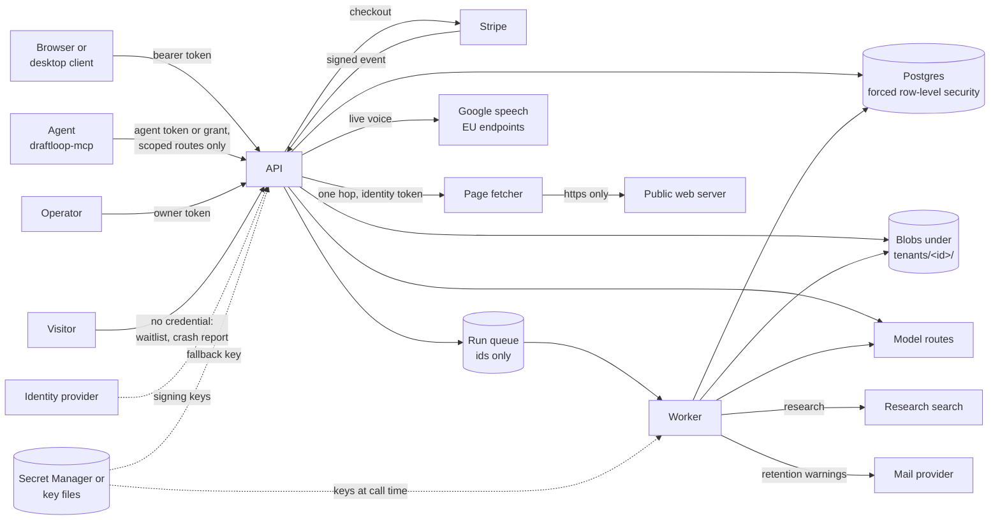

# Server threat model

This page is the security baseline for the DraftLoop server and its clients:
the API, the worker, the page fetcher, the model routes, the desktop client,
the agent channel and the self-hosted Compose stack. It is for anyone who
changes a server boundary or reviews a server release. It lists what is
protected, how, which test proves it, and what risk remains. The engine the
server shares with the CLI is covered by the [threat model](threat-model.md),
and this page does not repeat it.

## Contents

- [Scope](#scope)
- [Components and boundaries](#components-and-boundaries)
- [Assets](#assets)
- [Ranked abuse paths](#ranked-abuse-paths)
- [Operator and admin actions](#operator-and-admin-actions)
- [Residual risks and follow-ups](#residual-risks-and-follow-ups)
- [Review triggers](#review-triggers)

## Scope

| Runtime                       | Covered here                                                                                                                                                                  |
| ----------------------------- | ----------------------------------------------------------------------------------------------------------------------------------------------------------------------------- |
| The API                       | Authentication in both modes, tenant isolation, idempotency, operator and admin routes, record and organisation erasure, the public routes (waitlist, crash reports, payment events) |
| The API's own model calls     | Screening, the career interview and its live voice, cover letters and interview guides, the support assistant                                                                 |
| The worker                    | Queued runs, material reviews, profile derivation, research runs, the quality digest and insight ledger, and the retention sweeps (beta, waitlist, support tickets)            |
| The page fetcher              | Server-side request forgery and the one-hop design, for briefs and for job page copies                                                                                        |
| Model routes and keys         | Vertex AI in the EU, the direct Claude API fallback, OpenAI's endpoint, Google speech in the EU, research search, Secret Manager keys, local key files                         |
| Payments                      | Stripe Checkout for credit packs, its signed events and refunds                                                                                                               |
| Sign-up and feedback          | The beta waitlist, invite codes, feedback notes and support tickets                                                                                                           |
| The desktop client            | The server origin lock, the keychain-held owner token, the release check                                                                                                      |
| The agent channel             | `draftloop-mcp` over stdio and HTTP, agent tokens and assistant sign-ins, their scopes and spend cap, and notes as untrusted text                                              |
| The self-hosted Compose stack | Published ports, generated secrets and keys on disk                                                                                                                           |

Prompt injection through job posts and uploads is modelled in the
[threat model](threat-model.md#hosted-service-prompt-injection-through-job-posts-and-uploads).
The legal and privacy texts are out of scope.

## Components and boundaries

Each arrow is a boundary. The ones this page reviews are:

- **Caller to API.** Every route needs a bearer token except health, the web
  screen's files and the public routes listed in `web-screen.ts`: sign-in
  configuration, the token proof, crash reports, the waitlist and payment
  events. Owner-token mode takes one deployment token; sign-in mode takes the
  identity provider's access tokens and keeps the owner token for operator
  routes. The live voice WebSocket carries its token as a `bearer.` subprotocol,
  never a cookie.
- **API and worker to storage.** Both act as one tenant at a time, under
  forced row-level security, with blobs under the tenant's prefix.
- **API to queue to worker.** A job carries ids only, never candidate material.
  The worker re-reads state and re-checks consent, screening and erasure as it
  claims each job.
- **API to page fetcher to the web.** The API has no route to the internet. The
  fetcher makes one checked hop for it and holds no database, secret or
  candidate material.
- **Worker and API to model routes.** The worker runs every run step, material
  review, profile derivation and research run, with keys it reads at call time.
  The API's run driver refuses to build a provider client. The API calls Claude
  itself, on the same Vertex AI route, for screening, the career interview,
  cover letters, interview guides and the support assistant, and calls Google
  speech for the live interview.
- **Stripe to API.** Payment events carry no credential; the API checks
  Stripe's signature over the raw body before reading it.
- **Worker to search and mail.** Research searches run through Claude's web
  search or Linkup; the API and the worker fetch no search result themselves.
  Retention warnings go through the mail provider with a key from Secret
  Manager.
- **Desktop client to server.** The client is a sandboxed window over one
  server's own web screen, with the owner token in the system keychain.
- **Agent to API.** `draftloop-mcp` runs inside the candidate's agent, such
  as Claude Code or Codex, or as a remote MCP server over HTTP. It calls only
  the routes `agent-route-scopes.ts` admits for its scopes.

The architecture behind these boundaries is in
[Storage and tenancy](../architecture/storage-and-tenancy.md#tenant-isolation)
and [Hosted service](../architecture/hosted-service.md).

## Assets

| Asset                        | Where it lives                                                | Why it matters                                                  |
| ---------------------------- | ------------------------------------------------------------- | --------------------------------------------------------------- |
| Candidate material           | Postgres rows and blobs, per tenant                           | Career history, drafts and exports of real people               |
| Consent and audit records    | Postgres, append-only for the runtime role                    | Proof of what the candidate allowed                             |
| The owner token              | The deployment's secret store or secret file                  | Full access in owner-token mode; operator power in sign-in mode |
| Agent tokens                 | A file in the user's configuration folder; a hash in Postgres | Filing and listing one workspace's work journal notes           |
| Members' sign-in tokens      | The caller's browser or desktop keychain                      | One member's access to their organisation                       |
| Credits and plan assignments | Postgres credit ledger                                        | Spend on model calls, and what a plan allows                    |
| The API's network position   | Inside the deployment's network                               | A fetch made from there could reach private services            |
| Provider keys                | Secret Manager, or key files on a self-hosted machine         | Spend and access at the model provider                          |
| Stripe keys                  | The API's environment: a test-mode secret key and the webhook secret | Whoever holds the webhook secret can sign an event that grants credits |
| Invite codes                 | A hash in Postgres; the plain code shown once to the operator | One code creates one organisation on the Beta plan              |
| Waitlist addresses           | Postgres, deleted after six months                            | Visitors' email addresses                                       |
| Feedback and support tickets | Postgres, per organisation; tickets deleted after 90 days     | Members' own words, which the operator reads                    |
| The mail provider's key      | Secret Manager, read by the worker                            | Mail sent in the service's name                                 |

## Ranked abuse paths

The ratings are qualitative priorities. IDs are stable, so a retired threat
keeps its number. "Evidence" names the test that proves the control.

| ID    | Severity / confidence | Threat                                                                           | Control                                                                                                                                                                                                                                                                                                                                                                                                                                                                    | Evidence                                                                                                                                                                                                                                     | Residual risk                                                                                                                                                                                                |
| ----- | --------------------- | -------------------------------------------------------------------------------- | -------------------------------------------------------------------------------------------------------------------------------------------------------------------------------------------------------------------------------------------------------------------------------------------------------------------------------------------------------------------------------------------------------------------------------------------------------------------------- | -------------------------------------------------------------------------------------------------------------------------------------------------------------------------------------------------------------------------------------------- | ------------------------------------------------------------------------------------------------------------------------------------------------------------------------------------------------------------ |
| S-001 | High / high           | A member of one organisation reads or changes another's material                 | The tenant is bound from the caller before any route runs; a route with no tenant fails closed. Every key includes `tenant_id`, and row-level security is forced on every read and write                                                                                                                                                                                                                                                                                   | `apps/worker/src/tenancy-flow.test.ts` (two organisations, creation to export)                                                                                                                                                               | A query added outside the tenant ports would bypass the binding; review new storage code                                                                                                                     |
| S-002 | High / high           | The runtime role escapes row-level security                                      | The store refuses to open as a superuser or `BYPASSRLS` role. Migrations run as the schema owner; the runtime role gets table access only. The one cross-tenant read, the sign-in lookup, is a `SECURITY DEFINER` function the runtime may only execute                                                                                                                                                                                                                    | `packages/storage-postgres/src/postgres-storage.test.ts`, `packages/storage-postgres/src/owner-role-migration.test.ts`                                                                                                                       | A misconfigured grant on a new table; each migration needs the same review                                                                                                                                   |
| S-003 | High / medium         | A forged or replayed sign-in token is accepted                                   | `jose` verifies the signature against the issuer's published keys, with `iss` and `aud` compared exactly and expiry checked. Discovery refuses a document naming another issuer. The person must hold an active membership, or the API answers 403                                                                                                                                                                                                                         | `apps/api/src/oidc-sign-in.test.ts`                                                                                                                                                                                                          | A stolen, unexpired access token works until it expires; the hosted realm keeps access tokens for five minutes and refresh sessions for up to 30 days. No second factor is required of anyone ([operator and admin actions](#operator-and-admin-actions)) |
| S-004 | High / medium         | The owner token is guessed, leaked or misused                                    | At least 32 characters, compared in constant time over hashes. In sign-in mode it reaches only operator routes, matched on both the route and the raw path. A member's token reaches them only with the `draft-loop-operator` realm role and a second factor in `amr`, from the web screen's client, and then names its person on every log line (#2953). `draft-loop-server token --rotate` replaces it on a self-hosted stack, and a new Secret Manager version replaces it on a deployment                                                                                                                                   | `apps/api/src/config.test.ts`, `apps/api/src/operator-plan-routes.test.ts`, `apps/api/src/request-auth.test.ts`, `scripts/draft-loop-server.test.mjs`, `scripts/self-hosted-smoke.mjs`                                                                                            | One static credential with no expiry and no second factor; whoever holds it holds every record in owner-token mode, and every operator route in sign-in mode, until it is replaced. An operator who signs in by name instead leaves `operatorSubject` on each log line; with the owner token, audit lines cannot name the person who acted |
| S-005 | Medium / high         | A member reaches a record they are not assigned to                               | Record and knowledge access hooks answer 404, the same as an unknown record. Owners and admins assign members; each change writes an audit line                                                                                                                                                                                                                                                                                                                            | `apps/worker/src/coaching-flow.test.ts`                                                                                                                                                                                                      | Owners and admins reach every record by design                                                                                                                                                               |
| S-006 | Medium / high         | A retried request runs a command twice, such as a run start or a credit grant    | Idempotency keys belong to the tenant, under row-level security. A concurrent retry waits, then answers a retryable 409; a stalled request frees its key after a two-minute lease. Credit grants require a key                                                                                                                                                                                                                                                             | `apps/api/src/idempotency.test.ts`                                                                                                                                                                                                           | Routes that take no key rely on their own state checks                                                                                                                                                       |
| S-007 | High / medium         | Erased material survives in rows, blobs or a queued job                          | A close mark hides the record at once. One `SECURITY DEFINER` erase removes its history, consent, screening, keys, assignments and owned bases in one transaction. Objects are removed by key, then the tenant prefix on organisation deletion. Queued jobs end as `record-erased` or are dropped while the organisation closes                                                                                                                                            | `apps/worker/src/erasure-flow.test.ts`, `apps/api/src/postgres-record-erasure.test.ts`, `apps/api/src/organisation-erasure-routes.test.ts`                                                                                                   | Database backups keep erased rows until they age out, within 35 days; identity-provider accounts are not deleted                                                                                             |
| S-008 | High / medium         | An approved job page address makes the server reach a private service (SSRF)     | The API has no internet route. The fetcher accepts only `https` without credentials, checks literal and resolved addresses, connects only to the address it checked, and makes one hop. The API checks each redirect before asking for the next hop. Requests are capped at 8 KB; pages at intake's size limit and a timeout                                                                                                                                               | `apps/page-fetcher/src/page-fetcher.test.ts`, `packages/ingestion/src/pinned-url-fetcher.test.ts`                                                                                                                                            | Parser bugs on the fetched page stay possible; the fetched text is screened as untrusted (T-001)                                                                                                             |
| S-009 | Medium / medium       | Someone other than the API calls the page fetcher to use it as a proxy           | On the hosted service the fetcher takes internal traffic only, and Cloud Run checks an identity token that only the API's account may get. It logs the host only                                                                                                                                                                                                                                                                                                           | Deployment configuration in the private infrastructure repository                                                                                                                                                                            | On a self-hosted stack the fetcher is reachable from inside the Compose network without a token (S-023)                                                                                                      |
| S-010 | Medium / medium       | A caller runs up model spend or exhausts the service                             | Runs reserve credits before queueing and settle on the run's real cost; plan limits cap runs; each run has a cost cap. Bodies are size-limited per route. The work journal intake rate-limits notes. Each source address has a request limit per minute and a much smaller budget of refused credentials, after which it is answered 429 until the minute ends                                                                                                             | `apps/worker/src/run-credit-settlement.test.ts`, `apps/api/src/plan-limits-routes.test.ts`, `apps/api/src/rate-limit.test.ts`                                                                                                                | The limits are counted per API instance, so several Cloud Run instances multiply them. On a self-hosted stack every client shares 127.0.0.1, so one misconfigured agent can lock the others out for a minute |
| S-011 | Medium / medium       | A queued job acts on state that changed after queueing                           | A job carries ids only. The worker re-reads the run, and re-checks consent, screening and erasure as it claims each job, before any provider call                                                                                                                                                                                                                                                                                                                          | `apps/worker/src/run-job-handler.test.ts`, `apps/worker/src/tenant-services.test.ts`                                                                                                                                                         | A change during a provider call takes effect at the next step                                                                                                                                                |
| S-012 | Medium / low          | The web screen is framed, or injected script runs in it                          | The screen renders through React. The API serves it same-origin with its routes, with a same-origin `Content-Security-Policy` (`frame-ancestors 'none'`, no inline script), `X-Frame-Options`, `X-Content-Type-Options: nosniff` and `Referrer-Policy: no-referrer` on every answer                                                                                                                                                                                        | `apps/api/src/web-screen.test.ts`, `apps/api/src/app.test.ts`                                                                                                                                                                                | Style and script come only from the API's origin, so a script injected through the API's own files is not stopped                                                                                            |
| S-013 | Low / medium          | Logs leak candidate material or credentials                                      | Request lines carry tenant and member ids, never an email or token. Refusals and audit lines are content-free                                                                                                                                                                                                                                                                                                                                                              | `apps/api/src/logging.test.ts`                                                                                                                                                                                                               | New log lines need the same review                                                                                                                                                                           |
| S-014 | High / medium         | Hosted Claude calls process material outside the EU                              | Vertex AI accepts only the `eu` multi-region or a `europe-*` region, with the endpoint set explicitly. The direct Claude API fallback is off unless the deployment turns it on, keeps the model, and records the route it left and why                                                                                                                                                                                                                                     | `packages/model-gateway/src/vertex-client.test.ts`, `packages/model-gateway/src/routed-adapter.test.ts`                                                                                                                                      | With the fallback on, calls run outside the EU; moving them back is [#1564](https://github.com/akoita/draft-loop/issues/1564)                                                                                |
| S-015 | Medium / medium       | The critic's calls leave OpenAI's EU endpoint                                    | The hosted worker targets OpenAI's EU endpoint unless configured otherwise, and every call records its route                                                                                                                                                                                                                                                                                                                                                               | `packages/model-gateway/src/hosted-routes.test.ts`                                                                                                                                                                                           | EU residency and zero retention are terms of the OpenAI account, outside the code. A self-hosted stack defaults to the global endpoint                                                                       |
| S-016 | High / medium | A provider key leaks from the hosted service | Keys are read from Secret Manager at call time, never from an image or environment file. The worker reads the model keys. The API's run driver refuses to build a provider client whatever its environment holds. The API's own Claude calls use Vertex AI on its service identity, and read the Claude API key only when the deployment turns the direct fallback on. Errors name the provider only | `packages/model-gateway/src/secret-credentials.test.ts`, `apps/api/src/provider-boundary.test.ts`, `apps/api/src/content-screening-config.test.ts`, `apps/api/src/content-screening-direct.test.ts` | Whoever controls the worker's identity can read the keys. With the fallback on, so can whoever controls the API's identity |
| S-017 | Medium / medium       | A self-hosted key file is read by another user                                   | Keys are copied into a Docker secrets volume. A key file other users can read is refused, and errors never repeat its content                                                                                                                                                                                                                                                                                                                                              | `packages/model-gateway/src/file-credentials.test.ts`                                                                                                                                                                                        | The copy in `keys/` stays readable by the owner's account and its processes                                                                                                                                  |
| S-018 | High / medium         | An injected agent takes its token and calls other routes                         | The agent holds an agent token, not the owner token: it reaches only the routes its scopes admit on its own workspace (`journal` when issued without scopes, while the token form and `init` tick `journal`, `applications:read` and `jobs:write`; `jobs:write` from pasted text only; `drafts:read`, never ticked by default, reads exports and saved drafts; `runs:start`, never ticked by default, starts CV runs on a reviewed brief and drafts cover letters and interview questions on the default model, within a monthly spend cap that reserves each run's and each draft's cost limit), every other route is human-only and a route left unclassified fails the tests, it is stored as a hash, expires after 90 days by default, and is revoked on its own ([audit](agent-token-audit.md)). In sign-in mode a member's token lives in their organisation's store, acts as that member, and stops when they leave. Research, support, job page copies, payments and every operator and admin route are human-only. The files `draftloop-mcp init` writes hold no token                                                                                                                                                                  | `apps/api/src/agent-token-routes.test.ts`, `apps/api/src/agent-route-scopes.test.ts`, `apps/api/src/agent-spend-gate.test.ts`, `apps/api/src/member-agent-tokens.test.ts`, `apps/mcp/src/init.test.ts`                                                                                                                                                                       | Until revoked or expired, a stolen agent token can do what its scopes allow: file notes, which wait for review, list titles, read application names and run state, add job applications from pasted text, and, with `drafts:read`, read the exported CVs and saved cover letters and interview questions with the facts they cite, and, with `runs:start`, spend up to its monthly cap on CV runs and drafts, which wait for the candidate's review                                                                                                        |
| S-019 | Medium / medium       | A note carries injected instructions or invented claims toward a CV              | Notes wait in a pending inbox behind the candidate's consent switch and are screened like uploads. Secret-like text and non-`https` links are refused; notes are rate-limited per hour and capped per tenant. Nothing becomes evidence before the candidate approves it                                                                                                                                                                                                    | `packages/application/src/work-journal.test.ts`, `apps/api/src/work-journal-routes.test.ts`                                                                                                                                                  | An approved note is only as true as the candidate's review                                                                                                                                                   |
| S-020 | Medium / high         | The desktop window is steered to another site, or a page reaches Node or devices | The window loads only its server's origin and its sign-in issuer; other links open in the system browser and other schemes are refused. New windows are denied. Pages run sandboxed with context isolation, no Node and no device permissions, in a partition per server. Plain `http` is allowed only for this computer                                                                                                                                                   | `apps/desktop-client/src/navigation.test.ts`, `apps/desktop-client/src/window-security.test.ts`, the packaged acceptance                                                                                                                     | Installers are unsigned (T-011)                                                                                                                                                                              |
| S-021 | Medium / medium       | The remembered owner token is stolen, or handed to an impostor                   | The token is encrypted by the system keychain, per server origin. Where no keychain is available, including Linux's plain-text backend, nothing is remembered. Before each top-level page of a server window loads, a reload included, its server must answer `POST /v1/auth/proof`: an HMAC of a fresh challenge keyed by the owner token, which another process cannot compute. Packaged acceptance swaps in an impostor on the same address and checks it gets no token | `apps/desktop-client/src/remembered-sign-in.test.ts`, `apps/desktop-client/src/token-proof.test.ts`, `apps/desktop-client/src/token-offer.test.ts`, `scripts/desktop-client-acceptance.mjs`, `apps/api/src/owner-token-proof-routes.test.ts` | A token the person types into an impostor's page reaches it; the proof only protects the remembered one                                                                                                      |
| S-022 | Low / high            | The release check becomes an update path                                         | The client reads GitHub's releases list and offers the releases page; it never downloads or runs anything. `DRAFT_LOOP_DESKTOP_RELEASE_CHECK=off` turns it off                                                                                                                                                                                                                                                                                                             | `apps/desktop-client/src/release-notice.test.ts`                                                                                                                                                                                             | Signed installers and verified updates are not built (T-011)                                                                                                                                                 |
| S-023 | Medium / medium       | A self-hosted stack is reachable from the network                                | The API is published on 127.0.0.1 only; Postgres and the page fetcher publish no port. Every secret is random and generated at first start, and the init step has no network                                                                                                                                                                                                                                                                                               | `scripts/self-hosted-stack.test.mjs`                                                                                                                                                                                                         | Binding the port to another address exposes the API over plain `http`. Containers on the Compose network reach the page fetcher without a token                                                              |
| S-024 | High / medium | An assistant's sign-in token is used as the member's full access | On the hosted service, a verified access token issued to any client other than the web screen's is an agent grant: it reaches only the agent routes its `draftloop:` scopes admit and never sign-up; it spends only within the monthly cap its person set for that assistant, and never where no cap is kept; outside a workspace it reads only the ids of the workspaces its member reaches. The remote MCP server keeps no token and proves each one against the API before a tool runs. A token of an unclassified client gets no scope | `apps/api/src/agent-grant.test.ts`, `apps/api/src/agent-connection-cap-routes.test.ts`, `apps/api/src/request-auth.test.ts`, `apps/mcp/src/remote.test.ts` | A token that names no client (`azp` or `client_id`) is taken as the web screen's; the identity provider must set one on every client. Until it expires, a stolen grant can do what its scopes allow |
| S-025 | High / high | A forged or replayed payment event grants credits | Payment events are public, so the signature is the proof: an HMAC-SHA256 over the raw body with the webhook secret, compared in constant time, at most 300 seconds old, checked before the body is parsed. Bodies over 256 KB are refused. Live-mode events are ignored and a live key stops the start. Credits come from the plan catalog by pack id, never from the event, and each checkout grants once. A full refund takes back the purchase's unspent credits once | `apps/api/src/payment-event-routes.test.ts`, `apps/api/src/payments-config.test.ts` | Whoever holds the webhook secret, which sits in the API's environment, can grant any catalog pack to any organisation. The amount paid is recorded, not compared with the pack's price |
| S-026 | Medium / high | A member opens a checkout that credits another organisation | The checkout names the caller's own organisation, from the sign-in, never from the body. Sign-in mode only; the owner token gets 404. Errors carry the provider's status only | `apps/api/src/credit-purchase-routes.test.ts`, `apps/api/src/payments-config.test.ts` | Any member, not only owners and admins, may buy a pack for the organisation |
| S-027 | Medium / medium | A research run sends candidate material out, fetches an attacker's page, or carries injected text into findings | A person starts each run with `approved: true`; agents cannot. The worker re-checks erasure and consent as it claims the job, then searches by employer, role and location only. Claude's web search or Linkup fetches the pages, not the API or the worker. Each source is screened, a screener error fails closed, and old sources are dropped. A run costs at most US$0.20 and counts against the application's fair-use limit | `apps/api/src/research-brief-routes.test.ts`, `apps/worker/src/research-handler.test.ts`, `packages/application/src/research-run.test.ts`, `apps/api/src/agent-route-scopes.test.ts` | The search provider sees the employer and role. With the direct Claude fallback on, a search Vertex AI refuses runs on the Claude API outside the EU. A source the screen misses can still shape a finding the candidate reads |
| S-028 | Medium / medium | The live voice interview streams audio without consent, to the wrong place, or without end | The WebSocket takes its bearer token as a subprotocol, so another site's page cannot open it with the person's credential. The record's consent must allow both Anthropic and Google. Speech runs on Google's EU endpoints. Each conversation has an audio limit, and opening one counts as a model call. Logs carry counts and timings, never words or audio | `apps/api/src/career-interview-routes.test.ts`, `apps/api/src/career-interview-live.test.ts`, `packages/model-gateway/src/google-speech.test.ts`, `apps/api/src/model-call-gate.test.ts` | The API calls Google speech on its own identity, and the candidate's words pass through the API process |
| S-029 | Medium / medium | The support assistant reveals another member's data or runs up spend | The model reads only the guide and read tools bound to the caller's organisation and record: plan, credits, run states and service status. The server keeps no conversation and sends the last six turns without the member's id. The prompt refuses CV content and off-topic requests. Each member has a daily question limit and the server a daily cost cap; past either, the answer is guide search. A hand-off needs the member's consent, and the ticket is deleted after 90 days or with the organisation | `apps/api/src/support-routes.test.ts`, `packages/support/src/assistant.test.ts`, `apps/worker/src/support-ticket-retention.test.ts` | The limits are counted in each API instance's memory, so they multiply with instances and reset on restart. The screen sends the history, so a member can steer the model, though only over their own data |
| S-030 | Low / medium | Feedback notes flood the operator or carry text a model obeys | Members only, from the screen or an agent token with `journal`. A note is at most 2,000 characters, belongs to the member's organisation, and no model reads it. Only the owner token lists notes, and the log names the note, never its text | `apps/api/src/feedback-routes.test.ts`, `apps/api/src/agent-route-scopes.test.ts`, `packages/storage-postgres/src/feedback-notes.test.ts` | A member sends at most 20 notes in 24 hours, then gets 429 `feedback_cap_reached` (#2958); the operator lists at most 500 |
| S-031 | Low / high | The public waitlist leaks who signed up, or fills with junk | The route answers 202 whether or not the address was already listed. It takes 2 KB at most, requires consent, and admits 5 joins an hour from one address. Unused entries are deleted after six months | `apps/api/src/beta-waitlist-routes.test.ts`, `apps/worker/src/waitlist-retention.test.ts` | The hourly count lives in each instance's memory and keys on the forwarded address |
| S-032 | Medium / high | An invite code is guessed, shared or used by another person | Codes are stored as hashes and shown once. A code redeems only for a verified sign-in whose email it names, while the beta's account cap has room. Five refused attempts by one sign-in wait 15 minutes. The new organisation gets the Beta plan and the caller is its owner | `apps/api/src/beta-sign-up-routes.test.ts` | The refusal count lives in each instance's memory. The Beta plan is assigned after the organisation is created, in a separate step |
| S-033 | Medium / high | A job page copy makes the server fetch another address | A copy reads only the page approved when the application was created, once, through the page fetcher (S-008), or keeps text the person pasted. Agents cannot ask for a copy | `apps/api/src/application-job-copy-routes.test.ts`, `apps/api/src/job-page-brief-routes.test.ts`, `apps/api/src/agent-route-scopes.test.ts` | As S-008 |
| S-034 | Low / medium | The quality digest or insight ledger mixes organisations' data | The daily sweep reads each organisation's run spans as that organisation, under row-level security. Spans hold names, codes and identifiers only. The digest and the ledger keep counts, codes, model ids and at most three run ids per pattern. One worker start claims each day | `apps/worker/src/quality-digest-sweep.test.ts`, `packages/storage-postgres/src/quality-digests.test.ts`, `packages/application/src/quality-digest.test.ts`, `packages/application/src/quality-insights.test.ts` | The digest and ledger tables are deployment-wide by design, so any runtime connection reads them |
| S-035 | Medium / medium | The beta retention sweep erases an organisation still in use | Only Beta-plan organisations unused for 90 days are erased, and only after their owners were mailed at least 14 days before. Without a mail sender nothing is erased. Any member request clears the warning, and an active run postpones erasure. Erasure takes the same path as `DELETE /v1/organisation`. Mail logs name the template and outcome, never the address | `apps/worker/src/beta-retention.test.ts`, `apps/worker/src/mail.test.ts` | A warning that is never read still counts as given. The sweep's erasure writes an `erasure`-style log line, not an `audit` line |

## Operator and admin actions

Operator routes start with `/v1/operator/`. `isOperatorRequest` in
`apps/api/src/request-auth.ts` matches them on both the route and the raw path
and admits the deployment's owner token, in both modes. In sign-in mode it
also admits a named operator: the web screen's token with the
`draft-loop-operator` realm role and a second factor in `amr` (#2953). That
caller acts as the owner on operator routes only, and every log line of the
request carries `operatorSubject` (`apps/api/src/request-auth.test.ts`). Admin
actions take a member's sign-in, and the handler checks the role the directory
holds.

Second factors:

- The owner token is a static bearer secret, so it cannot carry one.
- A named operator's sign-in must carry one; the API reads `amr` for it.
- The hosted realm offers TOTP but requires it of nobody else, so admin
  actions still take a password-only sign-in (#2952).
- The local realm (`compose/keycloak/draft-loop-local-realm.json`) has no OTP
  setting, so only the owner token reaches operator routes there.

"Audit line" means a request log line with an `audit` field. These lines live
only in the deployment's request logs.

| Action | Route | Who may act, and where it is checked | Audit line | Test |
| --- | --- | --- | --- | --- |
| Create an organisation | `POST /v1/operator/organisations` | Owner token; repeated in the handler (`organisation-routes.ts:365`) | `organisation_created` (`organisation-routes.ts:372`) | `organisation-routes.test.ts` |
| Delete any organisation | `DELETE /v1/operator/organisations/:organisationId` | Owner token; repeated in the handler (`organisation-erasure-routes.ts:129`) | None: an `erasure` line with ids and counts (`organisation-erasure-routes.ts:57`) | `organisation-erasure-routes.test.ts`, which does not check the line |
| Assign a plan | `PUT /v1/operator/organisations/:organisationId/plan` | Owner token; `requireOperator` (`operator-plan-routes.ts:203`) | Yes (`operator-plan-routes.ts:257`) | `operator-plan-routes.test.ts` |
| Grant credits | `POST /v1/operator/organisations/:organisationId/credit-grants` | Owner token; `requireOperator` | Yes (`operator-plan-routes.ts:301`) | `operator-plan-routes.test.ts` |
| Read an organisation's credits | `GET /v1/operator/organisations/:organisationId/credits` | Owner token; `requireOperator` | None | `operator-plan-routes.test.ts` |
| Read feedback and support tickets | `GET /v1/operator/feedback` | Owner token, by the request hook only | None | `feedback-routes.test.ts` |
| Read the waitlist | `GET /v1/operator/waitlist` | Owner token, by the request hook only | None | `beta-waitlist-routes.test.ts` |
| Invite a waitlist entry | `POST /v1/operator/waitlist/:entryId/invite` | Owner token, by the request hook only | `beta_waitlist_invited` (`beta-waitlist-routes.ts:142`) | `beta-waitlist-routes.test.ts`, which does not check the line |
| Create, list or revoke invites | `/v1/operator/beta-invites` | Owner token, by the request hook only | Create and revoke (`beta-sign-up-routes.ts:127`, `:173`); listing none | `beta-sign-up-routes.test.ts`, which does not check the lines |
| Invite a member | `POST /v1/organisation/members` | Owners and admins (`organisation-routes.ts:158`); only an owner grants the owner role (`:253`) | `member_invited` (`organisation-routes.ts:261`) | `organisation-routes.test.ts` |
| Change a member's role | `PATCH /v1/organisation/members/:memberId` | Owners and admins; the directory decides the owner role under its lock | `member_role_changed` (`organisation-routes.ts:302`) | `organisation-routes.test.ts` |
| Remove a member | `DELETE /v1/organisation/members/:memberId` | Owners and admins; the last owner stays | `member_removed` (`organisation-routes.ts:337`) | `organisation-routes.test.ts` |
| Delete the organisation | `DELETE /v1/organisation` | Owners only (`organisation-erasure-routes.ts:102`) | None: an `erasure` line (`organisation-erasure-routes.ts:57`) | `organisation-erasure-routes.test.ts` |
| Erase a candidate record | `DELETE /v1/workspaces/:workspaceId` | Owners and admins (`record-erasure-routes.ts:84`) | None: an `erasure` line (`record-erasure-routes.ts:113`) | `record-erasure-routes.test.ts` |
| Assign or unassign record members | `/v1/workspaces/:workspaceId/members/:memberId` | Owners and admins (`record-member-routes.ts:122`) | Yes (`record-member-routes.ts:190`, `:221`) | `record-member-routes.test.ts` |
| Download a record's archive | `GET /v1/workspaces/:workspaceId/archive` | Owners and admins (`record-archive-routes.ts:71`) | `record_archive_downloaded` (`record-archive-routes.ts:80`) | `record-archive-routes.test.ts` |
| Release a screening result | `POST /v1/workspaces/:workspaceId/screening/:resultId/release` | Owners and admins (`content-screening-routes.ts:422`) | `content_screening_released` (`content-screening-routes.ts:447`) | `content-screening-routes.test.ts` |

Paths are under `apps/api/src/`. An organisation's plan and credit grants are
operator actions only; any member may buy a credit pack (S-026).

## Residual risks and follow-ups

The four gaps the first review found (#2144, #2145, #2146, #2148) are closed;
each path's row above names its mitigation and test. A new gap gets its own
issue and a row here.

The refresh against what shipped (#2934) found these gaps; each has its own
issue (#2952 to #2958). Those still open:

| Gap | Severity | Where it shows |
| --- | --- | --- |
| No second factor for organisation owners and admins, who can erase an organisation or download a record's archive | Medium | [Operator and admin actions](#operator-and-admin-actions) |
| Operator actions run on one shared static token, so no audit line names a person | Medium | S-004 |
| Erasures write an `erasure` line, not an `audit` line, and operator reads of feedback, the waitlist and invites write none | Medium | [Operator and admin actions](#operator-and-admin-actions) |
| Audit lines live only in request logs, with no longer-lived store | Medium | [Operator and admin actions](#operator-and-admin-actions) |

The API trusts forwarding headers, since Cloud Run's front end terminates TLS.
On a self-hosted stack the API is reached directly on 127.0.0.1, so a caller
there could spoof the address that request logs record. Only the per-address
rate limits use that address; no access decision does.

## Review triggers

Revisit this page when any of these change:

- a new route outside the tenant binding, a new public route, or a new
  cross-tenant function or sweep
- a new operator or admin route, or a change to who may call one
- a new credential, or a change to either auth mode
- a new table, grant or `SECURITY DEFINER` function
- a new outbound call from the API or the worker
- the page fetcher's ingress, identity or hop rules
- a new model route, endpoint or key store, or a new model call from the API
- a change to the payment provider, its events or live mode
- a new search, speech or mail provider
- a desktop client permission, navigation rule or update path
- a new agent tool or agent credential
- a new published port or secret in the Compose stack
